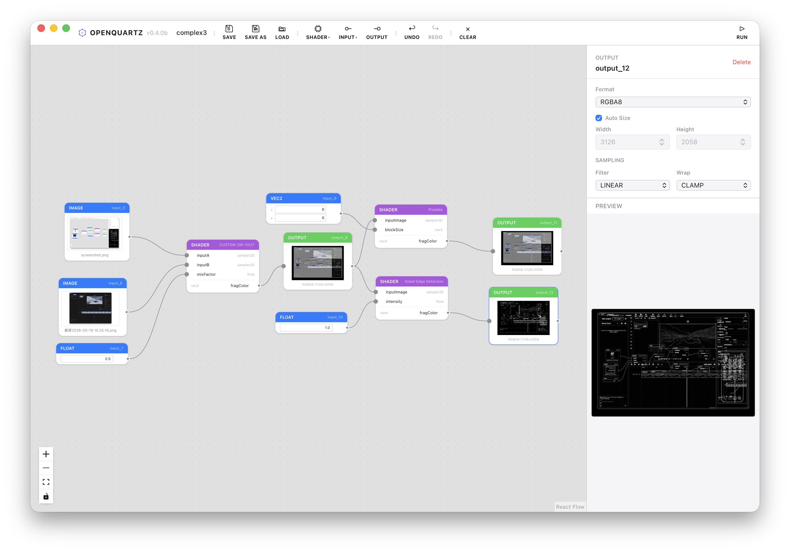

<p align="center">
  
</p>

<h1 align="center">Open Quartz</h1>

<p align="center">
  A real-time heterogeneous video pipeline editor — GPU shaders, neural networks, and CPU math in one graph.
</p>

<p align="center">
  
</p>

Open Quartz is a node-based, hardware-accelerated framework for authoring real-time video processing pipelines. It fuses GPU shader execution (WGSL), ONNX neural-network inference, and CPU-side math into a single heterogeneous graph. The current product is a **Rust + Slint** native desktop application plus an independent standalone Windows `.scr` screen saver runtime. Both use the shared native Rust core directly; there is no Web, Tauri, browser, WASM, or SDK bindings product. Android/iOS delivery remains deferred by user decision.

## Node Catalog

### Source Nodes

| Node | Type | Output | Description |
|------|------|--------|-------------|
| **Image** | Input | `sampler2D` | Load images as GPU textures. Drag-and-drop or file picker. |
| **Video** | Input | `sampler2D` | Native FFmpeg/VideoToolbox video files and cameras in the Slint application. |
| **Framebuffer** | Input | `sampler2D` | Raw binary dump files with configurable format (RGBA8/RGBA32F/RG8/RG32F/R8/R32F/NV12), width, height, stride. |
| **Time** | System | `float` | Elapsed time in seconds since Play. |
| **Time Delta** | System | `float` | Frame delta time. |
| **Frame** | System | `int` | Current frame number. |
| **Mouse** | System | `vec4` | Mouse position and click state (Shadertoy `iMouse` convention). |
| **Resolution** | System | `vec3` | Canvas resolution and pixel ratio. |
| **float / int / vec2-4 / mat2-4** | Constant | Various | Editable scalar, vector, and matrix values. |

### Shader Nodes (28 presets + custom)

| Category | Shaders |
|----------|---------|
| **Filter** | Resample, Sobel Edge Detection, Gaussian Blur 3×3, Box Blur, Sharpen, Emboss, Pixelate |
| **Color** | Grayscale, Brightness/Contrast, Hue Rotate, Threshold, Sepia |
| **Generator** | Solid Color, Gradient, Checkerboard, Noise, Circle |
| **Blend** | Add, Multiply, Screen, Overlay, Difference, Exclusion, Soft Light |
| **Distortion** | Twirl, Ripple, Displacement, Barrel, Pinch |
| **Custom** | Custom Shader (1 input), Custom 2-in-1 (2 inputs). Full WGSL editor with syntax highlighting, GPU validation linting, and shader/port documentation tooltips. |

### Math Nodes (29 operations)

| Category | Operations |
|----------|------------|
| **Arithmetic** | add, subtract, multiply, divide, negate, modulo |
| **Range** | min, max, clamp, saturate, step, smoothstep, abs, sign |
| **Trigonometry** | sin, cos, tan, asin, acos, atan |
| **Exponential** | pow, sqrt, exp, log |
| **Interpolation** | mix |
| **Rounding** | floor, ceil, round, fract |

Auto type inference from connected peers. CPU-only evaluation, results propagate to downstream shader uniforms.

### ONNX Neural Network Nodes (7 models + custom)

| Category | Model | Size | Input | Output | Task |
|----------|-------|------|-------|--------|------|
| **Detection** | YOLOv8n | 12.8MB | 640×640 | `roi` + `sampler2D` overlay | 80-class COCO object detection |
| **Super-Resolution** | Sub-pixel CNN 3× | 0.2MB | 224×224 fixed | `sampler2D` 3× upscaled | Lightweight Y-channel SR |
| **Super-Resolution** | Real-ESRGAN 4× | 4.9MB | dynamic | `sampler2D` 4× upscaled | Photo-realistic upscaling |
| **Background Removal** | U²Net-P | 4.4MB | 320×320 fixed | `sampler2D` RGBA (alpha=mask) | General-purpose foreground extraction |
| **Background Removal** | MODNet | 24.7MB | 512×512 fixed | `sampler2D` RGBA (alpha=matte) | Portrait-focused matting |
| **Depth Estimation** | MiDaS v2.1 Small | 63MB | 256×256 fixed | `sampler2D` grayscale depth | Monocular relative depth |
| **Custom** | User `.onnx` file | any | auto-introspected | auto-introspected | Load any ONNX model, ports generated from I/O metadata |

Models download when explicitly loaded in Slint. Native hosts use ONNX Runtime CPU or Windows DirectML with observable CPU fallback. Loading, inference, and downstream GPU execution share the typed Rust core/runtime contracts.

### Output Nodes

| Node | Input | Description |
|------|-------|-------------|
| **Renderer** | `sampler2D` | Explicit output viewer (Quartz Composer QCView equivalent) with in-place preview and fullscreen output mirror. |

## Native Editor Features

- Native graph canvas with drag-to-connect typed ports, release-only node moves, zoom, Fit View, MiniMap, multi-selection and owned graph copy/paste.
- Rust-owned project edits and undo/redo, native Open/Save/Save As dialogs and `.quartz.json` persistence.
- Typed node inspectors, explicit Shader Apply, read-only catalog presets, per-node status and shared-GPU previews; see the [native app README](apps/open_quartz_slint/README.md) for precise controls and limitations.
- One native render worker and shared wgpu device/queue. Renderer preview and fullscreen consume the same graph output texture; PNG capture is explicit readback.

### Project Management
- Save / Save As / Load (`.quartz.json` files)
- Rust-owned 50-level undo/redo with Cmd/Ctrl+Z / Cmd/Ctrl+Shift+Z
- Windows `File → Export As Screen Saver…` packages a selected Renderer into a self-contained version-3 native `.scr` with its graph-required image/video/model/runtime resources; `/s`, `/p <HWND>`, and `/c` do not require an installed OpenQuartz app.

## Native Desktop (Slint)
- Standalone Rust application with Slint 1.18.1 and wgpu 30; packaged builds require neither a WebView nor a browser/Node process.
- Launches into an empty Untitled canvas with playback stopped. Opening/New also stop playback; editing nodes does not implicitly press Play. Manual node drags preserve the drop position even for a single-node graph; Fit View remains explicit.
- Ownership extraction is complete. Final results: workspace 234, full-native 315, Slint 73, UI 18/18, Shader 34/34, editor 10, native boundaries, independent ONNX/runtime configurations and macOS release packaging passed. Both overall 100% coverage gates failed; see Design [验证基线](docs/DESIGN.md#validation). Camera, Windows/Linux/.scr and mobile remain untested. Changes remain Unreleased.
- Slint's native coordinator is `open_quartz::player::NativePlayer`; its `RenderDevice` uses the same wgpu device/queue instance on the existing render thread. Renderer and eligible graph nodes import real GPU textures directly; cards show output previews and resolution labels. Structured GPU errors mark the affected node and clear its stale preview. PNG capture remains explicit readback. Extraction paths and implementation status are tracked in Design [源码索引](docs/DESIGN.md#source-map).
- Filter **Auto size** follows connected input texture dimensions; disabling it uses explicit width/height. The toolbar displays composition time, while Renderer cards and previews show graph **Render FPS** (not source video FPS or screen refresh); Pause freezes time and Stop resets it.
- The native Shader editor uses the reusable `crates/slint_code_editor` component: cosmic-text shaping/editing with live WGSL colors, line numbers, goto/find/replace, selection and local undo/redo. Slint provides the UI and public desktop IME event bridge; no fork or WebView. Presets remain read-only and Apply is explicit. Full screen-reader caret/selection reporting and real IME/platform acceptance are not yet verified; completion and inline lint are not provided. Run `npm run dev:editor` for the independent WGSL/JSON demo.
- Rust owns graph editing/history, project I/O, source resources, native ONNX sessions, video/camera selection, previews/fullscreen, and Windows screen saver export. The native FILE menu uses platform Open/Save dialogs; see the app README for exact behavior.
- `npm run test:desktop:ui` runs real-window Slint UI automation and saves screenshots/logs under `test-results/slint-ui/`. `npm run dev:desktop:ui` enables interactive MCP inspection; see the [native app instructions](apps/open_quartz_slint/README.md#ui-automation).
- `npm run test:desktop:shaders` checks every catalog Shader with real PNG inputs, native graph connections and independently verified GPU previews, with per-Shader input/reference/output images in the HTML report.
- Portable packages include architecture-matched FFmpeg and official ONNX Runtime **1.21.0**, their notices, and (Windows) DirectML, app-local VC++ runtime DLLs, and the screen saver stub. Missing required resources fail packaging instead of producing a partial app.
- macOS file video uses in-process VideoToolbox H.264/HEVC decoding with retained CoreVideo/Metal surfaces and GPU SDR color conversion; NV12/P010 playback does not read decoded frames back to the CPU. A pinned LGPL-only FFmpeg 8.1.1 SDK, corresponding source and hardware-required patch are bundled. Unsupported presentation/color semantics fail explicitly; backend failures retain the existing software fallback. Windows/Linux/cameras keep their existing paths. See the [implementation boundaries and evidence](docs/MEDIA_CODEC_ARCHITECTURE.md#171-首轮实现与验收).
- The reusable media crate is [`oq-media`](crates/oq-media/README.md) (`oq_media` in Rust), under `crates/oq-media`. `oq` denotes its OpenQuartz origin, not an OpenQuartz dependency; the application is a consumer of the library. Its README records 8K performance methods/results and the macOS NV12 OpenGL-compatibility fix.
- ONNX remains the interchange format, not the cross-platform runtime contract. Native Core ML, DirectML/WinML, CUDA and CPU backends, plus strict device-residency policy, are an architecture proposal—not current capability. See [inference architecture and migration gates](docs/INFERENCE_ARCHITECTURE.md).
- macOS packages include an icon and camera usage description. They are ad-hoc signed, **not notarized**; Windows packages are unsigned. Camera access still requires OS permission and a real device.

Exported `.scr` files use an independent Win32/Rust host and do not require an installed Slint application; camera inputs are not deterministic export sources. Earlier macOS package/video/dialog acceptance is recorded in the [migration archive](docs/SLINT_UI_REFACTOR.md); an earlier winit startup abort remains unexplained and unreproduced.

## Rust SDK and Native Ownership

`open_quartz` remains the single core implementation and Rust SDK. `src/lib.rs` is the only root source module; public types such as `OpenQuartz`, `Project`, `Graph`, `ProjectNode`, `Port`, `Player`, `Resource`, and `Output` are root exports. State and production calls belong to the following concrete owners:

| Module / owner | Responsibility |
|---|---|
| `project` / `resources` | Project/model/history/catalog/layout/factories; typed resource plans and background model cache/download services |
| `compiler` | WGSL shader parsing/validation, topology and reusable graph plans |
| `evaluation::GraphEvaluator` / `GraphInstance` | Pure dirty/Math/feedback evaluation; applied graph identity, revision, node generation and state |
| `player::PlaybackSession` / `NativePlayer` | GraphInstance + clock + OutputHub; NativePlayer coordinates Slint's device owners, while standalone .scr drives PlaybackSession/evaluation/GpuExecutor in its own loop |
| `outputs::OutputHub` | Output contracts, subscriptions/registry, presentation planning, resources/backend/capabilities |
| `rendering::RenderDevice` | GPU executor/resources, explicit readback and Windows presenter on the shared device |
| `media::sources::VideoSources` (internal) | Graph-source map and lifecycle; uploads through a callback using RenderDevice |
| `inference::tasks::InferenceTasks` (internal) | Sessions, pending tasks, task IDs, channels/workers and accepted completions |

Advanced paths use these responsibility modules, plus project::catalog and resources::{plan,models}. The old execution/runtime namespaces and class aliases are removed with the old directories; actual state, resources and production calls moved to their owners. [Design 模块与所有权](docs/DESIGN.md#module-ownership) and [源码索引](docs/DESIGN.md#source-map) define the interfaces and current file index.

The Slint frame contract orders media upload, completion validation before texture mutation, graph evaluation/GPU work and inference dispatch. NativePlayer selects RenderDevice's presented output; OutputHub has an independent presentation backend path. Scalar advance preflights candidate graph/clock and the whole scalar batch, sharing static Arc data. PreparedNativeGraph stages fresh textures and owns prepared video handles; successful video open precedes candidate texture removal, while detach/obsolete-video removal clears staged textures before optional image upload. Aborted candidates preserve old source/pixels. UI request generation differs from accepted graph revision. Close invalidates pending work and releases descriptors/renderer outputs; active ORT workers retain Arc sessions until completion and InferenceTasks Drop joins them. Live GPU leases remain retained.

The public headless `Player` still has no real device driver, and `Project::graph_mut` can bypass revision/history. NativePlayer is the real native production coordinator; this extraction does not change those public API limitations.

Desktop Rust calls typed APIs directly. Web/Tauri, WASM, JS object/worker exports, `bindings::wasm`, `web-bindings` and `browser` remain retired with no opt-in compatibility adapter. SDK C ABI/JNI bridges are unnecessary; ORT, FFmpeg, AVFoundation/CoreVideo, Metal and D3D12/COM backend FFI remain necessary.

[Design 验证基线](docs/DESIGN.md#validation) records the latest architecture verification baseline. Coverage tests passed (default 134, native 201), but both 100% gates failed: default lines/functions/regions 98.53%/97.88%/98.34%; native 97.70%/95.96%/96.38%. Thresholds were not relaxed; RenderDevice/InferenceTasks/VideoSources remain measured, with NativePlayer's existing facade exclusion unchanged.

The core's `default = []` supports graph/project editing, compiler/evaluation and playback/output state without GPU, ORT, FFmpeg, HTTP or UI dependencies. Consumers select capabilities explicitly:

| Feature | Capability |
|---|---|
| `gpu` | wgpu execution, textures, readback and presentation |
| `native-runtime` | NativePlayer/RenderDevice coordination; enables gpu, not video, ONNX or downloads; existing feature name and behavior retained |
| `native-video` | Native video sources and platform workers; macOS uses independent `oq-media` |
| `native-video-d3d12` | Windows D3D12 video; enables `native-video` and `gpu` |
| `native-onnx` | Native ORT sessions/pipeline without requiring GPU or HTTP |
| `model-cache` | Model download, checksum verification and file cache without requiring ORT/GPU |

`oq-media`, `slint_code_editor`, the screen saver exporter, standalone `.scr` stub and Slint application remain independent components/products. A future inference extraction remains conditional on a real independent implementation and its own tests; no empty provider/API packages are introduced.

## Getting Started — Native Desktop

Install Node.js 22.12+ and Rust 1.92+ with the platform C++ toolchain (Xcode command-line tools on macOS; Visual Studio C++ tools, Windows SDK, and LLVM/libclang on Windows). Then:

```bash
npm ci
npm run dev                         # build and launch Slint, not Vite
npm run dev -- --project /path/to/project.quartz.json
npm run build                       # release binary + portable desktop package
```

The first run downloads the platform runtime libraries. No wasm-pack, browser, or Web frontend build is required for these commands. Windows builds set `FFMPEG_DIR` from the existing pinned shared-FFmpeg helper; if LLVM is not on the toolchain search path, set `LIBCLANG_PATH` to its `bin` directory. Portable Windows packaging requires the Visual Studio x64 VC++ redistributable files.

Linux build prerequisites (Debian/Ubuntu):

```bash
sudo apt-get install pkg-config libfontconfig1-dev libfreetype6-dev libxkbcommon-dev libxkbcommon-x11-dev libxcb1-dev libxcb-render0-dev libxcb-shape0-dev libxcb-xfixes0-dev libwayland-dev libegl1-mesa-dev libgl1-mesa-dev libdbus-1-dev libvulkan1 mesa-vulkan-drivers
```

Linux packages still require the system desktop/font/Vulkan libraries; they are not universal static binaries. Native builds run on their host architecture: macOS arm64/x64, Windows x64, Linux x64/arm64. CI covers Windows, macOS, and Linux desktop build/tests; it does not substitute for GPU/camera/native-window acceptance on each platform.

### Portable Artifacts and Runtime Resources

`npm run build` writes `dist-desktop/OpenQuartz-<version>-<platform>-<arch>/` and an adjacent archive:

- **macOS**: `Open Quartz.app` and `.zip`; executable at `Contents/MacOS/open_quartz_slint`, resources at `Contents/Resources/runtime/`.
- **Windows**: `.zip` containing `open_quartz_slint.exe`, `icon.ico`, shortcut, and `runtime/`. DLLs are also placed beside the executable because FFmpeg imports are resolved before Rust startup. Extract the whole archive before launching.
- **Linux**: `.tar.gz` with executable, icon, and `runtime/`; desktop/system-library dependencies remain external.

`runtime/` contains `ffmpeg` (`ffmpeg.exe` on Windows), `libonnxruntime.1.21.0.dylib` / `onnxruntime.dll` / `libonnxruntime.so.1.21.0`, and required companion libraries/notices. Windows also includes `DirectML.dll` and `open-quartz-screensaver-stub.exe`. Startup resolves `executable-parent/runtime`, or the macOS app resource path above. Development commands set `ORT_DYLIB_PATH`, `OPEN_QUARTZ_FFMPEG_PATH`, and runtime `PATH` explicitly. The ONNX library is from the [official 1.21.0 release](https://github.com/microsoft/onnxruntime/releases/tag/v1.21.0), not the unrelated Node ORT dependency; Microsoft's Windows DirectML package uses its declared [DirectML 1.15.4 dependency](https://www.nuget.org/packages/Microsoft.AI.DirectML/1.15.4).

Windows FFmpeg is a checksum-pinned, dated BtbN FFmpeg 9.0.2 snapshot (ABI 63), not a promise of permanent third-party hosting. BtbN may expire old snapshots; preserve the downloaded cache for repeat/offline builds. An unavailable asset or checksum mismatch stops preparation explicitly and requires updating the pinned dependency—there is no silent system/partial-runtime fallback.

Canonical source resources are [`apps/open_quartz_slint/icons/`](apps/open_quartz_slint/icons/) and generated/prepared [`apps/open_quartz_slint/runtime/`](apps/open_quartz_slint/runtime/), including SDK libraries, licenses and source notices. The packager derives the numeric macOS bundle version from `package.json`; Windows stub builds stage from `target/screensaver-stub/` into the app runtime. The Shader catalog is [`crates/open_quartz/src/project/shader_catalog.json`](crates/open_quartz/src/project/shader_catalog.json), shared by native catalog code and Shader automation. Native fixtures remain under `tests/fixtures/`.


## Testing and Acceptance

```bash
cargo test --workspace               # core, media, exporter and stub workspace
npm run test:desktop                 # Slint tests with native runtime preparation
npm run test:desktop:ui              # real native-window interactions
npm run test:desktop:shaders         # catalog Shader GPU/pixel acceptance
npm run test:editor                 # independent Slint editor workspace
npm run check:rust-boundaries        # default/native feature and public API boundaries
npm run test:sdk-coverage            # Rust core coverage gates
```

Final evidence is in [Design 验证基线](docs/DESIGN.md#validation): workspace 234/34 suites, full-native 315/30 suites, Slint 73, UI 18/18, Shader 34/34, editor 10 and boundaries passed. Independent --no-default-features ONNX-only 247/30 suites and runtime-only 279/28 suites passed. npm run build passed runtime copy/signing/--help and produced dist-desktop/OpenQuartz-0.20.0b-macos-arm64.zip. Both overall coverage gates failed; platform acceptance and public API limitations remain explicit there.

## Tech Stack

Rust · Slint 1.18.1 · cosmic-text · wgpu 30 · naga · ort · FFmpeg / VideoToolbox. Node.js runs native development/packaging/automation helpers; it is not an application runtime or Web frontend.

## Roadmap

### Rust SDK and native ownership

Open Quartz owns graph/project/catalog/lifecycle/inference-task/resource semantics through concrete components. See [Design 系统总览](docs/DESIGN.md#architecture-overview) for current ownership/interfaces/files, final evidence, unchanged public Player/graph_mut limitations and untested platform gates.

### Quartz Composer parity

| Patch | Description | Complexity |
|-------|-------------|------------|
| **3D Object / Mesh** | Load and render 3D models (GLTF/OBJ) as scene nodes | Native GPU scene/material implementation |
| **Lighting / Camera** | Directional, point, spot lights + perspective/ortho camera | Native scene and camera model |
| **Delay (1-frame)** | Read another node's previous frame output | Shares ping-pong infra with Accumulator |
| **Image Transition** | Animated wipe/dissolve/push between two images | Shader preset + iTime |
| **Iterator / Replicate** | Execute a sub-graph N times per frame with varying params | Graph engine loop construct |
| **Macro Patch** | Collapse a sub-graph into a reusable compound node | Graph serialization + UI |
| **Bloom** | Multi-pass blur + additive blend (CIFilter equivalent) | Multi-pass rendering |
| **Motion Blur** | Directional / radial blur driven by velocity | Feedback or multi-sample |
| **Sample & Hold** | Latch a value and hold until triggered | Stateful node type |

## License

MIT — see [LICENSE](LICENSE).
