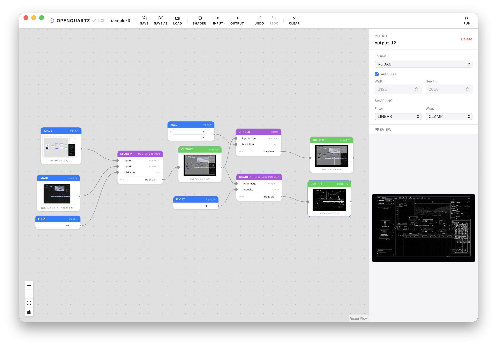

<p align="center">
  
</p>

<h1 align="center">Open Quartz</h1>

<p align="center">
  A real-time heterogeneous video pipeline editor — GPU shaders, neural networks, and CPU math in one graph.
</p>

<p align="center">
  
</p>

Open Quartz is a node-based, hardware-accelerated framework for authoring real-time video processing pipelines. It fuses GPU shader execution (WGSL), ONNX neural-network inference, and CPU-side math into a single heterogeneous graph. The default desktop application is **Rust + Slint**, using the shared native GPU/runtime host directly. The React/Web application is retained separately, not ported to Slint; Tauri remains an explicit fallback for one version. Android/iOS delivery (Phase 6) is deferred by user decision.

## Node Catalog

### Source Nodes

| Node | Type | Output | Description |
|------|------|--------|-------------|
| **Image** | Input | `sampler2D` | Load images as GPU textures. Drag-and-drop or file picker. |
| **Video** | Input | `sampler2D` | Native FFmpeg video files/cameras in Slint/Tauri; HTML media in the separate browser application. |
| **Framebuffer** | Input | `sampler2D` | Raw binary dump files with configurable format (RGBA8/RGBA32F/RG8/RG32F/R8/R32F/NV12), width, height, stride. |
| **Time** | System | `float` | Elapsed time in seconds since Play. |
| **Time Delta** | System | `float` | Frame delta time. |
| **Frame** | System | `int` | Current frame number. |
| **Mouse** | System | `vec4` | Mouse position and click state (Shadertoy `iMouse` convention). |
| **Resolution** | System | `vec3` | Canvas resolution and pixel ratio. |
| **float / int / vec2-4 / mat2-4** | Constant | Various | Editable scalar, vector, and matrix values. |

### Shader Nodes (28 presets + custom)

| Category | Shaders |
|----------|---------|
| **Filter** | Resample, Sobel Edge Detection, Gaussian Blur 3×3, Box Blur, Sharpen, Emboss, Pixelate |
| **Color** | Grayscale, Brightness/Contrast, Hue Rotate, Threshold, Sepia |
| **Generator** | Solid Color, Gradient, Checkerboard, Noise, Circle |
| **Blend** | Add, Multiply, Screen, Overlay, Difference, Exclusion, Soft Light |
| **Distortion** | Twirl, Ripple, Displacement, Barrel, Pinch |
| **Custom** | Custom Shader (1 input), Custom 2-in-1 (2 inputs). Full WGSL editor with syntax highlighting, GPU validation linting, and shader/port documentation tooltips. |

### Math Nodes (29 operations)

| Category | Operations |
|----------|------------|
| **Arithmetic** | add, subtract, multiply, divide, negate, modulo |
| **Range** | min, max, clamp, saturate, step, smoothstep, abs, sign |
| **Trigonometry** | sin, cos, tan, asin, acos, atan |
| **Exponential** | pow, sqrt, exp, log |
| **Interpolation** | mix |
| **Rounding** | floor, ceil, round, fract |

Auto type inference from connected peers. CPU-only evaluation, results propagate to downstream shader uniforms.

### ONNX Neural Network Nodes (7 models + custom)

| Category | Model | Size | Input | Output | Task |
|----------|-------|------|-------|--------|------|
| **Detection** | YOLOv8n | 12.8MB | 640×640 | `roi` + `sampler2D` overlay | 80-class COCO object detection |
| **Super-Resolution** | Sub-pixel CNN 3× | 0.2MB | 224×224 fixed | `sampler2D` 3× upscaled | Lightweight Y-channel SR |
| **Super-Resolution** | Real-ESRGAN 4× | 4.9MB | dynamic | `sampler2D` 4× upscaled | Photo-realistic upscaling |
| **Background Removal** | U²Net-P | 4.4MB | 320×320 fixed | `sampler2D` RGBA (alpha=mask) | General-purpose foreground extraction |
| **Background Removal** | MODNet | 24.7MB | 512×512 fixed | `sampler2D` RGBA (alpha=matte) | Portrait-focused matting |
| **Depth Estimation** | MiDaS v2.1 Small | 63MB | 256×256 fixed | `sampler2D` grayscale depth | Monocular relative depth |
| **Custom** | User `.onnx` file | any | auto-introspected | auto-introspected | Load any ONNX model, ports generated from I/O metadata |

Models download when explicitly loaded in Slint. Native hosts use ONNX Runtime CPU or Windows DirectML with observable CPU fallback. The separate browser host uses adaptive WebGPU→WASM fallback. Loading, inference, and downstream GPU execution share the Rust host/runtime contracts.

### Output Nodes

| Node | Input | Description |
|------|-------|-------------|
| **Renderer** | `sampler2D` | Explicit output viewer (Quartz Composer QCView equivalent) with in-place preview and fullscreen output mirror. |

## Retained Web/Tauri Interface Features

The following editor details describe the retained React interface; they are not a claim that the Slint editor has CodeMirror/React Flow feature parity. See the [native app README](apps/open_quartz_slint/README.md) for the native controls and limitations.

- **Worker-owned realtime rendering** — browser playback runs in a dedicated Worker with `OffscreenCanvas`; the Rust/WASM runtime owns clock, graph work batches, lifecycle, and output delivery. The React thread receives typed frame/output projections only.
- **GPU-first output path** — the main realtime output stays on GPU; only selected preview or explicit screenshot/output requests perform readback.
- **Multi-presenter GPU boundary** — Rust presentation sinks receive retained GPU handles through independent latest-frame mailboxes. Windows native consumers can acquire leased shared DXGI textures with NT resource/fence handles; a three-slot pool provides explicit backpressure without moving pixels through CPU memory.
- **Feedback / Accumulator** — Rust-planned per-node ping-pong work is executed by the browser GPU adapter for temporal effects.

### Node Graph Editor
- Drag, connect, and arrange nodes on an infinite canvas (React Flow)
- Bezier curve edges with type-safe connections — ports carry WGSL type metadata
- MiniMap, box selection, fit-to-view

### Node Inspector (Side Panel)
- CodeMirror 6 shader editor with WGSL syntax highlighting, GPU validation (red squiggly lines via `createShaderModule`), and debounced port reparse
- Read-only shader viewer for prebuilt catalog shaders (code visible for learning, not editable)
- Port inspector with color-coded type indicators and inline uniform editing
- Per-component vector editing (x/y/z/w) for vec2-4 uniforms
- Per-node live preview readback for selected shader/input nodes, plus Renderer output mirrored between the graph node, Side Panel, and fullscreen view
- Renderer Side Panel preview uses the browser PNG output, native bounded readback mirror, or the canonical Windows TextureStream consumer without starting a second runtime

### Preview Lightbox
- Full-screen viewer with scroll-to-zoom, drag-to-pan, double-click reset
- Nearest-neighbor rendering for pixel inspection
- Save as PNG, color picker with coordinate display

### Project Management
- Save / Save As / Load (`.quartz.json` files)
- Rust-owned 50-level undo/redo with Cmd/Ctrl+Z / Cmd/Ctrl+Shift+Z
- Windows `File → Export As Screen Saver…` packages a selected Renderer into a self-contained version-3 native `.scr` with its graph-required image/video/model/runtime resources; `/s`, `/p <HWND>`, and `/c` do not require an installed OpenQuartz app.

## Default Native Desktop (Slint)
- Standalone Rust application with Slint 1.18.1 and wgpu 30; packaged builds require neither a WebView nor a browser/Node process.
- Launches into an empty Untitled canvas with playback stopped. Opening/New also stop playback; editing nodes does not implicitly press Play. Manual node drags preserve the drop position even for a single-node graph; Fit View remains explicit.
- Phase 5/7 are complete within the agreed macOS scope: default Slint launch/package, relocated native ZIP execution, independent Web production build, and explicit Tauri fallback `.app` build are verified. Actual camera, Windows/Linux, and mobile acceptance are deferred. Changes remain Unreleased; no tagged release has been published.
- Slint and `NativeHost` share one GPU device/queue. Renderer and eligible graph nodes import real GPU textures directly; cards show output previews and resolution labels. Structured GPU errors mark the affected node and clear its stale preview. PNG capture remains explicit readback.
- The native Shader editor is a multiline `TextInput` with byte-safe line numbers, goto-line, UTF-8 find/next selection, live match counts, and explicit Apply. Native caret, selection, IME, clipboard, Unicode, and preset read-only behavior remain on Slint's input path. Syntax highlighting, completion, and inline lint are unavailable in Slint 1.18.
- Rust owns graph editing/history, project I/O, source resources, native ONNX sessions, video/camera selection, previews/fullscreen, and Windows screen saver export. The native FILE menu uses platform Open/Save dialogs; see the app README for exact behavior.
- Portable packages include architecture-matched FFmpeg and official ONNX Runtime **1.21.0**, their notices, and (Windows) DirectML, app-local VC++ runtime DLLs, and the screen saver stub. Missing required resources fail packaging instead of producing a partial app.
- macOS packages include an icon and camera usage description. They are ad-hoc signed, **not notarized**; Windows packages are unsigned. Camera access still requires OS permission and a real device.
- macOS packaging and production video/PNG/fullscreen/ONNX smoke pass; unlocked native Video/Image/Framebuffer dialogs and PNG save/cancel also pass. A fresh LaunchServices launch (including `--args --project …`) rendered bundled video successfully. An earlier winit startup abort remains unexplained and unreproduced; camera permission/capture and Windows/Linux runtime/`.scr` gates remain pending.

### Tauri Fallback
The prior React/Tauri shell and its native runtime remain available for one version through explicit commands. Windows WebView2 TextureStream and bounded readback presentation belong to this fallback, not the Slint renderer. Exported `.scr` files use an independent Win32/Rust host and do not require an installed Slint or Tauri application; camera inputs are not deterministic export sources.

## Rust SDK and Structured Runtime
- Real crate boundaries: `open_quartz_schema` → `open_quartz_execution` → `open_quartz_host_api` → `open_quartz_sdk`, with `open_quartz` as the thin native/WASM facade and `open_quartz_bindings` for JNI
- Rust-backed public `OpenQuartz`, `Project`, `Graph`, `Node`, `Port`, and `Player` aggregates with atomic edits, revision/history ownership, serialization, and structured errors
- Rust-backed production WGSL parser/compiler validation via `naga`
- Topological planning, downstream dirty propagation, typed frame inputs, graph revisions, node resource generations, feedback state preservation, catalog semantics, ONNX tasks, and host resource intents
- Native `wgpu` pipeline/target/readback primitives and framework-neutral `NativeHost`, shared by Slint and the retained Tauri render thread
- Dependency-boundary CI plus Rust/WASM/TypeScript/Java public-proxy conformance

## Getting Started — Native Desktop

Install Node.js 22.12+ and Rust 1.92+ with the platform C++ toolchain (Xcode command-line tools on macOS; Visual Studio C++ tools, Windows SDK, and LLVM/libclang on Windows). Then:

```bash
npm ci
npm run dev                         # build and launch Slint, not Vite
npm run dev -- --project /path/to/project.quartz.json
npm run build                       # release binary + portable desktop package
```

The first run downloads the platform runtime libraries. No wasm-pack, browser, or Web frontend build is required for these commands. Windows builds set `FFMPEG_DIR` from the existing pinned shared-FFmpeg helper; if LLVM is not on the toolchain search path, set `LIBCLANG_PATH` to its `bin` directory. Portable Windows packaging requires the Visual Studio x64 VC++ redistributable files.

Linux build prerequisites (Debian/Ubuntu):

```bash
sudo apt-get install pkg-config libfontconfig1-dev libfreetype6-dev libxkbcommon-dev libxkbcommon-x11-dev libxcb1-dev libxcb-render0-dev libxcb-shape0-dev libxcb-xfixes0-dev libwayland-dev libegl1-mesa-dev libgl1-mesa-dev libdbus-1-dev libvulkan1 mesa-vulkan-drivers
```

Linux packages still require the system desktop/font/Vulkan libraries; they are not universal static binaries. Native builds run on their host architecture: macOS arm64/x64, Windows x64, Linux x64/arm64. CI covers Windows, macOS, and Linux desktop build/tests; it does not substitute for GPU/camera/native-window acceptance on each platform.

### Portable Artifacts and Runtime Resources

`npm run build` writes `dist-desktop/OpenQuartz-<version>-<platform>-<arch>/` and an adjacent archive:

- **macOS**: `Open Quartz.app` and `.zip`; executable at `Contents/MacOS/open_quartz_slint`, resources at `Contents/Resources/runtime/`.
- **Windows**: `.zip` containing `open_quartz_slint.exe`, `icon.ico`, shortcut, and `runtime/`. DLLs are also placed beside the executable because FFmpeg imports are resolved before Rust startup. Extract the whole archive before launching.
- **Linux**: `.tar.gz` with executable, icon, and `runtime/`; desktop/system-library dependencies remain external.

`runtime/` contains `ffmpeg` (`ffmpeg.exe` on Windows), `libonnxruntime.1.21.0.dylib` / `onnxruntime.dll` / `libonnxruntime.so.1.21.0`, and required companion libraries/notices. Windows also includes `DirectML.dll` and `open-quartz-screensaver-stub.exe`. Startup resolves `executable-parent/runtime`, or the macOS app resource path above. Development commands set `ORT_DYLIB_PATH`, `OPEN_QUARTZ_FFMPEG_PATH`, and runtime `PATH` explicitly. The ONNX library is from the [official 1.21.0 release](https://github.com/microsoft/onnxruntime/releases/tag/v1.21.0), not the unrelated Node ORT dependency; Microsoft's Windows DirectML package uses its declared [DirectML 1.15.4 dependency](https://www.nuget.org/packages/Microsoft.AI.DirectML/1.15.4).

Windows FFmpeg is a checksum-pinned, dated BtbN FFmpeg 9.0.2 snapshot (ABI 63), not a promise of permanent third-party hosting. BtbN may expire old snapshots; preserve the downloaded cache for repeat/offline builds. An unavailable asset or checksum mismatch stops preparation explicitly and requires updating the pinned dependency—there is no silent system/partial-runtime fallback.

## Separate Web Application and Tauri Fallback

These paths require wasm-pack and `rustup target add wasm32-unknown-unknown`:

```bash
npm run dev:web                     # Vite at http://localhost:5173
npm run build:web                   # TypeScript + Vite output in dist/
npm run preview:web                 # preview the Web build
npm run dev:tauri                   # explicit one-version fallback
npm run package:tauri               # Tauri installers, not Slint artifacts
```

`npm run tauri -- dev` / `npm run tauri -- build` remain available. Tauri hooks deliberately call the Web commands (`dev:web` / `build:tauri` → `build:web`) and never recurse into the native default. `build:tauri` prepares the fallback frontend/stub; `package:tauri` invokes the actual installer build. Web is retained independently, not reimplemented with Slint WASM.

The macOS fallback was verified with `npm run package:tauri -- --bundles app`;
its output is `target/release/bundle/macos/Open Quartz.app` in the root Cargo
workspace. Default Slint artifacts remain in `dist-desktop/`, which is ignored by Git.

## Testing and Acceptance

```bash
npm run test:desktop                 # Slint tests with native runtime preparation
cargo test --workspace               # shared Rust workspace
npm test                            # separate Web unit tests
npm run test:sdk-coverage            # Rust SDK coverage
npm run test:sdk-wasm                # WASM/browser contracts
npm run test:models                  # real-model browser inference
npm run test:shaders                 # real-GPU browser shader tests
```

Recent local verification: the native Slint package builds and its **66 application tests** pass. Real shared-GPU smoke covers node thumbnails, resolution labels, collapse/expand, categorized Shader creation, read-only presets, Unicode editor navigation, exact GPU error status, stale-preview clearing and Undo recovery. Native FILE → Open and Save As dialogs were opened and cancelled successfully. Full Web, cross-platform and camera claims above remain separately scoped.

## Tech Stack

Rust · Slint 1.18.1 · wgpu 30 · naga · ort · FFmpeg; retained Web/Tauri: React 19 · TypeScript 6 · Vite 8 · React Flow 12 · Zustand 5 · CodeMirror 6 · Tailwind CSS 4 · Tauri 2 · onnxruntime-web/node

## Roadmap

### Rust SDK and native runtime

Open Quartz owns cross-platform graph, project, catalog, lifecycle, inference-task, and resource-intent semantics in Rust. TypeScript is limited to framework projection and required Browser/Tauri/WebView2/ORT-Web platform operations; production host selection remains explicit through `BrowserHost` and `NativeHost`.

| Stage | What | Status |
|-------|------|--------|
| **A. Structured FFI contract** | API version/capabilities, typed errors/events, WASM package | Done |
| **B. Stateless cutover** | Rust `naga` parser used by production UI | Done |
| **C. Stateful Engine core** | Revisions, generations, dirty execution, typed frames, lifecycle | Done |
| **D. Native GPU runtime** | Rust render thread, offscreen `GpuExecutor`, in-editor Renderer output | Done |
| **E. Native resource/output parity** | Image/video resources, FFmpeg, preview/screenshot readback, packaging | Done |
| **F. Native ONNX graph cutover** | Async texture/tensor execution, six-task parity, cascade, provider/output events | Done |
| **G. Production switch** | `PipelineService` selects one explicit runtime per host | Done |
| **H. Thin TypeScript convergence** | Rust-backed public proxies, Store graph commands, Project/screen saver/catalog/inference/resource policy, real crate boundaries | Done |

### Quartz Composer parity

| Patch | Description | Complexity |
|-------|-------------|------------|
| **3D Object / Mesh** | Load and render 3D models (GLTF/OBJ) as scene nodes | Three.js WebGPU + node material |
| **Lighting / Camera** | Directional, point, spot lights + perspective/ortho camera | Three.js built-in |
| **Delay (1-frame)** | Read another node's previous frame output | Shares ping-pong infra with Accumulator |
| **Image Transition** | Animated wipe/dissolve/push between two images | Shader preset + iTime |
| **Iterator / Replicate** | Execute a sub-graph N times per frame with varying params | Graph engine loop construct |
| **Macro Patch** | Collapse a sub-graph into a reusable compound node | Graph serialization + UI |
| **Bloom** | Multi-pass blur + additive blend (CIFilter equivalent) | Multi-pass rendering |
| **Motion Blur** | Directional / radial blur driven by velocity | Feedback or multi-sample |
| **Sample & Hold** | Latch a value and hold until triggered | Stateful node type |

## License

MIT — see [LICENSE](LICENSE).
