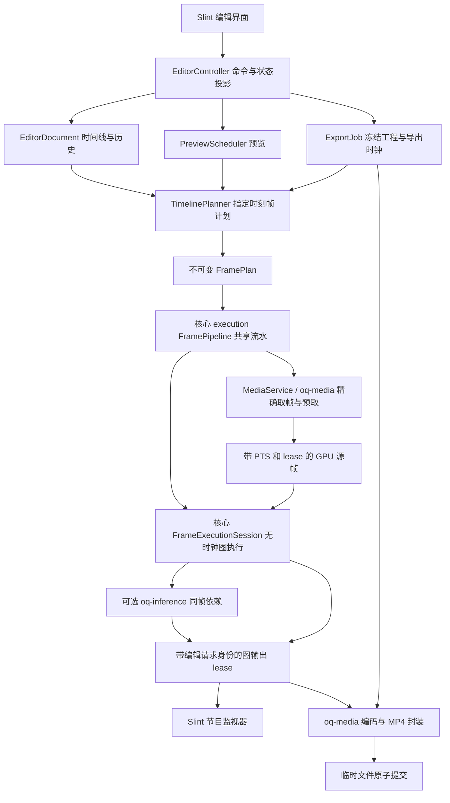
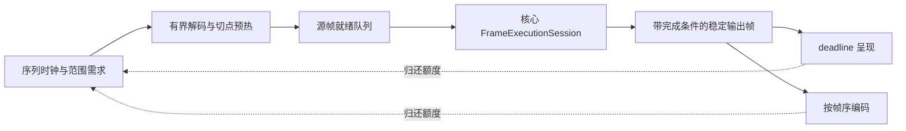
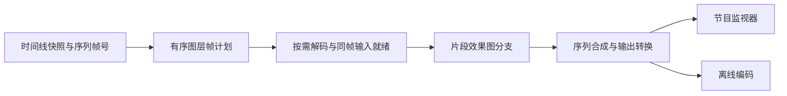

# OpenQuartz Video Editor 设计

## 1. 状态与决策

本目录现在是独立 **Rust + Slint 视频编辑应用 OpenQuartz Studio**，和原节点图应用并列。Phase6编辑基线含素材库、真实GPU监视器、单轨剪辑事务、撤销/重做、工程保存恢复与匹配素材重定位。阶段A的Clip-scoped静态Nodes工作区也已落地；各能力和未交付边界见[README](README.md)与[渲染管线编辑器](RENDER_PIPELINE_EDITOR_DESIGN.md)。Resolve交互参考不表示完整色彩管理/剪辑功能对等。

核心决策：

1. 视频剪辑页仍以**素材库、时间线、节目监视器、属性面板**为主要交互；片段Nodes是第二个DaVinci Resolve Color式工作区，复用共享OpenQuartz节点画布，不把节点图替代剪辑时间线。
2. 剪辑工程保存编辑意图；时间线编译器把指定时间的编辑意图转换为 GPU 帧工作。素材定位、时间线和渲染图各有唯一所有者。
3. 复用 `oq-media` 的解码与帧 lease、`open_quartz` 的图渲染及 `oq-inference` 的 GPU 推理；**复用现有实现，不复制图编辑 app 的控制器**。
4. 首个实现目标为 macOS Apple Silicon 上可用的单视频轨、1×速度、8-bit SDR、无音轨编辑与 H.264/MP4 导出闭环。它不是完整 NLE；音频、多轨等后续能力明确分阶段交付。
5. 精确 seek、按目标时间取帧和无窗口编码是前置工作；当前“视频能播放、模型能出图”不能替代这些前提。
6. 正常预览和导出保持硬件驻留、CPU 图像回传禁止。不能消费现有 GPU 表面的编码器须明确拒绝，不悄悄读回后走软件编码。
7. 本轮界面按用户要求参考剪映桌面的深色素材库/中央监视器/右侧属性/底部时间线工作流，保留OpenQuartz品牌，不使用剪映商标或专有图标/素材。编辑命令语义继续以固定Shotcut约束、Olive职责分离为参考；不复制Qt/MLT/OpenGL实现，不承诺整个剪映或Shotcut的功能对等。授权和基线见§17。
8. 明确采用 Rust + Slint + wgpu/Metal + 进程内 libav/VideoToolbox；不引入 MLT、Qt 或 Web 宿主。具体版本、线程和接口见 §18；代码与人力估算见 §19。
9. **原 OpenQuartz 在同一 crate 内分离无时钟执行流水与实时播放宿主，不拆渲染/执行 crate。** NativePlayer 与编辑器共同依赖拟议 `execution::FramePipeline`，其内部图阶段为 FrameExecutionSession；app 只保留序列需求规划和源/消费者策略，不复制流水或图执行器。决策和迁移见[核心架构](../../docs/DESIGN.md#execution-rendering-split)。

本设计只约定该新应用，不迁移、重命名或删除现有图编辑 app，也不恢复 Web/Tauri 产品。


### Phase 7：片段渲染管线闭环（已实现）

- 复用现有节点应用的GraphView、Inspector、WGSL CodeEditor、OpenQuartz Graph模型、工厂目录与GraphClipboard；视频应用通过宿主适配器持有clip目标与EditorDocument，不复制节点画布/执行器。每个Clip独立持有静态pipeline；Schema 1打开迁移成受保护`video → output`直通图，保存为Schema 2。
- Nodes工作区复用现有类型端口并插入Color/Filter/Distortion/Blend单image Shader、Custom Shader、Constant和Math；Source/Output受保护。候选图在共享GPU worker预检后才作为单个项目历史事务提交，Shader/uniform Inspector与布局编辑复用主工程撤销/重做。
- **验证（macOS原生窗口）：47个Rust测试通过；视频时间线窗口15项通过；Nodes窗口11项通过。** Nodes用实际红/蓝H.264解码源及截图像素oracle验证Invert颜色结果、custom Shader输出、端口重连/顺序变化、shader编译失败保留最后有效帧、uniform值、两片段隔离和保存重开。完整证据在`test-results/clip-pipeline/nodes-ui-2026-11-18T14-21-48-990Z/`及`test-results/phase6/ui-2026-11-18T14-21-23-512Z/`。
- 未交付：Inference/外部资源节点、time/frame/feedback、多源合成、node thumbnail、Before/After、Gallery/versions、Groups/scopes、专业颜色与HDR、音频/多轨和视频编辑器导出UI。现有核心仍用一个`timeline_ns`驱动源选择和System时间；视频宿主尚未集成模型目录/资源生命周期。**HDR色彩科学、输入控件、浮点工作域、HDR显示/编码已有分阶段评审提案，非运行时能力**，见[渲染管线设计](RENDER_PIPELINE_EDITOR_DESIGN.md)。
- 硬件预检执行在现有GPU worker；提交接口先拒绝disposed session，候选图和静态WGSL经GPU计划预检；现有核心Inference订阅同步的全局事务化尚未改造，故clip图禁止Inference，且不承诺在未来支持Inference图时保持同样全局原子性。时间契约首发排除Time/Frame：现有核心单一timeline_ns同时驱动VideoToolbox源选择与内建shader时间，跨源/效果时间拆分尚待设计阶段C。
- **共享Corrector设计（未实现）**：模型、lowering、参数更新、变体缓存和旁路是[OpenQuartz通用结构化算子协议](../../docs/DESIGN.md#structured-operators)，Corrector是首个消费者，不是视频app私有Shader方案。两款应用共享[Slint专用Palette/draft组件](../../docs/SLINT_UI_REFACTOR.md#structured-operator-ui)；`apps/open_quartz_slint`也必须支持创建/连线/编辑/GPU运行/旁路/复制/历史与持久化，视频app只增加clip隔离和EditorDocument宿主事务。

## 2. 现有基础与缺口

| 能力 | 已有依据 | 当前边界或后续仍需完成 |
|---|---|---|
| Slint原生预览/UI | 现有Edit时间线 + Phase7复用GraphView/Inspector/CodeEditor的Nodes工作区；共用Device/Queue | 图布局/缩略图仍为GraphView基础展示，无Resolve图库、Scopes或Before/After |
| 硬件视频解码 | `oq-media::Session`提供精确源PTS、顺序解码、取消/drain/FrameLease | 单cursor前向取帧；多源取帧、随机seek窗口、跨源同步仍不完整 |
| 图渲染 | 现有typed Graph、执行计划、FramePipeline候选预检及每clip静态图 | FrameStamp的单`timeline_ns`仍同时承载源选择/Shader系统时间；Inference型clip图及未来效果时钟需核心改造 |
| GPU输出/lease | 现有stable frame、预算和GPU texture直接交给Slint | Before/After和大量节点thumbnail尚未实现；专业颜色/alpha元数据有限 |
| 项目与历史 | `.oqvideo.json` schema2、schema1直通图迁移、per-clip Graph、clone/validate/commit共用撤销 | 只有一个活动Graph版本；Gallery/Local Versions/Groups和外部资源表未实现 |
| Inference/合成/色彩 | 其他OpenQuartz宿主具备部分推理与Shader目录 | 视频编辑器Cargo未集成推理资源；多输入Matte/Layer/Resolve式ParallelMixer、managed color/HDR input+float working+HDR display/encode、Scope均未交付；HDR路线已在[渲染管线提案](RENDER_PIPELINE_EDITOR_DESIGN.md)中分阶段定义 |
| 声音/导出 | 核心单独具备部分无音轨H.264基础 | 视频编辑器没有音频或导出UI；时间线全段确定性渲染/编码闭环仍需实施 |

源码核对入口：

- [`oq-media` 当前边界](../../crates/oq-media/README.md)、[`Session` 实现](../../crates/oq-media/src/videotoolbox.rs)。目前没有任意 `seek` 公共方法；`reset` 重开并复位，不等于随机访问。
- [`NativeVideoSource`](../../crates/open_quartz/src/media/native.rs) 当前负责播放源；它不是可以按剪辑时间随机读帧的公共编辑会话。
- [`NativePlayer`](../../crates/open_quartz/src/player/native.rs) 当前以实际时钟驱动 graph；新应用不能额外造一个 UI timer 与之竞争位置所有权。
- [`完整媒体设计`](../../docs/MEDIA_CODEC_ARCHITECTURE.md) 中的 seek、编码和 Slint 组件有提案部分，不当作现成 API。
- [`推理架构与回归`](../../docs/INFERENCE_ARCHITECTURE.md) 证明图处理路径，不证明剪辑切点、音频同步或导出正确性。

## 3. 产品范围

### 3.1 第一个可交付闭环

面向本地文件的非破坏性剪辑：

- 导入经能力检查的 H.264/HEVC SDR 文件，查看素材元数据、首帧与缩略图。
- 创建具有固定尺寸和有理数帧率的序列，添加多个素材片段到单视频轨；片段不能重叠，空隙渲染为不透明黑色。
- 时间线平移/缩放、播放头定位、逐序列帧前后步进、设置入出点、分割、移动、修剪边缘、lift 删除、撤销/重做。
- 基础变换和曝光调整：位置、缩放、旋转、透明度、曝光。首个闭环使用静态参数，不实现关键帧编辑器。
- 原尺寸/降低分辨率预览使用同一编辑配方；可报告降质与未达到实时的状态，但不能改变剪辑结果。
- 保存、关闭、重开工程，重定位缺失素材。
- 按序列范围或选定工作区导出无音轨 H.264/MP4；进度、取消、失败与最终文件状态可观察。

有音轨的源在导入时明确标识“当前仅使用视频”；输出对话框明确写“无音轨”，需用户确认。不能直接丢弃声音却宣称通用视频编辑完成；若音频是产品首发要求，须先完成 §12 的音频阶段再发布。

### 3.2 后续阶段，不先创建空实现

| 阶段 | 扩展能力 | 不可省略的前提 |
|---|---|---|
| [多轨合成](#multi-track-composition) | 图层顺序、锁定/隐藏、画中画、跨轨编辑 | 同一时刻多源取帧、线性混合和资源预算。转场另行扩展 |
| 音频编辑 | 音视频关联、波形、增益、混音、淡入淡出 | sample 精度定位、音频主时钟、设备时钟漂移、音频编码与封装 |
| 动画与 AI | 关键帧、抠像、分割、深度、超分辨率 | 同帧完成身份、缓存、预览降质可见、离线结果完整等待 |
| 代理与大工程 | 可切换代理、后台转码、磁盘缓存 | 原片↔代理时间映射、内容指纹、磁盘配额与可取消任务 |
| 更广格式/平台 | Windows/Linux、HDR、高位深与专业格式 | 分平台原生表面/编码器互操作、色彩和分发回归 |

首阶段不承诺相机/直播、反向播放、变速、光流补帧、可变帧率输出、HDR、协作、插件 ABI 或外部工程格式兼容。

## 4. 用户界面与交互

```svg
<svg xmlns="http://www.w3.org/2000/svg" viewBox="0 0 920 540">
  <g fill="none" stroke="var(--border)" stroke-width="1">
    <rect x="1" y="1" width="918" height="538" rx="6"/>
    <path d="M1 45H919 M1 338H919 M248 45V338 M675 45V338 M1 382H919"/>
    <rect x="269" y="76" width="386" height="213" rx="3"/>
    <rect x="17" y="93" width="100" height="68" rx="3"/>
    <rect x="132" y="93" width="100" height="68" rx="3"/>
    <path d="M112 397H900 M112 424H900 M112 494H900"/>
    <rect x="131" y="438" width="214" height="43" rx="3"/>
    <rect x="345" y="438" width="176" height="43" rx="3"/>
    <rect x="589" y="438" width="237" height="43" rx="3"/>
    <path d="M378 392V507" stroke="var(--accent)" stroke-width="2"/>
  </g>
  <g fill="currentColor" font-family="sans-serif" font-size="14">
    <text x="18" y="29">文件　编辑　序列</text>
    <text x="758" y="29">保存　　 导出</text>
    <text x="18" y="72">素材库 / 搜索</text>
    <text x="39" y="133">素材 A</text><text x="153" y="133">素材 B</text>
    <text x="371" y="182">节目监视器：实际图输出</text>
    <text x="344" y="316">前一帧　播放 / 暂停　后一帧</text>
    <text x="693" y="72">片段属性</text>
    <text x="693" y="110">入点 / 时长</text>
    <text x="693" y="145">变换 / 曝光</text>
    <text x="18" y="365">选择　分割　吸附</text><text x="674" y="365">时间码　 缩放</text>
    <text x="18" y="465">视频轨 V1</text>
    <text x="172" y="465">片段 A</text><text x="392" y="465">片段 B</text>
    <text x="665" y="465">片段 C</text>
  </g>
  <g fill="var(--muted)" font-family="sans-serif" font-size="13">
    <text x="18" y="192">原片、时长、分辨率、状态</text>
    <text x="693" y="184">缺失资源和错误原位显示</text>
    <text x="124" y="416">00:00:00:00</text><text x="576" y="416">00:00:10:00</text>
    <text x="18" y="527">任务进度 / 代理状态 / 硬件路径 / 错误</text>
  </g>
</svg>
```

交互规则：

- 选素材显示素材元数据；选片段显示该片段属性。选择不改变工程，播放头移动也不写撤销历史。
- 拖动期间显示轻量预览意图；松手产生一次原子命令，Esc 恢复原状态。无效放置不得改变图、片段或 redo 栈。
- 靠近片段边缘/播放头的吸附以屏幕像素阈值计算，最终位置量化为序列帧索引；缩放不改变实际编辑时间。
- scrub 可合并为最新目标。松手必须完成最后请求或显示错误；显示“请求位置”和“实际显示帧位置”，不能用播放头数字冒充已解码画面。
- trim 预览只取切点附近需要的帧，不从头顺序快进整个文件，也不在 UI 线程阻塞打开/seek。
- 缩略图仅为视觉索引，不作为节目监视器或导出帧；缓存未命中有明确占位，不复用不属于当前素材的旧图。
- 视频轨首阶段一条；不显示可编辑但无实现的音频轨或转场控件。后续能力只有在后端 capability 满足时才开放。
- 触控板水平滚动移动时间线，缩放以鼠标下时间为锚点。提供键盘操作与可访问标签，拖动有单独的命令语义，不把坐标序列当数据模型。

## 5. 工程模型与持久化

时间线工程是单一事实源，和 OpenQuartz 的节点图项目格式分开。拟议文件后缀 `.oqvideo.json`，独立 `schemaVersion`；不修改现有 `.quartz.json` 的意义。

| 实体 | 关键持久字段 | 不持久化 |
|---|---|---|
| Project | schemaVersion、projectId、名称、素材引用、序列集合 | 运行线程、已加载 decoder、GPU handle |
| MediaAsset | assetId、URI/相对路径、内容指纹、选定 video stream、探测快照 | 当前打开句柄、实时解码计数 |
| Sequence | sequenceId、宽高、fps 分子/分母、durationFrames、输出色彩、轨道 | UI 实时时钟、待完成 seek |
| Track | trackId、有序片段、启用/锁定、类型 | 挂起的帧队列 |
| Clip | clipId、assetId、timelineStartFrame、durationFrames、sourceIn、静态效果 recipe | 推理 session、代理帧、临时纹理 |
| Effect | effectId、实现标识/版本、参数、坐标/色彩域 | 编译出的 pipeline 与运行统计 |

编辑器视图状态（滚动、缩放、选区、播放头）可单独保存，但不能影响导出内容 hash。撤销栈不作为文件格式；重开后的工程状态来自文档内容，不依赖回放历史命令。

素材 URI 优先保存相对于工程的位置，不能把临时授权 token 当可重开路径。重开时重新验证文件、stream 身份与指纹；同路径换文件不能命中旧帧缓存。大文件指纹先用大小/修改时间作快速索引，但身份有歧义时必须校验内容；缓存不能只依赖路径和 mtime。首阶段只支持有权限的本地文件，不承诺 sandbox bookmark 或网络流。

保存先序列化经验证的快照，再写同目录临时文件、完成写入并原子替换；失败保留原工程。autosave 为独立恢复文件，不覆盖最后一次手动保存。schema 迁移明确记录版本，未来不认识的轨道/效果不能静默丢弃后另存为成功。

## 6. 时间与帧选择契约

### 6.1 序列时间和源时间分开

- 序列帧率表示为约分后的正有理数 `p/q`，例如 `30000/1001`。第 `n` 个输出帧的时间为 `n*q/p` 秒，用整数/有理数计算，不累计浮点 frame duration。
- 时间线边界统一用序列帧整数，片段范围为半开区间 `[startFrame, startFrame + durationFrames)`；时长必须正、运算检查溢出。
- `sourceIn` 用源流的有符号 timestamp 与原始 time base 表示，保存时间基准；不能写成 `frame / average_fps`。首阶段 rate 固定为 1。
- 序列全局时刻 `t` 落在某片段时，映射为 `sourceIn + (t - clipStartTime)`，再由源帧选择器查找对应 presentation frame。
- 源 PTS 可能负值或从非零开始；保留原值并在资产描述中记录起始映射。归一化后的编辑位置与原流时间不可混用。

VFR 输入允许，但输出为明确的 CFR。选择覆盖目标时刻的源帧：使用 presentation order 中最大且不大于目标的 PTS，对应区间为 `[pts_i, pts_next)`；有可用 frame duration 时验证其一致性。重复 PTS 以稳定 presentation sequence 最后一个为准并记录诊断；显式帧间空洞、损坏时间戳或无法确认末帧有效区间的素材不能通过精确编辑预检。源无可靠 PTS 时可提供标为“估算”的浏览，不能进入精确裁切导出。

### 6.2 边界例子

在 30 fps 序列中，片段 A 为 `[0,30)`，B 为 `[30,60)`：输出帧 29 只使用 A，输出帧 30 只使用 B。位置 30 的 split 得到两段不重叠且时长和不变的片段；右段入点按精确时间映射推进。VFR 的多个序列采样点可以合法使用同一源帧，不能因此把它们视为“未更新”错误。

first/last frame、入点等于 EOF、零长区间、非帧边界的源入点、非整数帧率和 24 小时以上时间码都要单独验证。首阶段 UI 使用非 drop-frame 的帧计数表示；若显示 SMPTE drop-frame，必须另实现编号规则，不能仅把冒号替换为分号。

### 6.3 seek 请求

`requestId`、`sourceEpoch`、`seekEpoch`、`sequenceRevision`、`clipId` 和目标时刻共同标识请求。seek 定位至目标前合适关键帧，flush 并解码到目标区间；回执带目标、实际 PTS 与 precision。快速拖动可以取消旧请求，但每个请求有完成/取消/失败终态；旧帧只释放，不发布到新播放头。

当前oq-media已交付Phase3原始PTS/timebase/精确cursor和epoch seek；实际selection沿既有`frame_at_ns`“目标之后第一张presentation frame”契约。Phase6 source_time_ns以精确有理数映射片段源入点与序列帧，预览显示真实source PTS，不能把尚未实施的覆盖区间hold选择说成当前行为。

## 7. 模块分层与复用边界



这些为职责与依赖设计，不要求立即创建对应 crate。先在新 app 内形成有实际消费者的模块；只有稳定公共边界需要被多个宿主复用时再提取，不能为图上的名字先建空包。

| 所有者 | 拟议落点 | 唯一职责 | 禁止承担 |
|---|---|---|---|
| EditorDocument | app `document/` | 时间线、验证、编辑命令、撤销、版本与保存快照 | 解码、GPU 操作、Slint 对象 |
| TimelinePlanner | app `timeline/` | 在给定序列帧产生不可变源请求/效果计划 | wall-clock、UI 状态、执行 I/O、隐式取最新帧 |
| MediaService | app `media/`；底层 `oq-media` | app 管资产/会话池/帧缓存；库管探测、seek、PTS、解码与原生 lease | ClipId 业务规则、工程历史 |
| PreviewScheduler | app `runtime/preview` | 唯一序列时钟、前瞻窗口、请求合并、预览质量和呈现 deadline | 修改工程、逐图命令执行、决定导出丢帧 |
| FramePipeline | 核心拟议 `execution/` | 共享需求窗口执行、预取/就绪、预算 admission、取消、阶段完成与消费者背压；NativePlayer 和编辑器均调用 | 推导剪辑语义、拥有 UI、推进第二个时钟或实现 codec |
| RenderAdapter / 内部 FrameExecutionSession | app `rendering/` / 核心拟议 `execution/` | app 只编译效果 recipe；流水内部图阶段组合现有求值/推理/GPU/输出，产生稳定帧 | 宿主绕过流水另建执行路径、复制 NativePlayer 或 GpuExecutor |
| ExportJob | app `export/`；底层 `oq-media` | app 冻结快照/帧序/任务终态；库管编码器与 MP4 mux | 捕获屏幕、依赖 UI 播放 timer、把文件提交成功前标为完成 |
| EditorController | app `controller/` 与 `ui/` | 命令提交、可访问状态投影和交互草稿 | 保存第二份可变时间线或直接拼 FFmpeg 命令 |

已按现有模式创建独立Cargo workspace `open_quartz_video_editor`，锁定Slint1.18.1/wgpu30。根workspace不改；真实入口`npm run dev:video-editor`，行为回归`test:video-editor`，原生窗口回归`test:video-editor:ui`。原`dev:editor`仍为代码编辑器组件示例。

共享核心已有显式 FrameInputs 和外部纹理注入；新增的是统一流水、输入版本/图内依赖与稳定输出完成契约，不是重写原语。NativePlayer 和编辑器宿主均调用核心 FramePipeline，不直接驱动其内部 FrameExecutionSession；迁移后删除旧 admission/完成循环，不把它留在 NativePlayer 或复制进 app。原图 app 保留 clock、需求映射和源/呈现政策，编辑器保留时间线规划与资产适配；公共行为与受影响回归须保持，不将历史七模型参考成功当作当前生产能力。

## 8. 编辑事务与效果 recipe

编辑命令通过同一工程事务更新 revision 和撤销历史。事务先验证候选工程，再提交整条命令。普通放置、移动和修剪遇到同轨重叠时拒绝提交。普通删除保留空隙。

插入、覆盖、波纹删除和滚动剪切都作用于目标视频轨和相关的链接音频。插入先切开播放头处的片段，再移动后续内容。覆盖先切开半开区间的两个边界，再替换区间内容。波纹删除前移本轨后续片段，移动量为被删片段的时长。滚动剪切移动两个相邻片段的共同切点，两端外边界固定。切开或修剪保留精确源入点、空间变换与效果图。其他视频轨和独立音频保持原有时间。锁轨、素材余量不足或链接音频冲突使整条事务失败。

多选移位和删除作为同一工程事务验证，任一目标片段锁定或发生冲突都会保留整组原位置。Slip 按精确有理数源映射调整源入点，Slide 平移中间片段及其两侧切点，在同一事务修剪相邻片段。标记保存在序列帧位置，可与剪辑操作共用撤销。

效果 recipe 保存稳定 effectId、实现版本、参数、坐标域和颜色域。静态参数编辑不重建解码器；源变更不要求重编所有着色器。图编译缓存 key 包括效果拓扑与专门化参数；不能只按片段名称缓存。

未保存的工程变更每隔两秒可生成后台恢复快照。进程使用独立的快照和文件锁，只有已关闭进程留下的快照会在下次启动时提供恢复。手动覆盖保存前保留同目录的前一版本。恢复打开的是可另存的副本，保留原工程和相对素材路径。

透明度关键帧存储在素材相对时间上。移动片段时曲线随素材移动，修剪或分割保留原曲线，以便新边界继续取到原来的插值。时间线合成图按当前帧时间求值，预览和离线导出使用相同的图及取样规则。首版采用线性插值和端点保持，每个片段最多 256 个透明度关键帧。

位置、缩放和旋转关键帧使用片段相对的序列帧。移动片段带着关键帧平移，修剪左侧或分割时重新计算相对位置以保留原曲线。每个关键帧可为下一段选择线性或缓入缓出。裁切按效果图输出的 UV 百分比遮盖四边，使用同一个序列合成图计算播放和导出。

恒定变速的源映射从有理数时间基和整数速度百分比求值。改变速度保持源入点及选中的源区间，时长取整到整帧，余量保留在工程里。分割和修剪沿相同映射推进源入点，透明度继续跟随素材时间。链接音频沿同一速度在 48 kHz 总线上进行带限重采样，解除链接时保留当时的速度。变速改变音高。

视频叠化保存同轨相邻片段的稳定 ID 和时长。切点决定显示范围，前半段向下取整，后半段包含剩余帧。普通片段仍按半开区间排列。叠化区间使用两侧片段的精确源映射取素材余量，保留各自片段效果、变速和透明度关键帧。按线性光预乘 Alpha 混合后，结果作为一个轨道合成到下方轨道。预览和导出沿用同一段落规划，音频按原剪辑位置混音。

事务验证叠化两端的素材余量及相邻关系。同轨叠化区间可相接。滚动剪切后的叠化跟随切点，相关片段删除时一并移除。源余量不足、同轨叠化重叠或破坏相邻关系的编辑会被拒绝。

标题是使用序列帧计时的生成片段。工程将文字和字号与片段的轨道、范围和变换一起保存。预览和导出共用标题排版与栅格化代码，在图准备阶段将透明文字纹理提供给序列合成图的图像输入。同一标题规格和画布尺寸在连续区间内复用纹理。合成器将字形覆盖率乘以片段透明度，再按轨道顺序在线性光中混合。

字幕在独立轨道使用序列帧和半开区间。UTF-8 SRT 的起止时间戳各自定位到第一个不早于该时间的序列帧，重叠或无可见帧的导入整体回滚。每段保留原有换行，复用标题的纹理输入和合成路径，并在画面底部绘制白色字形和半透明底板。

静帧素材保留原文件的路径和内容指纹。时间线仅保存片段的序列帧范围和变换，静帧没有媒体时间戳。在连续区间内，PNG 或 JPEG 解码后上传为可复用的图像输入，经同一个片段效果图进入序列合成。预览、播放和离线导出都用序列时钟采样静帧，叠化可在切点两侧复用同一纹理。

先使用固定画布和 contain-fit，letterbox 为黑色。顺序明确为：源呈现校正/颜色解码 → 片段颜色效果 → 空间变换 → 透明度 → 画布合成 → 显示或编码颜色转换。多轨 alpha 混合在后续阶段采用线性光、premultiplied alpha；旧 Shader catalog 的 encoded-space 行为保留为带版本效果，不把它们全部冒称线性调色。

## 9. 预览、缓存与 GPU 生命周期

### 9.1 语义与执行策略分开

**当前单轨实现**：视频编辑器已删除Controller播放clock/single-flight逐tick请求路径。Play提交不可变工程snapshot与起始序列帧，既有preview worker持有唯一单调播放时钟，复用`FramePipeline::submit_window/progress/poll_completion`执行源预取、按序图求值和有界稳定输出；UI的16ms timer只消费worker进度/图像并投影状态，不决定下一帧admission。

单轨播放已接入prefill、低/高水位、deadline呈现、未准入过期静态帧跳过、seek取消/精确最终目标、Pause/Resume及clip/gap预热切换。同一个worker处理Exact与Play，不另建decoder/GPU执行器或逐node队列。音频、代理/磁盘渲染缓存及任意时域效果仍是后续能力；下表中的离线编辑器导出也未接入UI。本轮实测范围与限制见§9.1.2。

| 工作模式 | 需求与调度 | 不可破坏的条件 |
|---|---|---|
| 连续播放 | 有界向前窗口、低水位补充、高水位停发；尽早准备切点后素材 | 时钟不因负载偷偷减速；同帧源/效果身份准确；过期呈现可跳过并记录 |
| scrub / 最终定位 | 一个活动交互目标＋一个最新待处理目标；取消旧发布资格，邻近目标复用 cursor/cache | 不限制整条播放流水只能一帧在途；最终目标完成或失败；已提交 GPU 工作不强行抢占 |
| 暂停 / 单步 | 保留稳定显示帧，优先完成精确目标；可停止投机预取 | 暂停像素不变、一步一个序列帧；不得以请求位置冒充已显示位置 |
| 离线导出 | 独立会话的有界向前窗口；跨阶段重叠，按输出帧序提交编码 | 不按实时 deadline 丢帧；容量不足反压上游，不改变质量 |
| 缩略图 / 后台缓存 | 使用剩余预算，当前交互/播放低水位时退让 | 不抢占前台最小工作集，不为每张缩略图永久开 decoder |

请求与完成至少关联工程/序列 revision、seek epoch、源内容身份/原始 PTS、效果 recipe hash、输出尺寸与颜色域；核心另校验图/node/session generation。AI 必须等待本次源帧的结果，不能用上一帧蒙版换取更高 FPS。播放时已完成的合法缓存帧不因“不是最新请求 ID”自动失效；按其内容 key、执行 epoch 和呈现时刻判断，scrub 最新目标策略不得套给整个缓存窗口。

<a id="bounded-playback-proposal"></a>
#### 9.1.1 已实现的单轨有界流水播放与扩展契约

**状态：单轨worker窗口已实现；多轨/音频/编辑器导出不在本次实现内，不承诺任意素材固定帧率。** 正常clock tick不建立新ticket或取消合法在途帧。ticket/revision标识一次Play snapshot或Exact意图，epoch区分失效/片段切换；窗口内每个需求另有单调request ID和序列帧metadata。展示按内容身份、GpuReady及序列deadline判断，不以“最后发出的逐帧请求号”淘汰整个窗口。原single-flight方案仅作为历史修复记录，不保留第二套正常播放调度器。

**时钟与线程所有权**

- 序列播放宿主拥有唯一单调视频主时钟；frame/deadline按序列有理数fps映射，source target/实际PTS保持独立，不能把素材PTS当效果时间。未来音频时钟另行接入，本方案不引入音频能力。
- 在既有preview worker运行规划、补水、`submit_window/progress/poll_completion`与截止时间调度。媒体ready、GPU completion、consumer释放和下一个deadline驱动唤醒；不靠UI每16ms轮询决定是否执行下一帧，不逐帧CPU等待GPU。
- UI只发送播放/暂停/seek/编辑意图、消费可呈现StableFrame并更新播放头/实际显示帧状态。UI刷新变慢时受预算反压；不得无限积累UI回执或提前回收仍被Slint持有的texture。

**窗口与交付**

- 复用§9.2–9.3的帧数、时间跨度、bytes和surface/slot联合限额，以及核心共享FrameBudget；输出未消费、GPU未完成、消费者仍持有的资源都占用相应额度。低水位补充、高水位停发；容量满返回WouldBlock，不忙等、不新增无界任务或私有预算。
- 启动/seek先以可见Preparing准备小窗口，达到prefill后建立播放时钟；每个静态帧仍在确定序列位置求值，decode(n+2)、GPU(n+1)、present(n)可以重叠，实际是否并行由设备决定。窗口深度按测量和预算配置，不能把“固定三帧”当所有素材/设备的答案。
- 执行completion与可显示时间分开：Submitted不等于GpuReady；就绪帧持有原始身份和lease，早到帧按deadline等待。不能把多帧completion塞进当前单个latest update槽后无声覆盖；有界终态在核心排队，由worker逐个消费，最终UI呈现通知可合并，但被替代项必须计入丢弃并安全释放。
- 迟到时不减慢主时钟、不重置clock origin，也不按新请求取消所有有效在途帧。呈现端可跳过过时的**显示**，使用当前epoch/clip内已就绪且到期的最新有效帧追赶，并记录late/drop；静态图可在admission前跳过已无显示价值的未执行计划。未来时域依赖不能据此跳过必要计算，未知时域能力继续拒绝。
- 持续吞吐不足时明确报告未实时、显示帧与播放头差距；保持最后有效画面须标为等待/旧帧，不能以A片段冒充B、用错误源PTS标新帧或自动降低精度/分辨率。降低质量/代理若未来提供，必须是显式模式。本次单帧修复不能代替该过载政策。

**失效、暂停与跨切点**

- 正常顺播不变更seek epoch；显式seek、工程/recipe变更或源身份替换建立新的发布资格，淘汰失效未提交计划，已提交GPU工作只撤销发布并等真实完成。每个已接受请求都有Submitted/Cancelled/Failed终态，旧completion不得覆盖新目标或解除新目标的pending。
- 切点前按§9.2预热下一clip资源与首个源帧，不提前切换active图使旧clip失效；按序列帧半开区间选择正确的clip/recipe，必要时复用受统一预算约束的准备会话。不能把每个clip永久绑定decoder或新建第二套执行链。预热准备失败有明确late/error状态，不能错放上个clip。
- Pause冻结唯一时钟并停止投机补水，明确结束或撤销未呈现的未来计划；完成精确暂停位置需要的图后保留稳定图像。单步/最终seek仍要求精确目标完成或失败；resume从暂停位置建立连续deadline映射，不按停顿墙钟补跑。编辑草稿沿现有暂停锁定目标/冻结预览政策，不投机推进feedback。
- 离线导出仍按完整帧序反压执行，绝不继承实时呈现丢帧策略；本方案不改变图像算法、颜色域或导出内容契约。

**迁移与验收门**

1. 已接入worker时钟/有界需求、终态窗口、clip/gap预热和过载追赶；源时间仍经既有`source_time_ns`映射，序列deadline保存在独立metadata，不更改全局FrameStamp的source取样含义。按§9.3.1只在异步阶段边界缓冲，同图node按依赖执行。删除旧controller clock/preview_pending路径；Exact仍采用最新意图取消语义。§9.3.2的多轨join不在本次单轨实现中，不预建空track服务。
2. 使用同素材/同图/同分辨率的旁路、活动Corrector与较重静态效果测冷启动、稳态和人为慢consumer；分别记录Debug/Release、设备、分辨率/fps与活动stages。测实际显示PTS间隔P50/P95/最长停顿、late/drop、显示落后量、启动/seek延迟、源打开/seek次数、pipeline创建与target分配计数、峰值应用surface/bytes；UI回调次数和播放头推进不能证明流畅度，窗口缓存也不能掩盖长期吞吐不足。
3. 确定回归覆盖正常tick不取消合法在途帧、超过一个帧周期的处理仍持续交付、UI消费延迟与释放后恢复、跨cut/gap不串clip、seek/undo/relink/结构切换的迟到结果拒绝、VFR与有理数fps的源PTS映射、Pause/Resume/单步、GPU失败/关闭与所有lease最终归还。实际原生窗口验证显示内容/时序，独立像素oracle保证正确性，才算接入完成。

<a id="eight-k-playback-evidence"></a>
#### 9.1.2 8K实测与可复跑证据（2026-11-20）

设备为Apple M4 Pro/Metal、24 GiB统一内存，应用为Release＋ui-automation。实际视频为VideoToolbox编码HEVC、7680×4320、8-bit YUV420、30/1fps、8秒240帧；ffprobe独立核对stream及decoded-frame尺寸。素材生成参数、文件SHA-256与画布尺寸见[fixture记录](../../test-results/window-playback/fixture-8k.json)。源与序列/交付texture均为真实8K，Corrector使用原FP16/AP1算法；没有将8K降为1080p或CPU读图预览。

每项测6秒，8ms间隔通过Slint MCP读取实际monitor `Frame`状态，100ms采样worker/UI计数。HTTP观察到的变化是下界，不是GPU timestamp或屏幕扫描输出FPS；启动prefill包含在采样段，UI计数包含初始帧。P95为被观察到的显示更新间隔，不能用180次worker发布冒充180次UI显示。各项单独运行，不并行跑GPU回归；曾有并行回归/观察者启动干扰的两Corrector测量，单列留档但不用于下表。

`late`专指worker在超过一帧周期后发布到期输出的计数，不是Slint实际扫描呈现lateness；UI消费迟缓由displayed差额、coalesced及monitor采样间隔另行观察。真实视频和可直接重开的单/双Corrector/旁路工程保存在`test-results/window-playback/8k-hevc30.mp4`及同目录`8k-*.oqvideo.json`，工程使用相对素材路径。

| 8K30图 | 观察到的monitor变化 | UI实际交付计数 | 更新间隔P95(ms) | 应用帧credit峰值(GiB) | pipeline创建 / graph target分配 | late / drop / 合并 |
|---|---:|---:|---:|---:|---:|---:|
| Corrector旁路 | 179 | 180 | 40.37 | 1.035 | 1 / 1 | 0 / 0 / 0 |
| 一个活动Corrector，Exposure +1 | 178 | 179 | 41.73 | 1.282 | 2 / 3 | 0 / 0 / 0 |
| 两个串行活动Corrector，Exposure +1、−0.5 | 178 | 179 | 40.01 | 1.530 | 3 / 5 | 0 / 0 / 0 |

三项source open均为1、CPU image bytes均为0，host在途/ready峰值均为2；一/两Corrector实测source请求持续预取，final稳定输出4个RGBA8 slot共530,841,600 bytes，未超过2 GiB全局上限。pipeline/target数字是会话累计创建，不是每帧创建。峰值只覆盖共享FrameBudget可观测物理credit，不能宣称进程RSS/VT私有DPB也小于该数。原始报告：[旁路](../../test-results/window-playback/8k-bypass/measurement.json)、[单Corrector最终版本](../../test-results/window-playback/8k-final/measurement.json)、[双Corrector隔离运行](../../test-results/window-playback/8k-chain-isolated/measurement.json)，各目录有原生截图/应用日志。

最终保留工程另跑9秒观察完整8秒视频，[报告](../../test-results/window-playback/8k-reopen-full/measurement.json)实际观察到序列0–239共240个显示位置，终态frame239/sourcePTS7,966,666,667ns、playing=false、queue=ready=0，UI delivered241（初始Exact1＋Play240），late/drop/coalesced均0。该完整运行credit峰值1,509,598,144 bytes（约1.406 GiB），高于上表单Corrector六秒段但仍有界。采样末尾约883ms画面不变是视频结束后保持最后帧，不是播放中停顿；不能把EOF静止算成实时卡顿。

最终原生正确性套件：[Nodes/Corrector 15/15](../../test-results/clip-pipeline/nodes-ui-2026-11-20T09-20-46-290Z/report.html)、[时间线15/15](../../test-results/phase6/ui-2026-11-20T09-21-24-613Z/report.html)，包含保存/重开、取消/撤销、clip隔离、源PTS、play/pause与实际像素。新流水更快时曾暴露保存提示被frame状态覆盖，已将monitor状态与IO回执分离；自动化同时等待实际Inspector/连线事务生效，避免把临时accessibility handle当稳定状态。核心SDK452、视频55、图宿主82（2项既有ignored）测试通过，本轮未运行coverage gate。

同一1080p30活动Corrector的旧单帧Release与新窗口各观察到180次monitor变化/6秒，P95分别48.97/47.01ms；原本已达到素材节奏，不宣称这里有倍数FPS提升。旧512 MiB路径在全8K工程首帧60秒超时，新路径明确配置2 GiB并通过；这既包括容量/liveness修复，也包括窗口接入，不能把两者全算为单纯流水提速。当前结果只证明该设备/素材/效果与短窗口运行，不代表任意8K codec、复杂图或平台都实时，不是完整压力/覆盖率/功耗或纯GPU耗时测量。

```sh
apps/open_quartz_slint/runtime/ffmpeg -f lavfi -i testsrc2=size=7680x4320:rate=30 -t 8 \
  -c:v hevc_videotoolbox -tag:v hvc1 -b:v 50M -pix_fmt yuv420p -y /tmp/oq-playback-8k.mp4
cargo build --release --manifest-path apps/open_quartz_video_editor/Cargo.toml --features ui-automation
DYLD_LIBRARY_PATH="$PWD/apps/open_quartz_slint/runtime/ffmpeg-media/lib" \
  node scripts/measure-video-editor-playback.mjs \
  apps/open_quartz_video_editor/target/release/open_quartz_video_editor \
  /absolute/path/full-resolution.oqvideo.json test-results/window-playback/recheck 6
```

测量器要求工程已引用真实素材，记录完整Corrector配置与输入/输出尺寸，检查UI显示计数、零CPU拷贝及budget/window边界；不会为了通过测量改工程质量。`Playback metrics`无障碍JSON区分submitted、worker presented、UI displayed、late/drop/coalesced与sourcePTS；窗口只展示精简摘要。图像算法/像素由既有独立GPU oracle及原生正确性套件另验，不以彩条运动和计数代替全部数值契约。


### 9.2 前瞻窗口与解码游标

TimelinePlanner 保持纯函数；范围规划（拟议 plan_range）按序列帧迭代并合并源时间区间/recipe，不一次性物化整段工程。核心 FramePipeline 通过宿主注入的源适配器调用媒体窗口接口；app 只解析资产和映射源时间，不实现预取队列/水位循环。frame_at 为精确查询，命中立即取 lease，相近顺播复用 cursor，只有不连续/缓存不可覆盖才 seek，禁止一帧一次 flush/seek。

源窗口包括目标 PTS 区间、codec 必需的关键帧预滚/重排、必要末帧区间确认，而不是只缓存输出帧号。VFR 中多个序列帧可共享同一源帧 owner。解码器 reference/DPB、codec look-ahead 属于后端，宿主窗口不可将它们当成可随意丢弃的预览帧。

临近切点，提前打开/验证下一素材、定位到入点前关键帧并准备首个所需帧；同时活动的素材/cursor 数量受预算限制。重复引用同素材但源时间不连续时可有独立 cursor；顺播相邻范围优先复用，不能机械规定一个文件一个 decoder，也不每片段永久分配一个。预热未完成时不得继续显示 A 冒充 B，按当前时钟与实际完成状态报告 late/缺帧；空隙才按计划生成黑帧。

窗口以时间、帧数、bytes 和原生 surface/slot 四个维度同时限额。初始实施使用配置化窗口，不在未实测时承诺固定毫秒或帧数；P0 在目标硬件测 decoder open/seek/首帧、阶段延迟分位数和工作集，确定启动 prefill、低/高水位及最大窗口。预热调度按“切点 deadline 减去准备延迟估计”触发，并受最早可用 budget 限制；估计不足显示 late，不伪造实时。窗口内按需求优先级和临近 deadline 工作，填到高水位即停止投机提交，seek/revision 改变时清除失效未提交计划。

初次播放/定位可进入可见 Preparing 状态，达到 prefill 后以实际开始时刻建立视频时钟；启动等待不算丢帧。连续播放中缺帧不偷偷重置/减慢时钟；恢复/重新定位建立新 epoch，未来音频阶段改由实际音频设备时钟主导。预取与流水能隐藏启动/抖动和阶段空洞，不能弥补持续吞吐低于播放速率。

### 9.3 跨阶段流水、稳定帧与 credit



允许 decode(n+2)、GPU(n+1)、present/encode(n) 跨阶段在途；这是目标行为，不代表硬件一定可物理并行。共享 Queue 上转换/推理/合成可能串行，不能用线程数证明加速。同一图会话的求值/feedback 按序，准备、执行与输出保留使用对应输入版本；时域 recipe 声明依赖，必要中间计算不能因跳过显示而跳过。首阶段静态效果，未知时域依赖明确拒绝。

普通 GpuOutputHandle 是 live texture view，不能直接排入异步编码/缓存当作不可变帧。核心 outputs/rendering 扩展稳定输出 lease：明确颜色/alpha/尺寸/格式、内容身份、GpuReady 与 ConsumerReleased，持有期间不覆盖像素；按保留边界使用有界 slot 或 GPU detach copy，不给所有节点强制每帧复制。克隆 Arc 只保对象生存，不保像素稳定；当前推理三槽 lease 也不能被当成所有 shader 都已有的契约。

宿主为共享设备创建并注入统一物理预算协调者；多个核心FramePipeline会话共享它，app不重复实现credit算法。源缓存、应用分配的GPU中间纹理/推理输出/编码输入按实际资源身份或明确的有界工作集预留计费。流水维护有界admission/completion队列，接收源工作前预留下游最小工作集，下游满则停止上游扩张。**2026-11-12用户确认的验收修订：硬预算只覆盖应用拥有/可观测的资源，不把VideoToolbox私有DPB/表面池、driver或MPSGraph私有runtime内存算成已硬限额。**FFmpeg的VT解码直接由VTDecompressionSession分配目标表面，`initial_pool_size/extra_hw_frames`不能保证限制该私有池；codec参考/重排需求单列，不能按输出帧数或虚构倍率冒报内部bytes。0..N输出沿decoder增量推进，预滚帧不形成无界应用队列。禁止持预算锁等待codec/GPU/UI；未提交投机任务先释放，在途owner按真实完成回收。此边界不等于进程RSS或整机GPU内存硬上限。

目标状态明确区分 Planned、Admitted、SourceReady、GpuSubmitted、GpuReady、ConsumerReleased。Submitted 不是完成；同 queue 依赖优先用顺序/设备同步表达，跨平台 codec/encoder 使用真实完成协议。原 importer 的逐次 CPU wait 只能在 retained AVFrame、原生 wrapper、输出 slot 与 completion 回收被证明正确后替换；不能仅删 wait。错误、取消、timeout 或设备丢失均停止新 admission，已在途资源按真实完成或设备安全销毁协议退出。

<a id="stage-queues-resource-lifetimes"></a>
#### 9.3.1 按异步阶段缓冲，不按 node 设置 queue

**后续流水设计契约，非新增实现声明。** CPU侧任务/就绪队列、GPU资源存储和设备执行顺序是不同概念：queue缓冲调度身份与owner；中间纹理承载像素；lease/完成条件防止像素仍被使用时覆盖或归还。本文的“阶段queue”不等于新建`wgpu::Queue`，所有兼容GPU工作继续使用同一Device/Queue。逻辑就绪集合也不要求各自创建线程、channel或独立物理池。

| 边界 | 默认组织方式 | 引入独立缓冲的条件 |
|---|---|---|
| 解码/源准备 → 图执行 | 按需求身份与source PTS索引的有界源就绪集合，复用核心预取/cursor | 解码异步完成且须与GPU消费解耦；VFR可让多个序列需求共享同一源owner，不机械复制像素 |
| 同图相邻GPU node/pass | 有序命令、显式依赖和中间纹理；无逐node FIFO、无逐级CPU完成等待 | 只有确需跨异步执行域或保留版本时才增加缓冲，图上增加node不自动增加queue |
| 分支汇合/同Device track合成 | 同一帧任务的依赖就绪记录，输入纹理保持至最后消费者用完 | 输入尚未齐全时可保持有界依赖状态，不因此给每条输入边建独立播放器/队列 |
| GPU图 → 显示/编码 | 带GpuReady条件的有界StableFrame完成集合，按deadline/输出帧序消费 | 这些消费者与图执行生命周期不同，必须保留稳定像素，不能只排live texture handle |
| 独立异步推理后端、跨设备或平台交接 | 沿既有任务身份/真实完成协议保留必要输入输出 | 仅在实际后端需要时建立有界交接；推理node本身不意味着每个GPU pass都要queue |
| feedback/时域node | 算法声明的历史状态与按序求值 | 历史buffer是算法语义，不是普通播放积压队列；不把未知时域节点加入当前视频能力 |

**图内资源与跨帧复用规则**

- 编译/执行计划表达读写依赖、尺寸、格式、颜色/alpha及资源别名。先允许多个node在同一batch按依赖编码；不为制造“流水”而逐node submit、CPU wait或detach复制，也不要求任意Shader融合。独立分支有并行机会不等于驱动必须并行，同一会话求值及feedback仍按核心契约有序。
- 每个在途资源版本区分生产者、GPU读取者及外部消费者：命令已编码但尚未提交的依赖也必须保持owner；写入下一帧之前，要保证前一版本的所有读取已被正确排序或完成。一个快分支不能覆盖仍等待慢分支汇合的纹理。
- 同一Queue内可依靠已建立的提交/资源依赖顺序复用纹理，无须每个node CPU等fence；跨Queue/设备/平台须有真实同步协议。资源跨异步边界存活时使用受预算的多版本slot或必要GPU detach；仅克隆Arc保生存期，不能证明像素不被后续写入。
- 最后GPU读取提交完成后，且所有外部lease释放，物理资源才能回池/归还credit。逻辑输出Alias保留来源owner及provenance，不产生专属queue/输出纹理；扇出共享输入，不能按每条边重复计费。中间纹理只有生命周期和格式兼容且无在途读写冲突时才可复用；不声称当前已实现通用瞬态纹理alias优化。
- 池容量由全局在途帧窗口、图DAG活跃资源峰值和消费者保留决定，不是“node数量×固定queue深度”。完整最小工作集在admission预检，不可满足则拒绝；增加node不能绕开共享预算创建隐藏buffer。

<a id="same-frame-track-join"></a>
#### 9.3.2 多轨出口按序列帧汇合，不按每轨最新帧混合

**多轨首版已复用相同的帧需求与图依赖模型。** 原生源准备在同一有界需求内按源节点分别取样，GPU 图只对准备齐全的帧执行。跨设备、跨推理后端或独立序列的汇合沿用下列契约。

- 一次合成需求以`sequence revision + playback/seek epoch + sequenceFrame + render规格/颜色契约`标识，携带该时刻确定的合成recipe和完整依赖集合。依赖项含track/clip/版本、图/参数/资源generation、源时间映射及实际源PTS。具体字段复用现有身份类型，必要扩展在实现时定义，不另建重复时钟。不同素材的实际PTS不必相等，但必须分别满足同一个序列时刻的采样映射，不能简单用源PTS相等判断同帧。
- TimelinePlanner在该序列时刻确定有效轨道、叠放/混合顺序、变换和alpha/颜色契约。空轨、明确关闭视频输出的轨道、clip之外或明确禁用的贡献按recipe确定为无贡献；是否完全遮挡必须由可证明的语义裁剪，不能仅看UI选中/可见性。缺失资源、失败或未就绪的有效轨道不是透明帧，不得冒充无贡献。
- **同一Device图内执行优先**：track出口只是合成node的中间输入纹理，由图依赖协调就绪，可在同batch编码，不必每轨detach或排一个FIFO。是否保留多个图会话由真实状态/后端隔离需求决定，不机械规定“一个track一个播放器/FramePipeline/decoder”。
- **确需独立异步处理时**：使用共享的有界join集合，按合成需求身份登记每个依赖的Pending/Ready/Failed/Cancelled与资源owner；只有所需输入全部齐全且契约一致才执行合成。物理上可共用map/池/调度器，不要求每轨独立FIFO；同一贡献可按不可变内容身份被多个需求共享引用。去重键不清楚时宁可不复用，不能跨clip/epoch猜测复用。
- join不能“每轨取最新”或用上一帧mask补齐；独立完成可乱序到达，但帧n与帧n+1不能混合。某轨持续慢时暂停更多远期需求，优先满足最早仍有用的合成需求，避免其他快轨积压。完成输出、部分join和等待任务共同占用窗口额度，不能只限制最终queue却让内部join无界增长。
- 接受合成需求前，统一预检并预留可前进的最小依赖/中间工作集、汇合输出和交付额度；多个会话的预留由核心预算协调，不允许快轨持满全部credit、慢轨/合成器永远无额度的环路。首个可前进工作集不可能时明确capacity失败；满足前进后才利用剩余额度投机，资源不按轨道重复预留/重复计费。禁止持预算锁等待另一轨完成，也不靠临时突破预算解死锁。
- 实时deadline已过时，按§9.1.1政策跳过**整个过期合成帧的显示**；当前epoch内尚有效的其他帧可继续前进。未执行静态任务可撤销，已提交工作等真实完成；必要时域计算仍须保留。不能为保FPS隐式省略一个有效track、降低其质量或换用错误时间的像素。离线导出等待全依赖，明确失败或反压，不继承显示丢帧。
- seek/recipe/revision/source失效撤销相应join发布资格及未提交任务；共享源/资源只有最后引用和实际GPU读取结束后才回收。迟到的旧track结果只释放自身owner，不能填入新join或解除新请求pending。单条track失败使依赖它的合成需求明确失败，独立未来需求按错误/取消政策处理，不以永远Pending吞掉错误。暂停/关闭清理未呈现需求并drain在途owner，不提前销毁消费者仍持有的图像。

**补充验收门**：多级串行node、扇出/汇合的非交换效果须与独立像素oracle一致；人为延迟一分支并跨帧推进，证明中间纹理不被覆盖、快分支有界背压并在释放后恢复。未来多轨另测不同帧率/VFR及不同source PTS的同序列帧映射、乱序到达不混帧、慢轨不隐式复用旧图、gap/禁用与error区分、叠放/alpha/颜色正确、低预算时仍可前进或提前拒绝、共享输入只计一次、seek/revision后旧join不复活及所有owner归还。比较pipeline/target分配、queue/join峰值与物理工作集，不能用每级queue数量或线程数量作为性能证据。


### 9.4 预算、过载与优先级

初始预算为设计默认值，不是实测性能指标：

- scrub 一个活动/一个最新待处理只约束交互意图。播放/导出有各自有界在途窗口，不共享 latest-only 输出槽。
- 核心FrameBudget默认仍为64 application surfaces/512 MiB；视频宿主在任何初始Exact/验证/Play之前显式注入64 surfaces/2 GiB共享上限，以容纳8K FP16及多个稳定输出。窗口按源/画布较大extent选高水位（RGBA8单帧至少64 MiB时为2，其余3）、prefill2；稳定输出容量为high+2、最多1 GiB，窗口native/source子预算也有界。池跨extent保留的容量只取有界lifetime high-water，未按设备内存比例自动扩张。源预取、native导入、图纹理、稳定帧和缩略图共用物理协调者；不把VT/driver/MPSGraph私有池计为已硬限额，也不是进程RSS上限。聚合最小工作集在部分分配前预检，不能满足则明确拒绝；`peak_usage`记录成功唯一物理credit分配/重分配的生命周期峰值，释放到0不清零，surface/bytes峰值可发生在不同时间。
- 推理输出池当前最多三份 consumer lease；窗口不能假定可无限增加模型在途帧。最终呈现保留、任务执行和必要最小 slot 优先，低优先级缓存只用剩余额度。
- 视频代理成品缓存上限 2 GiB，按最近使用时间淘汰。缩略图使用有界 GPU 图像池，播放使用短窗口预取。完整离线渲染缓存仍属于后续工作。
- 前台精确定位优先于投机预取，播放低水位补给优先于缩略图；导出与交互共享物理预算但各有会话，不承诺同时满速。导出必须有最低前进额度；资源不足时暂停可见的背景任务/预览，不能一边让用户导出一边将其永久饿死。

持续过载时，预览可跳过过时呈现并统计 drop/late，或按明确显示的质量设置降分辨率；解码 reference 与时域依赖不随意丢弃。用户可以开启代理来减小视频输入尺寸。最小工作集不可满足时报 capacity/unsupported 或提示用户选择预览质量；导出不自动降质、不静默丢帧。暂停/最终 scrub 的正确目标不得丢弃，帧池回收始终等待实际 GPU/encoder/显示消费者完成。

## 10. 色彩、格式与硬件能力

首个闭环限定 8-bit SDR、方形像素、逐行、无未处理的显示旋转/crop。素材预检按实际帧元数据验证色彩，而不只按容器标签。现有 P010 解码能力不意味着本编辑器已支持 HDR 或高位深显影。

工作画布以 BT.709 primaries 的 RGBA 表示；每个效果需声明接收 linear 还是 sRGB-encoded RGB，转换节点在计划中明确。节目监视器输出 SDR sRGB；视频编码前转换为约定的 BT.709 transfer / matrix、limited-range NV12，显式写入容器与码流颜色标签。不能把 sRGB 数值直接标成 BT.709 视频后认为导出颜色一致。

源旋转、非方形像素、隔行、未知 transfer/HDR、流配置动态变化等首阶段未支持内容明确拒绝或标为不可加入序列；不能只忽略 metadata。多次导入/替换不同 primaries 的素材要验证 pipeline cache 不串色。

能力快照分别报告 decoder、renderer、encoder、GPU adapter/device、原生表面格式、是否硬件、是否发生 CPU 图像传输。硬件解码成功不证明编码器可消费该表面；不支持 GPU → encoder 互操作就不能声称“零拷贝导出”。必要的 GPU 内拷贝允许并统计，不冒称没有任何拷贝。

本地视频代理以原片 SHA-256 和代理规格为缓存键。后台进程使用随 Studio 分发的 FFmpeg CLI 缩放并调用 VideoToolbox 编码，保留源时间基与每帧呈现时间。生成后用 VideoToolbox 逐帧核对相对 PTS，并核对工程可用范围内的末帧覆盖，验证成功才发布。预览使用单独的路径快照，音频与导出保留原片。成品缓存上限为 2 GiB，按最近使用时间淘汰，正在使用的文件持有共享锁。后台任务可取消并清理临时文件。

## 11. 导出设计

### 11.1 确定性逐帧执行

首阶段输出为 CFR、8-bit BT.709 SDR、H.264/MP4、无音轨。尺寸必须满足编码器约束（例如偶数宽高），不支持的 profile/尺寸/格式在创建任务前拒绝。

导出范围为序列帧半开区间 `[a,b)`，产生恰好 `b-a` 帧；第 `k` 个编码输入的 PTS 为 `k`，time base 为 `q/p`，源采样时刻为 `(a+k)*q/p`。EOF、片段末端和空隙按 §6 统一处理，不多写一个结束帧。任何 time-base 重标度都检查溢出与单调性。

导出任务拥有冻结的工程、原素材内容身份、效果版本、参数、模型哈希、目标设置和输出权限快照。工程可继续编辑，任务不变；若源在任务期间改变或无法保持可重现读句柄，任务失败，不混用新旧字节。预览与导出共用 TimelinePlanner、帧选择和效果 recipe，但使用独立执行会话、缓存预算和完整质量输出。

导出不允许预览式丢帧、latest-only、只取最新推理结果或录屏。FramePipeline 用 §9 的有界窗口重叠解码/图执行/编码；静态效果可跨帧准备，但提交/完成按依赖与内容身份管理，输出有界重排并按序列帧序送入编码器，不等于强制编码包 DTS/PTS 同序。AI 阶段按帧等待正确模型/输入完成；超时显式失败，不跳过该帧。

### 11.2 原生编码与封装

拟议 macOS VideoToolbox 编码路径：图 RGBA lease → GPU 颜色转换/尺寸对齐 → 编码器可保留的 CoreVideo NV12 表面 → H.264 packets → MP4 muxer。需要在 `oq-media` 扩展实际 encoder/mux 实现；当前仓库的 PNG capture、`.scr` 导出、FFmpeg executable 存在均不是该能力的替代品。

编码提交有背压：Accepted 或 WouldBlock；未接受时帧所有权返回。输入 EOF 后 drain delayed packets，保留 PTS/DTS 与 duration，完成 trailer、关闭文件后才提交最终文件。编码器保留 source lease 直到消费完成，不能以 CPU submit 返回替代 GPU/encoder completion。

目标使用同目录临时文件；成功后按覆盖许可原子提交。失败/取消清理自己创建的临时产物，保留既有目标文件；磁盘写满、权限丢失、编码器错误和 mux trailer 失败都不能显示 Completed。

### 11.3 状态和恢复

ExportJob：Queued → Preparing → Rendering/Encoding → Draining → Committing → Completed；活动阶段可进入 Cancelling → Cancelled 或 Failed。进入 Committing 前是可取消边界；原子提交开始后若无法安全撤回，以实际提交成功/失败为终态，不把已成功文件标为 Cancelled。

进度报告已处理帧、总帧数、阶段与诊断，不把“已送入 encoder 的帧”当作整个任务完成。关闭窗口时提示正在导出，等待已接受的取消终态或用户选择继续后台任务；首阶段不实现跨进程断点续导，重启后遗留临时文件只做可见清理/恢复提示。

### 11.4 当前编辑器导出

工具栏 EXPORT 导出完整序列 H.264/MP4。任务冻结工程和可见轨的源文件身份，和预览共用连续区间规划、源时间映射、片段效果与序列合成图。在区间边界，离线任务收齐当前区间的图结果后再切图，编码器贯穿所有区间，PTS 从第一帧起连续递增。导出和预览的图执行会话独立，共享 GPU 与物理资源预算。

当前应用每次运行一个导出任务，目的地须为新文件。窗口底部显示进度及终态，工具栏可取消。关闭窗口前须等待导出完成或取消。导出窗口默认选择完整序列，可输入起始帧和不包含在输出中的结束帧。音频按同一序列区间取样并从输出时间零点开始。任务只验证选区实际涉及的源素材，包括叠化区间的两侧。分辨率预设保持序列宽高比。帧率转换按成片采样时刻选择原序列帧，音频沿原时间轴裁切。SRT 输出使用相同的帧范围并按毫秒写出。后台队列属于后续交付。

## 12. 音频与多轨演进约束

音频不是复制原文件音轨就完成。裁切、拼接、空隙、变速、音量和转场都要求时间映射；AAC 等还涉及 encoder delay/padding。音频阶段需有 sample 精度的 clip in/out、统一 resample 策略、混音总线和输出 duration 对齐回归。

启用音频设备后选择音频主时钟，视频按其目标采样并允许可见的预览丢帧；暂停/seek 同时 flush 对应音频队列和失效旧视频结果。设备切换、重采样漂移和 underrun 有明确状态，不让多个独立 timer 互相追赶。

### 音频首期工程模型

- 工程保留现有视频轨，增加有顺序的音频轨。音频轨有持久 ID、名称、锁定、静音和增益。音频片段有持久 ID、音频流引用、半开序列区间、精确源入点和独立增益。轨和片段的增益都由同一混音器处理。旧工程迁移为空音频轨列表，原时间点、图和轨序保持原值。
- 导入素材记录实际可解码的音频流、时基、起点和声道布局。原视频与音频流按容器时间戳对齐。音频晚于视频出现的部分填静音，源入点跨过音频开头时按精确偏移取样。素材库支持音频独立放置。带音频的视频放入序列时创建共享链接 ID 的两个片段，移动、修剪、分割和删除一次提交并可撤销，解除链接后分别编辑。任一目标轨锁定或冲突时整条命令失败。
- 视频保留有理数序列帧，音频总线使用 48 kHz 双声道 PCM。序列帧边界 `f` 在 `p/q` fps 下映射为 `round(f * q * 48000 / p)`。相邻区间使用同一个边界，所有位置由原点计算，避免逐段累加造成漂移。音频片段允许精确到总线采样位置，视频链接编辑使用上述边界。工程时长取视频和音频最大结束时间，离线输出在末尾补黑或补静音至交付边界。

### 音频播放与成片

1. `oq-media` 提供可取消、按 PTS 定位的音频解码和重采样。在锁定版本的媒体 SDK 中明确启用首期所需的 AAC、PCM 和重采样能力。源布局到双声道的下混、源缺口处理和增益应用在测试中使用已知信号验证。
2. 编辑器用一个有界混音队列为监听和导出生成同一批序列采样。监听读取设备播放位置作为视频的目标时间，处理设备延迟。seek、暂停和工程切换同时推进音频与视频 epoch，丢弃旧 PCM 和旧帧。设备不可用或 underrun 有可见状态。音频波形和电平从音频链路生成。
3. 导出 worker 按冻结序列快照请求连续 PCM。MP4 封装仍由同一个任务拥有，将 H.264 与 AAC 按各自时基交错写入，保留 AAC 首尾延迟与填充信息。两路编码 drain、trailer 和原子提交都成功后才报告完成，取消沿用现有文件清理语义。
4. 冒烟 E2E 导入两路可区分频率的音频，验证音画联动剪辑、可观察的静音结果及 MP4。全量覆盖解除链接、锁轨、跳转后旧 PCM 隔离、非整数帧率、延迟开始、重开和取消。独立解码核对声道、空隙、混音变化和音画标记，混音单测按采样位置精确断言。

首版实现把链接音频的区间从视频片段精确推导，独立音频直接保存 48 kHz 采样位置。监听和 AAC 导出复用同一个有界混音器，监听由 CoreAudio AudioQueue 报告相对播放起点的硬件采样位置。独立音频支持原轨移动、修剪、分割和线性淡化。拖动以序列帧为刻度，落点转换为 48 kHz 总线采样后通过同一工程事务验证。波形后台从原始音轨生成有界峰值缓存，片段按源入点和速度显示对应区间。分割保留两端的原有淡化并限制在新片段内。设备选择属于后续完善项。

<a id="multi-track-composition"></a>
### 12.1 多视频轨合成

**时间线持有叠放顺序和片段变换，运行时派生序列合成计划。** 需要独立的序列合成职责。普通画中画和叠层由编辑器自动生成 GPU 图依赖，复用核心执行器。现有 Nodes 工作区继续编辑单个片段的效果图。未来若需要跨片段遮罩、跟踪和任意路由，可让用户显式创建有输入、有时间范围的合成片段。该片段的输出仍可按普通图层参与外层时间线叠放。

首版已接入 [EditorDocument](src/document.rs)、[序列合成图](src/sequence_composition.rs)、[节目监视器手势](src/monitor_transform.rs)和 [Slint 时间线](ui/editor.slint)。使用现有 macOS SDR 视频素材能力，支持静态位置、等比缩放、旋转、透明度和普通多轨编辑。转场、裁剪、关键帧、非 Normal 混合模式和音频各有独立语义，放到后续交付。

#### 竞品参考

| 产品或引擎 | 可核对的行为 | OpenQuartz 的取舍 |
|---|---|---|
| DaVinci Resolve | Edit 页叠放片段后，可直接在 Viewer 缩放和移动上层片段，Inspector 可编辑同一属性。多源节点合成由用户显式创建 Fusion Clip，该片段可以包含多个时间线片段。 [Edit](https://www.blackmagicdesign.com/products/davinciresolve/edit) · [Fusion 手册](https://documents.blackmagicdesign.com/UserManuals/FusionManual.pdf) | 日常叠层留在 Edit，复杂跨源路由有明确的片段边界。 |
| Premiere | 高轨片段盖在低轨上。Program Monitor 的手柄和 Effect Controls 数值共同编辑片段 Motion。Timeline 另有显式 Rearrange 操作。 [Motion](https://helpx.adobe.com/premiere/desktop/add-video-effects/commonly-used-effects/apply-motion-effect.html) · [Rearrange](https://helpx.adobe.com/premiere/desktop/edit-projects/change-clip-sequence/rearrange-clips-on-the-timeline.html) | Viewer 与 Inspector 共用片段参数。同轨冲突首版沿用现有拒绝语义。 |
| Shotcut、Kdenlive、MLT | Shotcut 支持拖轨头改序，也提供上移/下移命令。Kdenlive 默认自动做轨道合成，轨头菜单支持同类轨道上移/下移。MLT 的 tractor 将 multitrack 和转场包装为一个输出源。 [Shotcut 发布说明](https://www.shotcut.org/download/releasenotes/) · [Kdenlive 时间线](https://docs.kdenlive.org/en/user_interface/timeline.html#reordering-tracks) · [Kdenlive 合成设置](https://docs.kdenlive.org/en/getting_started/configure_kdenlive/configuration_misc.html) · [MLT 框架](https://mltframework.org/docs/framework/) | 拖轨头和上移/下移按钮走同一事务，轨道顺序直接驱动画面。参考 MLT 的输出边界，执行继续走现有 wgpu/Metal 管线。 |
| AVFoundation | 用时间区间内的有序 layer instructions 表达轨道层级、变换和透明度，也允许自定义 compositor。 [图层顺序](https://developer.apple.com/documentation/avfoundation/avvideocompositioninstruction-swift.class/layerinstructions?changes=la_9_8_7_8&language=objc) · [AVVideoComposition](https://developer.apple.com/documentation/avfoundation/avvideocomposition?changes=lat__5_8_2&language=objc) | 有序图层足够表达普通 NLE 合成。保留 OpenQuartz 图执行能力供片段效果使用。 |

#### 文档和时间线编辑

- Schema 3 在现有单序列 `ProjectData` 中持久化 `tracks: Vec<VideoTrack>`，顺序为**从上到下**。轨道包含稳定 `TrackId`、名称、`visible`、`locked` 和按开始帧排序的 `clips`。轨道数组是层级的唯一来源。片段全局 `ClipId`、源入点、效果图与参数随跨轨移动保留。序列时长仍由所有轨道最大片段终点决定，隐藏轨道也计入。运行时计划、选择、滚动、拖拽草稿均在持久模型之外。
- 旧 Schema 1 经直通图迁移，Schema 1/2 的全部片段放入一个确定性 ID 的 V1，默认可见、解锁，保留位置、源时间、变换和图。保存写 Schema 3 并保持现有原子写入规则。读取校验内外版本一致、轨道与片段 ID 唯一、有效引用、同轨半开区间不重叠。旧版本应用对 Schema 3 显式报版本不支持。
- **时间线工具栏**提供加轨。轨头提供重命名、显隐、锁定、上移/下移和删除空轨。保留至少一条视频轨，删除非空轨前先移走片段。锁定保留画面贡献，阻止向该轨放置、移出、修剪、变换、Nodes 修改和删除。本轨的排序手柄也禁用，其他可编辑轨移过它时采用同一插入规则。显隐是独立命令。隐藏轨仍可在时间线上选中和编辑，节目监视器忽略其图层。
- **拖片段**时横向改序列起点，纵向改目标轨，保持抓取点相对片段起点的帧偏移。片段边缘只做本轨 trim。跨轨时间重叠合法。同轨冲突时 ghost 标红并给出原因，松手取消。相接的半开区间合法。素材库拖入使用同一落点校验。工具栏 Add Clip 在当前可写目标轨寻找第一个可容纳的空位，锁定时提示选择可写轨。需要额外一轨时通过轨头加轨。
- **拖整轨**只从轨头手柄发起，显示插入线，落点用相邻 `TrackId` 与前后关系表达。预拖时只更新候选顺序与插入线，松手应用叠放结果。片段时间和选中项按 ID 保持。轨头按钮和键盘快捷键提供同一命令。重排已有轨道、在同轨移动 clip、跨轨移动 clip 分别使用不同的命令。
- 轨头固定在左，时间标尺固定在上，轨头与 lane 共用纵向滚动偏移。拖动到边缘时自动滚动，并在新视口坐标下重算目标。吸附阈值按视口像素计算，吸附点包括播放头和目标轨可用切点，trim 以其所在线轨为目标轨。最终时间量化到序列帧，排序、吸附与碰撞由 Rust 计算。选中片段优先作为 Inspector 与 Nodes 目标。未显式选中时，播放头下最上层有效片段可用于观察，split/trim 等写命令须有明确片段目标。
- 手势从原始值和项目 revision 开始，移动仅更新草稿和预览，松手用同一候选执行文档校验和一次提交。Esc、失去指针捕获、工程被替换或 revision 已变时取消。无效或零变化操作保留历史和 redo。所有入口统一检查锁轨，包括数值编辑、快捷键和 Nodes 的异步提交。

#### 节目监视器里的移动与缩放

1. Edit 页提供 Transform 开关。默认点画布按从上到下的变换后几何选中当前帧可见的片段。选中片段的手柄优先命中，透明度为零的片段通过时间线选中。首版用几何判定，逐像素 alpha 采样留给未来有透明素材需求时评估。在时间线上显式选中被遮挡的片段，Transform 仍显示其外框、四角和旋转柄。锁轨的片段仅显示只读外框。隐藏轨、离开片段区间或无有效同帧合成画面时，手柄停用。
2. 拖框内部移动，拖角等比缩放且固定对角，旋转柄绕片段中心。缩放夹到合法范围，越过对角时保持最小值。移动吸附可对齐序列中心和边界，容差使用视口像素。Inspector 提供位置、缩放、旋转、透明度与 Reset，使用 `ClipTransform` 同一份值。保留现有归一化 `x/y`、`scale` 和 `exposure`，增加默认零旋转和 `opacity=1`。Inspector 可显示序列像素，内部左上为原点、Y 向下，位移仍以序列宽高归一化。
3. UI 先从 Slint `contain` 实际显示矩形映射到序列画布像素，使用与渲染器相同的 `contain → scale → rotate → translate` 几何。片段宽高由原片解码尺寸及效果出口尺寸决定。用逆矩阵做命中，用正矩阵投影边框。逻辑手柄保持固定屏幕大小，画面裁到序列画布。覆盖层占用的视口空间、窗口大小和 DPI 不进入工程参数。窗口缩放和滚动时刷新投影。
4. 开始空间手势时暂停并锁定当前有效呈现的序列帧，冻结该帧的图层与源取样。在上一帧仍挂在屏幕上且当前定位未完成时，等待对应图像后才启用手柄。pointer move 立即刷新 Slint 覆盖层和 Inspector，以最新草稿提交合成请求。用 `gestureEpoch + draftSeq` 区分迟到的草稿帧。松手复用同一几何参数，提交一次 `SetClipTransform` 并请求精确最终帧。取消回到已提交快照。手柄、选框和吸附线均由 Slint 绘制，最终视频纹理只含节目图像。

#### 取帧与 GPU 执行



1. **计划**。用一个 `SequenceFramePlan` 取代单素材 `PreviewRequest` 的内容部分。给定冻结 revision 与序列帧 `n`，按半开区间找每条可见轨的有效片段，输出有序 layer 列表及各自的 ClipId、Graph 版本、变换、素材身份、目标源时间。按 clip in 和有理数序列时间独立映射每个素材，使用目标处或之后首张 presentation frame。到达 EOF 时，仅在目标仍处于已知源时长内、末帧声明的时长覆盖目标时使用末帧。Play 中同时有效的片段集合可按切点划为区间，逐帧变化的源时间仍单独计算。无贡献输出黑帧。有效层缺素材或失败使该帧失败，并定位到具体轨道和片段。
2. **解码与时间**。共享现有 worker、`FramePipeline` 和 GPU 资源预算。`submit_window_with_source_times` 按源节点传入独立媒体取样时间，源准备阶段收集同一需求的全部源帧后才提交图求值。多轨工程使用片段作用域的源节点，多层合成与单层区间切换时仍可保留活动片段的解码游标。同一素材的不同入点可独立取帧。连续空间手势请求同一时刻时，优先复用已有源选择和已上传的 GPU 源纹理。预览和将来的离线导出使用同一个帧计划。外部输入需要由独立后端提供时，可沿用核心 `FrameDemand.sources` 路径。
3. **图与执行**。按活动片段效果生成一份运行图。各片段节点和端口使用 ClipId 命名空间，受保护的片段输出接入序列的合成 Shader。变换、透明度和叠放次序走 Shader 参数。轨道排序和空间手势复用编译好的多轨 Shader。首版使用单个片元 pass 按顺序混合，后续可按实测需要扩展为核心 typed op 和按层 GPU draw list。
4. **颜色和覆盖**。旧片段效果及曝光沿用原 SDR 语义。片段矩形外保留透明覆盖，矩形内覆盖乘片段透明度。现有任意 Shader alpha 保持片段效果语义。序列输出将采样转换到线性 Rec.709/sRGB 原色域，在片元寄存器中按 source-over 累积。黑色为初始底色，混合结束后编码到显示域。单轨原有变换继续使用兼容输出，保持旧工程留白、采样和曝光的像素基线。
5. **汇合和发布**。按 [同帧汇合](#same-frame-track-join) 预留各源、工作纹理与最终稳定帧的总预算。每层源帧可能有不同实际 PTS，全部必须匹配同一序列需求。单一节目输出携带记录的各实际 PTS 与完整需求身份，最终用稳定帧 lease 交给 Slint 或编码端。实时过期按整帧跳过，Exact 等待最终有效请求的成功或失败。发生错误时监视器可保留最后完成的完整帧，并标明该帧位置和错误。离线输出等待全部输入或失败。空间拖动期间复用当前精确时刻的源选择。单独保留不可变效果纹理版本须计入预算，可在后续性能评估后引入。

#### 实施顺序和验收

| 工作包 | 完成标准 |
|---|---|
| 两源 GPU 验证 | 无窗口运行同一核心执行器，用两段不同颜色、尺寸、帧率或源入点的真实视频验证两路源绑定、透明留白、轨道互换、线性混合及片段效果隔离。读回仅用于独立像素 oracle。例如两路纯红/蓝、上层 50% 混合、输出按 sRGB 编码时，重叠区红蓝通道各约 188/255，容差按格式量化另定。与现有单轨截帧逐像素对照。 |
| 多轨编辑与项目迁移 | 用原生窗口完成「建 V2 → 拖素材到 V2 → 移动/缩放得到画中画 → 在 Inspector 查看同值 → 拖轨头改序 → 隐藏 → undo/redo → 保存重开」。同时覆盖跨轨碰撞、相邻边界、锁轨、取消、缩放窗口后的命中、横纵滚动中的落点、旧工程重开和每次手势恰好一次历史。 |
| 播放与离线一致性 | 用不同帧率、不同源入点、同素材双实例及迟到层验证切点、scrub、播放、无窗口离线取同帧的内容一致。验证 seek/编辑后旧结果失效、超预算明确报错、lease 在取消/退出后全部归还。以 Apple Silicon 双路 1080p30 SDR 为第一条实测线，记录机器、输入规格、实际显示帧率、丢帧、拖动响应、峰值资源和 CPU 回传字节。另测单轨回归。编码 UI 仍是独立交付。 |

首版验收覆盖 57 项编辑器 Rust 测试、41 项核心执行测试、8 项解码测试和原生 Edit/Nodes 自动化。原生多轨场景使用两路 1920×1080 SDR H.264（30 fps 与 24 fps），验证了拖入、缩放、移动、顺序、锁轨、重开和逐源 PTS 至序列末帧。[原生 Edit 报告](../../test-results/phase6/ui-2026-11-23T13-45-13-283Z/result.json) · [原生 Nodes 报告](../../test-results/clip-pipeline/nodes-ui-2026-11-23T13-45-55-247Z/result.json)

Apple M4 Pro 上同一工程的 30 fps 序列实测 3 秒，原生监视器采到 89 次帧更新，采样间隔中位数 33.6 ms，worker 记录 0 丢帧、0 CPU 图像回传，应用可观测峰值约 101 MiB。该测量使用双色素材与基础画中画。[实测原始记录](../../test-results/window-playback/multitrack-1080p-2026-11-23/measurement.json)

## 13. 工程与测试布局

下面是完整产品职责目标，不要求为每个框建立空模块。Phase6实际文件为`src/{main,document,media,preview,controller}.rs`与`ui/editor.slint`：document的source_time_ns和controller不可变request构造承担TimelinePlanner，preview仅交接核心FramePipeline，不新增执行引擎。export产品模块留Phase8，不创建空实现。

```text
apps/open_quartz_video_editor/
  README.md                 当前入口与实现状态
  DESIGN.md                 本设计
  Cargo.toml / Cargo.lock   实施时创建的独立 workspace
  src/
    main.rs                 进程入口与真实能力探测
    document/               时间线模型、命令、验证、保存
    timeline/               rational 时间映射、帧计划
    media/                  资产解析、会话与缓存宿主适配
    rendering/              显式时刻 GPU 图适配
    runtime/                序列时钟/需求规划与核心 FramePipeline 的宿主适配，不实现流水循环
    export/                 冻结快照与导出任务
    controller/             Slint 状态投影与交互事务
  ui/                       Slint 布局与可复用时间线组件
  tests/                    工程、时序、真实媒体与原生窗口回归
```

公共底层能力在现有 `crates/oq-media` / `crates/open_quartz` / `crates/oq-inference` 中增量实现；app 内模块只做编辑业务适配。Node 工具仅用于开发/打包/自动化，应用运行不依赖 Node。不能直接复用现有根 `npm run dev` 来启动两个应用；新入口必须在实际程序可构建后单独接入并清楚命名。

## 14. 实施阶段与完成门槛

| 阶段 | 实施内容 | 完成证据 |
|---|---|---|
| P0 媒体/渲染前提 | 精确 seek/帧区间；NativePlayer 与编辑器共用核心 FramePipeline（内部 FrameExecutionSession）；稳定帧/完成/credit；预取与切点预热；GPU→encoder 互操作 | 长 GOP/B-frame/VFR/非零起点正确；无窗口流水文件可独立解码；小池/慢消费者不覆盖、不死锁；测定 prefill/水位并证明跨阶段在途；两宿主不留双执行循环；硬件互操作不可达则重新评审 |
| P1 工程与交互 | 时间线模型、命令、入出点/分割/移动/trim/lift、撤销、保存重开与缺失素材恢复 | 每条命令边界测试；真实 app 可编辑项目并读回，不只画时间线 |
| P2 单轨闭环 | 硬件预览、节目监视器、静态效果、精确导出、进度取消、运行库打包 | 导入→剪切多段→效果→保存重开→导出→重新解码逐帧核对；明确无音轨；P0/P1 不另称完整编辑器 |
| P3 音频/多轨 | 声音与 A/V 同步、多轨合成、转场 | sample 对齐、同步漂移与各轨合成的真实导出回归；到此才评估通用 NLE 定位 |
| P4 AI/代理/动画 | 可选推理效果、代理、关键帧与后台渲染缓存 | 同帧 AI、原片/代理映射、可复现导出和预算压力回归 |

P0～P2 是首个可用编辑闭环的依赖顺序，不是允许只交付窗口空壳的范围缩减。具体实现前需重新核对库版本和真实设备能力；§19 提供带假设的工作量估算，不代表性能实测、交付日期或跨平台完成度。

### 14.1 Phase 提交序列与依赖

本节将产品里程碑P0～P2拆为实施提交；**Phase与P0/P1/P2不是同一编号体系**。Phase0～5已提交（Phase5：`cd1d857`）；Phase6可操作编辑器与本轮真实窗口验收见下。Phase7完整预览/效果、Phase8导出UI/打包尚未交付。既有全局100% coverage gates仍红，不发布。

| Phase / 建议 commit subject | 交付边界与已有消费者 | 必须新增/更新的单元与行为测试 | 真实端到端验收门槛 |
|---|---|---|---|
| **0 设计基线** `docs: plan shared frame pipeline implementation phases` | 本设计、核心/媒体边界、提交/测试纪律；不创建源代码骨架 | 文档链接/锚点、阶段依赖与估算口径一致性检查；不为文字创建产品测试 | 明确现有 GPU smoke 仅为旧能力证据，不能将目标流水记为通过；提交后再实施 Phase 1 |
| **1 稳定帧与完成** `feat(rendering): add bounded stable frame output leases` | 在现有 rendering/outputs 增量实现稳定输出、图像描述与设备/消费者完成；接入 NativePlayer 的异步保留/显示输出，不先造无人调用的 API | 保留帧后新帧不改写；池饱和 WouldBlock/输入归还；克隆/多消费者最后释放；取消/超时不提前复用；尺寸/格式/设备拒绝 | 真实 Metal 两源/动态图生成连续编号帧，慢消费者持有 n 时继续绘制 n+1，独立读回比较；真实 Slint 窗口播放/暂停/替图/关闭无像素串帧。readback 仅测试 oracle，正常显示不走 CPU |
| **2 共享流水切换** `refactor(execution): route NativePlayer through shared FramePipeline` | 同 crate FramePipeline + 内部 FrameExecutionSession 接入当前实际图源/呈现/推理适配器；迁移 NativePlayer/PlaybackSession 受影响调用方，删除旧循环；此时媒体仍可保当前顺序源，未冒称精确 seek | demand admission/单终态、输入版本/图内依赖、revision/epoch 失效、Every/Latest 背压、图准备失败保留旧图、feedback 顺序与 reset、关闭与 pending 竞争 | 同一生产 pipeline 无窗口显式时间/外部源执行＋真实原图 app 的 Shader→当前支持 resident 推理→Renderer；视频 Play/Pause/替换与关闭；生产路径禁用 ORT/CPU fallback，检查共享设备/输出 lease。不能只 mock 源回显即称迁移完成 |
| **3 精确源时间访问** `feat(media): add precise seek and presentation frame selection` | oq-media 保存 source rational time base / origin / duration / seekability，顺序 cursor 上 `frame_at_ns` 前推筛选、断点向前关键帧 seek+flush+presentation decode；macOS 原图 pipeline 消费 NativeVideoSource 精确 demand；完整视频编解码状态不移动到别的 crate | rational 重标度/溢出、VFR与长 GOP/B-frame 实际 PTS、负/非零起点、半开目标/EOF/重复 PTS、取消与旧 epoch、真实像素 oracle、快进 cursor 不重复 seek；保留原图 app 顺序播放/暂停与 PreviewOnce 不消耗播放起点 | 固定许可/hash 的 VFR/长 GOP/B-frame/非零起点样本：真实 VideoToolbox→FramePipeline→GPU 输出，以独立软件解码 PTS+编号亮度图案对照任意目标、后退 epoch seek、EOF；macOS CI 与实际 hardware 路径必须通过，不因不支持而 skip；Windows/Linux 仍运行既有路径但不据此宣称精确访问 |
| **4 前瞻与非阻塞流水** `feat(execution): add bounded prefetch and cross-stage flow control` | FramePipeline 统一窗口/水位/credit/预热/源就绪；NativePlayer 使用该机制；在 owner/completion 证明后替换 importer 逐帧宿主 wait | 高/低水位、不重复计费、最小工作集/容量错误、阶段反压/公平前进、邻近 scrub 复用、seek 清投机任务、慢消费者释放与唤醒、codec 0..N/时域依赖不误丢 | 真实双素材切点预热、冷启动、持续过载、最终 scrub、受限 surface/慢 GPU/慢呈现，记录阶段起止/PTS/bytes/surfaces/credit；证明 decode 与 GPU 多帧跨阶段在途且无死锁；测定默认 prefill/水位并 revise §9。尚无 encoder，编码侧端到端压力在 Phase 5 补齐 |
| **5 硬件编码与封装** `feat(media): add resident H264 MP4 export pipeline` | SDK 启用实际 VideoToolbox encoder/MOV-MP4 mux，更新 build/cache identity/notices；GPU NV12 表面、编码消费/排空与按序 sink 接入同一 FramePipeline；现阶段真实 headless 文件任务 | encoder Accepted/WouldBlock、0..N packets、PTS/DTS/time base、reorder/drain/trailer、颜色转换/标签、取消/错误/磁盘失败不提交、已有目标保护、lease 消费完成 | 真实硬解→效果→GPU NV12→硬件编码→MP4，独立 FFmpeg/ffprobe 检查帧数/切点/尾帧/时间戳/颜色/画面；慢 encoder/小池、取消各边界、源变化、写入失败；正常路径 CPU 图像 bytes=0；无法互操作时停止并修订方案，不交软件 fallback |
| **6 工程与可操作编辑器** `feat(editor): add timeline document and native editing workflow` | 创建真实独立 app，EditorDocument/TimelinePlanner/保存恢复/relink；素材库、单轨放置/trim/split/move/lift、撤销/重做、基础监视器接共享 pipeline；无空控制器或不可用编辑控件 | 每条命令合法/非法边界、时长/源入点守恒、overlap 拒绝、revision/redo、拖动一次历史/Esc、schema/相对路径/指纹/relink、原子保存失败、帧/范围计划 | Slint MCP 真菜单/键盘/拖动导入两素材→放置/修剪/分割/移动/lift→撤销重做→保存关闭重开→缺素材重定位；定位/显示来自真实流水并核对帧，不能源码创建项目代替交互覆盖 |
| **7 完整预览与效果** `feat(editor): complete precise playback and static effects` | 连续播放/暂停/单步/scrub、吸附缩放/可见区缩略图、静态变换/透明度/曝光、质量状态与跨切点前瞻；不重复实现核心水位循环 | 参数/坐标/颜色域、效果顺序与 cache invalidation、缩放不改编辑时间、选择不写历史、最终目标不丢、降质不改剪辑结果、未知时域 recipe 拒绝 | 真实窗口多个切点/空隙、30000/1001、快速 scrub/暂停步进、效果编辑、同尺寸不同颜色源切换、慢 UI；独立图像 oracle 核对画面和实际 PTS，截图/状态/日志报告完整，纯数值测试不能代替窗口验证 |
| **8 产品导出与分发闭环** `feat(editor): complete export jobs and native distribution` | UI 导出冻结快照、范围/进度/队列/取消/目标覆盖、无音轨确认；独立 app runtime/打包/许可；收齐 P0～P2 场景 | 任务状态/单终态、范围帧数、提交前取消/提交竞争、任务冻结 revision/源身份、排队超限、错误映射、恢复提示与路径权限 | 从真实 UI 两素材剪辑/效果/保存重开→导出，独立解码核对指定帧；导出中继续编辑/取消/关闭窗口/磁盘失败/慢 encoder，验证文件与状态；安装包移出开发路径真实启动/导入/播放/导出/正常退出，记录签名/公证实际状态，原图 app 回归保持 |

Phase 3 只接受 stream-relative nonnegative nanoseconds，并以目标之前可 seek 的关键帧为锚点。顺序播放沿同一 VideoToolbox session/cursor 继续，不逐帧重开 codec；重复/同一已选展示时刻复用 retained surface。需要向后选帧时提高 source timeline epoch；被取消/旧 epoch demand 不发布。无真实起点或 decoded PTS 明确失败，不由 nominal FPS、composition time 或 DTS 造实际 PTS。缺失 stream duration 可顺序解码到 EOF；只有存在可靠容器 duration 时才可按显式 loop 取模。

Phase 4 实施契约（2026-11-12）：沿用同一个FramePipeline，图/feedback按序执行；新增有界需求窗口将解码未来帧、当前GPU提交与较早稳定输出消费分离。媒体cursor移到有界worker，render owner仅request/poll/import，不同步seek/decode。保留单请求显式submit边界用于离线/现有调用；窗口入口复用同一求值、推理与终态实现，不建立第二执行循环。窗口按时间跨度、计划/终态总量、原生surface和bytes限额；取消清未提交投机任务，已提交GPU资源至真实completion归还。预热复用PreparedNativeGraph的真实source游标，不造剪辑/时间线业务层。默认prefill/低高水位在本Phase真实冷启动、切点与过载实验后确定；未验收前不把配置值当性能结论。Phase开始基线：SDK的100% gates仍红（default 98.37/96.99/98.45%，native95.93/90.01/94.35%）；全仓fmt check报告既有非本Phase文件差异。保留scope/threshold，不发布。

Phase 4资源门槛已由用户明确选择“修订为可执行的资源门槛”：共享硬预算覆盖应用持有的原生表面、GPU中间纹理、推理输出和稳定帧；codec参考/重排工作集另列，VideoToolbox私有池和同类不可观测driver/runtime内存明确不作硬上限保证。若后续要求整个decoder/private runtime硬限额，必须先具备后端分配观测/约束能力，不通过FFmpeg pool参数冒充完成。

Phase5实施契约（2026-11-12）：锁定libav8.1.1在原LGPL-only配置启用h264_videotoolbox及MOV/MP4 mux，build identity为`oq-vt-hw3-metal-encode-r2`，拒绝旧SDK并回移上游two-frame reorder-depth修复。媒体库仅拥有编码参数/CoreVideo NV12 surface/AVFrame消费/packets/mux；GPU适配在同Device/Queue将显式SDR sRGB RGBA8转BT709 limited NV12，不map/readback。跨GPU→VT在实际queue callback后送encoder，AVFrame buf[0]留存surface/pool credit至真实消费。

文件任务使用已冻结的FramePipeline图/源配置和checked CFR半开帧范围，无UI clock、不丢帧/不使用latest-only；bounded需求→稳定输出→NV12转换→有界编码worker按帧序衔接。encoder `finish`只排空并写trailer/fsync/close至ReadyToCommit；宿主核对源身份后显式commit，同目录临时文件原子提交。取消/错误/源变化不覆盖既有目标，已有目标必须明确overwrite许可。默认B-frame0降低最小工作集，但send/receive按0..N packets处理；可配置reorder须有足够input capacity。应用可观测资源沿用共享FrameBudget，VT/driver私有池仍不冒报硬上限。Phase5真实互操作、独立FFmpeg/ffprobe时间戳/尾帧/颜色/像素、受限池/取消/写入失败均通过后才独立commit。


### 14.2 每个 Phase 的硬性完成与提交协议

1. **先核对现实，再定改动。** 读取现有实现/调用方/测试与本 Phase 前置条件；导出符号变更先查询引用。发现设计不符、API 已有或硬件能力不同，先修订本 Phase 契约/依赖/估算与原因，再落代码；不按旧文档强造重复接口。新增范围或验收缩减需显式评审，不能自行删去失败项。
2. **单元测试＋真实 E2E 覆盖全部新增消费者行为。** 每项功能/契约分配稳定 case 名，覆盖成功、边界、错误、取消/恢复、背压/生命周期中适用项。bug 尽量保留失败前/修复后的回归。永久测试断言可观察结果，不测试源码文字、调用转发或 mock 回显；mock/可控延迟可验证逻辑竞争，但不能替代实际 Metal/VideoToolbox/Slint/encoder 链路。没有 UI 的 Phase 以真实无窗口链路为 E2E；改变可见行为的 Phase 另需原生窗口 E2E。
3. **行为覆盖与数值覆盖分开。** 建立“需求/不变量 → 单元 case → E2E 场景 → 命令/产物/结果”的映射，功能没有相关测试不得标完成。现有 SDK 100% lines/functions/regions 门槛保留，不增加 exclusion、不删有价值测试或放宽数值阈值过关；执行逻辑迁入 execution 后不能沿旧 native 文件排除规则隐身。新增代码纳入对应 package/feature coverage；oq-media、新 app 等不在现有 SDK 脚本统计范围的部分，在对应 Phase 加真实测试/覆盖报告与 CI 调用，不能只引用总测试数。
4. **保存可复核证据。** 每 Phase 在本节更新记录：实际改动/设计差异、验证命令、环境/硬件、测试 case/数量、失败/ignored、覆盖报告、真实 UI/媒体产物位置与限制。媒体样本有许可/hash；时间戳/颜色/切点由独立 oracle 判定。错误或 unavailable 硬件算前提失败，不 skip 成绿；历史报告不复用为本轮通过。实现和回归完成后统一执行验收，不把中途局部通过当最终证据。
5. **代码、测试、文档在同一个 Phase commit。** 更新核心/媒体/推理/编辑器所有受影响章节，区分目标与当前实现；删除被替代执行路径、死代码与失效的实现细节测试，不保留双实现/迁移开关。只暂存本 Phase 的文件，不带无关用户改动，不自动 push，不 amend/rebase 已交付提交；修复尚未通过的 Phase 后才产生该 Phase 的一个实现 commit。
6. **有失败就不宣称完成。** Phase 开始记录已有失败与其证据；已有 coverage gates 失败不因本计划被豁免，也不无证据归因为旧问题。新增行为/受影响回归必须通过；整体既有 gate 未关闭时明确保持失败状态，不标为全部验收通过，不发布。若失败影响本 Phase 的前进条件，停止提交该实现 Phase 并先修复/重新评审；不能提交半成品绕到下一 Phase。现有全局 gate 的修复必须用有消费者价值的测试/真实修正，不靠测试 wiring 或降低门槛。

如实施发现一个 Phase 不再能形成合理的可验收提交，可在启动它之前修订拆分（例如 Phase 4a/4b），同时补齐每个子 Phase 的真实路径、测试和依赖，再各自一个 commit；已完成提交不重写。变更必须记录理由，不将整个 Phase 拆成一串无可运行消费者的 scaffolding commits。

### 14.3 现有测试入口与后续接入点

下列命令当前存在，不代表本轮已执行或通过：

- `cargo test --locked --workspace`：根 workspace 测试；独立 Slint app 不包含在其中。
- `npm run test:desktop`、`npm run test:desktop:ui`、`npm run test:desktop:shaders`：原图 app 的 Rust、真实 MCP 交互与 shader 画面回归，Phase 1/2 切换及后续影响它的阶段必须保持。
- `npm run check:rust-boundaries`：默认核心/feature 与独立推理依赖边界；新增 execution 不得把 wgpu/codec 拉进默认闭包。
- `npm run test:sdk-coverage`：当前 open_quartz/oq-inference 默认与 native 的 100% gate；[已有失败记录](../../docs/DESIGN.md#validation)不得说成已通过，本次文档提交不重跑以假装关闭。
- `npm run test:desktop:inference` / `npm run test:desktop:inference:ui`：既有推理链路及独立 reference/真实窗口入口；迁移不得要求未支持模型变成生产支持，也不得把预期能力拒绝改为 skip 或软件 fallback。实际失败按证据处理，不默认承诺“七模型生产全部支持”。

Phase 1～5 的新 GPU/媒体/流水行为测试优先进入已有核心/oq-media 的 tests 与真实硬件 runner；Phase 6 创建新 app 时提供明确独立命令与相应 MCP suite/报告，而非借用现有 `dev:editor`（那是代码编辑组件示例）。具体新命令名、test target 和 CI job 在实际可运行时写入本节及开发指南，不提前写不存在的命令。测试产物遵循 test-results 的现有报告/日志模式，永久 case 不依赖用户素材绝对路径。

### 14.4 当前实施记录与后续范围

Phase0～5已提交；Phase6独立应用、完整窗口编辑工作流和本轮回归见末尾Phase6记录。CPU行为、实际GPU帧、原生窗口与SDK gate分开报告；不以历史通过数替代本轮证据。

实际实现：新增 `rendering::{StableFramePool,StableFrame,FrameReady,StableFrameBudget,FrameCaptureError}`；设备无关图像描述/快照身份位于 outputs。通过 GPU copy 脱离可重写目标，默认每 NativePlayer 三槽/256 MiB，同时限制 frames/bytes，空闲兼容 slot 复用，尺寸变化只回收空闲旧分配；超过单帧预算报 Capacity，暂时被消费的池满返回 WouldBlock，借用源不被消耗/改写。监视器需至少两帧容量，最小工作集不足明确拒绝，不永久返回无图。NativePlayer::try_stable_preview 接入主监视器/选中节点大图；节点卡仍为低频 live view，不冒称可缓存/编码稳定帧。颜色/alpha 未知明确 Unknown，当前图 source PTS/内容时间不能可靠恢复则 None，Phase 2/3 才补完整按帧 provenance。

**按实测 revise：** 最初依赖 AfterRendering 释放 UI 旧 owner，实际 E2E 的部分绘制未经过原窗口 notifier，池耗尽后尺寸切换失败，故 macOS 改为受控 Metal 纹理别名的 native drop guard：Slint Image/缓存仅克隆 wgpu Texture 也保留实际 slot lease，最后纹理/owner 释放后才申请同 queue completion。原生 destructor 可能在 wgpu 内部锁下执行，因此只标记原子 release_requested，池维护在锁外设备上下文安排完成回调；不在 drop guard 重入 wgpu。副作用为每次快照一个 GPU detach copy＋轻量 ownership wrapper，不新建设备/不回传 CPU 像素，未声称无 GPU copy。其他平台保留显式 GpuOutputHandle lease 与 notifier 交接，但本轮无实机验收，不能从 Metal 结论推广。

另一个真实缺陷：暂停后切换预览恰遇池满时，worker 原先会永久睡眠。新增 pending 最终预览重试，保留当前播放暂停状态；增加三消费者耗尽池→暂停选红色→只释放蓝色消费者、不再发送 Play/Seek→收到红色稳定快照的真实 worker 回归。Phase 4 再统一为共享流水事件机制，本阶段沿现有 render worker 的有限 recv_timeout 重试，不提前宣称 FramePipeline 已落地。

需求到测试映射（GPU tests 在 `rendering/stable_frame_tests.rs`，均为真实设备而非假纹理；源图案 CPU initial upload 仅准备边界，readback 仅 oracle）：

| 不变量 | 单元/真实链路 case | E2E 证据 |
|---|---|---|
| 多帧与多消费者像素不改写、池满返还/复用 | `snapshots_keep_pixels_and_provenance_across_source_changes_and_pool_saturation`；`explicit_time_two_source_graph_frames_stay_stable_during_later_execution` | 双源在显式时间 0/0.5/1 生成红/紫/蓝并同时保留；NativePlayer 连续编号帧与替图 |
| byte/slot 双预算、resize/reset、池释放后资源仍有效 | `byte_budget_resize_and_reset_preserve_outstanding_frames`；`readiness_or_wait_does_not_release_a_consumer_and_pool_drop_does_not_destroy_pixels` | 主监视器 Auto size 96×48→320×180→96×48、动态图连续回收 |
| pending/取消/零 timeout 不提前回收、源 owner 保留 | `dropping_pending_frame_retains_source_until_producer_completion`；上述 readiness case | 真实 GPU copy/consumer submission 完成后才复用；timeout 结果依实际进度可成功或超时，但两种情况都不释放持有 lease |
| 格式/设备/身份校验；RGBA32F 不量化 | `invalid_sources_and_wrong_devices_do_not_consume_capacity`；`float_snapshots_keep_format_and_exact_values` | 错误在容量变化前拒绝，浮点 2.0/0.5/0.25/1.0 保持；生产 UI 只接受 RGBA8 |
| Slint 裸纹理持有、宿主工作集/替图与释放 | `slint_style_texture_clone_keeps_the_pool_slot_until_native_resource_release`；`native_player_stable_preview_backpressure_and_graph_replacement`；native `stable_monitor_rejects_impossible_working_sets_instead_of_permanent_backpressure` | 真实显示/暂停/替图与 CloseRequested 正常退出；主监视器不靠属性替换时间猜 GPU 已用完 |
| 暂停最终预览在容量恢复后前进 | app `paused_selected_preview_retries_after_slow_consumers_release_without_resuming` | Shader suite 在暂停下切换 Shader/Renderer 后等待真实结果，Circle 与其余 33 个画面按独立 oracle 通过 |

2026-11-11，macOS 26 / Apple M4 Pro / Metal 实测：

| 精确命令/范围 | 结果与产物 |
|---|---|
| `cargo test --locked --workspace` | 271 passed；默认无 GPU 核心闭包保持 |
| 设置 `OPEN_QUARTZ_FFMPEG_PATH=$PWD/apps/open_quartz_slint/runtime/ffmpeg` 后 `cargo test --locked -p open_quartz -p oq-inference --features native-runtime,native-video,native-onnx,model-cache -- --test-threads=1` | 393 passed、1 ignored；包含新增 9 项稳定帧真实 GPU/NativePlayer 测试及 1 项最小工作集测试；未设置 executable 时最初有 6 项媒体前提失败，显式配置实际 runtime 后通过，未改成 skip |
| `npm run test:desktop` | 80 passed、2 既有 opt-in ignored；含暂停池满恢复回归；未把模型 opt-in 标为已运行 |
| `npm run test:desktop:ui` | 19/19；[交互报告](../../test-results/slint-ui/interaction-2026-11-11T11-01-35-463Z/report.html)、[动态稳定帧结果](../../test-results/slint-ui/interaction-2026-11-11T11-01-35-463Z/result.json)。动态 ROI 从 [0,68,255]→[0,95,255]，Pause 两次 [0,102,255]，替图 [255,0,0] |
| `npm run test:desktop:shaders` | 34/34；[独立画面 oracle 报告](../../test-results/slint-ui/shaders-2026-11-11T11-01-35-226Z/report.html)，含 feedback 实际变化与暂停预览 |
| 两个 UI runner 的正常退出 | run.json 均记录 CloseRequested → exit 0 / signal null；MCP 不支持系统关闭，ui-automation 专用 stdin 将关闭事件投递真实 event loop，走生产 on_close_requested/shutdown/窗口销毁路径；不是鼠标点击系统标题栏。正常构建无此测试入口；中途 restart 仍由 runner 管理 |
| `npm run check:rust-boundaries` | 默认/feature/独立推理边界通过 |
| `node --test scripts/slint-ui-report.test.mjs scripts/shader-e2e-reference.test.mjs` | 13 passed；画面 oracle 与报告正确处理失败/未运行 |
| 同 FFmpeg 环境下 `npm run test:sdk-coverage` | 测试默认 143+16、native 238+33（1 ignored）通过，但两项 100% gates 失败；默认 lines/functions/regions=96.29/95.32/95.98%，native=90.68/83.80/84.54%。新增 stable_frame.rs=95.80/86.96/91.30%；未覆盖含格式化错误诊断和设备错误分支，不通过测试字符串来填数，不增加 exclusion/放宽门槛 |

限制：整体 coverage 红色状态保留，未发布；未测其他平台、硬件 encoder/随机 seek、完整流水性能或新编辑器；未运行本轮七模型完整 inference UI。此阶段只交付稳定快照和消费回收，Phase 2 才迁移共享执行流水。默认预算是保守配置不是吞吐保证；时间 provenance 未知不伪造，也不因独立快照可用就宣称预览/导出帧已完整同帧绑定。

#### Phase 2：共享执行与原图宿主切换

实际边界：`FrameExecutionSession` 只拥有 GraphInstance/OutputHub 与显式求值事务；`FramePipeline` 组合该状态、RenderDevice、VideoSources、InferenceTasks 和稳定池。这样默认无设备的 PlaybackSession 可以复用同一图/输出实现，不把 GPU/codec 依赖拉入默认闭包。NativePlayer 保留 CompositionClock、内容需求/输入/呈现政策，源上传→命令→同 demand 推理依赖→稳定完成统一由 pipeline 执行；不保留旧图求值/推理完成循环。

每会话一个 admitted demand（含未取走终态）；满时 WouldBlock 返回原需求与所有输入 lease。请求携带 revision、epoch/request id、显式时间/前一时间、目标输出和外部源版本；拒绝过期身份、版本别名和跨设备输入，Every 预检失败恢复绑定。`progress` 在所属 worker 推进、`poll_completion` 只取终态；Submitted 表示图依赖和快照 copy 已提交，物理完成仍由 frame.ready 表达。池满保留同请求，取消/替图/卸载/关闭只产生一个终态，已提交 GPU 资源仍按 owner/completion 回收。推理完成只消费内部 OnChange 通知，不吞掉外部 Every/Latest 交付（新增真实 GPU 回归曾失败为空队列，修复后通过）。

补充错误恢复：已加载推理缺少纹理且无活动生产者时明确失败，不无限 pending；失败后恢复未完成命令的 dirty 状态，下一请求不能把已分配但从未执行的空纹理当成成功（两项均保留失败前/修复后回归）。直接 attach/detach 视频与图提交一样取消旧 demand、清除 latest/旧 source binding；替换源先准备成功再改变当前状态，准备失败保留旧源。永久 `video_to_image_same_id_drops_decoder_and_preserves_image_textures` 同时验证这两种在途取消/无重复终态。

媒体仍使用顺序当前帧，VideoToolbox importer 的宿主等待保留；无可靠 source PTS 时保持 None，不将 composition timeline 冒作媒体 PTS。无时钟并不等于随机取帧或多帧并行；精确帧区间/seek 属 Phase 3，多窗口/credit/共享物理预算和非阻塞完成属 Phase 4，encoder/mux 属 Phase 5。

需求映射（永久 case 位于 `execution/session_tests.rs` 与 `execution/pipeline_tests.rs`；GPU 使用真实 Metal，读回只作为 oracle）：

| 不变量 | case / 可观察断言 |
|---|---|
| 显式内容时间、请求顺序/唯一终态 | `explicit_time_frames_have_one_terminal_and_return_blocked_input_ownership`：0.25/0.75 秒输出红蓝通道精确像素；旧/重复 request、旧 epoch 拒绝，新 epoch 可重置编号 |
| 输入版本/设备和失败前状态 | `external_source_versions_and_wrong_owner_reject_before_mutation`；`every_preflight_restores_external_binding_and_retries_without_losing_demand`：拒绝不改旧红色绑定/求值，容量释放后重试蓝色 |
| 同帧依赖、不可覆盖源/结果、外部订阅 | `real_gpu_inference_keeps_each_demand_source_until_same_frame_result_and_cancels_unload`：真实 GPU SR3 红→蓝、launch stamp 123/456、旧帧不变、两次 Every 均交付、卸载只取消一次、host bytes=0 |
| 有界池/取消/关闭/恢复 | `output_pool_backpressure_cancellation_and_close_keep_exactly_one_terminal`；`released_consumer_finishes_the_same_admitted_request_without_resubmission`；原 NativePlayer 慢消费者/替图回归 |
| 图准备失败和旧 revision | `rejected_graph_staging_keeps_request_and_valid_replacement_cancels_old_revision`：无效图保留 pending，合法替图先取消旧请求，下一请求显示新图 |
| Every/Latest、epoch 和 feedback | `no_clock_evaluation_and_every_rejection_preserve_graph_until_retry`；`completion_epoch_is_checked_before_publication_and_dirty_changes`；`new_epoch_resets_feedback_but_same_epoch_preserves_history`；真实 Gray-Scott 窗口演化 |
| 真实窗口生命周期 | Shader→原始 SR3→Renderer 24×24：暂停 hash 相等，真实源码替图红→蓝；硬解视频→SR3→Renderer 960×576：像素变化、暂停 hash 相等、Resume 继续；两实例 CloseRequested 正常 exit 0 |

本轮命令与证据（macOS / Apple M4 Pro / Metal）：

| 命令/场景 | 结果 |
|---|---|
| `cargo test --locked --workspace` | 275 passed；默认边界保持 |
| 设置 FFmpeg executable 后，`cargo test --locked -p open_quartz -p oq-inference --features native-runtime,native-video,native-onnx,model-cache -- --test-threads=1` | 405 passed、1 ignored；新增 12 项 execution 回归与原宿主均运行。删除旧 source attach 后，`cargo test ... media::sources:: -- --test-threads=1` 两项硬件源测试通过；完整 coverage 重跑包含最终入口 |
| `npm run test:desktop` | 80 passed、2 原有 opt-in ignored |
| `npm run test:desktop:ui` | 19/19，[最终报告](../../test-results/slint-ui/interaction-2026-11-11T12-03-19-248Z/report.html) |
| `npm run test:desktop:shaders` | 34/34，[报告](../../test-results/slint-ui/shaders-2026-11-11T11-47-44-778Z/report.html) |
| MCP 实际模型窗口 smoke | [最终证据/样本 hash](../../test-results/slint-ui/phase2-2026-11-11T12-05-18-256Z/evidence.json)、[视频 Resume](../../test-results/slint-ui/phase2-2026-11-11T12-05-18-256Z/video-resumed.png)。原始 SR3 SHA256=85f36ff88cc504a24af5e0602148bc56a8aa09a58eca8c0da2756f3e8186035e；NASA 公共领域夹具沿 manifest 许可/hash。ORT 路径不存在；视频提交 98、接受 97、暂停取消 1，failed/rejected/stale=0，逐帧四项 host bytes=0。仅传输/生命周期验收，不重测模型数值精度；MCP 调用实际 Load/Play/Pause/Resume/Apply，通过 stdin 注入真实 CloseRequested，非标题栏鼠标关闭 |
| `npm run check:rust-boundaries` | 默认/feature/独立推理边界通过 |
| 同 FFmpeg 环境 `npm run test:sdk-coverage` | 默认 147+16、native 250+33（1 ignored）测试通过，两个 100% gates **仍失败**；line/function/region：默认 96.11/95.30/95.96%，native 90.11/83.40/84.54%。execution/pipeline.rs=81.94/73.96/82.98%，session.rs=89.39/88.00/90.37%；迁移代码纳入统计，未加 exclusion/改阈值；rustfmt 后物理行数变化，百分比不与格式化前逐行直比 |

窗口 smoke 最初两次因指标在可视区域外未读到而失败；改为滚动到指标文本。另一次运行中查询遇已销毁 MCP handle，改为暂停后采集再恢复；这些是验收探针修正，不伪称前次通过。限制：整体 coverage 仍红、未发布；本轮未重跑七模型完整 E2E/独立数值 oracle、发布包或 Windows/Linux/.scr 实机；不得把 SR3 验收推广为这些路径已通过。

#### Phase 3 前覆盖率加固（独立于功能 Phase）

按用户要求在 Phase 3 开始前补齐行为回归并修正暴露的问题。默认 line/function/region 从96.11/95.30/95.96%提高至98.37/96.99/98.45%，native从90.11/83.40/84.54%提高至96.23/90.35/94.52%；未更改两个100% gates、feature或排除规则，仍以失败状态报告，未发布。新增真实 Metal catalog 图/ORT tensor-container-output-shape/VideoToolbox color测试，修正未提交反馈帧取消推进历史、源纹理删除后返回clean旧结果、旧参数规范化覆盖显式配置三类问题。[完整命令、需求映射、残余类型和原始报告](../../docs/DESIGN.md#pre-phase3-coverage)。


#### Phase 3：精确 source time

**实现边界：** `oq-media::Session` 保留 selected stream 的 rational `time_base/start_pts/duration/seekable`；frame 同时提供 original `(AVFrame.pts,time_base)` 与 checked source-relative `pts_ns`。`frame_at_ns(target_ns,timeline_epoch)` 收 nonnegative source-origin-relative nanoseconds，返回最早实际 presentation PTS≥target 的 lease；向前沿同 decoder cursor，重复所选帧保留相同 surface/sequence，向后读取需新 epoch 并 seek 前一 keyframe、flush B-frame reorder、顺序 decode/discard preroll。unknown PTS/origin、stale epoch、同 epoch backwards/EOF 不由 FPS/clock/wall time 猜补。 NativePlayer 每个 accepted FramePipeline demand 在所属 render worker 同步按 `timeline_ns × playback_rate` 选 VideoToolbox 输入并上传后再执行本帧 graph/inference，single video source 的 snapshot stamp 保留 actual source-relative media PTS；多输入 scalar PTS 不足以描述时留 None。Loop 仅在有可靠 duration 时按周期取模，EOF再起新source epoch；无已知时长不能制造播放位置。PreviewOnce 固定读 source origin，不消耗正式 Play 起点。现阶段仍同步解码/导入，不代表异步 SeekCompleted/window/credit/多帧缓存或吞吐优化。macOS文件H.264/HEVC为真实exact输入路径；Windows/D3D12旧顺序source仍可用但没有Phase3 exact seek验收，camera/Linux/HDR/剪辑器资产映射未实现。

测试映射和实际 evidence：

| 不变量 | case / oracle / 结果 |
|---|---|
| 保留原PTS/time base、VFR/B-frame/long-GOP、nonzero origin、目标边界/EOF、重复lease/顺序cursor/backseek epoch/cancel/reset；采样帧正确 | `oq-media/tests::source_time_access_matches_software_pts_and_frame_markers` 对固定自生成64×64 H.264标记样本的VideoToolbox实际 surface，逐帧匹配另一 FFmpeg software decode 的showinfo PTS与亮度checksum；时间base 1/1000、起点2s、可变duration、含B帧。样本[SHA256 dc6d398a48575e0e3d731c9b28aa8eb1e872a0abad83fa09783213bc04c9b5ee](../../crates/oq-media/tests/source-time.mp4)，MIT自生成、无第三方影像；构造命令[在README](../../crates/oq-media/README.md) |
| Composition clock→指定source frame→Metal import→GPU graph output，stamp无时间伪造，EOF不交付旧帧 | `execution::pipeline::tests::exact_video_demand_carries_vfr_pts_through_gpu_and_seek_epoch`：targets 0/0.5/repeat/1.0后退(epoch2)/回源0(epoch3)，PTS与独立marker像素一致，检查 exact VideoToolbox copy bytes=0；loop跨EOF时PTS周期重置，non-loop EOF失败单终态但已持有旧output lease不改 |
| 原图App连续真实 resident inference 仍有效 | `npm run test:desktop:inference:ui` 15/15，七模型 Image+Video lane；真实菜单/typed graph/local model Load/Play/Pause/Resume/reload，Renderer内容随实际解码视频推进并由独立屏幕内容变化 oracle检查；[最终报告](../../test-results/inference-e2e/ui-2026-11-12T04-31-58-931Z/report.html)，CloseRequested exit0/signal null |

本轮记录（macOS 26 / Apple M4 Pro / Metal）：

| 命令 | 结果 |
|---|---|
| 设置真实 FFmpeg executable 与 ORT 1.21 dylib 后，`cargo test --locked -p open_quartz -p oq-inference -p oq-media --features native-runtime,native-video,native-onnx,model-cache,videotoolbox -- --test-threads=1` | 468 passed、1既有 cached-model opt-in ignored；覆盖单请求 exact-source→GPU、resident推理、media native tests。没有用测试中skip掩盖硬件/media prerequisites |
| `cargo test --locked -p oq-media --features videotoolbox --test decode -- --test-threads=1` | 6 passed；真实VideoToolbox/VFR软件PTS及luma oracle、B-frame顺序/EOF drain、时间映射/取消/恶意输入 |
| `cargo test --locked --workspace` | 287 passed；default build/device-free closure仍独立 |
| `npm run test:desktop:ui` | 19/19；[交互报告](../../test-results/slint-ui/interaction-2026-11-12T04-19-59-395Z/report.html)，检查真实GPU渲染、Pause、替图/关闭等旧图宿主场景 |
| `npm run test:desktop:inference:ui` | 七模型Image+Video 15/15；[最终报告](../../test-results/inference-e2e/ui-2026-11-12T04-31-58-931Z/report.html)，每视频lane走actual VideoToolbox NativePlayer demand→resident GPU inference→Renderer，Play/Pause/Resume/reload/save-reopen；normal CloseRequested exit0/signal null。检测/asset/model源已hash pinned |
| `npm run check:rust-boundaries` | 默认/feature/Core API/独立推理边界通过 |
| `npm run test:sdk-coverage` | 所有coverage case通过，但原有100% gates未通过、命令exit 1；default line/function/region=98.37/96.99/98.45%，native=95.93/90.01/94.35%；未改scope/threshold |

VFR媒体为crate内自生成无第三方数据；软解PTS/Y-plane checksum仅测试oracle，不出现在生产中。限macOS文件 VideoToolbox 实机验证；D3D12/Windows、Linux、相机不据Apple测试推断。视频绘制仍保留 importer host wait，本次不报吞吐/异步 seek改善。精确 source 访问同步在 render worker、一次接收一个 frame；这不满足 Phase 4 前瞻窗口/水位/credit/非阻塞 stage 验收。

#### Phase 4：有界前瞻与非阻塞流水

FramePipeline新增`submit_window/configure_window`和有界planned/completed队列；显式单请求入口继续走同一求值/推理/稳定输出实现。Source worker执行精确cursor，render owner只request/poll/import，准备素材的缓存cursor/首帧可跨图提交移交。每个accepted request最多一个终态；源cancel局部abort不污染Session全局关闭状态，投机失效只提升source epoch，不用composition epoch误重置feedback。真正GPU提交不可抢占，retained AVFrame/CV wrapper/平面纹理和slot credit到queue completion/最后native consumer后释放。

共享`FrameBudget`对native identity去重；graph target/feedback双目标、转换输出、resident预处理/卷积scratch与输出rawtensor slot、稳定帧跨会话计费。图目标先staging、evaluator接受后commit，不因WouldBlock改写旧graph；最小稳定/推理工作集在source admission前预留。临时满保留任务或归还demand，单工作集不可能明确Capacity。Waker仅通知所属worker，所有sharing会话随credit释放被唤醒；Slint合并Wake，不在GPU/native destructor内重入渲染。

| 不变量 / 消费者行为 | 永久回归 / 真实验证 |
|---|---|
| 窗口上限、低高水位、ordered PTS与像素、取消后最终epoch不会被旧完成覆盖 | `bounded_window_preserves_order_pixels_and_final_epoch_after_cancellation`；`window_rejects_impossible_working_set_and_reclaims_only_after_consumer_release` |
| 真实VideoToolbox前瞻与双素材预热切换、旧显示lease不改 | `video_window_prefetches_future_pts_and_cut_prewarm_survives_graph_commit`：VFR marker源→另一white fixture，prewarm selected lease跨commit，实际PTS与独立像素检查 |
| 慢consumer共享物理预算、lease跨会话dispose/尺寸变更仍保留、归还后前进 | `sharing_pipelines_reject_impossible_working_sets_and_progress_after_slow_session_disposes`；graph executor/native importer/stable pool/coordinator真实设备资源测试 |
| 部分多源上传不重复prefix、重复PTS只charge一个surface、旧投机取消不毒化cursor | `real_prefetch_preserves_partial_upload_credit_and_surface_reuse`、`real_prefetch_forward_epoch_backseek_and_cancelled_final_request`、source speculative rollback与pending-prewarm handoff回归；媒体crate `cancelled_local_selection_does_not_poison_reusable_session` |
| 暂停/恢复保持feedback与已显示像素、不算未来未呈现的历史 | `native_feedback_pause_discards_source_lookahead_without_advancing_unpresented_history`；既有feedback与原生窗口回归 |
| 推理scratch/输出slot实际owner跨unload/resize、满容量前不执行额外模型帧 | `resident_output_credits_follow_live_slots_and_gpu_completion_across_resizes`与persistent minimum rejection；既有resident数值/lifecycle及七模型窗口路径 |

真实阶段smoke：macOS26/Apple M4 Pro/Metal，debug，自生成64×64 VFR文件→1024×1024 shader，256迭代图像处理制造可观察GPU在途；9个请求并保留较早consumer，不是FPS基准。[原始阶段报告](../../test-results/phase4/pipeline-smoke-final.json)、[三轮汇总](../../test-results/phase4/measurements.json)。

| 指标 | 第1轮 | 第2轮 | 第3轮 |
|---|---:|---:|---:|
| 冷选帧ms | 49.19 | 49.92 | 49.75 |
| 首GPU submission ms | 99.82 | 54.83 | 53.95 |
| 第4帧decode开始ms | 99.88 | 54.90 | 54.02 |
| 首GPU completion callback ms | 121.86 | 77.40 | 76.70 |
| 应用physical surface峰值 | 8 | 8 | 8 |
| 应用physical bytes峰值 | 16,800,320 | 16,800,320 | 16,800,320 |

每轮decode4开始落在GPU1提交与callback之间，证明多帧跨阶段在途；callback是host观察，不证明硬件物理并行或GPU timestamp。GPU提交返回时9/9均尚未ready，实际PTS为0/0.1/0.2/0.4/0.4/0.5/0.6/0.7/0.8秒，重复VFR选帧复用sequence。生产CPU image bytes=0；显式readback仅oracle。

配置按这一小样本的工作集与抖动采用保守默认：low=1/high=3、prefill=2、timeline span≤100ms；source最多6表面/128MiB，稳定池3槽/256MiB，共享backend默认64 application surfaces/512MiB，可显式注入更小/更大预算。不是自动读取device建议工作集10%，也不是任意4K/模型实时保证；超出最小工作集明确失败。feedback图只做source前瞻、GPU求值按deadline，启动以首个真实完成而非两帧投机feedback建立时钟。静态图视频启动prefill后平移wall-clock起点；持续过载不减慢composition clock，只记录late，不丢必需的时域依赖。Trace默认关闭，显式开启后各ring≤512。

资源范围严格按本节用户批准的修订：VT/driver私有DPB和MPSGraph私有runtime不作硬上限，应用owned buffers/retained surface可计费；weights/model准备内存另列。Phase5已覆盖encoder 0..N/reorder/mux/drain、导出前进性与文件终态；非mac精确source worker/HDR/camera/完整编辑器scrub不据Apple路径推断。

本轮命令与实测（macOS26/Apple M4 Pro；FFmpeg executable与ORT1.21显式配置，ORT只供reference）：

| 命令 / 范围 | 结果 / 证据 |
|---|---|
| `cargo test --locked -p open_quartz -p oq-inference -p oq-media --features native-runtime,native-video,native-onnx,model-cache,videotoolbox -- --test-threads=1` | 504 passed / 1既有cached-model opt-in ignored；含真实source→synthetic MODNet→Renderer连续12个PTS/12次RGB变化、retained首帧和prefill在途身份回归，生产host image/tensor bytes=0 |
| `cargo test --locked --workspace` | 293 passed / 36 suites，默认core/device-free边界仍独立 |
| `npm run test:desktop` | 80 passed / 2既有opt-in ignored；源预览、显式Play、拒绝替图保留旧revision/video与暂停满池释放后恢复 |
| `npm run test:desktop:ui` | 19/19，真实菜单/图连接/播放/暂停/Auto size/稳定纹理；[报告](../../test-results/slint-ui/interaction-2026-11-12T07-35-38-590Z/report.html)，CloseRequested code0/signal null |
| `npm run test:desktop:shaders` | 34/34，含Gray-Scott feedback演化、真实PAUSE及独立屏幕像素oracle；[最终报告](../../test-results/slint-ui/shaders-2026-11-12T08-13-33-176Z/report.html) |
| `npm run test:desktop:inference:ui` | 最终15/15，七模型Image+Video完整真实菜单/typed连接/Load/Play/Pause/Resume/Unload/Reload/Save/重开；实际Renderer独立屏幕内容变化与image oracle，不缩减case、不复用失败旧报告；[最终报告](../../test-results/inference-e2e/ui-2026-11-12T08-30-04-373Z/report.html)，CloseRequested code0/signal null |
| `npm run check:rust-boundaries` | Core API/feature/独立推理contract/backend边界通过 |
| `npm run test:sdk-coverage` | 测试均通过，原有100% gates仍失败exit1；default line/function/region=98.02/95.86/97.99%，native=94.21/87.53/92.27%；scope/exclusions/threshold未变，未开branch instrumentation |
| `cargo llvm-cov --locked -p oq-media --features videotoolbox --json --output-path test-results/phase4/media-coverage.json -- --test-threads=1` | lib3+decode7通过，line/function/region=78.46/70.00/79.96%；[媒体coverage](../../test-results/phase4/media-coverage.json)，独立macOS CI job同命令，不以此替代SDK gates |

本轮失败前/修复后：异步source-only preview原测试曾在无纹理时读回，改为等待真实source完成；catalog output preflight曾把allocated数当writable capacity，两个protected输出不申请合法第三槽/三槽满又不能正确唤醒，修正可写预留和最后外部consumer guard；slot物理credit随GPU callback保留，不用强占consumer槽来表达GPU在途。真实桌面替图回归还发现status-only响应也携带稳定texture，测试持有accepted/rejected/continuing三份lease导致恢复被正确反压；现在用完status即drop，不延长fixture或隐藏失败。完整七模型窗口曾出现5条video停滞，必须以修复后的报告为验收，失败旧报告不作通过。

真实视频重载又暴露prefill时钟身份错误：第3帧已提交resident inference，prefill完成却修改pending `FrameStamp.deadline_ns`，随后completed/accepted均为3但pending永远等同stamp匹配，画面冻结。现在presentation wall-clock偏移独立保存，所有已接受evaluation/content stamp和推理completion envelope保持不可变；仅deadline比较应用偏移。永久`prefill_presentation_delay_preserves_inflight_inference_stamp_and_finishes_once`在真实GPU上覆盖这一竞争，不延长UI超时或降低内容变化oracle。

Shader窗口首轮33/34，Ripple在Connections=1且“Output selected”的连接阶段超时，而非像素oracle失败。自动化改为点击Shader输出后再读取Renderer输入端口，避免用选择重绘前的handle/坐标；重跑34/34。不增加retry、延长超时或修改shader/像素容差，完整报告保留失败前证据。


Phase0～5已完成；Phase6现已提供实际编辑窗口，详见下方本轮记录。声音、多轨/转场、关键帧、代理/后台缓存、完整效果和导出UI仍属后续阶段。沿用每Phase单commit，不自动push；全局coverage门槛未关时不发布。

#### Phase 5：驻留硬件H.264/MP4导出（2026-11-12）

Phase5在同一个`FramePipeline`上冻结图/source identity和checked CFR半开范围，顺序执行真实VideoToolbox source→GPU effect→NV12→hardware H.264→MP4。GPU到编码器跨queue completion交接；`EncoderSurface`为Metal-compatible 420v IOSurface，AVFrame owner持续到VideoToolbox source-consumption callback，CPU image bytes保持0。`Mp4Encoder`的bounded `Accepted/WouldBlock` credit覆盖queue+worker+AVBuffer在途，finish完成0..N packet drain/trailer/fsync后才ReadyToCommit，commit做同目录exclusive-descriptor临时文件原子rename；错误/取消/source-change/write failure不替换目标。

| 命令/产物 | 实际结果 |
|---|---|
| `cargo test --locked -p oq-media --features videotoolbox encoder::mp4::tests -- --nocapture` | 4 real encoder cases passed：two-frame reorder/small credit/backpressure（24 packets，DTS严格递增，in_flight归零）、ENOSPC、取消/目标竞争、非法PTS/admission |
| `cargo test --locked -p oq-media --features videotoolbox --test encode -- --nocapture` | 2 passed：硬编MP4 packets/PTS/target cancel |
| `env OPEN_QUARTZ_FFMPEG_PATH=.../runtime/ffmpeg cargo test --locked -p open_quartz --features native-runtime,native-video --lib execution::pipeline::export::tests -- --nocapture` | 4 passed：真实source PTS→effect→NV12→H264/MP4、12帧半开范围、尾帧/BT709/独立software luma oracle、源变更/取消/alias |
| `cargo test --locked -p open_quartz --features native-runtime,native-video --lib -- --test-threads=1` | 297 passed |
| `cargo test --locked --workspace` | 293 passed / 37 suites；source identity仅在native-video/non-wasm构建，默认不编译无消费者的原生实现 |
| `npm run test:desktop` | 80 passed / 2既有opt-in ignored；旧video preview回归修复后通过 |
| `npm run test:desktop:ui` | 19/19真实Slint cases passed；[报告](../../test-results/slint-ui/interaction-2026-11-12T09-55-48-968Z/report.html) |
| `npm run test:desktop:shaders` | 34/34，真实shader/feedback像素与pause回归；[报告](../../test-results/slint-ui/shaders-2026-11-12T10-00-59-509Z/report.html) |
| `npm run test:desktop:inference:ui` | 15/15：七模型Image+Video，实际Load/Play/Pause/Resume/Unload/重载/保存重开；[报告](../../test-results/inference-e2e/ui-2026-11-12T10-02-09-967Z/report.html) |
| `npm run check:rust-boundaries` | 通过 |
| `cargo run --locked -p open_quartz --features native-runtime,native-video --example export_video -- crates/oq-media/tests/source-time.mp4 test-results/phase5/cli-export.mp4 1 13 10 1 --invert --overwrite` | Apple M4 Pro/Metal成功：12 frames，hardware=true，12 packets |
| 独立`ffprobe` | `cli-export`/`resident-export`: 12 frames、PTS 0..1.1/0.1、tv/bt709；`reordered-export`: 24 frames、has_b_frames=2、PTS 0..0.767433、DTS严格递增；完整JSON在`test-results/phase5/*-ffprobe.json` |
| `cargo llvm-cov --locked -p oq-media --features videotoolbox --json --output-path test-results/phase5/media-coverage.json -- --test-threads=1` | 16 passed（lib7/decode7/encode2）；media line/function/region=78.35/69.77/79.21%，不替代核心100% gate |
| `npm run test:sdk-coverage` | 行为测试通过但100% gate仍exit1：最终default line/function/region=98.02/95.86/97.99%，native=94.00/87.04/92.11%；scope/exclusions/threshold均未放宽 |

固定FFmpeg8.1.1 SDK的`oq-vt-hw3-metal-encode-r2`应用上游H.264 reorder-depth patch `2da55bf59a68801a8157ab141a487196ce3416a8`，避免宿主伪造DTS或关闭B-frame。完整源码、hardware patch、reorder patch、build config与LGPL notices随SDK。CI媒体job保留source coverage并新增Phase5 native build/CLI artifact；现有coverage gate仍按仓库协议失败即不发布。

本轮失败前/修复后：ExportJob最初stop了图后直接evaluate，现按合法pause/resume冻结空闲会话；独立软件oracle须保留copyts并取原始Y plane，避免减两次stream origin和低亮RGB转换量化造成错误期望。原SDK的真实B-frame测试观察到PTS=1/DTS=2非法packet，回移上游depth2后24帧及独立ffprobe通过。桌面video移除回归的“250ms内绝无update”将合法异步budget wake误判为继续poll视频，按协议删除这一实现细节断言，保留真实像素/替图拒绝/节点移除/preview缺席契约；桌面80 passed。


#### Phase 6：OpenQuartz Studio 单轨原生剪辑（2026-11-13）

新建独立`apps/open_quartz_video_editor` workspace（Rust1.92/Slint1.18.1/wgpu30），不改根Cargo workspace、不修改原节点图宿主的窗口/正常启动。真实入口`npm run dev:video-editor`，测试`npm run test:video-editor`、`npm run test:video-editor:ui`；CI Mac job运行combined coverage。实际布局按用户选定的剪映工作流：左素材库/搜索/缩略图、中节目监视器、右时间线片段属性、底部单轨工具与帧标尺；深色OpenQuartz品牌，不复制剪映品牌、私有icon/模板。剪辑数据拥有者为`EditorDocument`；Slint列表更新按asset/clip ID reconcile，异步纹理完成不销毁行及当前pointer/text编辑。

| 行为/边界 | 真实验收 | 结果 |
|---|---|---|
| `npm run test:video-editor` | 单轨事务、精确fractional源tick/30000:1001映射、trim端点/EOF、overlap/no-partial mutation、undo/history上限、atomic save、相对路径/fingerprint/relink/unknown schema、真实Metal source/GPU/gap与保留surface | 18 passed |
| `npm run test:video-editor:ui` | 插桩真实Slint窗口13/13；设置、红蓝素材probe/import、精确首帧、两片段、move/undo/redo、左右trim、frame45 split/lift、重叠拒绝、拖动Esc、play/pause、save/正常退出/reopen、错误与成功relink；独立PNG中心900像素oracle；两个进程正常code0；[完整报告/截图](../../test-results/phase6/ui-2026-11-13T01-55-44-762Z/report.html) |
| `npm run test:video-editor:coverage` | 同一插桩运行Rust和真实窗口后合并；app line/function/region=90.38/88.21/88.78%；controller=83.35/89.90/81.33%，document=96.08/89.92/94.38%，media=87.10/63.64/86.49%，preview=92.78/80/89.77%；report=`test-results/phase6/editor-coverage.json`，非SDK100% gate |
| 默认 workspace | `cargo test --locked --workspace` | 293 passed / 37 suites |
| 原图应用 | `npm run test:desktop`、`npm run test:desktop:ui` | 80 passed / 原有2 ignored；真实窗口19/19，[报告](../../test-results/slint-ui/interaction-2026-11-12T13-57-43-797Z/report.html) |
| 核心依赖边界 | `npm run check:rust-boundaries` | core/default/独立inference边界通过 |
| 现有SDK coverage gate | `npm run test:sdk-coverage` | 行为测试通过但100% gate仍exit1：default line/function/region=98.02/95.86/97.99%，native=94.03/87.09/92.13%；未改scope/exclusions/threshold，不发布 |

Phase6失败前/修复后：timebase精度测试最初fixture时长填成300 ticks、但该fixture期望90 frames；按Rational(1/30)修为duration_pts=90，不改生产逻辑。旧Slint文档草案的`.oqvideo`后缀统一修成schema契约`.oqvideo.json`。原生real-world插桩UI在relink时触发“element handle destroyed”不是媒体失败，而是每个GPU preview完成均重建完整VecModel造成真实拖动对象替换；改为stable `Rc<VecModel>`按ID reconciliation，未知异步surface只更新Image数据。修复后combined 13窗口case全部通过，未对MCP加入retry/延长timeout或用纯模型代替拖动。

本阶段产品边界：仅macOS Apple GPU/Metal + VideoToolbox，无CPU解码/图像fallback；无音轨播放、单轨、1×、8-bit SDR、视频only，无关键帧/多轨/转场、无clip transform颜色处理、无编辑器导出UI。音轨在UI真实标为 unused；菜单和面板不显示Phase7/8尚未实现的假控件。导出经核心Phase5 headless CLI单独执行。未来容器/编码能力和多平台支持不能从本阶段测试外推。

README与最终窗口证据：[操作说明](README.md) · [13/13原生UI报告/截图](../../test-results/phase6/ui-2026-11-13T01-55-44-762Z/report.html) · [合并Rust+UI coverage](../../test-results/phase6/editor-coverage.json)。报告工程`edit.oqvideo.json`含红片精确剪切及有gap的蓝片；离线红片以matching SHA256重定位并另存。

## 15. 回归与验收方案

### 15.1 纯逻辑与状态

- rational 时间重标度、`30000/1001` 无累计漂移、负源起点、checked arithmetic、半开范围与 EOF。
- split 时长守恒、trim 不越源区间、overlap 拒绝、lift 保留空隙、拖动一次历史、撤销后修改清 redo、失败不修改历史。
- 工程版本、相对路径、重定位身份变化、保存失败保留原文件；未知效果/轨道拒绝不丢数据。
- 请求终态、取消与完成竞争、过期 seek/推理不能发布到新播放头，导出冻结 revision 不受后续编辑影响。

### 15.2 真实媒体与 GPU

固定哈希、可再分发的样本含：长 GOP H.264/B-frame、VFR、非零起点、相邻同尺寸不同颜色素材、视频末帧和损坏/不支持格式。用时间码/编号色块形成独立预期，不只比较帧数增加。

| 场景 | 断言 |
|---|---|
| 任意 seek / 连续 scrub | 显示帧属于最终目标源区间；错误/取消有终态；旧帧不闪回 |
| 跨 clip 切点与空隙 | A 末帧、B 首帧和不透明黑色按精确序列帧生效 |
| 暂停、步进、恢复 | 暂停像素不变；一步恰为一个序列帧；恢复无重复起点/时钟跳变 |
| GPU 生命周期压力 | 小池/慢 UI/慢 encoder 下 lease 不提前复用，预算有界，不通过丢导出帧解压 |
| 预览/导出一致 | 同尺寸同配方在指定时刻的渲染输出一致；降质预览单列，不作完整质量 oracle |
| 编码与 mux | 独立解码检查帧数、PTS/duration、切点、尾帧、颜色标签及画面；有损 H.264 使用固定内容阈值，不要求字节相等 |
| 取消/磁盘失败 | 原目标保留、临时文件处理正确、终态准确；首帧/最后帧/提交前取消都覆盖 |
| 冷启动与切点预热 | 记录 open/seek/首帧延迟、prefill 和切点前后正确源帧；未命中报告 late，不把 A 延长冒充 B |
| 流水与背压 | 记录 decode/GPU/encoder 起止、等待和队列水位；小池、慢 GPU/编码器下多帧跨阶段在途且 bytes/surfaces 有界、导出有前进性，不以多线程存在作证 |
| live view 与稳定帧 | 保留帧 n 后继续渲染 n+1，稳定 lease 像素不变；live view 语义单列；慢呈现/编码消费完成前不重用 slot |
| 过载与取消 | 持续低吞吐只改变显式预览质量/呈现 drop，不破坏 source/时域依赖；seek 失效投机窗口、最终目标正确，迟到 GPU 完成只回收资源 |

先以编码前帧与独立 CPU/数学 reference 核对效果，再独立验证有损编码；不把“同一段错误渲染预览和导出都一样”当成正确。性能统计区分 seek 到正确画面的 wall latency、解码吞吐、图完成延迟、UI 显示速率和导出完成时间。

源监视器状态与序列播放头分开。源位置以当前序列帧率表示，实际素材帧由精确解码器按目标源时间选取。会话中的入出点以半开区间传入 Insert / Overwrite，提交时把源入点换算为原流时基及分数 tick。链接音频由同一源入点推导。指定音频目标的可写性和区间冲突在同一工程事务中校验，失败时视频及音频改动一并撤回。

Schema 14 新增视频轨和音频轨的波纹同步开关，旧工程默认关闭。插入或删除按原序列帧区间在活动轨和参与轨处理切点。视频复用片段分割及时间重映射，链接音频由视频片段推导。独立音频用序列两端映射的 48 kHz 采样差移动，并保留区间外的源入点与外侧淡化。全部轨道共用一个工程事务，受影响的锁轨或最终冲突会阻止整个编辑。覆盖写入维持单目标轨语义。

批量导入在后台逐文件验证，按指纹去重并一次提交。文件夹重连只匹配已离线的素材，先按大小过滤，再比对完整指纹。扫描不跟随目录符号链接；接收结果时检查项目 revision。代理批处理复用单文件校验、磁盘配额与统一取消机制，任务串行推进，已经发布的有效缓存可以继续使用。

Schema 15 保存音轨独听状态及相邻音频交叉淡化。共享混音器按轨累加并报告逐轨峰值，再从总和计算削波状态和限幅输出。交叉淡化在切点两侧使用延伸的源样本，以等功率系数叠加两路，保留原工程片段边界。导出区间查询包括与有效淡化窗口相交的源；原速限制保证延伸段和主体使用同一精确采样位置。

Schema 16 将既有空间和透明度关键帧迁移至共同的时间、值与插值结构，并把裁切接入同一模型。旧透明度关键帧沿用源时间，旧空间关键帧沿用片段帧偏移及原平滑曲线。裁切在片段时间上求值，与空间关键帧一起经历分割和左修剪的偏移校正。CPU 属性检查和 GPU 合成从同一个插值定义派生，导出复用合成请求。

关键帧轨显示当前片段范围内的帧。透明度关键帧按当前速度映射回最近的序列帧，裁切和空间关键帧直接使用片段帧偏移。拖拽通过项目 revision 检查后统一转换时间，目标越界或关键帧时间重复时回滚。剪贴板保存相对首个选中帧的偏移及插值值，可粘贴到同属性轨道。

曲线属于关键帧到后继关键帧的区间。Hold 在下个关键帧跳变，Linear 直接插值，Smooth 沿用原平滑公式。Bezier 以归一化时间反解曲线参数，再求数值进度。控制柄限定在归一化范围且时间轴单调，CPU 选择和 GPU 合成使用相同的求解迭代。控制柄拖拽草稿在松手后才提交。

Schema 17 将效果参数关键帧保存为片段、节点与参数名的关联，时间为片段帧偏移。片段运行图把精确时钟换算后的关键帧交给节点求值器。每次需求会更新受动画影响的 uniform 和下游节点，无须在帧间重新编译着色器。编辑图时移除已经删除、改变类型或改为连线输入的参数轨，工程撤销可恢复原轨。

Schema 18 保存活动序列身份与其他序列的独立快照，原工程的活动时间线字段保持兼容。各序列共享素材身份，切换在单一事务内交换活动字段，冻结的播放或导出计划保持原来的序列。旧工程以 Sequence 1 打开。

Schema 19 用子序列 ID 和源时钟表达嵌套引用。编译时把内层合成图命名空间化，将内层程序输出连接到父片段的输入，解码窗口按包含的切点同步。混音递归按同一实例范围读取，并对变速采样。已定长的实例始终引用源序列当前内容，空白仍保留透明度，音频保留静音。完整工程验证会拒绝直接和间接循环。

### 15.3 原生 UI E2E 与分发

视频时间线吸附作为拖拽草稿的计算步骤。单片段匹配目标轨边界，成组移动匹配参与轨道的组外边界，播放头和命名标记可供所有视频轨使用。吸附容差按当前缩放换算为画面像素，候选按距离、目标帧排序。参考线与草稿同生灭，实际修改仍通过原有事务与校验提交，移动或修剪的松手操作各占一个撤销步骤。

复用仓库已有 Slint MCP 场景/截图/HTML 报告模式，不硬编码用户机器素材路径。真实操作：导入、创建序列、拖入两个片段、trim/split/delete、Undo/Redo、scrub/step、Play/Pause、保存重开、重定位缺失文件、导出与取消，并独立读取导出文件验证。源码创建工程可用于准备条件，但不把它计作已覆盖真实菜单/拖动。

首阶段硬件 CI 仅选择能实际通过 Metal/VideoToolbox/原生窗口检查的 macOS runner；无硬件属于前提失败，不跳过变绿。已有核心、图编辑 app、七模型 E2E 与正常 feature 依赖边界都必须继续通过。打包后在脱离开发路径的目录启动，检查动态库、编码器、对应源码/许可证、权限与普通关闭；未签名/未公证状态明确报告。

Studio 的 macOS 应用包从同一次 LGPL SDK 构建取得媒体运行库与代理编码工具，通过应用内相对路径加载。发布工作流重新解包、校验签名和动态库依赖，在移除开发媒体路径后检查 Studio 命令行启动，并用随包工具转封装测试素材。原生窗口、解码和编码行为由具备 Metal 与 VideoToolbox 的机器验收。

## 16. 风险与发布判定

| 风险 | 决策 |
|---|---|
| 当前播放架构只提供最新帧 | 先落地按目标时间取帧及离线不丢帧路径，不能直接复用 latest-only 导出 |
| 同设备硬解不等于同设备硬编码 | P0 用实际表面/编码器完成小规模闭环，再决定发行支持矩阵 |
| 旧效果的 encoded-space 数学 | 标注颜色域和版本；不无声改变已有图应用效果，线性混合单独验收 |
| CPU oracle 自身数值不稳定 | 原 FP32 容差、高精度归约和分类边界判定沿用已明确批准的推理回归原则；不靠扩大阈值掩盖结果 |
| AI 模型资源与分发许可 | 功能默认可关闭；原始模型/fixture hash、来源、各自许可与可下载性分别审查，测试可下载不等于可随安装包分发 |
| FFmpeg / Slint 分发条件 | 锁版本、对应构建参数/源码与 notices；发布前核对 Slint 授权及编码器/目标市场分发要求，不把 MIT app 标签当依赖许可结论 |
| 转换为大工程后内存/响应失控 | 轨道/缩略图虚拟化、有界缓存与任务取消作为数据规模门槛，而非堆 UI 线程后台任务 |

发布最小判据：P0～P2 真实闭环全部通过、缺素材/不支持内容可恢复、导出文件经独立解码验证、无隐藏音频丢失声明、无导出静默丢帧或 CPU fallback。完整音频/多轨未交付前，产品说明只能称“单视频轨、无音轨剪辑与效果编辑”，不能称 Premiere/Resolve 替代品。

## 17. 开源参考基线与行为约束

### 17.1 固定参照，不追随 master 漂移

本轮于 2026-11-11 核对以下源码与发布元数据。这里记录的是**设计参照**，不是运行时依赖，也不是已经完成的跨应用行为回归。

- **Shotcut 主参照**：[v26.9.27 发布](https://github.com/mltframework/shotcut/releases/tag/v26.9.27)，固定源码 commit [`325c2cc6422d93567d4edb57f1fee401f73beea1`](https://github.com/mltframework/shotcut/commit/325c2cc6422d93567d4edb57f1fee401f73beea1)。同一 release 页面存在不同日期的修订安装包，不能只用 release URL 代表同一个二进制。行为录制选择原始 `shotcut-macos-26.9.27.dmg`，发布 API 的 SHA-256 为 `629b056bfee1670c1669dd73f19f76fe48e0cdf90e184dc1aa1bdd6d09aa2548`；执行前仍须下载校验、记录实际 About 版本、架构和设置。本轮未运行该安装包。
- **Olive 架构专项参照**：固定源码 commit [`7e0e94abf6610026aebb9ddce8564c39522fac6e`](https://github.com/olive-editor/olive/commit/7e0e94abf6610026aebb9ddce8564c39522fac6e)。其 [README](https://github.com/olive-editor/olive/blob/7e0e94abf6610026aebb9ddce8564c39522fac6e/README.md) 明确标记 alpha/highly unstable，只参考职责划分，不以它的输出充当正确性 oracle。
- Kdenlive 与 OpenTimelineIO 不再作为首阶段并行规格来源；需要新增交换格式或复杂编辑语义时再单独评审，避免多套默认行为冲突。

### 17.2 从参考入口到本项目职责

下表是源码追踪入口，不表示这些 C++ 类应当逐个移植；特别是模型/命令依赖 MLT 和 Qt 的部分不能直接复用。

| 固定源码入口 | 采用的参考约束 | 本项目实现 / 验收 |
|---|---|---|
| Shotcut [timelinecommands.h](https://github.com/mltframework/shotcut/blob/325c2cc6422d93567d4edb57f1fee401f73beea1/src/commands/timelinecommands.h)、[timelinecommands.cpp](https://github.com/mltframework/shotcut/blob/325c2cc6422d93567d4edb57f1fee401f73beea1/src/commands/timelinecommands.cpp) | 显式区分 append/insert/overwrite/lift 等命令；命令可撤销，不把鼠标事件当历史 | EditorDocument；首阶段只交付 §8 的明确子集，验证 split、trim、lift 与一次拖动一次历史 |
| Shotcut [multitrackmodel.cpp](https://github.com/mltframework/shotcut/blob/325c2cc6422d93567d4edb57f1fee401f73beea1/src/models/multitrackmodel.cpp)、[timeline 视图目录](https://github.com/mltframework/shotcut/tree/325c2cc6422d93567d4edb57f1fee401f73beea1/src/qml/views/timeline) | 轨道/片段编辑与选择、缩放、拖动视图分离 | Rust 文档是事实源，Slint 投影；同一操作序列核对片段位置/时长/源入点，不要求像素相同 |
| Shotcut [autosavefile.cpp](https://github.com/mltframework/shotcut/blob/325c2cc6422d93567d4edb57f1fee401f73beea1/src/autosavefile.cpp)、[mltxmlchecker.cpp](https://github.com/mltframework/shotcut/blob/325c2cc6422d93567d4edb57f1fee401f73beea1/src/mltxmlchecker.cpp) | 工程恢复、资源检查必须是显式产品路径 | 自有 JSON schema、恢复文件、relink；不读写 MLT XML，不复制其格式迁移 |
| Shotcut [jobqueue.cpp](https://github.com/mltframework/shotcut/blob/325c2cc6422d93567d4edb57f1fee401f73beea1/src/jobqueue.cpp)、[jobs 目录](https://github.com/mltframework/shotcut/tree/325c2cc6422d93567d4edb57f1fee401f73beea1/src/jobs) | 导出有排队、进度、取消和失败，而非只调用编码器 | ExportJob；单活动导出、有界等待队列，覆盖 §11 的文件提交和终态语义；不运行 melt |
| Shotcut [proxymanager.cpp](https://github.com/mltframework/shotcut/blob/325c2cc6422d93567d4edb57f1fee401f73beea1/src/proxymanager.cpp) | 代理是可追踪的派生资源，不能改变剪辑时间或误用于最终导出 | P4 才引入代理；P2 降分辨率渲染不是代理文件 |
| Olive [renderticket.h](https://github.com/olive-editor/olive/blob/7e0e94abf6610026aebb9ddce8564c39522fac6e/app/render/renderticket.h)、[rendermanager.h](https://github.com/olive-editor/olive/blob/7e0e94abf6610026aebb9ddce8564c39522fac6e/app/render/rendermanager.h) | 请求、完成等待与调度分离，取消不等于底层工作已经停止 | 带身份的 RenderRequest/RenderedFrame，单终态与 GPU fence；不复制 QObject/QVariant ticket 模型 |
| Olive [previewautocacher.h](https://github.com/olive-editor/olive/blob/7e0e94abf6610026aebb9ddce8564c39522fac6e/app/render/previewautocacher.h)、[framehashcache.h](https://github.com/olive-editor/olive/blob/7e0e94abf6610026aebb9ddce8564c39522fac6e/app/render/framehashcache.h) | 播放头附近的缓存/失效与渲染解耦；取消后仍要安全回收在途任务 | PreviewScheduler、内容身份缓存、预算与 lease；不复制其 OpenGL 纹理、磁盘布局或缓存启发式 |

### 17.3 行为对齐方法与有意差异

每个纳入范围的行为以“固定输入素材/序列 → 操作与设置 → 可观察结果”记录，素材有分发许可、hash、time base 和独立的帧编号预期。Shotcut 和新 app 分别建立本机工程，执行相同的有效操作；对比规范化片段表、撤销/重做后的状态、切点处源帧、导出帧数/时间戳与画面容差，而不是比较工程 XML/JSON 或 H.264 文件字节。

首个纵向场景为：两个素材 → 放置到单轨 → trim/split/lift → undo/redo → 保存关闭重开 → 缺素材重定位 → 定位切点 → 无音轨导出 → 独立解码检查。无效 overlap、取消、磁盘失败和旧帧回流按本项目契约另行验证。参考运行结果与独立数学/编号帧预期不一致时，先定位差异，不能自动把参考软件的行为判成正确。

有意差异必须保留：首阶段不做 ripple/overwrite/自动转场、音频、多轨、MLT 工程互通、任意滤镜兼容；PlaceClip/MoveClip/TrimClip 遇 overlap 拒绝。默认吸附、拖动修饰键和快捷键在行为录制中显式记录，不能因为 Shotcut 在另一组设置下能操作就宣称对齐。界面参考工作流，不复制品牌、图标、文案或整套视觉布局。

### 17.4 授权路线

仓库现有 [MIT 许可](../../LICENSE) 保持不变。上面核对的 Shotcut/Olive 头文件声明 GPL-3.0-or-later；本路线仅记录可观察行为与通用职责，用自有模型、接口和实现，不复制或逐段翻译其源码、测试、素材或资源。这不是已完成的 clean-room 认证，也不以“换语言”规避派生作品判断。若实施中确需源码级移植，先停止该部分并单独决定 GPL 合规/分发路线，不将派生代码直接标为 MIT。Slint、libav、模型和系统编码器各自的分发义务仍单独审查。

## 18. 明确的软件栈与运行接口

### 18.1 首阶段选型

以下版本来自当前仓库，或被明确标为新增选型；这是实施基线，不是新 app 已有的依赖文件。新增包的精确补丁版本在真正创建 Cargo.lock 时锁定，不能把未构建的依赖组合写成已验证。

| 层 | 决定采用 | 复用 / 新增边界 |
|---|---|---|
| 支持目标 | macOS Apple Silicon，首轮硬件验收基线为 macOS 26；更低系统版本未认证 | 不因现有 libav 的 macOS 13 deployment target 就承诺整个 app 支持 13；首阶段不支持 Intel/Windows/Linux |
| 语言与构建 | Rust edition 2021、MSRV 1.92；独立 Cargo workspace/lockfile | 与现有 app/SDK 对齐；不把每个逻辑模块拆成 crate |
| 原生 UI | `slint = =1.18.1`、`slint-build = =1.18.1`；femtovg-wgpu 与 `unstable-wgpu-30` | 同现有 app 固定版本；自写时间线 Slint 组件与可见区数据投影，不嵌入 WebView/Qt/QML |
| GPU 与着色器 | `wgpu 30`、Metal 后端、WGSL；共享同一个 Device/Queue | 复用 OpenQuartz 编译/求值/渲染/输出 lease；不新建 OpenGL 或第二个独立 GPU 设备 |
| 编解码与封装 | `oq-media` + `ffmpeg-next 9` + 仓库固定 FFmpeg **8.1.1** 的 LGPL-only 动态 libav SDK；VideoToolbox H.264/HEVC 解码、H.264 编码、libavformat MP4 mux | seek/probe/encoder/mux 是新增能力；禁用软件视频 fallback，不以 FFmpeg 子进程传 RGBA |
| GPU 表面互操作 | CoreVideo CVPixelBuffer/IOSurface + CVMetalTextureCache，必要时受控 Metal/wgpu GPU 内拷贝 | 通过 VideoToolbox 编码器可保留的 NV12 表面池；只用有文档的互操作接口，不伪造 CPU 指针或假定任意 wgpu texture 可被编码 |
| 工程与偏好 | `serde 1` / `serde_json 1`、版本化 `.oqvideo.json`，`directories 6`；本地文件缓存 | 复用依赖选择，自写文档 schema/事务/恢复；不使用 MLT XML、SQLite 或云后端 |
| 内容与实体身份 | `sha2 0.10` 内容指纹；新增 `uuid 1` 的 v4/serde 功能用于持久 ID | 持久 ID 不复用临时 NodeId；缓存按内容/时间/recipe/颜色/尺寸，非路径字符串 |
| 文件对话框与诊断 | `rfd 0.16`、`log 0.4`；结构化任务错误与现有诊断输出模式 | 正常安装运行不依赖 Node/Python/开发目录；不为首阶段引入遥测服务 |
| 并发与时钟 | Slint 事件循环 + 受控原生 worker；`std::thread`、有界 `sync_channel`/条件变量与原子取消标志 | 不新增 Tokio/Rayon/通用任务框架；UI 不等待 seek/GPU/编码，队列满有显式背压 |
| 验收与打包 | Rust 行为测试、现有 Slint MCP 自动化/截图报告、独立 FFmpeg/ffprobe 解码验证、既有 Node 打包脚本模式 | Node 仅开发工具；新 app 的资源目录/签名/动态库安装名单独产出，绝不运行时引用旧 app 的 runtime 路径 |
| 推理 | P0～P2 不要求 AI；P4 复用 `oq-inference` 驻留 GPU 推理 | 正常 features 以 `open_quartz/native-runtime,native-video` 为基础；native-runtime 已带 inference GPU 依赖不等于要加载模型；不默认启用 ORT/native-onnx/model-cache |

版本依据：[`open_quartz` manifest](../../crates/open_quartz/Cargo.toml)、[`oq-media` manifest](../../crates/oq-media/Cargo.toml)、[现有 Slint app manifest](../open_quartz_slint/Cargo.toml)、[媒体 SDK 构建脚本](../../scripts/prepare-media-sdk.mjs)。后者固定源包 hash，并且目前 `--disable-everything` 后只显式启用解码/解封装，**没有启用 encoder/muxer**；视频编码不是安装 SDK 就能使用的现成能力。P0 需在同一构建流程启用 H.264 VideoToolbox encoder、MOV/MP4 muxer，更新构建 revision/cache identity 与 notices，保留原图 app 所需解码配置；不能另装 Homebrew FFmpeg 作为暗依赖。音频阶段才增启用音频 decoder、libswresample 和 AAC encoder，不能用这次选型假装声音已支持。

原生编码互操作是本选型的硬门槛：P0 必须证明 GPU 图输出 → NV12 表面 → 实际硬件编码 → 可独立读取的 MP4。如果 libav 的 VideoToolbox encoder 无法接收所需表面，不直接切到软件编码；先评审 `oq-media` 内用系统 VTCompressionSession 编码、libavformat mux 的替代实现及代价。这个备选不创建双后端，更不预先建占位 trait。

P3 音频明确采用 libav 音频解码/编码、libswresample 重采样、Rust CPU 浮点混音，以及新增 `cpal` 的 CoreAudio 输出后端；届时锁定与 MSRV 兼容版本。CPU 音频处理不违反禁止 CPU **图像**回传的约束。P3/P4 不引入 MLT；首阶段不新增 OpenColorIO，HDR/广色域另行设计，不能把有限 SDR 转换宣传为完整色彩管理。

### 18.2 库边界和新增接口归属

以下名称为拟议接口，不是当前导出 API。模块归属已经决定；实现时遵守现有 public root/advanced module 约定并先查询调用方，不先复制 NativePlayer。

- `oq-media`：增加媒体描述/stream time base、精确定位和目标区间帧读取、硬件 encoder、packet/mux 生命周期。只接受源时间/表面/编码参数；不知道 ClipId、工程 revision 或 Slint。保留已用的顺序解码 API；图 app 继续使用现有契约。
- `open_quartz` 拟议 `execution::FramePipeline` 是 NativePlayer、编辑器预览和导出的共享入口，负责源预取/就绪、窗口/credit admission、阶段完成/取消和消费者背压。内部 FrameExecutionSession 复用 GraphInstance/GraphEvaluator、OutputHub、InferenceTasks 与 RenderDevice，处理图内依赖/稳定输出，不另设宿主调度队列。pipeline 经源/消费者适配器协调媒体与呈现/编码，不自己实现 codec 或 UI；各会话状态独立，共享 Device/Queue 与物理预算。见[核心决策](../../docs/DESIGN.md#execution-rendering-split)。
- app `rendering/` 只做 recipe→核心图与缓存；app `runtime/` 只保序列时钟、范围需求规划、源身份解析、策略与核心流水的宿主适配。资产源适配器交给 pipeline 调用，UI/导出消费者提供背压和释放通知；app 不拥有另一套 FramePipeline，不直接绕过流水驱动 FrameExecutionSession。预览/导出为共享流水实现的不同实例/策略，不共享 latest-only 槽。
- `oq-inference`：P0～P2 不新增编辑器专属接口。P4 的帧/模型身份由已有推理任务契约与 app 请求关联；不把时间线业务塞入独立推理库。

### 18.3 跨模块最小契约

| 契约 | 必需输入 / 输出 | 不变量 |
|---|---|---|
| `apply(command, expectedRevision)` | 输入编辑意图；输出 revision、变更摘要和可撤销事务，或类型化错误 | 验证后一次提交；拒绝过期 revision；失败不改文档、历史或 redo |
| `plan(snapshot, sequenceId, frameIndex, outputSpec)` | 输出 FramePlan：精确源时间请求、源身份、静态 recipe、画布/颜色/质量 | 纯函数，不解码；空隙有显式黑色计划；使用 §6 的同一半开范围 |
| `prefetch_window(source, interval, epoch, budget)` / `frame_at(source, sourceTime, cancel)` | 前者表达未来范围需求/可取消 token；后者查询目标区间并返回带原始时间的 lease 或 Pending/EOF/错误 | 共享顺序 cursor/缓存，非每目标 seek；预取不改变内容时间；取消旧目标不必销毁仍可用 cursor；无预算时显式反压 |
| `FramePipeline::submit(demand)` / `poll_completion` | 核心接收宿主映射后的图/源需求、策略与 deadline；Accepted 或 WouldBlock 返回所有权，事件交付状态/稳定输出/错误 | 流水驱动源适配器→内部图阶段→消费者；不推进时钟、不实现 codec；宿主不另建 admission/完成循环；只交付本请求依赖完整结果 |
| `encode(frame, pts, duration)` | Accepted 或 WouldBlock（所有权返回）；错误有明确终态 | 接收后保留 lease 至实际消费；drain 完成才能结束 mux；正确处理延迟包和 DTS |
| `publish(completion)` | 将预览结果投影到 UI，或将导出结果按 PTS 送入 encoder | UI 只发布匹配 revision/seekEpoch 的完成；导出不丢序列帧；无消费者时仍安全释放 |

`requestKey` 至少包含 requestId、工程/序列 revision、seekEpoch、源内容身份/目标时间、recipe hash、输出尺寸和颜色域；源游标另持 sourceEpoch。取消是请求不再被需要的信号，不是立即释放 GPU 表面的许可。失败/取消有且只有一个宿主终态，底层迟到完成只负责资源回收；错误分出不支持素材、过期工程、容量不足、I/O、解码、GPU、编码和 mux，不统一伪装成黑帧。

### 18.4 线程、队列和所有权

UI 线程拥有 EditorDocument 和可访问视图模型；阻塞的工程读写只接收不可变快照，结果携带 revision，文件对话框遵守平台线程要求。预览时钟在 runtime，UI timer 只显示状态。解码会话有固定所属 worker，避免同一 FFmpeg/VideoToolbox cursor 在多个线程间无保护竞争；背景缩略图使用受预算控制的会话池，空闲时回收。

GPU worker 对共享 Queue 做有界提交，事件/水位而非 UI timer 驱动补充需求；Slint 只在允许的事件循环/渲染回调更新图像。编码/mux worker 不阻塞 UI，任何等待不得持有 UI 回调所需锁。预览的 scrub 意图与连续播放窗口按 §9 分开；导出首阶段一个活动任务、等待任务最多 8，任务内仍允许有界流水。两类会话共享物理预算但不共享 latest-only 槽，必须保证被接收导出的最低前进额度，不承诺同时满速或静默降低导出质量。

关闭顺序为停止接收意图、取消并确认任务终态、停止/唤醒 worker、drain 在途 GPU/encoder 消费、释放 lease/会话，最后销毁共享 GPU 和 UI 集成资源。正常退出、窗口关闭时导出取消以及异常初始化失败都进入这一条清理路径，不能靠进程退出代替生命周期设计。

## 19. 代码量与工作规模估算

### 19.1 估算口径与假设

**[INFERENCE] 本节为工程量级估算，不是现有代码统计、实测速率、报价或排期承诺。** 估的是 §3 首个闭环与 §14 的 P0～P2：macOS Apple Silicon、本地 H.264/HEVC SDR 输入、CFR 序列、单视频轨、1×速度、静态变换/曝光、无音轨 H.264/MP4 导出、原生 UI、工程恢复和可分发运行库。不是 Shotcut 整体移植，更不是完成通用 NLE 的总价。

假设继续复用现有图编译/求值、共享 Device/Queue、硬解/帧 lease 和原生预览集成；已有回归保持可用。底层显式时间/外部纹理接口已存在，但完整无时钟 FrameExecutionSession、稳定输出、输入版本/完成、精确取帧、预取流水和编码/mux 都需补齐。工程师熟悉 Rust，至少一人有 Metal/VideoToolbox/FFmpeg 实际经验，且持续可用 Apple Silicon 硬件；缺少这些条件时不套用本表日历规模。

- 代码单位为 **kLOC（千行）**：最终交付的新增或实质改写的手写非空、非纯注释行；同一最终行只计一次，不按反复编辑次数累计，不计删除量。生产列含 Rust、Slint、WGSL 和必要构建脚本；测试列独立列出。
- 不把已复用核心、第三方源码、生成代码、Cargo.lock、模型、样本媒体、文档文字算成新增代码。现有库的增量改造计入对应行，不能只报告新 app 目录的行数。
- 人周按一名工程师每周 5 个工作日的有效工程投入；各功能行含设计细化、实现、局部回归、review 和修复。最后一行只计跨模块真实媒体/UI/分发验收，不重复计算局部测试工时。代码量不是目标，也不拿行数除以固定“每日产量”推算时间。
- 不含音频、多轨、关键帧、AI、代理、HDR、其他平台、商业素材/图标采购、翻译、法律服务费、外部签名/公证审批等待；基础依赖/许可证清单和一次发布包验证已包括。

### 19.2 P0～P2 工作包

| 工作包与归属 | 生产 kLOC | 测试/验收 kLOC | 基础人周 | 主要不确定性 |
|---|---:|---:|---:|---|
| 工程模型、命令/撤销、保存/恢复/relink；app `document/` | 3.0–4.5 | 0.6–1.0 | 4–6 | 原子事务、身份变化与恢复边界 |
| 时间计算、源映射、FramePlan；app `timeline/` | 1.5–2.5 | 0.5–0.8 | 3–5 | VFR、非零起点、EOF、checked rational arithmetic |
| probe、精确 seek、帧区间、会话/源缓存；`oq-media` + app `media/` | 3.0–5.0 | 0.8–1.3 | 6–10 | 长 GOP/B-frame、损坏时间戳、取消与会话重用 |
| 无时钟 FrameExecutionSession、稳定帧/完成、静态效果适配；`open_quartz` + app `rendering/` | 2.0–3.5 | 0.5–0.9 | 4–7 | dirty/输入版本、图内依赖、离线确定性、原图 app 迁移 |
| 共享 FramePipeline 的窗口/水位/credit/切点预热；核心 `execution/` + app `runtime/` 宿主适配 | 3.0–4.5 | 0.5–0.8 | 5–8 | 过期结果、两宿主迁移、慢消费者、阶段重叠与无死锁 credit |
| 素材库/时间线/监视器/属性/导出 UI、键盘与控制器；app `ui/`、`controller/` | 6.0–9.0 | 0.4–0.7 | 8–12 | 时间线虚拟化、拖动/吸附、UI 线程与 GPU 集成 |
| GPU NV12 转换/表面池、VideoToolbox encoder、MP4 mux；`oq-media` + 核心 GPU 适配 | 4.0–6.0 | 0.7–1.2 | 7–11 | GPU→encoder 互操作、颜色、延迟包、PTS/DTS 与 drain |
| 冻结快照、导出队列/进度/取消/原子提交；app `export/` | 2.0–3.0 | 0.4–0.7 | 3–5 | 完成/取消竞争、磁盘失败和源文件变化 |
| 独立入口、依赖构建/打包、能力与错误诊断；app/现有 scripts 增量 | 1.0–2.0 | 0.1–0.2 | 2–4 | 动态库安装名、许可清单、脱离开发目录运行 |
| 跨模块真实媒体、独立解码、Slint MCP 和安装包验收工具 | 0 | 1.0–1.5 | 7–11 | oracle/样本准备、硬件差异、退出压力与回归修复 |
| **合计** | **25.5–40.0** | **5.5–9.1** | **49–79** | 不含下面的风险余量 |

手写代码合计为 **31.0–49.1 kLOC**，不是需要重写相同规模的底层 GPU/媒体库。测试/验收代码量与生产量分开；纯粘合可用短脚本证明，永久测试集中在 §15 的消费者可见边界，不靠重复测试复制代码膨胀数字。

本次职责切分和基础预取/流水明确分配到媒体、核心执行、宿主调度及跨模块验收工作包，不新增重复收费的“引擎重写”。上表仍为未校准粗估，细化契约不构成这些区间足够的证明；surface 池/原图宿主迁移与流水压力实测后必须在 P0 重估剩余工作，不暗中把它们降为 P4 才做。

计划预算另留 **25%–35% 的工程风险余量**，用于互操作、seek/颜色/PTS 等发现后返工；按区间两端向上取整，P0～P2 的人力预算为 **62–107 人周**。它不是 P50/P90 概率区间，也不能当作“最多只要这么久”的上限。若 P0 证明当前硬件驻留路线不可达，或产品把声音/多轨改成首发必需项，表中假设失效，必须重估，不能靠消耗余量偷偷扩范围。

### 19.3 团队与日历规模

| 固定有效投入 | 日历规划量级 | 分工与限制 |
|---|---|---|
| 1 名全职工程师 | 62–107 周 | 媒体、UI、GPU、验收全部串行；需要具备跨栈经验 |
| 2 名全职工程师 | 36–60 周 | 一人媒体/GPU，一人工程/UI；导出/集成仍有串行等待 |
| **3 名全职工程师，推荐** | **26–42 周** | 媒体/编码；文档/时间线/调度；Slint/UI/自动化，三条职责线；GPU 接口由媒体线牵头、调度线共同验收 |

日历范围含上述工程风险余量及不能均匀并行的集成阶段，但不含休假、兼职折损、招人或外部审批等待。不是用人周除人数后直接给出日期；界面可以与媒体前提并行做已确定的模型/交互，真实预览和导出验收必须等待 P0 接口。继续增员也不能消除 shared Device/Queue、FrameExecutionSession 与编码器互操作的关键路径。

实施排序：先做 P0 的 GPU→encoder 小闭环与精确取帧风险验证，再扩展稳定接口；工程/命令与时间线交互可在固定数据契约下并行。P1 接入真实媒体后才能验收编辑路径，P2 再收齐效果、任务终态、独立解码和安装包验证。最先的互操作实验属于编码/核心工作包，不是另收费的阶段，也不意味着 P0 只要能导出一张图就完成。P0 完成时根据实际改动和缺陷重新给出剩余预算，P1 再校准一次；未通过实际硬件路径前不承诺发布日期。

### 19.4 后续能力的增量规模

以下均为 **[INFERENCE] 低置信度粗估**，前提是 P0～P2 已通过且不重建执行引擎。代码列包含该扩展新增/实质改写的生产与行为测试代码；人周是基础投入、尚未另加风险余量。行之间可能共享改造，不能机械求和当成完整 NLE 总价。

| 增量能力 | 手写 kLOC | 基础人周 | 必须一起交付的内容 |
|---|---:|---:|---|
| P3 音频闭环 | 12–18 | 24–38 | 音频素材/关联片段、波形、混音/重采样、CoreAudio 播放、主时钟、AAC/mux、seek/设备切换与 A/V 回归 |
| P3 多轨与基本转场 | 8–12 | 16–24 | 同时多源取帧、轨道命令/撤销、线性 alpha 合成、转场时间与渲染预算，不只多画几条轨 |
| P4 关键帧 | 5–8 | 10–16 | 可重放插值、参数曲线编辑/事务、时间坐标与预览/导出一致性；不含完整曲线工具集 |
| P4 代理与后台缓存 | 6–10 | 12–20 | 转码任务、原片/代理映射、指纹/配额/失效、切换预览与强制原片导出 |
| P4 现有模型接入剪辑 | 6–10 | 12–20 | 同帧身份、参数/尺寸适配、模型分发、缓存和确定性离线等待；不含新模型训练或 GPU 算子补全 |
| Windows 或 Linux 原生移植，逐平台另计 | 8–16 | 16–32 | 对应硬件解码/编码表面互操作、窗口/设备、分发与硬件回归；不能从 Rust 可编译推断已完成 |

HDR/高位深、反向/变速/光流、专业媒体格式、插件与外部工程交换尚无足够细化规格，不给伪精确工时报价。若目标变成 Shotcut 全功能等价，需要先建立逐项功能清单和平台矩阵；本设计的首阶段估算不适用于该目标。

