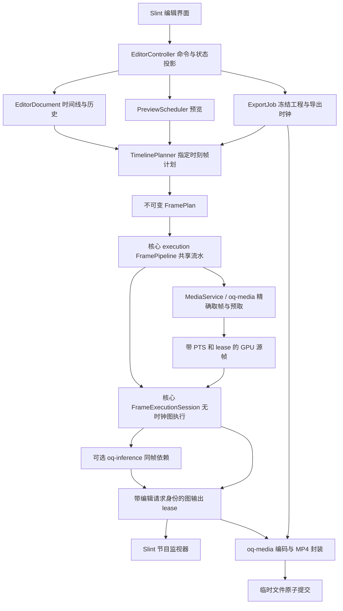
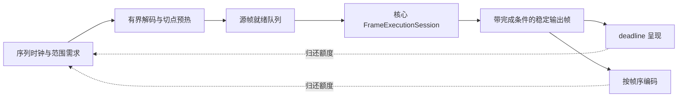

# OpenQuartz Video Editor 设计

## 1. 状态与决策

本目录为新的 **Rust + Slint 视频编辑应用**预留，和 `apps/open_quartz_slint` 并列。当前仅交付设计文档；以下新增类型、模块、命令与产品行为均为拟议接口，不表示代码已实现或测试通过。

核心决策：

1. 新应用以**素材库、时间线、节目监视器、属性面板**为主要交互，不把节点图画布当作主剪辑界面。
2. 剪辑工程保存编辑意图；时间线编译器把指定时间的编辑意图转换为 GPU 帧工作。素材定位、时间线和渲染图各有唯一所有者。
3. 复用 `oq-media` 的解码与帧 lease、`open_quartz` 的图渲染及 `oq-inference` 的 GPU 推理；**复用现有实现，不复制图编辑 app 的控制器**。
4. 首个实现目标为 macOS Apple Silicon 上可用的单视频轨、1×速度、8-bit SDR、无音轨编辑与 H.264/MP4 导出闭环。它不是完整 NLE；音频、多轨等后续能力明确分阶段交付。
5. 精确 seek、按目标时间取帧和无窗口编码是前置工作；当前“视频能播放、模型能出图”不能替代这些前提。
6. 正常预览和导出保持硬件驻留、CPU 图像回传禁止。不能消费现有 GPU 表面的编码器须明确拒绝，不悄悄读回后走软件编码。
7. 以固定版本的 Shotcut 约束所选编辑行为，以 Olive 参考渲染任务/缓存职责；不逐文件翻译、不复制 Qt/MLT/OpenGL 后端，也不承诺整个 Shotcut 的功能对等。基线、差异与授权边界见 §17。
8. 明确采用 Rust + Slint + wgpu/Metal + 进程内 libav/VideoToolbox；不引入 MLT、Qt 或 Web 宿主。具体版本、线程和接口见 §18；代码与人力估算见 §19。
9. **原 OpenQuartz 在同一 crate 内分离无时钟执行流水与实时播放宿主，不拆渲染/执行 crate。** NativePlayer 与编辑器共同依赖拟议 `execution::FramePipeline`，其内部图阶段为 FrameExecutionSession；app 只保留序列需求规划和源/消费者策略，不复制流水或图执行器。决策和迁移见[核心架构](../../docs/DESIGN.md#execution-rendering-split)。

本设计只约定该新应用，不迁移、重命名或删除现有图编辑 app，也不恢复 Web/Tauri 产品。

## 2. 现有基础与缺口

| 能力 | 已有依据 | 新应用仍需完成 |
|---|---|---|
| Slint 原生预览 | 现有 app 使用 Slint 1.18.1、wgpu 30，共享 Device/Queue | 新时间线 UI、缩略图虚拟化、编辑控制器与独立入口 |
| 硬件视频解码 | `oq-media::Session` 在 macOS 提供 VideoToolbox 顺序解码、PTS、reset、取消、drain、FrameLease | 任意精确 seek、时长/流探测、按目标时间取帧、缓存和编辑时钟模式 |
| 图渲染 | `NativePlayer`、`RenderDevice`、图编译与资源生命周期 | 可显式注入时间/外部源帧的适配；离线不能调用 wall-clock 播放循环录屏 |
| 推理 | 七模型生产链路及图像/视频回归 | 剪辑帧身份、确定性导出、推理缓存和尺寸适配；首个闭环不依赖 AI |
| 输出与 lease | 当前 GPU 输出持有、背压和三槽资源约束 | 预览、后台任务、编码消费者的独立预算与释放协议 |
| 项目编辑 | 图项目已有命令、撤销与持久化模式 | 时间线自己的模型、事务、格式版本与迁移；不是图 JSON 的别名 |
| 声音与视频导出 | 仓库媒体文档记录设计要求 | 音频解码/播放/混音与 A/V 同步、编码、封装、可靠任务终态均需实施 |

源码核对入口：

- [`oq-media` 当前边界](../../crates/oq-media/README.md)、[`Session` 实现](../../crates/oq-media/src/videotoolbox.rs)。目前没有任意 `seek` 公共方法；`reset` 重开并复位，不等于随机访问。
- [`NativeVideoSource`](../../crates/open_quartz/src/media/native.rs) 当前负责播放源；它不是可以按剪辑时间随机读帧的公共编辑会话。
- [`NativePlayer`](../../crates/open_quartz/src/player/native.rs) 当前以实际时钟驱动 graph；新应用不能额外造一个 UI timer 与之竞争位置所有权。
- [`完整媒体设计`](../../docs/MEDIA_CODEC_ARCHITECTURE.md) 中的 seek、编码和 Slint 组件有提案部分，不当作现成 API。
- [`推理架构与回归`](../../docs/INFERENCE_ARCHITECTURE.md) 证明图处理路径，不证明剪辑切点、音频同步或导出正确性。

## 3. 产品范围

### 3.1 第一个可交付闭环

面向本地文件的非破坏性剪辑：

- 导入经能力检查的 H.264/HEVC SDR 文件，查看素材元数据、首帧与缩略图。
- 创建具有固定尺寸和有理数帧率的序列，添加多个素材片段到单视频轨；片段不能重叠，空隙渲染为不透明黑色。
- 时间线平移/缩放、播放头定位、逐序列帧前后步进、设置入出点、分割、移动、修剪边缘、lift 删除、撤销/重做。
- 基础变换和曝光调整：位置、缩放、旋转、透明度、曝光。首个闭环使用静态参数，不实现关键帧编辑器。
- 原尺寸/降低分辨率预览使用同一编辑配方；可报告降质与未达到实时的状态，但不能改变剪辑结果。
- 保存、关闭、重开工程，重定位缺失素材。
- 按序列范围或选定工作区导出无音轨 H.264/MP4；进度、取消、失败与最终文件状态可观察。

有音轨的源在导入时明确标识“当前仅使用视频”；输出对话框明确写“无音轨”，需用户确认。不能直接丢弃声音却宣称通用视频编辑完成；若音频是产品首发要求，须先完成 §12 的音频阶段再发布。

### 3.2 后续阶段，不先创建空实现

| 阶段 | 扩展能力 | 不可省略的前提 |
|---|---|---|
| 多轨合成 | 图层顺序、锁定/禁用、叠加、转场 | overlap 语义、同一时刻多源取帧、线性混合和资源预算 |
| 音频编辑 | 音视频关联、波形、增益、混音、淡入淡出 | sample 精度定位、音频主时钟、设备时钟漂移、音频编码与封装 |
| 动画与 AI | 关键帧、抠像、分割、深度、超分辨率 | 同帧完成身份、缓存、预览降质可见、离线结果完整等待 |
| 代理与大工程 | 可切换代理、后台转码、磁盘缓存 | 原片↔代理时间映射、内容指纹、磁盘配额与可取消任务 |
| 更广格式/平台 | Windows/Linux、HDR、高位深与专业格式 | 分平台原生表面/编码器互操作、色彩和分发回归 |

首阶段不承诺相机/直播、反向播放、变速、光流补帧、可变帧率输出、HDR、协作、插件 ABI 或外部工程格式兼容。

## 4. 用户界面与交互

```svg
<svg xmlns="http://www.w3.org/2000/svg" viewBox="0 0 920 540">
  <g fill="none" stroke="var(--border)" stroke-width="1">
    <rect x="1" y="1" width="918" height="538" rx="6"/>
    <path d="M1 45H919 M1 338H919 M248 45V338 M675 45V338 M1 382H919"/>
    <rect x="269" y="76" width="386" height="213" rx="3"/>
    <rect x="17" y="93" width="100" height="68" rx="3"/>
    <rect x="132" y="93" width="100" height="68" rx="3"/>
    <path d="M112 397H900 M112 424H900 M112 494H900"/>
    <rect x="131" y="438" width="214" height="43" rx="3"/>
    <rect x="345" y="438" width="176" height="43" rx="3"/>
    <rect x="589" y="438" width="237" height="43" rx="3"/>
    <path d="M378 392V507" stroke="var(--accent)" stroke-width="2"/>
  </g>
  <g fill="currentColor" font-family="sans-serif" font-size="14">
    <text x="18" y="29">文件　编辑　序列</text>
    <text x="758" y="29">保存　　 导出</text>
    <text x="18" y="72">素材库 / 搜索</text>
    <text x="39" y="133">素材 A</text><text x="153" y="133">素材 B</text>
    <text x="371" y="182">节目监视器：实际图输出</text>
    <text x="344" y="316">前一帧　播放 / 暂停　后一帧</text>
    <text x="693" y="72">片段属性</text>
    <text x="693" y="110">入点 / 时长</text>
    <text x="693" y="145">变换 / 曝光</text>
    <text x="18" y="365">选择　分割　吸附</text><text x="674" y="365">时间码　 缩放</text>
    <text x="18" y="465">视频轨 V1</text>
    <text x="172" y="465">片段 A</text><text x="392" y="465">片段 B</text>
    <text x="665" y="465">片段 C</text>
  </g>
  <g fill="var(--muted)" font-family="sans-serif" font-size="13">
    <text x="18" y="192">原片、时长、分辨率、状态</text>
    <text x="693" y="184">缺失资源和错误原位显示</text>
    <text x="124" y="416">00:00:00:00</text><text x="576" y="416">00:00:10:00</text>
    <text x="18" y="527">任务进度 / 代理状态 / 硬件路径 / 错误</text>
  </g>
</svg>
```

交互规则：

- 选素材显示素材元数据；选片段显示该片段属性。选择不改变工程，播放头移动也不写撤销历史。
- 拖动期间显示轻量预览意图；松手产生一次原子命令，Esc 恢复原状态。无效放置不得改变图、片段或 redo 栈。
- 靠近片段边缘/播放头的吸附以屏幕像素阈值计算，最终位置量化为序列帧索引；缩放不改变实际编辑时间。
- scrub 可合并为最新目标。松手必须完成最后请求或显示错误；显示“请求位置”和“实际显示帧位置”，不能用播放头数字冒充已解码画面。
- trim 预览只取切点附近需要的帧，不从头顺序快进整个文件，也不在 UI 线程阻塞打开/seek。
- 缩略图仅为视觉索引，不作为节目监视器或导出帧；缓存未命中有明确占位，不复用不属于当前素材的旧图。
- 视频轨首阶段一条；不显示可编辑但无实现的音频轨或转场控件。后续能力只有在后端 capability 满足时才开放。
- 触控板水平滚动移动时间线，缩放以鼠标下时间为锚点。提供键盘操作与可访问标签，拖动有单独的命令语义，不把坐标序列当数据模型。

## 5. 工程模型与持久化

时间线工程是单一事实源，和 OpenQuartz 的节点图项目格式分开。拟议文件后缀 `.oqvideo.json`，独立 `schemaVersion`；不修改现有 `.quartz.json` 的意义。

| 实体 | 关键持久字段 | 不持久化 |
|---|---|---|
| Project | schemaVersion、projectId、名称、素材引用、序列集合 | 运行线程、已加载 decoder、GPU handle |
| MediaAsset | assetId、URI/相对路径、内容指纹、选定 video stream、探测快照 | 当前打开句柄、实时解码计数 |
| Sequence | sequenceId、宽高、fps 分子/分母、durationFrames、输出色彩、轨道 | UI 实时时钟、待完成 seek |
| Track | trackId、有序片段、启用/锁定、类型 | 挂起的帧队列 |
| Clip | clipId、assetId、timelineStartFrame、durationFrames、sourceIn、静态效果 recipe | 推理 session、代理帧、临时纹理 |
| Effect | effectId、实现标识/版本、参数、坐标/色彩域 | 编译出的 pipeline 与运行统计 |

编辑器视图状态（滚动、缩放、选区、播放头）可单独保存，但不能影响导出内容 hash。撤销栈不作为文件格式；重开后的工程状态来自文档内容，不依赖回放历史命令。

素材 URI 优先保存相对于工程的位置，不能把临时授权 token 当可重开路径。重开时重新验证文件、stream 身份与指纹；同路径换文件不能命中旧帧缓存。大文件指纹先用大小/修改时间作快速索引，但身份有歧义时必须校验内容；缓存不能只依赖路径和 mtime。首阶段只支持有权限的本地文件，不承诺 sandbox bookmark 或网络流。

保存先序列化经验证的快照，再写同目录临时文件、完成写入并原子替换；失败保留原工程。autosave 为独立恢复文件，不覆盖最后一次手动保存。schema 迁移明确记录版本，未来不认识的轨道/效果不能静默丢弃后另存为成功。

## 6. 时间与帧选择契约

### 6.1 序列时间和源时间分开

- 序列帧率表示为约分后的正有理数 `p/q`，例如 `30000/1001`。第 `n` 个输出帧的时间为 `n*q/p` 秒，用整数/有理数计算，不累计浮点 frame duration。
- 时间线边界统一用序列帧整数，片段范围为半开区间 `[startFrame, startFrame + durationFrames)`；时长必须正、运算检查溢出。
- `sourceIn` 用源流的有符号 timestamp 与原始 time base 表示，保存时间基准；不能写成 `frame / average_fps`。首阶段 rate 固定为 1。
- 序列全局时刻 `t` 落在某片段时，映射为 `sourceIn + (t - clipStartTime)`，再由源帧选择器查找对应 presentation frame。
- 源 PTS 可能负值或从非零开始；保留原值并在资产描述中记录起始映射。归一化后的编辑位置与原流时间不可混用。

VFR 输入允许，但输出为明确的 CFR。选择覆盖目标时刻的源帧：使用 presentation order 中最大且不大于目标的 PTS，对应区间为 `[pts_i, pts_next)`；有可用 frame duration 时验证其一致性。重复 PTS 以稳定 presentation sequence 最后一个为准并记录诊断；显式帧间空洞、损坏时间戳或无法确认末帧有效区间的素材不能通过精确编辑预检。源无可靠 PTS 时可提供标为“估算”的浏览，不能进入精确裁切导出。

### 6.2 边界例子

在 30 fps 序列中，片段 A 为 `[0,30)`，B 为 `[30,60)`：输出帧 29 只使用 A，输出帧 30 只使用 B。位置 30 的 split 得到两段不重叠且时长和不变的片段；右段入点按精确时间映射推进。VFR 的多个序列采样点可以合法使用同一源帧，不能因此把它们视为“未更新”错误。

first/last frame、入点等于 EOF、零长区间、非帧边界的源入点、非整数帧率和 24 小时以上时间码都要单独验证。首阶段 UI 使用非 drop-frame 的帧计数表示；若显示 SMPTE drop-frame，必须另实现编号规则，不能仅把冒号替换为分号。

### 6.3 seek 请求

`requestId`、`sourceEpoch`、`seekEpoch`、`sequenceRevision`、`clipId` 和目标时刻共同标识请求。seek 定位至目标前合适关键帧，flush 并解码到目标区间；回执带目标、实际 PTS 与 precision。快速拖动可以取消旧请求，但每个请求有完成/取消/失败终态；旧帧只释放，不发布到新播放头。

当前 `oq-media` 只有顺序解码和 reset；上述 seek、帧区间与原始 time base 元数据需要先补齐并以 B-frame、VFR 和非零起点素材验证，不能通过新 app 的 UI 先行“模拟”。

## 7. 模块分层与复用边界



这些为职责与依赖设计，不要求立即创建对应 crate。先在新 app 内形成有实际消费者的模块；只有稳定公共边界需要被多个宿主复用时再提取，不能为图上的名字先建空包。

| 所有者 | 拟议落点 | 唯一职责 | 禁止承担 |
|---|---|---|---|
| EditorDocument | app `document/` | 时间线、验证、编辑命令、撤销、版本与保存快照 | 解码、GPU 操作、Slint 对象 |
| TimelinePlanner | app `timeline/` | 在给定序列帧产生不可变源请求/效果计划 | wall-clock、UI 状态、执行 I/O、隐式取最新帧 |
| MediaService | app `media/`；底层 `oq-media` | app 管资产/会话池/帧缓存；库管探测、seek、PTS、解码与原生 lease | ClipId 业务规则、工程历史 |
| PreviewScheduler | app `runtime/preview` | 唯一序列时钟、前瞻窗口、请求合并、预览质量和呈现 deadline | 修改工程、逐图命令执行、决定导出丢帧 |
| FramePipeline | 核心拟议 `execution/` | 共享需求窗口执行、预取/就绪、预算 admission、取消、阶段完成与消费者背压；NativePlayer 和编辑器均调用 | 推导剪辑语义、拥有 UI、推进第二个时钟或实现 codec |
| RenderAdapter / 内部 FrameExecutionSession | app `rendering/` / 核心拟议 `execution/` | app 只编译效果 recipe；流水内部图阶段组合现有求值/推理/GPU/输出，产生稳定帧 | 宿主绕过流水另建执行路径、复制 NativePlayer 或 GpuExecutor |
| ExportJob | app `export/`；底层 `oq-media` | app 冻结快照/帧序/任务终态；库管编码器与 MP4 mux | 捕获屏幕、依赖 UI 播放 timer、把文件提交成功前标为完成 |
| EditorController | app `controller/` 与 `ui/` | 命令提交、可访问状态投影和交互草稿 | 保存第二份可变时间线或直接拼 FFmpeg 命令 |

实现时沿用现有 Slint app 的独立 Cargo workspace 与锁定版本模式。未来包名可为 `open_quartz_video_editor`；本次不创建 Cargo.toml、锁文件或 `src/main.rs`，不改根 workspace，也不提供不存在的 `npm run` 命令。

共享核心已有显式 FrameInputs 和外部纹理注入；新增的是统一流水、输入版本/图内依赖与稳定输出完成契约，不是重写原语。NativePlayer 和编辑器宿主均调用核心 FramePipeline，不直接驱动其内部 FrameExecutionSession；迁移后删除旧 admission/完成循环，不把它留在 NativePlayer 或复制进 app。原图 app 保留 clock、需求映射和源/呈现政策，编辑器保留时间线规划与资产适配；公共行为与受影响回归须保持，不将历史七模型参考成功当作当前生产能力。

## 8. 编辑事务与效果 recipe

拟议命令包括 AddAsset、PlaceClip、MoveClip、TrimClip、SplitClip、DeleteClip、SetEffectParam、RelinkAsset、SetSequenceSettings。每条命令携带 expectedRevision；成功后产生新 revision 和可撤销变更，失败不部分修改。PlaceClip 表示在可用空隙放置片段，不借用 Shotcut Insert 的名称暗示 ripple 插入；真正的插入/覆盖以后作为不同命令交付。

单轨默认普通 move/trim 不推动其他片段；发生 overlap 则拒绝并提示。lift 删除保留空隙。ripple 删除/修剪属于后续独立命令，不能把不同操作混在一个“智能删除”隐式规则中。split、批量删除和一次拖动只占一个历史条目。

效果 recipe 保存稳定 effectId、实现版本、参数、坐标域和颜色域。静态参数编辑不重建解码器；源变更不要求重编所有着色器。图编译缓存 key 包括效果拓扑与专门化参数；不能只按片段名称缓存。

先使用固定画布和 contain-fit，letterbox 为黑色。顺序明确为：源呈现校正/颜色解码 → 片段颜色效果 → 空间变换 → 透明度 → 画布合成 → 显示或编码颜色转换。多轨 alpha 混合在后续阶段采用线性光、premultiplied alpha；旧 Shader catalog 的 encoded-space 行为保留为带版本效果，不把它们全部冒称线性调色。

## 9. 预览、缓存与 GPU 生命周期

### 9.1 语义与执行策略分开

预览由唯一序列时钟驱动：首阶段单调视频时钟产生目标序列帧；UI timer 只刷新状态。指定时间求值是内容契约，不是逐帧 seek→等待解码→等待 GPU→显示。app PreviewScheduler 根据时钟和 TimelinePlanner 提出前瞻需求，核心 execution::FramePipeline 执行有界窗口、处理水位/完成并驱动后续阶段；NativePlayer 也复用此循环，UI 刷新暂停不使运行时停工。

| 工作模式 | 需求与调度 | 不可破坏的条件 |
|---|---|---|
| 连续播放 | 有界向前窗口、低水位补充、高水位停发；尽早准备切点后素材 | 时钟不因负载偷偷减速；同帧源/效果身份准确；过期呈现可跳过并记录 |
| scrub / 最终定位 | 一个活动交互目标＋一个最新待处理目标；取消旧发布资格，邻近目标复用 cursor/cache | 不限制整条播放流水只能一帧在途；最终目标完成或失败；已提交 GPU 工作不强行抢占 |
| 暂停 / 单步 | 保留稳定显示帧，优先完成精确目标；可停止投机预取 | 暂停像素不变、一步一个序列帧；不得以请求位置冒充已显示位置 |
| 离线导出 | 独立会话的有界向前窗口；跨阶段重叠，按输出帧序提交编码 | 不按实时 deadline 丢帧；容量不足反压上游，不改变质量 |
| 缩略图 / 后台缓存 | 使用剩余预算，当前交互/播放低水位时退让 | 不抢占前台最小工作集，不为每张缩略图永久开 decoder |

请求与完成至少关联工程/序列 revision、seek epoch、源内容身份/原始 PTS、效果 recipe hash、输出尺寸与颜色域；核心另校验图/node/session generation。AI 必须等待本次源帧的结果，不能用上一帧蒙版换取更高 FPS。播放时已完成的合法缓存帧不因“不是最新请求 ID”自动失效；按其内容 key、执行 epoch 和呈现时刻判断，scrub 最新目标策略不得套给整个缓存窗口。

### 9.2 前瞻窗口与解码游标

TimelinePlanner 保持纯函数；范围规划（拟议 plan_range）按序列帧迭代并合并源时间区间/recipe，不一次性物化整段工程。核心 FramePipeline 通过宿主注入的源适配器调用媒体窗口接口；app 只解析资产和映射源时间，不实现预取队列/水位循环。frame_at 为精确查询，命中立即取 lease，相近顺播复用 cursor，只有不连续/缓存不可覆盖才 seek，禁止一帧一次 flush/seek。

源窗口包括目标 PTS 区间、codec 必需的关键帧预滚/重排、必要末帧区间确认，而不是只缓存输出帧号。VFR 中多个序列帧可共享同一源帧 owner。解码器 reference/DPB、codec look-ahead 属于后端，宿主窗口不可将它们当成可随意丢弃的预览帧。

临近切点，提前打开/验证下一素材、定位到入点前关键帧并准备首个所需帧；同时活动的素材/cursor 数量受预算限制。重复引用同素材但源时间不连续时可有独立 cursor；顺播相邻范围优先复用，不能机械规定一个文件一个 decoder，也不每片段永久分配一个。预热未完成时不得继续显示 A 冒充 B，按当前时钟与实际完成状态报告 late/缺帧；空隙才按计划生成黑帧。

窗口以时间、帧数、bytes 和原生 surface/slot 四个维度同时限额。初始实施使用配置化窗口，不在未实测时承诺固定毫秒或帧数；P0 在目标硬件测 decoder open/seek/首帧、阶段延迟分位数和工作集，确定启动 prefill、低/高水位及最大窗口。预热调度按“切点 deadline 减去准备延迟估计”触发，并受最早可用 budget 限制；估计不足显示 late，不伪造实时。窗口内按需求优先级和临近 deadline 工作，填到高水位即停止投机提交，seek/revision 改变时清除失效未提交计划。

初次播放/定位可进入可见 Preparing 状态，达到 prefill 后以实际开始时刻建立视频时钟；启动等待不算丢帧。连续播放中缺帧不偷偷重置/减慢时钟；恢复/重新定位建立新 epoch，未来音频阶段改由实际音频设备时钟主导。预取与流水能隐藏启动/抖动和阶段空洞，不能弥补持续吞吐低于播放速率。

### 9.3 跨阶段流水、稳定帧与 credit



允许 decode(n+2)、GPU(n+1)、present/encode(n) 跨阶段在途；这是目标行为，不代表硬件一定可物理并行。共享 Queue 上转换/推理/合成可能串行，不能用线程数证明加速。同一图会话的求值/feedback 按序，准备、执行与输出保留使用对应输入版本；时域 recipe 声明依赖，必要中间计算不能因跳过显示而跳过。首阶段静态效果，未知时域依赖明确拒绝。

普通 GpuOutputHandle 是 live texture view，不能直接排入异步编码/缓存当作不可变帧。核心 outputs/rendering 扩展稳定输出 lease：明确颜色/alpha/尺寸/格式、内容身份、GpuReady 与 ConsumerReleased，持有期间不覆盖像素；按保留边界使用有界 slot 或 GPU detach copy，不给所有节点强制每帧复制。克隆 Arc 只保对象生存，不保像素稳定；当前推理三槽 lease 也不能被当成所有 shader 都已有的契约。

宿主为共享设备创建并注入统一物理预算协调者；多个核心 FramePipeline 会话共享它，app 只配置份额/优先级，不重复实现 credit 算法。源缓存、GPU 中间结果、推理输出、编码输入按实际资源身份计费。流水统一维护各阶段有界 admission/completion 队列，接收可前进工作单元前预留下游必要 slot，下游满则停止上游扩张。codec 预滚/DPB/encoder reorder 独立计入，0..N 输出不硬套一帧一 slot。禁止拿满资源后互等，未提交投机任务先释放，不能持预算锁等待 codec/GPU/UI。

目标状态明确区分 Planned、Admitted、SourceReady、GpuSubmitted、GpuReady、ConsumerReleased。Submitted 不是完成；同 queue 依赖优先用顺序/设备同步表达，跨平台 codec/encoder 使用真实完成协议。原 importer 的逐次 CPU wait 只能在 retained AVFrame、原生 wrapper、输出 slot 与 completion 回收被证明正确后替换；不能仅删 wait。错误、取消、timeout 或设备丢失均停止新 admission，已在途资源按真实完成或设备安全销毁协议退出。

### 9.4 预算、过载与优先级

初始预算为设计默认值，不是实测性能指标：

- scrub 一个活动/一个最新待处理只约束交互意图。播放/导出有各自有界在途窗口，不共享 latest-only 输出槽。
- GPU 已解码/处理帧缓存的软上限取设备建议工作集的 10%，封顶 512 MiB；无可用设备预算信息时采用保守固定值并报告来源。此值只限制可留存缓存，不代表完整 pipeline 工作集；decoder 内部表面、最小在途 slot、渲染中间目标、模型、Slint 和 encoder 保留另作统一预算核算，不能隐藏在上限之外假称总内存有界。
- 推理输出池当前最多三份 consumer lease；窗口不能假定可无限增加模型在途帧。最终呈现保留、任务执行和必要最小 slot 优先，低优先级缓存只用剩余额度。
- 缩略图/代理磁盘缓存默认上限 2 GiB、LRU 淘汰；不删除原素材，不将代理误标原片。基础解码前瞻与短窗口预渲染属于 P0～P2，完整磁盘渲染缓存/代理仍属 P4。
- 前台精确定位优先于投机预取，播放低水位补给优先于缩略图；导出与交互共享物理预算但各有会话，不承诺同时满速。导出必须有最低前进额度；资源不足时暂停可见的背景任务/预览，不能一边让用户导出一边将其永久饿死。

持续过载时，预览可跳过过时呈现并统计 drop/late，或按明确显示的质量设置降分辨率；解码 reference 与时域依赖不随意丢弃。降低图输出尺寸不保证降低硬解耗时，解码瓶颈需明确报告，代理未实现前不假装已解决。最小工作集不可满足时报 capacity/unsupported 或提示用户选择预览质量；导出不自动降质、不静默丢帧。暂停/最终 scrub 的正确目标不得丢弃，帧池回收始终等待实际 GPU/encoder/显示消费者完成。

## 10. 色彩、格式与硬件能力

首个闭环限定 8-bit SDR、方形像素、逐行、无未处理的显示旋转/crop。素材预检按实际帧元数据验证色彩，而不只按容器标签。现有 P010 解码能力不意味着本编辑器已支持 HDR 或高位深显影。

工作画布以 BT.709 primaries 的 RGBA 表示；每个效果需声明接收 linear 还是 sRGB-encoded RGB，转换节点在计划中明确。节目监视器输出 SDR sRGB；视频编码前转换为约定的 BT.709 transfer / matrix、limited-range NV12，显式写入容器与码流颜色标签。不能把 sRGB 数值直接标成 BT.709 视频后认为导出颜色一致。

源旋转、非方形像素、隔行、未知 transfer/HDR、流配置动态变化等首阶段未支持内容明确拒绝或标为不可加入序列；不能只忽略 metadata。多次导入/替换不同 primaries 的素材要验证 pipeline cache 不串色。

能力快照分别报告 decoder、renderer、encoder、GPU adapter/device、原生表面格式、是否硬件、是否发生 CPU 图像传输。硬件解码成功不证明编码器可消费该表面；不支持 GPU → encoder 互操作就不能声称“零拷贝导出”。必要的 GPU 内拷贝允许并统计，不冒称没有任何拷贝。

## 11. 导出设计

### 11.1 确定性逐帧执行

首阶段输出为 CFR、8-bit BT.709 SDR、H.264/MP4、无音轨。尺寸必须满足编码器约束（例如偶数宽高），不支持的 profile/尺寸/格式在创建任务前拒绝。

导出范围为序列帧半开区间 `[a,b)`，产生恰好 `b-a` 帧；第 `k` 个编码输入的 PTS 为 `k`，time base 为 `q/p`，源采样时刻为 `(a+k)*q/p`。EOF、片段末端和空隙按 §6 统一处理，不多写一个结束帧。任何 time-base 重标度都检查溢出与单调性。

导出任务拥有冻结的工程、原素材内容身份、效果版本、参数、模型哈希、目标设置和输出权限快照。工程可继续编辑，任务不变；若源在任务期间改变或无法保持可重现读句柄，任务失败，不混用新旧字节。预览与导出共用 TimelinePlanner、帧选择和效果 recipe，但使用独立执行会话、缓存预算和完整质量输出。

导出不允许预览式丢帧、latest-only、只取最新推理结果或录屏。FramePipeline 用 §9 的有界窗口重叠解码/图执行/编码；静态效果可跨帧准备，但提交/完成按依赖与内容身份管理，输出有界重排并按序列帧序送入编码器，不等于强制编码包 DTS/PTS 同序。AI 阶段按帧等待正确模型/输入完成；超时显式失败，不跳过该帧。

### 11.2 原生编码与封装

拟议 macOS VideoToolbox 编码路径：图 RGBA lease → GPU 颜色转换/尺寸对齐 → 编码器可保留的 CoreVideo NV12 表面 → H.264 packets → MP4 muxer。需要在 `oq-media` 扩展实际 encoder/mux 实现；当前仓库的 PNG capture、`.scr` 导出、FFmpeg executable 存在均不是该能力的替代品。

编码提交有背压：Accepted 或 WouldBlock；未接受时帧所有权返回。输入 EOF 后 drain delayed packets，保留 PTS/DTS 与 duration，完成 trailer、关闭文件后才提交最终文件。编码器保留 source lease 直到消费完成，不能以 CPU submit 返回替代 GPU/encoder completion。

目标使用同目录临时文件；成功后按覆盖许可原子提交。失败/取消清理自己创建的临时产物，保留既有目标文件；磁盘写满、权限丢失、编码器错误和 mux trailer 失败都不能显示 Completed。

### 11.3 状态和恢复

ExportJob：Queued → Preparing → Rendering/Encoding → Draining → Committing → Completed；活动阶段可进入 Cancelling → Cancelled 或 Failed。进入 Committing 前是可取消边界；原子提交开始后若无法安全撤回，以实际提交成功/失败为终态，不把已成功文件标为 Cancelled。

进度报告已处理帧、总帧数、阶段与诊断，不把“已送入 encoder 的帧”当作整个任务完成。关闭窗口时提示正在导出，等待已接受的取消终态或用户选择继续后台任务；首阶段不实现跨进程断点续导，重启后遗留临时文件只做可见清理/恢复提示。

## 12. 音频与多轨演进约束

音频不是复制原文件音轨就完成。裁切、拼接、空隙、变速、音量和转场都要求时间映射；AAC 等还涉及 encoder delay/padding。音频阶段需有 sample 精度的 clip in/out、统一 resample 策略、混音总线和输出 duration 对齐回归。

启用音频设备后选择音频主时钟，视频按其目标采样并允许可见的预览丢帧；暂停/seek 同时 flush 对应音频队列和失效旧视频结果。设备切换、重采样漂移和 underrun 有明确状态，不让多个独立 timer 互相追赶。

多视频轨之后规定从下到上合成顺序、隐藏/锁定语义、overlap、转场占用区间、可重放关键帧函数。过渡到这些格式时升级 schema 并迁移，不能令旧 app 静默读取新项目却丢掉轨道和音频。

## 13. 工程与测试布局

下面是确定的首阶段模块归属；模块内部文件名可随实现细化。本次不创建空源文件，也不为每个模块新建 crate：

```text
apps/open_quartz_video_editor/
  README.md                 当前入口与实现状态
  DESIGN.md                 本设计
  Cargo.toml / Cargo.lock   实施时创建的独立 workspace
  src/
    main.rs                 进程入口与真实能力探测
    document/               时间线模型、命令、验证、保存
    timeline/               rational 时间映射、帧计划
    media/                  资产解析、会话与缓存宿主适配
    rendering/              显式时刻 GPU 图适配
    runtime/                序列时钟/需求规划与核心 FramePipeline 的宿主适配，不实现流水循环
    export/                 冻结快照与导出任务
    controller/             Slint 状态投影与交互事务
  ui/                       Slint 布局与可复用时间线组件
  tests/                    工程、时序、真实媒体与原生窗口回归
```

公共底层能力在现有 `crates/oq-media` / `crates/open_quartz` / `crates/oq-inference` 中增量实现；app 内模块只做编辑业务适配。Node 工具仅用于开发/打包/自动化，应用运行不依赖 Node。不能直接复用现有根 `npm run dev` 来启动两个应用；新入口必须在实际程序可构建后单独接入并清楚命名。

## 14. 实施阶段与完成门槛

| 阶段 | 实施内容 | 完成证据 |
|---|---|---|
| P0 媒体/渲染前提 | 精确 seek/帧区间；NativePlayer 与编辑器共用核心 FramePipeline（内部 FrameExecutionSession）；稳定帧/完成/credit；预取与切点预热；GPU→encoder 互操作 | 长 GOP/B-frame/VFR/非零起点正确；无窗口流水文件可独立解码；小池/慢消费者不覆盖、不死锁；测定 prefill/水位并证明跨阶段在途；两宿主不留双执行循环；硬件互操作不可达则重新评审 |
| P1 工程与交互 | 时间线模型、命令、入出点/分割/移动/trim/lift、撤销、保存重开与缺失素材恢复 | 每条命令边界测试；真实 app 可编辑项目并读回，不只画时间线 |
| P2 单轨闭环 | 硬件预览、节目监视器、静态效果、精确导出、进度取消、运行库打包 | 导入→剪切多段→效果→保存重开→导出→重新解码逐帧核对；明确无音轨；P0/P1 不另称完整编辑器 |
| P3 音频/多轨 | 声音与 A/V 同步、多轨合成、转场 | sample 对齐、同步漂移与各轨合成的真实导出回归；到此才评估通用 NLE 定位 |
| P4 AI/代理/动画 | 可选推理效果、代理、关键帧与后台渲染缓存 | 同帧 AI、原片/代理映射、可复现导出和预算压力回归 |

P0～P2 是首个可用编辑闭环的依赖顺序，不是允许只交付窗口空壳的范围缩减。具体实现前需重新核对库版本和真实设备能力；§19 提供带假设的工作量估算，不代表性能实测、交付日期或跨平台完成度。

### 14.1 Phase 提交序列与依赖

本节将产品里程碑 P0～P2 拆为实际实施提交；**Phase 与 P0/P1/P2 不是同一编号体系**。顺序为 Phase 0 → 1 → 2 → 3 → 4 → 5 → 6 → 7 → 8；每个实现 Phase 都必须有可运行的真实纵向路径，不以空接口/假 decoder/假 encoder 过关。Phase 0 只提交设计，Phase 1～8 当前全部未开始。P0 在 Phase 1～5 收齐，P1 在 Phase 6 收齐，P2 在 Phase 7～8 收齐；共享流水不能等到最后才迁移 NativePlayer。

| Phase / 建议 commit subject | 交付边界与已有消费者 | 必须新增/更新的单元与行为测试 | 真实端到端验收门槛 |
|---|---|---|---|
| **0 设计基线** `docs: plan shared frame pipeline implementation phases` | 本设计、核心/媒体边界、提交/测试纪律；不创建源代码骨架 | 文档链接/锚点、阶段依赖与估算口径一致性检查；不为文字创建产品测试 | 明确现有 GPU smoke 仅为旧能力证据，不能将目标流水记为通过；提交后再实施 Phase 1 |
| **1 稳定帧与完成** `feat(rendering): add bounded stable frame output leases` | 在现有 rendering/outputs 增量实现稳定输出、图像描述与设备/消费者完成；接入 NativePlayer 的异步保留/显示输出，不先造无人调用的 API | 保留帧后新帧不改写；池饱和 WouldBlock/输入归还；克隆/多消费者最后释放；取消/超时不提前复用；尺寸/格式/设备拒绝 | 真实 Metal 两源/动态图生成连续编号帧，慢消费者持有 n 时继续绘制 n+1，独立读回比较；真实 Slint 窗口播放/暂停/替图/关闭无像素串帧。readback 仅测试 oracle，正常显示不走 CPU |
| **2 共享流水切换** `refactor(execution): route NativePlayer through shared FramePipeline` | 同 crate FramePipeline + 内部 FrameExecutionSession 接入当前实际图源/呈现/推理适配器；迁移 NativePlayer/PlaybackSession 受影响调用方，删除旧循环；此时媒体仍可保当前顺序源，未冒称精确 seek | demand admission/单终态、输入版本/图内依赖、revision/epoch 失效、Every/Latest 背压、图准备失败保留旧图、feedback 顺序与 reset、关闭与 pending 竞争 | 同一生产 pipeline 无窗口显式时间/外部源执行＋真实原图 app 的 Shader→当前支持 resident 推理→Renderer；视频 Play/Pause/替换与关闭；生产路径禁用 ORT/CPU fallback，检查共享设备/输出 lease。不能只 mock 源回显即称迁移完成 |
| **3 精确源时间访问** `feat(media): add precise seek and presentation frame selection` | oq-media 探测/原始 time base/有效帧区间/seek；核心源适配器消费，沿同一顺序 cursor 查询/缓存，不每帧 seek | rational 重标度/溢出、负/非零起点、半开区间/EOF/重复 PTS、取消与旧 epoch、损坏/不可靠时间拒绝、缓存身份与不连续定位 | 固定许可/hash 的长 GOP、B-frame、VFR、非零起点/尾帧样本：真实硬解→共享流水→GPU 输出，用独立编号帧/PTS oracle 断言任意目标；保留顺序播放、暂停选源首帧不消耗正式起点的 E2E |
| **4 前瞻与非阻塞流水** `feat(execution): add bounded prefetch and cross-stage flow control` | FramePipeline 统一窗口/水位/credit/预热/源就绪；NativePlayer 使用该机制；在 owner/completion 证明后替换 importer 逐帧宿主 wait | 高/低水位、不重复计费、最小工作集/容量错误、阶段反压/公平前进、邻近 scrub 复用、seek 清投机任务、慢消费者释放与唤醒、codec 0..N/时域依赖不误丢 | 真实双素材切点预热、冷启动、持续过载、最终 scrub、受限 surface/慢 GPU/慢呈现，记录阶段起止/PTS/bytes/surfaces/credit；证明 decode 与 GPU 多帧跨阶段在途且无死锁；测定默认 prefill/水位并 revise §9。尚无 encoder，编码侧端到端压力在 Phase 5 补齐 |
| **5 硬件编码与封装** `feat(media): add resident H264 MP4 export pipeline` | SDK 启用实际 VideoToolbox encoder/MOV-MP4 mux，更新 build/cache identity/notices；GPU NV12 表面、编码消费/排空与按序 sink 接入同一 FramePipeline；现阶段真实 headless 文件任务 | encoder Accepted/WouldBlock、0..N packets、PTS/DTS/time base、reorder/drain/trailer、颜色转换/标签、取消/错误/磁盘失败不提交、已有目标保护、lease 消费完成 | 真实硬解→效果→GPU NV12→硬件编码→MP4，独立 FFmpeg/ffprobe 检查帧数/切点/尾帧/时间戳/颜色/画面；慢 encoder/小池、取消各边界、源变化、写入失败；正常路径 CPU 图像 bytes=0；无法互操作时停止并修订方案，不交软件 fallback |
| **6 工程与可操作编辑器** `feat(editor): add timeline document and native editing workflow` | 创建真实独立 app，EditorDocument/TimelinePlanner/保存恢复/relink；素材库、单轨放置/trim/split/move/lift、撤销/重做、基础监视器接共享 pipeline；无空控制器或不可用编辑控件 | 每条命令合法/非法边界、时长/源入点守恒、overlap 拒绝、revision/redo、拖动一次历史/Esc、schema/相对路径/指纹/relink、原子保存失败、帧/范围计划 | Slint MCP 真菜单/键盘/拖动导入两素材→放置/修剪/分割/移动/lift→撤销重做→保存关闭重开→缺素材重定位；定位/显示来自真实流水并核对帧，不能源码创建项目代替交互覆盖 |
| **7 完整预览与效果** `feat(editor): complete precise playback and static effects` | 连续播放/暂停/单步/scrub、吸附缩放/可见区缩略图、静态变换/透明度/曝光、质量状态与跨切点前瞻；不重复实现核心水位循环 | 参数/坐标/颜色域、效果顺序与 cache invalidation、缩放不改编辑时间、选择不写历史、最终目标不丢、降质不改剪辑结果、未知时域 recipe 拒绝 | 真实窗口多个切点/空隙、30000/1001、快速 scrub/暂停步进、效果编辑、同尺寸不同颜色源切换、慢 UI；独立图像 oracle 核对画面和实际 PTS，截图/状态/日志报告完整，纯数值测试不能代替窗口验证 |
| **8 产品导出与分发闭环** `feat(editor): complete export jobs and native distribution` | UI 导出冻结快照、范围/进度/队列/取消/目标覆盖、无音轨确认；独立 app runtime/打包/许可；收齐 P0～P2 场景 | 任务状态/单终态、范围帧数、提交前取消/提交竞争、任务冻结 revision/源身份、排队超限、错误映射、恢复提示与路径权限 | 从真实 UI 两素材剪辑/效果/保存重开→导出，独立解码核对指定帧；导出中继续编辑/取消/关闭窗口/磁盘失败/慢 encoder，验证文件与状态；安装包移出开发路径真实启动/导入/播放/导出/正常退出，记录签名/公证实际状态，原图 app 回归保持 |

Phase 1 不先完成全部流水；Phase 2 不谎称媒体随机访问已交付；Phase 4 不以模拟 encoder 代替未来真实编码验收。已有消费者在每一步接入其已可用能力，未交付能力不露出假按钮/假成功。后续 Phase 为前面路径补充完整回归，不能以“下个 Phase 会测”为由省略本 Phase 已新增行为的测试。

### 14.2 每个 Phase 的硬性完成与提交协议

1. **先核对现实，再定改动。** 读取现有实现/调用方/测试与本 Phase 前置条件；导出符号变更先查询引用。发现设计不符、API 已有或硬件能力不同，先修订本 Phase 契约/依赖/估算与原因，再落代码；不按旧文档强造重复接口。新增范围或验收缩减需显式评审，不能自行删去失败项。
2. **单元测试＋真实 E2E 覆盖全部新增消费者行为。** 每项功能/契约分配稳定 case 名，覆盖成功、边界、错误、取消/恢复、背压/生命周期中适用项。bug 尽量保留失败前/修复后的回归。永久测试断言可观察结果，不测试源码文字、调用转发或 mock 回显；mock/可控延迟可验证逻辑竞争，但不能替代实际 Metal/VideoToolbox/Slint/encoder 链路。没有 UI 的 Phase 以真实无窗口链路为 E2E；改变可见行为的 Phase 另需原生窗口 E2E。
3. **行为覆盖与数值覆盖分开。** 建立“需求/不变量 → 单元 case → E2E 场景 → 命令/产物/结果”的映射，功能没有相关测试不得标完成。现有 SDK 100% lines/functions/regions 门槛保留，不增加 exclusion、不删有价值测试或放宽数值阈值过关；执行逻辑迁入 execution 后不能沿旧 native 文件排除规则隐身。新增代码纳入对应 package/feature coverage；oq-media、新 app 等不在现有 SDK 脚本统计范围的部分，在对应 Phase 加真实测试/覆盖报告与 CI 调用，不能只引用总测试数。
4. **保存可复核证据。** 每 Phase 在本节更新记录：实际改动/设计差异、验证命令、环境/硬件、测试 case/数量、失败/ignored、覆盖报告、真实 UI/媒体产物位置与限制。媒体样本有许可/hash；时间戳/颜色/切点由独立 oracle 判定。错误或 unavailable 硬件算前提失败，不 skip 成绿；历史报告不复用为本轮通过。实现和回归完成后统一执行验收，不把中途局部通过当最终证据。
5. **代码、测试、文档在同一个 Phase commit。** 更新核心/媒体/推理/编辑器所有受影响章节，区分目标与当前实现；删除被替代执行路径、死代码与失效的实现细节测试，不保留双实现/迁移开关。只暂存本 Phase 的文件，不带无关用户改动，不自动 push，不 amend/rebase 已交付提交；修复尚未通过的 Phase 后才产生该 Phase 的一个实现 commit。
6. **有失败就不宣称完成。** Phase 开始记录已有失败与其证据；已有 coverage gates 失败不因本计划被豁免，也不无证据归因为旧问题。新增行为/受影响回归必须通过；整体既有 gate 未关闭时明确保持失败状态，不标为全部验收通过，不发布。若失败影响本 Phase 的前进条件，停止提交该实现 Phase 并先修复/重新评审；不能提交半成品绕到下一 Phase。现有全局 gate 的修复必须用有消费者价值的测试/真实修正，不靠测试 wiring 或降低门槛。

如实施发现一个 Phase 不再能形成合理的可验收提交，可在启动它之前修订拆分（例如 Phase 4a/4b），同时补齐每个子 Phase 的真实路径、测试和依赖，再各自一个 commit；已完成提交不重写。变更必须记录理由，不将整个 Phase 拆成一串无可运行消费者的 scaffolding commits。

### 14.3 现有测试入口与后续接入点

下列命令当前存在，不代表本轮已执行或通过：

- `cargo test --locked --workspace`：根 workspace 测试；独立 Slint app 不包含在其中。
- `npm run test:desktop`、`npm run test:desktop:ui`、`npm run test:desktop:shaders`：原图 app 的 Rust、真实 MCP 交互与 shader 画面回归，Phase 1/2 切换及后续影响它的阶段必须保持。
- `npm run check:rust-boundaries`：默认核心/feature 与独立推理依赖边界；新增 execution 不得把 wgpu/codec 拉进默认闭包。
- `npm run test:sdk-coverage`：当前 open_quartz/oq-inference 默认与 native 的 100% gate；[已有失败记录](../../docs/DESIGN.md#validation)不得说成已通过，本次文档提交不重跑以假装关闭。
- `npm run test:desktop:inference` / `npm run test:desktop:inference:ui`：既有推理链路及独立 reference/真实窗口入口；迁移不得要求未支持模型变成生产支持，也不得把预期能力拒绝改为 skip 或软件 fallback。实际失败按证据处理，不默认承诺“七模型生产全部支持”。

Phase 1～5 的新 GPU/媒体/流水行为测试优先进入已有核心/oq-media 的 tests 与真实硬件 runner；Phase 6 创建新 app 时提供明确独立命令与相应 MCP suite/报告，而非借用现有 `dev:editor`（那是代码编辑组件示例）。具体新命令名、test target 和 CI job 在实际可运行时写入本节及开发指南，不提前写不存在的命令。测试产物遵循 test-results 的现有报告/日志模式，永久 case 不依赖用户素材绝对路径。

### 14.4 当前实施记录与后续范围

本提交为 **Phase 0 设计基线**；Phase 1～8 未开始。Phase 0 验证只覆盖文档/计划，不代表任何新流水代码被测试。实施提交时按当次结果追加 Phase 记录：需求→单元/E2E 映射、现实与设计差异、精确命令/环境/结果/产物和遗留限制；不预填测试通过数或未来 commit hash。设计提交 hash 由 git 记录，不为把自身 hash 写回文档再创建第二个设计提交。

首轮提交序列明确覆盖 P0～P2，不取消 P3/P4。声音、多轨/转场、关键帧、代理/后台缓存、现有模型剪辑接入分别作为后续独立实施 Phase，沿用相同“一 Phase 一 commit＋文档 revise＋单元/E2E”纪律；每项启动前根据前序真实接口、平台能力和 §12/§19 的范围补齐同粒度验收/依赖，未规划细节不能先写占位。HDR/其他平台等仍须独立规格与硬件门槛，不混入当前单轨无音轨发布承诺。

## 15. 回归与验收方案

### 15.1 纯逻辑与状态

- rational 时间重标度、`30000/1001` 无累计漂移、负源起点、checked arithmetic、半开范围与 EOF。
- split 时长守恒、trim 不越源区间、overlap 拒绝、lift 保留空隙、拖动一次历史、撤销后修改清 redo、失败不修改历史。
- 工程版本、相对路径、重定位身份变化、保存失败保留原文件；未知效果/轨道拒绝不丢数据。
- 请求终态、取消与完成竞争、过期 seek/推理不能发布到新播放头，导出冻结 revision 不受后续编辑影响。

### 15.2 真实媒体与 GPU

固定哈希、可再分发的样本含：长 GOP H.264/B-frame、VFR、非零起点、相邻同尺寸不同颜色素材、视频末帧和损坏/不支持格式。用时间码/编号色块形成独立预期，不只比较帧数增加。

| 场景 | 断言 |
|---|---|
| 任意 seek / 连续 scrub | 显示帧属于最终目标源区间；错误/取消有终态；旧帧不闪回 |
| 跨 clip 切点与空隙 | A 末帧、B 首帧和不透明黑色按精确序列帧生效 |
| 暂停、步进、恢复 | 暂停像素不变；一步恰为一个序列帧；恢复无重复起点/时钟跳变 |
| GPU 生命周期压力 | 小池/慢 UI/慢 encoder 下 lease 不提前复用，预算有界，不通过丢导出帧解压 |
| 预览/导出一致 | 同尺寸同配方在指定时刻的渲染输出一致；降质预览单列，不作完整质量 oracle |
| 编码与 mux | 独立解码检查帧数、PTS/duration、切点、尾帧、颜色标签及画面；有损 H.264 使用固定内容阈值，不要求字节相等 |
| 取消/磁盘失败 | 原目标保留、临时文件处理正确、终态准确；首帧/最后帧/提交前取消都覆盖 |
| 冷启动与切点预热 | 记录 open/seek/首帧延迟、prefill 和切点前后正确源帧；未命中报告 late，不把 A 延长冒充 B |
| 流水与背压 | 记录 decode/GPU/encoder 起止、等待和队列水位；小池、慢 GPU/编码器下多帧跨阶段在途且 bytes/surfaces 有界、导出有前进性，不以多线程存在作证 |
| live view 与稳定帧 | 保留帧 n 后继续渲染 n+1，稳定 lease 像素不变；live view 语义单列；慢呈现/编码消费完成前不重用 slot |
| 过载与取消 | 持续低吞吐只改变显式预览质量/呈现 drop，不破坏 source/时域依赖；seek 失效投机窗口、最终目标正确，迟到 GPU 完成只回收资源 |

先以编码前帧与独立 CPU/数学 reference 核对效果，再独立验证有损编码；不把“同一段错误渲染预览和导出都一样”当成正确。性能统计区分 seek 到正确画面的 wall latency、解码吞吐、图完成延迟、UI 显示速率和导出完成时间。

### 15.3 原生 UI E2E 与分发

复用仓库已有 Slint MCP 场景/截图/HTML 报告模式，不硬编码用户机器素材路径。真实操作：导入、创建序列、拖入两个片段、trim/split/delete、Undo/Redo、scrub/step、Play/Pause、保存重开、重定位缺失文件、导出与取消，并独立读取导出文件验证。源码创建工程可用于准备条件，但不把它计作已覆盖真实菜单/拖动。

首阶段硬件 CI 仅选择能实际通过 Metal/VideoToolbox/原生窗口检查的 macOS runner；无硬件属于前提失败，不跳过变绿。已有核心、图编辑 app、七模型 E2E 与正常 feature 依赖边界都必须继续通过。打包后在脱离开发路径的目录启动，检查动态库、编码器、对应源码/许可证、权限与普通关闭；未签名/未公证状态明确报告。

## 16. 风险与发布判定

| 风险 | 决策 |
|---|---|
| 当前播放架构只提供最新帧 | 先落地按目标时间取帧及离线不丢帧路径，不能直接复用 latest-only 导出 |
| 同设备硬解不等于同设备硬编码 | P0 用实际表面/编码器完成小规模闭环，再决定发行支持矩阵 |
| 旧效果的 encoded-space 数学 | 标注颜色域和版本；不无声改变已有图应用效果，线性混合单独验收 |
| CPU oracle 自身数值不稳定 | 原 FP32 容差、高精度归约和分类边界判定沿用已明确批准的推理回归原则；不靠扩大阈值掩盖结果 |
| AI 模型资源与分发许可 | 功能默认可关闭；原始模型/fixture hash、来源、各自许可与可下载性分别审查，测试可下载不等于可随安装包分发 |
| FFmpeg / Slint 分发条件 | 锁版本、对应构建参数/源码与 notices；发布前核对 Slint 授权及编码器/目标市场分发要求，不把 MIT app 标签当依赖许可结论 |
| 转换为大工程后内存/响应失控 | 轨道/缩略图虚拟化、有界缓存与任务取消作为数据规模门槛，而非堆 UI 线程后台任务 |

发布最小判据：P0～P2 真实闭环全部通过、缺素材/不支持内容可恢复、导出文件经独立解码验证、无隐藏音频丢失声明、无导出静默丢帧或 CPU fallback。完整音频/多轨未交付前，产品说明只能称“单视频轨、无音轨剪辑与效果编辑”，不能称 Premiere/Resolve 替代品。

## 17. 开源参考基线与行为约束

### 17.1 固定参照，不追随 master 漂移

本轮于 2026-11-11 核对以下源码与发布元数据。这里记录的是**设计参照**，不是运行时依赖，也不是已经完成的跨应用行为回归。

- **Shotcut 主参照**：[v26.9.27 发布](https://github.com/mltframework/shotcut/releases/tag/v26.9.27)，固定源码 commit [`325c2cc6422d93567d4edb57f1fee401f73beea1`](https://github.com/mltframework/shotcut/commit/325c2cc6422d93567d4edb57f1fee401f73beea1)。同一 release 页面存在不同日期的修订安装包，不能只用 release URL 代表同一个二进制。行为录制选择原始 `shotcut-macos-26.9.27.dmg`，发布 API 的 SHA-256 为 `629b056bfee1670c1669dd73f19f76fe48e0cdf90e184dc1aa1bdd6d09aa2548`；执行前仍须下载校验、记录实际 About 版本、架构和设置。本轮未运行该安装包。
- **Olive 架构专项参照**：固定源码 commit [`7e0e94abf6610026aebb9ddce8564c39522fac6e`](https://github.com/olive-editor/olive/commit/7e0e94abf6610026aebb9ddce8564c39522fac6e)。其 [README](https://github.com/olive-editor/olive/blob/7e0e94abf6610026aebb9ddce8564c39522fac6e/README.md) 明确标记 alpha/highly unstable，只参考职责划分，不以它的输出充当正确性 oracle。
- Kdenlive 与 OpenTimelineIO 不再作为首阶段并行规格来源；需要新增交换格式或复杂编辑语义时再单独评审，避免多套默认行为冲突。

### 17.2 从参考入口到本项目职责

下表是源码追踪入口，不表示这些 C++ 类应当逐个移植；特别是模型/命令依赖 MLT 和 Qt 的部分不能直接复用。

| 固定源码入口 | 采用的参考约束 | 本项目实现 / 验收 |
|---|---|---|
| Shotcut [timelinecommands.h](https://github.com/mltframework/shotcut/blob/325c2cc6422d93567d4edb57f1fee401f73beea1/src/commands/timelinecommands.h)、[timelinecommands.cpp](https://github.com/mltframework/shotcut/blob/325c2cc6422d93567d4edb57f1fee401f73beea1/src/commands/timelinecommands.cpp) | 显式区分 append/insert/overwrite/lift 等命令；命令可撤销，不把鼠标事件当历史 | EditorDocument；首阶段只交付 §8 的明确子集，验证 split、trim、lift 与一次拖动一次历史 |
| Shotcut [multitrackmodel.cpp](https://github.com/mltframework/shotcut/blob/325c2cc6422d93567d4edb57f1fee401f73beea1/src/models/multitrackmodel.cpp)、[timeline 视图目录](https://github.com/mltframework/shotcut/tree/325c2cc6422d93567d4edb57f1fee401f73beea1/src/qml/views/timeline) | 轨道/片段编辑与选择、缩放、拖动视图分离 | Rust 文档是事实源，Slint 投影；同一操作序列核对片段位置/时长/源入点，不要求像素相同 |
| Shotcut [autosavefile.cpp](https://github.com/mltframework/shotcut/blob/325c2cc6422d93567d4edb57f1fee401f73beea1/src/autosavefile.cpp)、[mltxmlchecker.cpp](https://github.com/mltframework/shotcut/blob/325c2cc6422d93567d4edb57f1fee401f73beea1/src/mltxmlchecker.cpp) | 工程恢复、资源检查必须是显式产品路径 | 自有 JSON schema、恢复文件、relink；不读写 MLT XML，不复制其格式迁移 |
| Shotcut [jobqueue.cpp](https://github.com/mltframework/shotcut/blob/325c2cc6422d93567d4edb57f1fee401f73beea1/src/jobqueue.cpp)、[jobs 目录](https://github.com/mltframework/shotcut/tree/325c2cc6422d93567d4edb57f1fee401f73beea1/src/jobs) | 导出有排队、进度、取消和失败，而非只调用编码器 | ExportJob；单活动导出、有界等待队列，覆盖 §11 的文件提交和终态语义；不运行 melt |
| Shotcut [proxymanager.cpp](https://github.com/mltframework/shotcut/blob/325c2cc6422d93567d4edb57f1fee401f73beea1/src/proxymanager.cpp) | 代理是可追踪的派生资源，不能改变剪辑时间或误用于最终导出 | P4 才引入代理；P2 降分辨率渲染不是代理文件 |
| Olive [renderticket.h](https://github.com/olive-editor/olive/blob/7e0e94abf6610026aebb9ddce8564c39522fac6e/app/render/renderticket.h)、[rendermanager.h](https://github.com/olive-editor/olive/blob/7e0e94abf6610026aebb9ddce8564c39522fac6e/app/render/rendermanager.h) | 请求、完成等待与调度分离，取消不等于底层工作已经停止 | 带身份的 RenderRequest/RenderedFrame，单终态与 GPU fence；不复制 QObject/QVariant ticket 模型 |
| Olive [previewautocacher.h](https://github.com/olive-editor/olive/blob/7e0e94abf6610026aebb9ddce8564c39522fac6e/app/render/previewautocacher.h)、[framehashcache.h](https://github.com/olive-editor/olive/blob/7e0e94abf6610026aebb9ddce8564c39522fac6e/app/render/framehashcache.h) | 播放头附近的缓存/失效与渲染解耦；取消后仍要安全回收在途任务 | PreviewScheduler、内容身份缓存、预算与 lease；不复制其 OpenGL 纹理、磁盘布局或缓存启发式 |

### 17.3 行为对齐方法与有意差异

每个纳入范围的行为以“固定输入素材/序列 → 操作与设置 → 可观察结果”记录，素材有分发许可、hash、time base 和独立的帧编号预期。Shotcut 和新 app 分别建立本机工程，执行相同的有效操作；对比规范化片段表、撤销/重做后的状态、切点处源帧、导出帧数/时间戳与画面容差，而不是比较工程 XML/JSON 或 H.264 文件字节。

首个纵向场景为：两个素材 → 放置到单轨 → trim/split/lift → undo/redo → 保存关闭重开 → 缺素材重定位 → 定位切点 → 无音轨导出 → 独立解码检查。无效 overlap、取消、磁盘失败和旧帧回流按本项目契约另行验证。参考运行结果与独立数学/编号帧预期不一致时，先定位差异，不能自动把参考软件的行为判成正确。

有意差异必须保留：首阶段不做 ripple/overwrite/自动转场、音频、多轨、MLT 工程互通、任意滤镜兼容；PlaceClip/MoveClip/TrimClip 遇 overlap 拒绝。默认吸附、拖动修饰键和快捷键在行为录制中显式记录，不能因为 Shotcut 在另一组设置下能操作就宣称对齐。界面参考工作流，不复制品牌、图标、文案或整套视觉布局。

### 17.4 授权路线

仓库现有 [MIT 许可](../../LICENSE) 保持不变。上面核对的 Shotcut/Olive 头文件声明 GPL-3.0-or-later；本路线仅记录可观察行为与通用职责，用自有模型、接口和实现，不复制或逐段翻译其源码、测试、素材或资源。这不是已完成的 clean-room 认证，也不以“换语言”规避派生作品判断。若实施中确需源码级移植，先停止该部分并单独决定 GPL 合规/分发路线，不将派生代码直接标为 MIT。Slint、libav、模型和系统编码器各自的分发义务仍单独审查。

## 18. 明确的软件栈与运行接口

### 18.1 首阶段选型

以下版本来自当前仓库，或被明确标为新增选型；这是实施基线，不是新 app 已有的依赖文件。新增包的精确补丁版本在真正创建 Cargo.lock 时锁定，不能把未构建的依赖组合写成已验证。

| 层 | 决定采用 | 复用 / 新增边界 |
|---|---|---|
| 支持目标 | macOS Apple Silicon，首轮硬件验收基线为 macOS 26；更低系统版本未认证 | 不因现有 libav 的 macOS 13 deployment target 就承诺整个 app 支持 13；首阶段不支持 Intel/Windows/Linux |
| 语言与构建 | Rust edition 2021、MSRV 1.92；独立 Cargo workspace/lockfile | 与现有 app/SDK 对齐；不把每个逻辑模块拆成 crate |
| 原生 UI | `slint = =1.18.1`、`slint-build = =1.18.1`；femtovg-wgpu 与 `unstable-wgpu-30` | 同现有 app 固定版本；自写时间线 Slint 组件与可见区数据投影，不嵌入 WebView/Qt/QML |
| GPU 与着色器 | `wgpu 30`、Metal 后端、WGSL；共享同一个 Device/Queue | 复用 OpenQuartz 编译/求值/渲染/输出 lease；不新建 OpenGL 或第二个独立 GPU 设备 |
| 编解码与封装 | `oq-media` + `ffmpeg-next 9` + 仓库固定 FFmpeg **8.1.1** 的 LGPL-only 动态 libav SDK；VideoToolbox H.264/HEVC 解码、H.264 编码、libavformat MP4 mux | seek/probe/encoder/mux 是新增能力；禁用软件视频 fallback，不以 FFmpeg 子进程传 RGBA |
| GPU 表面互操作 | CoreVideo CVPixelBuffer/IOSurface + CVMetalTextureCache，必要时受控 Metal/wgpu GPU 内拷贝 | 通过 VideoToolbox 编码器可保留的 NV12 表面池；只用有文档的互操作接口，不伪造 CPU 指针或假定任意 wgpu texture 可被编码 |
| 工程与偏好 | `serde 1` / `serde_json 1`、版本化 `.oqvideo.json`，`directories 6`；本地文件缓存 | 复用依赖选择，自写文档 schema/事务/恢复；不使用 MLT XML、SQLite 或云后端 |
| 内容与实体身份 | `sha2 0.10` 内容指纹；新增 `uuid 1` 的 v4/serde 功能用于持久 ID | 持久 ID 不复用临时 NodeId；缓存按内容/时间/recipe/颜色/尺寸，非路径字符串 |
| 文件对话框与诊断 | `rfd 0.16`、`log 0.4`；结构化任务错误与现有诊断输出模式 | 正常安装运行不依赖 Node/Python/开发目录；不为首阶段引入遥测服务 |
| 并发与时钟 | Slint 事件循环 + 受控原生 worker；`std::thread`、有界 `sync_channel`/条件变量与原子取消标志 | 不新增 Tokio/Rayon/通用任务框架；UI 不等待 seek/GPU/编码，队列满有显式背压 |
| 验收与打包 | Rust 行为测试、现有 Slint MCP 自动化/截图报告、独立 FFmpeg/ffprobe 解码验证、既有 Node 打包脚本模式 | Node 仅开发工具；新 app 的资源目录/签名/动态库安装名单独产出，绝不运行时引用旧 app 的 runtime 路径 |
| 推理 | P0～P2 不要求 AI；P4 复用 `oq-inference` 驻留 GPU 推理 | 正常 features 以 `open_quartz/native-runtime,native-video` 为基础；native-runtime 已带 inference GPU 依赖不等于要加载模型；不默认启用 ORT/native-onnx/model-cache |

版本依据：[`open_quartz` manifest](../../crates/open_quartz/Cargo.toml)、[`oq-media` manifest](../../crates/oq-media/Cargo.toml)、[现有 Slint app manifest](../open_quartz_slint/Cargo.toml)、[媒体 SDK 构建脚本](../../scripts/prepare-media-sdk.mjs)。后者固定源包 hash，并且目前 `--disable-everything` 后只显式启用解码/解封装，**没有启用 encoder/muxer**；视频编码不是安装 SDK 就能使用的现成能力。P0 需在同一构建流程启用 H.264 VideoToolbox encoder、MOV/MP4 muxer，更新构建 revision/cache identity 与 notices，保留原图 app 所需解码配置；不能另装 Homebrew FFmpeg 作为暗依赖。音频阶段才增启用音频 decoder、libswresample 和 AAC encoder，不能用这次选型假装声音已支持。

原生编码互操作是本选型的硬门槛：P0 必须证明 GPU 图输出 → NV12 表面 → 实际硬件编码 → 可独立读取的 MP4。如果 libav 的 VideoToolbox encoder 无法接收所需表面，不直接切到软件编码；先评审 `oq-media` 内用系统 VTCompressionSession 编码、libavformat mux 的替代实现及代价。这个备选不创建双后端，更不预先建占位 trait。

P3 音频明确采用 libav 音频解码/编码、libswresample 重采样、Rust CPU 浮点混音，以及新增 `cpal` 的 CoreAudio 输出后端；届时锁定与 MSRV 兼容版本。CPU 音频处理不违反禁止 CPU **图像**回传的约束。P3/P4 不引入 MLT；首阶段不新增 OpenColorIO，HDR/广色域另行设计，不能把有限 SDR 转换宣传为完整色彩管理。

### 18.2 库边界和新增接口归属

以下名称为拟议接口，不是当前导出 API。模块归属已经决定；实现时遵守现有 public root/advanced module 约定并先查询调用方，不先复制 NativePlayer。

- `oq-media`：增加媒体描述/stream time base、精确定位和目标区间帧读取、硬件 encoder、packet/mux 生命周期。只接受源时间/表面/编码参数；不知道 ClipId、工程 revision 或 Slint。保留已用的顺序解码 API；图 app 继续使用现有契约。
- `open_quartz` 拟议 `execution::FramePipeline` 是 NativePlayer、编辑器预览和导出的共享入口，负责源预取/就绪、窗口/credit admission、阶段完成/取消和消费者背压。内部 FrameExecutionSession 复用 GraphInstance/GraphEvaluator、OutputHub、InferenceTasks 与 RenderDevice，处理图内依赖/稳定输出，不另设宿主调度队列。pipeline 经源/消费者适配器协调媒体与呈现/编码，不自己实现 codec 或 UI；各会话状态独立，共享 Device/Queue 与物理预算。见[核心决策](../../docs/DESIGN.md#execution-rendering-split)。
- app `rendering/` 只做 recipe→核心图与缓存；app `runtime/` 只保序列时钟、范围需求规划、源身份解析、策略与核心流水的宿主适配。资产源适配器交给 pipeline 调用，UI/导出消费者提供背压和释放通知；app 不拥有另一套 FramePipeline，不直接绕过流水驱动 FrameExecutionSession。预览/导出为共享流水实现的不同实例/策略，不共享 latest-only 槽。
- `oq-inference`：P0～P2 不新增编辑器专属接口。P4 的帧/模型身份由已有推理任务契约与 app 请求关联；不把时间线业务塞入独立推理库。

### 18.3 跨模块最小契约

| 契约 | 必需输入 / 输出 | 不变量 |
|---|---|---|
| `apply(command, expectedRevision)` | 输入编辑意图；输出 revision、变更摘要和可撤销事务，或类型化错误 | 验证后一次提交；拒绝过期 revision；失败不改文档、历史或 redo |
| `plan(snapshot, sequenceId, frameIndex, outputSpec)` | 输出 FramePlan：精确源时间请求、源身份、静态 recipe、画布/颜色/质量 | 纯函数，不解码；空隙有显式黑色计划；使用 §6 的同一半开范围 |
| `prefetch_window(source, interval, epoch, budget)` / `frame_at(source, sourceTime, cancel)` | 前者表达未来范围需求/可取消 token；后者查询目标区间并返回带原始时间的 lease 或 Pending/EOF/错误 | 共享顺序 cursor/缓存，非每目标 seek；预取不改变内容时间；取消旧目标不必销毁仍可用 cursor；无预算时显式反压 |
| `FramePipeline::submit(demand)` / `poll_completion` | 核心接收宿主映射后的图/源需求、策略与 deadline；Accepted 或 WouldBlock 返回所有权，事件交付状态/稳定输出/错误 | 流水驱动源适配器→内部图阶段→消费者；不推进时钟、不实现 codec；宿主不另建 admission/完成循环；只交付本请求依赖完整结果 |
| `encode(frame, pts, duration)` | Accepted 或 WouldBlock（所有权返回）；错误有明确终态 | 接收后保留 lease 至实际消费；drain 完成才能结束 mux；正确处理延迟包和 DTS |
| `publish(completion)` | 将预览结果投影到 UI，或将导出结果按 PTS 送入 encoder | UI 只发布匹配 revision/seekEpoch 的完成；导出不丢序列帧；无消费者时仍安全释放 |

`requestKey` 至少包含 requestId、工程/序列 revision、seekEpoch、源内容身份/目标时间、recipe hash、输出尺寸和颜色域；源游标另持 sourceEpoch。取消是请求不再被需要的信号，不是立即释放 GPU 表面的许可。失败/取消有且只有一个宿主终态，底层迟到完成只负责资源回收；错误分出不支持素材、过期工程、容量不足、I/O、解码、GPU、编码和 mux，不统一伪装成黑帧。

### 18.4 线程、队列和所有权

UI 线程拥有 EditorDocument 和可访问视图模型；阻塞的工程读写只接收不可变快照，结果携带 revision，文件对话框遵守平台线程要求。预览时钟在 runtime，UI timer 只显示状态。解码会话有固定所属 worker，避免同一 FFmpeg/VideoToolbox cursor 在多个线程间无保护竞争；背景缩略图使用受预算控制的会话池，空闲时回收。

GPU worker 对共享 Queue 做有界提交，事件/水位而非 UI timer 驱动补充需求；Slint 只在允许的事件循环/渲染回调更新图像。编码/mux worker 不阻塞 UI，任何等待不得持有 UI 回调所需锁。预览的 scrub 意图与连续播放窗口按 §9 分开；导出首阶段一个活动任务、等待任务最多 8，任务内仍允许有界流水。两类会话共享物理预算但不共享 latest-only 槽，必须保证被接收导出的最低前进额度，不承诺同时满速或静默降低导出质量。

关闭顺序为停止接收意图、取消并确认任务终态、停止/唤醒 worker、drain 在途 GPU/encoder 消费、释放 lease/会话，最后销毁共享 GPU 和 UI 集成资源。正常退出、窗口关闭时导出取消以及异常初始化失败都进入这一条清理路径，不能靠进程退出代替生命周期设计。

## 19. 代码量与工作规模估算

### 19.1 估算口径与假设

**[INFERENCE] 本节为工程量级估算，不是现有代码统计、实测速率、报价或排期承诺。** 估的是 §3 首个闭环与 §14 的 P0～P2：macOS Apple Silicon、本地 H.264/HEVC SDR 输入、CFR 序列、单视频轨、1×速度、静态变换/曝光、无音轨 H.264/MP4 导出、原生 UI、工程恢复和可分发运行库。不是 Shotcut 整体移植，更不是完成通用 NLE 的总价。

假设继续复用现有图编译/求值、共享 Device/Queue、硬解/帧 lease 和原生预览集成；已有回归保持可用。底层显式时间/外部纹理接口已存在，但完整无时钟 FrameExecutionSession、稳定输出、输入版本/完成、精确取帧、预取流水和编码/mux 都需补齐。工程师熟悉 Rust，至少一人有 Metal/VideoToolbox/FFmpeg 实际经验，且持续可用 Apple Silicon 硬件；缺少这些条件时不套用本表日历规模。

- 代码单位为 **kLOC（千行）**：最终交付的新增或实质改写的手写非空、非纯注释行；同一最终行只计一次，不按反复编辑次数累计，不计删除量。生产列含 Rust、Slint、WGSL 和必要构建脚本；测试列独立列出。
- 不把已复用核心、第三方源码、生成代码、Cargo.lock、模型、样本媒体、文档文字算成新增代码。现有库的增量改造计入对应行，不能只报告新 app 目录的行数。
- 人周按一名工程师每周 5 个工作日的有效工程投入；各功能行含设计细化、实现、局部回归、review 和修复。最后一行只计跨模块真实媒体/UI/分发验收，不重复计算局部测试工时。代码量不是目标，也不拿行数除以固定“每日产量”推算时间。
- 不含音频、多轨、关键帧、AI、代理、HDR、其他平台、商业素材/图标采购、翻译、法律服务费、外部签名/公证审批等待；基础依赖/许可证清单和一次发布包验证已包括。

### 19.2 P0～P2 工作包

| 工作包与归属 | 生产 kLOC | 测试/验收 kLOC | 基础人周 | 主要不确定性 |
|---|---:|---:|---:|---|
| 工程模型、命令/撤销、保存/恢复/relink；app `document/` | 3.0–4.5 | 0.6–1.0 | 4–6 | 原子事务、身份变化与恢复边界 |
| 时间计算、源映射、FramePlan；app `timeline/` | 1.5–2.5 | 0.5–0.8 | 3–5 | VFR、非零起点、EOF、checked rational arithmetic |
| probe、精确 seek、帧区间、会话/源缓存；`oq-media` + app `media/` | 3.0–5.0 | 0.8–1.3 | 6–10 | 长 GOP/B-frame、损坏时间戳、取消与会话重用 |
| 无时钟 FrameExecutionSession、稳定帧/完成、静态效果适配；`open_quartz` + app `rendering/` | 2.0–3.5 | 0.5–0.9 | 4–7 | dirty/输入版本、图内依赖、离线确定性、原图 app 迁移 |
| 共享 FramePipeline 的窗口/水位/credit/切点预热；核心 `execution/` + app `runtime/` 宿主适配 | 3.0–4.5 | 0.5–0.8 | 5–8 | 过期结果、两宿主迁移、慢消费者、阶段重叠与无死锁 credit |
| 素材库/时间线/监视器/属性/导出 UI、键盘与控制器；app `ui/`、`controller/` | 6.0–9.0 | 0.4–0.7 | 8–12 | 时间线虚拟化、拖动/吸附、UI 线程与 GPU 集成 |
| GPU NV12 转换/表面池、VideoToolbox encoder、MP4 mux；`oq-media` + 核心 GPU 适配 | 4.0–6.0 | 0.7–1.2 | 7–11 | GPU→encoder 互操作、颜色、延迟包、PTS/DTS 与 drain |
| 冻结快照、导出队列/进度/取消/原子提交；app `export/` | 2.0–3.0 | 0.4–0.7 | 3–5 | 完成/取消竞争、磁盘失败和源文件变化 |
| 独立入口、依赖构建/打包、能力与错误诊断；app/现有 scripts 增量 | 1.0–2.0 | 0.1–0.2 | 2–4 | 动态库安装名、许可清单、脱离开发目录运行 |
| 跨模块真实媒体、独立解码、Slint MCP 和安装包验收工具 | 0 | 1.0–1.5 | 7–11 | oracle/样本准备、硬件差异、退出压力与回归修复 |
| **合计** | **25.5–40.0** | **5.5–9.1** | **49–79** | 不含下面的风险余量 |

手写代码合计为 **31.0–49.1 kLOC**，不是需要重写相同规模的底层 GPU/媒体库。测试/验收代码量与生产量分开；纯粘合可用短脚本证明，永久测试集中在 §15 的消费者可见边界，不靠重复测试复制代码膨胀数字。

本次职责切分和基础预取/流水明确分配到媒体、核心执行、宿主调度及跨模块验收工作包，不新增重复收费的“引擎重写”。上表仍为未校准粗估，细化契约不构成这些区间足够的证明；surface 池/原图宿主迁移与流水压力实测后必须在 P0 重估剩余工作，不暗中把它们降为 P4 才做。

计划预算另留 **25%–35% 的工程风险余量**，用于互操作、seek/颜色/PTS 等发现后返工；按区间两端向上取整，P0～P2 的人力预算为 **62–107 人周**。它不是 P50/P90 概率区间，也不能当作“最多只要这么久”的上限。若 P0 证明当前硬件驻留路线不可达，或产品把声音/多轨改成首发必需项，表中假设失效，必须重估，不能靠消耗余量偷偷扩范围。

### 19.3 团队与日历规模

| 固定有效投入 | 日历规划量级 | 分工与限制 |
|---|---|---|
| 1 名全职工程师 | 62–107 周 | 媒体、UI、GPU、验收全部串行；需要具备跨栈经验 |
| 2 名全职工程师 | 36–60 周 | 一人媒体/GPU，一人工程/UI；导出/集成仍有串行等待 |
| **3 名全职工程师，推荐** | **26–42 周** | 媒体/编码；文档/时间线/调度；Slint/UI/自动化，三条职责线；GPU 接口由媒体线牵头、调度线共同验收 |

日历范围含上述工程风险余量及不能均匀并行的集成阶段，但不含休假、兼职折损、招人或外部审批等待。不是用人周除人数后直接给出日期；界面可以与媒体前提并行做已确定的模型/交互，真实预览和导出验收必须等待 P0 接口。继续增员也不能消除 shared Device/Queue、FrameExecutionSession 与编码器互操作的关键路径。

实施排序：先做 P0 的 GPU→encoder 小闭环与精确取帧风险验证，再扩展稳定接口；工程/命令与时间线交互可在固定数据契约下并行。P1 接入真实媒体后才能验收编辑路径，P2 再收齐效果、任务终态、独立解码和安装包验证。最先的互操作实验属于编码/核心工作包，不是另收费的阶段，也不意味着 P0 只要能导出一张图就完成。P0 完成时根据实际改动和缺陷重新给出剩余预算，P1 再校准一次；未通过实际硬件路径前不承诺发布日期。

### 19.4 后续能力的增量规模

以下均为 **[INFERENCE] 低置信度粗估**，前提是 P0～P2 已通过且不重建执行引擎。代码列包含该扩展新增/实质改写的生产与行为测试代码；人周是基础投入、尚未另加风险余量。行之间可能共享改造，不能机械求和当成完整 NLE 总价。

| 增量能力 | 手写 kLOC | 基础人周 | 必须一起交付的内容 |
|---|---:|---:|---|
| P3 音频闭环 | 12–18 | 24–38 | 音频素材/关联片段、波形、混音/重采样、CoreAudio 播放、主时钟、AAC/mux、seek/设备切换与 A/V 回归 |
| P3 多轨与基本转场 | 8–12 | 16–24 | 同时多源取帧、轨道命令/撤销、线性 alpha 合成、转场时间与渲染预算，不只多画几条轨 |
| P4 关键帧 | 5–8 | 10–16 | 可重放插值、参数曲线编辑/事务、时间坐标与预览/导出一致性；不含完整曲线工具集 |
| P4 代理与后台缓存 | 6–10 | 12–20 | 转码任务、原片/代理映射、指纹/配额/失效、切换预览与强制原片导出 |
| P4 现有模型接入剪辑 | 6–10 | 12–20 | 同帧身份、参数/尺寸适配、模型分发、缓存和确定性离线等待；不含新模型训练或 GPU 算子补全 |
| Windows 或 Linux 原生移植，逐平台另计 | 8–16 | 16–32 | 对应硬件解码/编码表面互操作、窗口/设备、分发与硬件回归；不能从 Rust 可编译推断已完成 |

HDR/高位深、反向/变速/光流、专业媒体格式、插件与外部工程交换尚无足够细化规格，不给伪精确工时报价。若目标变成 Shotcut 全功能等价，需要先建立逐项功能清单和平台矩阵；本设计的首阶段估算不适用于该目标。

