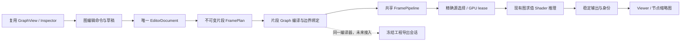

# 视频编辑器：渲染管线编辑器设计

## 1. 决策与状态

**状态：阶段 A 与首批原生Corrector（Primaries/HDR Zones）已接入；阶段 B–D及完整HDR输入/监视/输出仍为待评审方案。** 本文分别标识已实现边界与后续提案，不把FP16内部处理等同端到端HDR支持。

用户约束：**复用现有 OpenQuartz 节点编辑器；整体交互全面参考 DaVinci Resolve。** 不另写 Color 页专用画布，不复制原图应用控制器，不把 OpenQuartz 节点强行改成 Resolve 的 RGB/key 节点，也不引入 Qt、MLT 或第二个渲染引擎。

产品入口：视频编辑器内的 **Edit / Nodes** 两个工作区；中文名称为“剪辑 / 管线”。Nodes 是片段级渲染工作区，不是另开一个 `.quartz.json` 工程。时间轴、文档、撤销历史和 GPU Device/Queue 始终相同。

交互借鉴 Resolve Color 页：Viewer、Nodes、片段缩略条、mini-timeline、底部参数面板、效果库、对比与旁路。算法与端口继续采用 OpenQuartz 定义；界面相似不构成 Resolve 色彩科学、Parallel Mixer、OpenFX、跟踪、HDR 或调色精度对等承诺。

## 2. 源码核对与复用边界

| 当前依据 | 已有能力 | 本功能必须补齐 |
|---|---|---|
| `apps/open_quartz_slint/ui/components/graph_view.slint` | GraphNode/GraphEdge/GraphPort、节点拖动、端口连接、选区、缩放、Fit、缩略图 | 工作区宿主、深色主题参数、上下文菜单、串行插入/删除、节点旁路与状态 |
| `apps/open_quartz_slint/src/graph_view_model.rs`、`graph_clipboard.rs` | 节点投影、复制子图与ID重建逻辑 | 从原app的Project/选区/播放器所有权解耦；时间线文档作为唯一提交者 |
| `ui/components/inspector.slint`、`inspector_forms.rs`、`inspector_inference.rs`、`crates/slint_code_editor` | 类型化参数表单、Shader编辑、推理配置UI | 节点参数面板可嵌入布局、字段能力过滤、编辑事务适配，不新建第二套参数解释器 |
| `crates/open_quartz/src/project/model/node.rs`、`node_factory.rs`、`catalog.rs` | Graph及现有节点/端口/工厂/目录 | 片段边界绑定、允许节点策略、版本及颜色说明 |
| `apps/open_quartz_video_editor/src/document.rs` | schema1、ClipTransform、精确源入点、全工程事务与100条历史 | 片段持有Graph、schema2迁移、图命令、版本/复制规则 |
| `apps/open_quartz_video_editor/src/preview.rs:132–159` | 每帧意图生成固定 `video → Program Shader` 图 | 将片段图编译成核心Graph；保留现有contain-fit、变换和旧曝光语义 |
| 同文件 `run` | 同Device流水、prepare/commit、请求替换与稳定帧 | 图/参数/资源身份拆分，调图不重复打开视频；图内时间与源时间分离 |
| `execution/pipeline.rs` | prepare_graph、commit_graph、ExternalFrameInput、输出订阅 | 不承诺现有commit全面回滚：其后段仍有可失败的推理同步/视频同步；扩展图原子激活契约 |
| `execution/export.rs` | 无时钟硬件ExportJob | **没有视频编辑器多片段/效果导出UI闭环**；未来复用同一编译器，不能直接声称调用即可导出时间线 |

Slint GraphView/Inspector当前引用原app的浅色Theme；复用必须向组件注入颜色/宿主策略，而不是在视频编辑器复制一份文件改颜色。先在现有源码中抽出被两个真实消费者调用的组件/纯投影，必要时集中到同一个共享UI目录；不为本功能拆分渲染crate。

## 3. 达芬奇交互映射

主要参考 [Resolve Color官方介绍][resolve-color] 以及 [Resolve 20 Colorist Guide][resolve-guide] 的 Interface Review、Lesson 5/6/7。下表“目标”是本设计的产品范围，不代表本轮已具备全部功能。

| Resolve操作心智 | OpenQuartz对应设计 | 实现边界 |
|---|---|---|
| Color页工作区切换、可收起面板 | Edit / Nodes；左侧Media / Nodes标签共享素材库与节点目录；Viewer、Graph、统一右侧属性面板 | 同一窗口；页切换不另起播放器，不改变工程 |
| 点击片段缩略条进入该镜头 | 按时间轴顺序列出**片段实例**；Nodes图上方紧凑条可切clip，同素材多次使用显示多个实例 | 点击选择clip并定位到该片段，不编辑asset全局效果 |
| mini-timeline与片段范围 | Nodes页显示图上方clip条；完整时间轴持续在下方，同一播放头/帧映射 | 不建立第二套时间坐标 |
| 点击节点切换参数 | 单击GraphNode，右侧统一属性侧栏显示现有Inspector表单；Edit页同侧栏显示Clip属性 | 单击节点默认仍看最终片段输出，不自动改节目输出 |
| 输出端拖至输入端 | 保留GraphView现有拖线/点端口连接；增加兼容端口提示 | OpenQuartz类型验证；不能只按连线颜色接受输入 |
| 节点拖到线中插入 | 合法主图像路径悬停高亮，松手原子插入；Esc取消 | 只支持具备明确主image-in/out的节点；复杂节点打开连接选择，不猜端口 |
| Add Serial Before/After | 节点右键和工具栏菜单；选中模板后自动接线 | 自定义Shader串行命令默认创建具名image输入的pass-through模板 |
| 拖动节点布局、框选、缩放、Fit | 继续使用GraphView；补Resolve式中键平移及触控板等价操作 | 节点位置不影响执行顺序；布局不触发GPU重编 |
| Node Label、序号、缩略图开关 | 编号仅作显示，稳定NodeId作身份；保留名称编辑与缩略图展开 | 编号不作为连线/持久化引用 |
| 节点启用/禁用、全部旁路 | 节点持久化enabled；Viewer整体旁路仅用于比较 | 多输出/改变类型的节点不能隐式旁路，须有明确bypass映射 |
| 前后wipe、选中节点查看 | Viewer Final / Selected node / Before，以及可拖分隔线的Before/After | Viewer模式不会改变工程输出节点；Before保留同一时间、尺寸和变换 |
| 复制/应用grade、Gallery still | 复制图/参数、替换或追加到目标片段；抓取参考帧及管线快照 | 克隆而非隐式联动；覆盖前明确Replace/Append，不把中键误触变成静默批量覆盖 |
| Local Versions | 每片段命名版本、复制/切换、重命名 | 非活动版本也保存；切换是可撤销工程操作 |
| Parallel / Layer Mixer | 现有分支与Blend节点可手动构图；后续增加操作快捷入口 | 不将普通Blend命名为Resolve Parallel Mixer；两种算法不同 |
| Groups Pre/Post、Timeline级 | 后续作用域入口及明确的执行顺序 | 首个闭环只开放Clip；未实现的作用域不画成可点击空菜单 |
| Qualifier、Power Windows、Tracking、Scopes | 作为后续真实节点/工具能力接入同一参数区 | 不用无实现的色轮、曲线、示波器或跟踪按钮装饰界面 |

### 3.1 布局

1440×900建议布局。左侧媒体/节点目录用互斥标签切换；Nodes的效果按类别以双列方形图标卡片呈现。右侧节点Inspector复用Edit页片段属性侧栏，不与节点选择区争夺横向空间。

```svg
<svg xmlns="http://www.w3.org/2000/svg" viewBox="0 0 960 580">
  <g fill="none" stroke="var(--border)" stroke-width="1">
    <rect x="1" y="1" width="958" height="578" rx="7"/>
    <path d="M1 49H959 M1 87H959 M1 386H959 M1 430H959 M170 87V386 M410 87V386 M740 87V386"/>
    <rect x="185" y="110" width="210" height="202" rx="3"/>
    <rect x="425" y="124" width="70" height="48" rx="4"/><rect x="510" y="124" width="70" height="48" rx="4"/>
    <rect x="430" y="198" width="26" height="36" rx="3"/><rect x="500" y="188" width="72" height="58" rx="4"/><rect x="610" y="188" width="26" height="36" rx="3"/>
    <rect x="755" y="112" width="190" height="245" rx="4"/>
    <rect x="16" y="453" width="928" height="104" rx="3"/>
    <path d="M456 216H500 M572 216H610" stroke="var(--accent)" stroke-width="2"/>
  </g>
  <g fill="currentColor" font-family="sans-serif" font-size="13">
    <text x="18" y="31">OPENQUARTZ STUDIO</text><text x="370" y="31">Edit  /  Nodes</text>
    <text x="14" y="73">Media  |  Nodes</text><text x="185" y="73">Viewer</text><text x="425" y="73">Clip strip + Graph</text><text x="755" y="73">Properties</text>
    <text x="20" y="111">COLOR</text><text x="23" y="144">[◉] Invert</text><text x="93" y="144">[◉] Grade</text>
    <text x="23" y="184">[▧] Filter</text><text x="93" y="184">[◇] Distort</text>
    <text x="23" y="224">[ƒx] Custom</text><text x="23" y="270">grouped square tiles</text>
    <text x="220" y="215">Actual GPU viewer</text><text x="430" y="154">clip A</text><text x="515" y="154">clip B</text>
    <text x="500" y="221">Nodes graph</text><text x="775" y="116">Node Inspector</text><text x="775" y="143">Same sidebar slot</text>
    <text x="20" y="477">Full timeline</text><text x="20" y="505">Single project history</text><text x="18" y="572">Status · frame time · GPU path</text>
  </g>
</svg>
```

### 3.2 片段、播放头与编辑目标

- `activeClipId`是图编辑目标；`selectedNodeIds`是该图的节点选择。两者不能借用当前`selected_asset`推导。
- 从Edit进入Nodes：优先进入选中clip；若播放头不在其范围内，暂停并定位片段首帧；无选择则进入播放头所在片段。空隙显示黑色/无活动片段，不把前一片段的参数误应用到空隙。
- 点击片段条暂停、切换目标；若播放头已在该clip内保留帧，否则定位首帧。同asset的两个clip各自持有管线。
- 连续播放跨切点时，默认节点区跟随当前clip；首个参数拖动或图编辑动作暂停播放并锁定本次目标。不能在手指未松开时把参数提交给下一镜头。
- 切换工作区、节点选择、查看中间输出、Viewer wipe、面板尺寸/视口不写内容历史。切换片段先完成或取消当前编辑事务；Shader未提交草稿按clip/node保留，并显示明确状态。
- 单击节点只改变Inspector；右键“View selected node”显式切换中间预览，Viewer持续标注Node名称和“非最终输出”。同一帧节点缩略图不可显示来自另一clip的旧结果。

### 3.3 快捷键与焦点

Nodes工作区采用Resolve习惯，保留菜单等价入口与触控板路径：

| 快捷键 | 行为 | 适用焦点 |
|---|---|---|
| Option/Alt+S | 在选中节点后添加串行节点 | 节点画布 |
| Shift+S | 在选中节点前添加串行节点 | 节点画布 |
| Cmd/Ctrl+D | 持久化切换选中节点启用 | 节点画布；不是复制节点 |
| Shift+D | 临时切换整个用户管线旁路对比 | 非文字编辑区 |
| Cmd/Ctrl+C、V | 复制/粘贴选中子图 | 节点画布；文字区仍是文字剪贴板 |
| Delete/Backspace | 删除选中节点或连线 | 节点画布；时间轴仍lift片段 |
| Cmd/Ctrl+Z、Shift+Z | 工程级撤销/重做 | 非文字编辑区 |
| Space、←/→ | 播放/暂停与序列帧步进 | 非文字编辑区 |
| Esc | 取消当前连线/拖动/参数草稿或退出比较模式 | 最内层活动交互优先 |

原图app的快捷键默认不被视频编辑器策略覆盖。与Resolve不同，本应用保留**一个工程级撤销历史**，避免切片段后撤销找不到刚才的修改；界面显示动作与clip名称。不照搬Resolve共享节点不可撤销的例外。

## 4. 管线模型：复用Graph，不复制节点定义

### 4.1 作用域与边界

第一交付的每个clip拥有自己的管线；asset只保存媒体事实。新片段为直通：`Clip source → Clip output`。两端是宿主管理的现有核心节点投影，不创建新的SDK NodeType：

- Clip source：绑定本片段asset及精确源时间；不可删除、复制或修改文件路径。每次FramePlan决定来源，图中不另开自由运行播放器。
- 用户节点：现有Shader/Constant/Math及经过审核的catalog effects；使用现有端口和Shader解析结果。
- Clip output：唯一受保护的片段出口，接收一张图像，应用当前`ClipTransform`和contain-fit，再输出序列画布尺寸。不让多个Renderer窗口成为多个节目输出。
- 预览中间节点只改变需求的观察目标，不重接用户图、不改变持久化出口。

节点图先在源尺寸域处理，Clip output负责画布适配。改变尺寸的节点必须报告实际输出尺寸；出口按**上游实际尺寸**重新contain-fit，不能仍按原asset尺寸计算。预览和以后导出使用相同规则。

保留现有`ClipTransform`为出口配置唯一事实源，包括既有曝光字段；不在迁移时悄悄改其公式、clamp、采样顺序或alpha。新曝光节点是用户选择的新效果，不再写入出口的旧曝光字段。旧工程直通图必须逐像素等价于当前实现。

### 4.2 持久化草案（不是现有API）

`schema_version=2`，`Clip`增加`pipeline`。其内部数据结构采用以下职责，不再定义一份nodes/edges JSON协议：

| 字段 | 内容 |
|---|---|
| pipeline.version | 管线容器/编译策略版本 |
| pipeline.active_version_id | 当前管线版本ID |
| pipeline.versions[] | 稳定versionId、名称、`graph: open_quartz::Graph`、受保护source/output绑定、节点启用/旁路映射元数据 |
| 既有Clip.transform | 出口的空间/旧曝光设置；单一来源，不复制到graph.uniforms |
| Clip.effect_time_offset | 有符号有理数秒；split/trim保持效果连续，详见§6；不复制到asset |
| 编辑器视图状态 | clip/version独立的画布视口、节点选区、查看目标、面板尺寸；不参与渲染hash |

第一阶段可只有一个命名版本，但格式应允许后续版本管理。Graph中已有的节点位置按现有序列化保存；内容hash显式排除位置和label，独立layout revision处理拖动。禁止把wgpu纹理、编译结果、推理session、解码器、原生窗口句柄放进工程。

schema1读取时构造等价直通管线，保存仅写schema2；保留读取迁移，不保留双写和两套渲染路线。未知schema、节点实现版本或不支持的资源类型明确拒绝，不丢节点后保存“成功”。

资源绑定不从`Graph`中的任意文件字符串直接打开。Clip source只引用既有assetId；以后允许的外部image/model资源通过工程资源表及节点绑定保存，相对路径、内容身份和重定位遵守现有资产规则。复制图时同时复制资源引用但不复制解码/推理句柄；资源缺失阻止该图激活并定位节点，不以空纹理替代。首交付不开放自由媒体节点，因此无需伪造多源时间同步。

### 4.3 编辑/复制规则

- split：两个片段得到值相等但独立的管线副本；右片段源入点仍用当前精确tick/subtick算法。后续一边改图不影响另一边。
- move/trim：不改变管线内容；每个节点内的时间按§6定义，避免移动clip后动画跳动。
- Copy pipeline：复制用户图、静态参数与启用状态，不复制asset、源时间、空间变换、UI选择或GPU缓存；粘贴后使用目标clip的边界绑定。
- Replace：一次原子替换用户图；Append：只允许明确单image入口/出口的子图，接入出口之前。多入口子图必须让用户绑定，不自动选第一端口。
- Gallery still包含参考像素身份和用户图快照；应用为复制，不是共享可变对象。版本复制和选择都可撤销。
- 节点删除只有在主图像入口/出口唯一且类型兼容时可自动桥接；普通“断开并删除”仍保留，结果进入待连接草稿。分支/多输出删除不猜测合成顺序。

## 5. 文档事务与运行图激活

复用`EditorDocument::transact_at`，不得在嵌入的`open_quartz::Project`里再维护一套可保存历史。SDK Project若用于命令验证只能是短命候选/适配器；最终状态只进EditorDocument。

两种状态分开：

1. **Graph draft**：拖线未结束、未连接新节点、Shader语法错误、参数输入未确认。可显示错误和最后有效帧；不写正式工程、保存及导出不消费未提交草稿。保存前明确提示Apply/Discard/Cancel，不能静默漏存。
2. **Committed recipe**：验证通过的工程内容。预览工作线程准备/激活所需图，执行错误不回写工程；画面继续保留上一稳定帧并明确“旧帧/当前管线失败”。

普通参数滑动遵循Resolve的即时反馈：拖动期间合并最新候选，反馈不要求点击Apply；松手提交一次历史，Esc恢复原值。文本参数Enter/失焦提交合法值；源码保留显式Compile/Apply，因为不完整源码不能宣称可执行。快速连续修改只让最新候选有发布资格。

图拓扑/源码prepare成功后，按`clipId + versionId + expectedDocumentRevision + draftGeneration`提交。用户已切片段/撤销/重开则丢弃准备结果并释放资源。节点坐标拖动一次一条布局历史，不准备GPU图、不重开媒体。

核心`commit_graph`必须先把所有可失败阶段准备好，或提供完整回滚；现实现于session/render提交之后仍调用可失败的inference/video同步，不能把“prepare成功”等同真正原子激活。先修此契约再允许编辑器依赖“失败保持旧图”。

节点持久化enabled通过编译器按显式映射降低为直通连线，不执行该节点：仅主image输入/输出匹配的节点默认允许。源/出口、生成器、类型转换、多输出推理或Mixer没有可证明等价映射时不提供盲目Disable。Viewer全局旁路仅跳过用户效果，保留来源、源时间、出口变换/尺寸；这是显示比较，不污染保存内容或导出。

## 6. 执行与时间契约



### 6.1 时间不能混用

当前preview把`request.source_ns`传给`FrameStamp.timeline_ns`，对固定无动画图足够，但加System Time/Frame节点后会把素材PTS误当片段时间。

新FramePlan同时保存：`sequenceFrame/sequenceTime`、`clipLocalFrame/clipLocalTime`、`sourceTargetPts/timeBase`、实际解码PTS，以及独立`effectTime`。效果时间默认为片段放置时的0起点，但不直接等同当前clip-local：Clip持久化`effectTimeOffset`（有符号有理数秒），`effectTime = effectTimeOffset + clipLocalTime`；Time节点用该值，Frame节点用序列fps精确换算的向下取整帧值。split右片段offset加切点相对时长，trim-start同样按新旧入点差调整，move不改offset；因此单纯拆分/修剪/移动不会意外重启动画。该字段在schema2迁移及所有相关命令中一并更新，不借源PTS代替效果时间。

现有原生视频准备按`demand.input.stamp.timeline_ns`取帧。必须在核心需求中分离**逐源采样时间**和**效果求值时间**，或复用真正已准备的ExternalFrameInput注入。优先在共享流水内增加明确的逐源时间映射，不在UI线程另建解码循环。新增接口保持现有NativePlayer的默认同时间行为；不能更改全局FrameStamp含义而让原图app动画回归。

### 6.2 缓存与资源

- 不再使用当前`asset + width/height + ClipTransform`单一configured key。分别维护资源身份、拓扑/源码hash、参数hash、frame内容身份、显示target；仅参数变化不得stage_video重开文件。
- 同asset/clip切换仍校验指纹、stream、源epoch；回退seek使用现有精确游标，不把播放状态作为效果时间。
- Frame结果关联document revision、clip/version、recipe hash、draft generation、求值时刻、源PTS、输出target及规格。相同请求ID不代表相同图；跨clip迟到结果只能释放不能覆盖画面。
- Viewer、选中节点和缩略图来自同次帧图执行；优先最终输出，再选中节点，再可见缩略图。隐藏节点不持续抓帧；不得为每个缩略图重跑一次完整视频图。
- GPU纹理直接给Slint，消费者持有稳定lease。保留有界队列/预算/回收；比较模式最多增加明确受预算控制的参考帧，不借“对比”无限缓存整段。
- Before/After比较通过同源帧的两个观察分支（用户处理/直通）产生结果，共享解码和上游资源；Viewer wipe仅在UI消费已配对的同帧稳定输出。Selected node按节点真实尺寸显示并明确其颜色解释；若用于对比，先经过同一显示/尺寸适配，不把不同尺寸或不同源PTS的图直接当作前后对比。
- 未提交GPU工作可取消；已提交只撤销发布资格并等待真实完成，不提前释放。复杂图或AI未达实时显示状态，不偷偷用上一帧mask。
- 首交付排除Feedback、依赖wall-clock/mouse的System源和其他隐含历史节点；它们在任意seek和离线重放尚无本功能确定性契约。显式Time/Frame节点待时间拆分完成才开放。

#### 6.2.1 播放调度：单轨窗口已接入

**当前已实现**：视频宿主Play提交工程snapshot，preview worker持有唯一时钟，复用核心`submit_window`进行有界前瞻、prefill、deadline呈现和clip/gap预热。旧controller逐tick/single-flight播放路径已删除，正常时钟不撤销合法在途帧；Exact/seek/草稿走同一worker的最新意图取消政策，暂停锁定精确位置。帧metadata/ready与核心admission共同受host高水位约束，不逐node或逐palette建队列。

详细契约与8K实测在[编辑器设计§9.1](DESIGN.md#bounded-playback-proposal)。序列deadline与素材source PTS映射分离；Corrector颜色/alpha、片段隔离和精确定位不随调度改变，不新增渲染器、不降低预览质量。全尺寸工作集采用明确的共享/局部预算，过载时统计late/drop而不减慢主时钟；多轨、音频和编辑器离线导出仍未实现。

多级node的queue/纹理/lease区分见[§9.3.1阶段边界契约](DESIGN.md#stage-queues-resource-lifetimes)；分支与未来track出口的就绪/背压/取消见[§9.3.2同序列帧join](DESIGN.md#same-frame-track-join)。使用同图依赖优先，不将每个palette、node或track展开成独立队列/播放器；未来多轨的独立验收不阻塞当前单轨流水迁移。


### 6.3 参数关键帧提案（未实现）

Resolve Color 的关键帧不是另一套图：关键帧在现有节点/调色参数上生效，Keyframe Editor 可按节点和参数组显示轨道；All/Color/Sizing 是批量作用范围，Dynamic 插值和 Static 瞬时切换是两种编辑语义。OpenQuartz可借鉴“参数属于明确轨道、编辑作用域可见、时间线上可定位”的心智，不需要复制 Resolve 的全部 keyframe panel、调色参数组或控制台行为。

**建议拆小交付，不作为下一个大阶段一次实现：**

1. **K0：先冻结时间语义**。动画默认锚定片段局部编辑时间（clip-local），与解码源 PTS 分开。节点参数键为稳定的 `(clipId, nodeId, parameterPath)`，时间和值使用精确有理数/已有类型；评估时间必须来自确定的序列帧映射，不用播放 wall-clock。move 不改变动画；trim/split 的边界策略、右片段 keyframe 移交规则必须在 schema 前定，不能仅靠 `effectTimeOffset` 暗中平移所有参数动画。
2. **K1：仅动态关键帧最小闭环**。给现有可编辑的有限数值参数（标量/向量）提供 keyframe add/update/delete、前后跳转及相邻 keyframe 之间线性插值；Inspector 在已有关键帧处编辑即改该点，不在其他帧改图基线；当前帧无关键帧时，显式 Add Keyframe 才创建。参数默认值作为片段首帧前基线。先不做 Auto-Keyframe、Bezier/ease 曲线、静态关键帧、键帧编辑器任意拖拽、多选、Bool/Enum/结构体/Shader 源动画。
3. **K2：可用的关键帧编辑体验**。增加按节点/参数路径折叠的时间轨道、当前帧指示、选择/移动/删除关键帧、关键帧导航；支持单次拖动单个历史事务，缩放和滚动沿用序列帧坐标。不先做 Resolve 式 All 模式批量打点或曲线手柄。
4. **K3：再评审扩展**。只有 K1/K2 被实际使用并稳定后，单独决定自动打点、离散 Step（Bool/Enum/突变值）、缓入缓出曲线或更丰富曲线编辑；不同插值不能默认为所有类型都适用。

关键约束：关键帧只是参数求值，不是时间节点，不改变 Graph 拓扑；不对 Shader 源码、端口/资源选择或节点增删做动画。所有 track 先限定在 Clip 域，不能沿用 Source PTS 当 keyframe 时间。无效类型、非有限数值、越界/不可编辑属性应拒绝而不损坏图。未选中节点/参数不得被全局“加关键帧”悄悄创建大量轨道。

持久化方案暂定为 clip pipeline 外的版本化 `animation_tracks`：轨道使用稳定node id + 参数路径，不复制节点状态快照；未知轨道版本/参数类型明确拒绝或按 schema 策略处理。undo/redo 对一次打点、移点、删点各产生一个工程历史事务。GPU候选帧的身份需包括 clip、document revision、track/value revision、序列帧和 source PTS；快速scrub或切片段时迟到渲染不能覆盖当前帧。预览与未来离线导出调用同一个纯参数求值函数。

K1 验收：有已知数值动画的真实片段逐帧 seek 与连续播放在同一序列帧给出相同值/像素；首尾、负/有理帧率、精确关键帧命中、片段边界、scrub倒退、切clip、undo/redo、save/reopen、split/trim/move以及迟到GPU结果都有确定测试。至少用一个非交换视觉效果和独立CPU数值oracle验证插值；关闭/没有轨道的旧项目像素保持不变。K2另验收keyframe拖动边界、同帧多轨、取消、焦点快捷键隔离及一动作一历史。

## 7. 颜色、Alpha与节点能力

这是现有渲染图的编辑入口，不把目录中的`Color`分类等同专业调色引擎。

**当前实现状态（非目标方案）**：素材入口仍为`legacy_sdr`；`oq-media`虽可取得部分P010硬件表面，解码公开色彩模型目前只覆盖BT.709/sRGB与BT.470BG一类SDR输入，PQ/HLG明确拒绝；视频宿主导入即转换为SDR编码RGB。原生Corrector在显式sRGB兼容转换后使用scene-linear AP1 `Rgba16Float`，保持负值/超白与straight alpha；Corrector链不重复解码。Renderer/Slint预览显式转换至8-bit SDR，旧Shader保持encoded-space语义。现有macOS编码surface/配置仍为NV12/8-bit、BT.709 tags。**FP16内部调色已实现，但不支持HDR输入工作流、HDR桌面监视或HDR导出；Sony Log和完整managed project模式仍未实现。**

旧工程继续走`legacy_sdr`：保留已有encoded-space Shader行为、clamp、输出格式和像素一致性。Managed HDR是显式工程模式，不允许把历史Rgba8数值默认为线性值或自动重解释旧Shader。

| 类别 | Managed mode规则 |
|---|---|
| 单image Shader/Filter/Color catalog | 输入/输出约定为场景线性working RGB及明确alpha；必须移除中间sRGB clamp或明确保留其旧域变体 |
| Math/Constant | 保留类型端口；线性光数值，不按显示RGB处理；NaN/Inf/维度错误拒绝 |
| Blend/Mask | 明确A/B/mask、working domain、straight/premultiplied约定；线性光合成与mask alpha oracle |
| 自定义Shader | 按project color mode标注接口；managed shader不得被legacy项目静默重解释；仅最终view/output transform允许tone/gamut mapping |
| Inference | 模型输入色彩/量化转换需显式记入节点配置；输出重新标注domain，不凭tensor形状猜HDR编码 |
| 自由Video/Camera/Renderer窗口 | 不作为首期节点开放；避免第二时钟、越过片段边界取帧或弹额外节目窗口 |

视频编辑器当前Cargo仅启用核心native-runtime/native-video，尚未接入原图app的完整推理配置/模型资源链路。阶段C须连同必要feature、模型资源准备、typed端口与预算/错误生命周期一起迁移到共享宿主适配。

### 7.1 目标、参照与明确承诺

这是一套从素材解释到编码文件的色彩管线，不是“支持P010”或给文件加HDR标签。产品目标：正确解释常见SDR/HDR视频及首批Sony S-Log录制视频；所有managed节点在浮点HDR工作域计算；SDR桌面预览保持可看；具备能力时提供可验证HDR桌面/参考监视；实际硬件可编码时导出SDR、HDR10/PQ和后续HLG。像素位深、信号传递函数、工作域、显示能力和编码profile分别探测、分别报告。

**评审结论（已同意）**：working space选**ACEScg/AP1线性**；首发平台macOS Apple Silicon；先做PQ/HDR10 10-bit文件输出，HLG与HDR桌面EDR分开后续推进；首批相机Log只做Sony；RAW不纳入本设计实施阶段，单独评审。HDR-0仍需锁定实现版本、数值精度、变换oracle与metadata细节，不再重新比较/选择working-space家族。

Resolve参考Input Space→统一宽色域工作空间→Output/Display Transform工作流；Resolve DWG/Intermediate是工作流参照，不声称兼容。[Blackmagic说明][resolve-wide-gamut]。ACEScg采用AP1 primaries/ACES white、线性场景曝光值及16/32-bit浮点；工作域保留负值和大于1的值，不对内部中间值clamp。逐项转换与working-space schema version锁定见[ACES规范][acescg]。

**HDR计划输出**：第一种HDR文件目标是BT.2020 primaries + SMPTE ST 2084 PQ + 10-bit HEVC Main10 / MP4或MOV HDR10静态metadata；HLG/BT.2020是之后的独立输出profile，不能把HDR10 metadata贴到HLG。ITU-R BT.2100定义PQ/HLG系统；ST 2086与CTA HDR Static Metadata定义使用的metadata。HDR10+动态metadata、Dolby Vision profile/授权/动态metadata暂不承诺。按目标硬件实际探测encoder/profile/bit depth/mux；不支持时拒绝该profile，绝不降8-bit SDR却保留HDR标签。[ITU-R BT.2100][bt2100] [SMPTE ST 2086][st2086] [CTA-861.3][cta8613]。

### 7.2 每个素材的输入色彩解释

文件像素和解码帧需暴露分开的metadata：pixel format/实际sample depth、YUV matrix、range、chroma location、RGB primaries/white point、transfer、HDR mastering display metadata（SMPTE ST 2086）、MaxCLL/MaxFALL（CTA HDR static metadata）、codec/profile及metadata来源/assumed/conflict状态。P010是10-bit存储格式，不等于HDR；BT.2020标签也不等于PQ。PQ/HLG信号、容器codec profile与metadata不匹配时不静默猜测。HDR10+ / Dolby Vision等dynamic metadata首期不参与转换；若基础层不具备独立可解释的已验收profile，则拒绝或请求确认。

素材库提供**Auto (metadata)**、常见SDR/HDR视频preset、Sony Log preset及Manual override；只读metadata摘要标出位深和各字段来源。首批内置Sony video Log profile为：**S-Log3 / S-Gamut3.Cine、S-Log3 / S-Gamut3、S-Log2 / S-Gamut**，按素材真实Picture Profile选择；三个配对不能混成单一“S-Log”曲线。仅当文件/相机metadata足以确认组合时Auto选择，否则用户明确选择。Preset需版本化、有公开定义或授权transform、camera sample及独立灰卡/色卡oracle；Sony gamut/Log配对以Sony文档为准。[Sony Gamut说明][sony-gamut] [Sony Gamma/Color Mode说明][sony-gamma]。

可覆写primaries/white point、transfer、matrix、range、chroma location、reference white/mastering peak及IDT；单字段override可恢复Auto并显示来源徽标。IDT用于源还原；creative look LUT是图中的独立Look操作，需声明输入/输出domain、LUT尺寸/shaper/插值和license，不能代替metadata解释。首批不含其他厂商Log、Sony S-Cinetone/Cine presets或相机RAW；RAW解码、去马赛克、相机metadata与RAW颜色管线另开方案评审。

优先序：实际解码帧/bitstream metadata解释信号；容器metadata用于补缺；用户明确override最高且显徽标。逐字段记录来源/冲突。Auto的关键字段缺失/矛盾时用显式fallback并标`assumed`；PQ/HLG/HDR关键传递函数未知则暂停请求确认，不猜PQ。允许10-bit SDR经普通SDR profile处理；异常标签仅在用户override后接受。绝不根据“10-bit”本身推断HDR。


### 7.3 工作域、像素格式与alpha

新增project color config（versioned）：`legacy_sdr`或`managed`、working space ID/version、scene reference convention、alpha convention、显示view默认值及timeline/output profile。新建项目可选择SDR或HDR mastering intent；导入HDR素材不会擅自改变已有项目mastering intent。旧schema迁移固定为`legacy_sdr`，维持当前RGBA8/BT.709→sRGB、旧Shader/clamp及像素；“切到managed”是明确项目事务并展示外观可能改变，永不静默重解释旧图。

Managed mode的所有节点端口传递**场景线性AP1、浮点、straight alpha输入/输出契约**；合成前统一转premultiplied进行混合，结果再显式转回端口约定；遮罩端口语义独立声明。所有Color/Filter/Distortion/Blend/custom Shader改为在这个域内计算，禁止默认`clamp(rgb,0,1)`、对负值/高光截断或在中间节点烘焙显示变换。WGSL `f32`本身不决定texture格式；渲染目标采用可探测`Rgba16Float`作为基线HDR工作纹理，高精度/部分运算可选RGBA32Float，依据实际usage/features/预算选择。FP16有限范围、负数/亚黑、精度、NaN/Inf统一规则必须测试。设备不支持所需render/sample/filter用途时明确拒绝Managed HDR，允许用户另存/转换为Legacy SDR，不隐式退化到Rgba8。每个节点计划声明input/output color domain/alpha；DisplayTransform只能位于viewer/export边界。

输入适配：YUV range/matrix/chroma reconstruction → 解码transfer（BT.1886/BT.709/sRGB、PQ/ST 2084、HLG OETF及明确的HLG OOTF/system gamma）→ linear light → primaries/white-point变换 → managed working space。PQ按绝对亮度解释；reference white、mastering peak和paper white是独立参数。提出默认HDR diffuse/reference white为203 cd/m²，项目和输出view可显式改值；该数值是ITU HDR制作指导中的名义参考白，不是所有内容的硬限制。HLG按目标显示system gamma/峰值解释；仅逆OETF不是完整HLG显示变换。SDR/display-referred输入参考白由输入preset明定，不把其100%信号当无限场景高光；Log输入经版本化IDT恢复场景相对光。[ITU-R BT.2408-9][bt2408]。变换数学、量化点及边界编码均版本化。

### 7.4 Resolve式工作流和显示变换

- **Input**：每素材Input Color面板，Auto/preset/manual；提供metadata inspector和source->working transform预览。
- **Timeline working**：每个项目一个managed working space；节点图只处理working values。节点旁Inspector显示当前工作域、值域/单位和是否有负值/超参考白值；不模拟不存在的色轮。
- **Display/View**：viewer view transform与导出transform分离。SDR屏幕用经指定view/look的SDR输出变换；HDR桌面只在Slint/WGPU/native window实际支持EDR/合适surface时启用，并将extended linear values映射至显示headroom。支持的display peak、EDR headroom、paper white与profile显示在状态/设置。多屏按当前承载viewer的屏幕能力刷新；能力消失时明确切到SDR view，不改工程/导出intent。
- **Reference monitoring**：桌面EDR不自动等于色彩参考监视。专业母版需校准参考显示器、受控输出路径及实测峰值/黑位；若无这些能力，UI标为“系统显示预览”，不能声称母版级色彩准确。Before/After和still都经同一个view transform，底层working图不变。
- 当前`slint::Image::try_from(wgpu::Texture)`路径实证/依赖约束为Rgba8Unorm类viewer surface；不能假定RGBA16Float可直接显示。实施HDR monitor前必须先验证Slint Metal renderer支持的HDR surface/presentation/color space；若Slint无对应公开接口，设计并评审一个窄的macOS EDR presenter/Slint integration seam，继续共享窗口/输入，无CPU image readback；不能伪装成普通Image有效显示。

### 7.5 HDR输出与导出
Output UI把**mastering/output target**和当前monitor view分离，首批明确提供：

- `SDR Rec.709 / BT.1886 / 100 cd/m²`：SDR gamut/transfer及limited-range或明确选定的编码range；
- `HDR10 PQ / BT.2020 / 10-bit HEVC Main10`：ST 2084输出变换；默认1000 cd/m² mastering target但可选经验证的目标峰值；
- `HLG / BT.2020 / 10-bit HEVC`：独立HLG OOTF/transfer及system peak配置；不写HDR10 static mastering tags来伪装HLG。

各Profile可设置output gamut、transfer、mastering peak/min luminance、diffuse/paper white、tone/gamut mapping look、signal range、chroma siting、bit depth、codec/profile/quality、目标surface及Hardware/CPU-transfer policy。标记“参考输出”和“兼容转换”：当working内容超出目标范围时，仅在最终output transform做roll-off/gamut compression，不在节点中clamp。PQ输出首选1000-nit BT.2020 HDR10 mastering target是提案默认，不代表素材/显示器真实峰值；可经用户选择设为其他实测target。

Mastering-display ST 2086必须代表实际用于mastering/用户明确填写的显示器参数；不可从源clip复制。MaxCLL/MaxFALL属于输出programme content statistics，不等同mastering-display metadata；优先通过最终output-transform后GPU统计得到，或用户明确提供声明值，无法计算时标为unknown/按容器规则省略，绝不捏造。界面区分测量/计算值与用户声明值。输出summary列出最终编码profile、transform版本、reference white、峰值、metadata来源和fallback。

渲染/导出顺序：冻结工程/资源/颜色profile → 确定性序列帧图 → 最终output transform恰好一次 → 10-bit YCbCr 4:2:0量化/range/chroma siting → P010或平台10-bit surface → 实际编码器 → MP4/MOV mux及bitstream/container metadata。Preview和export共用同一带版本output transform；monitor view可不同。保留PTS/DTS/reorder/drain、半开范围、取消/磁盘失败、目标原子提交及CPU transfer禁止策略。

编码器探测必须检查实际codec/profile/bit depth/pixel format、surface/device interop、颜色及static HDR metadata写入、mux支持，并在创建任务前呈现能力结果。整段输出后独立检查stream tags及bitstream VUI/SEI/mastering metadata/CLL并解码验证像素；不能只信文件扩展名/容器标签。P010输入可硬件解码、NV12 encoder可用，都不代表10-bit HDR编码可用。HDR profile不可用时禁用该profile并解释原因，不做silent 8-bit SDR fallback。

### 7.6 Schema、缓存与迁移

工程asset记录原始检测metadata的可复算摘要、用户输入override和preset版本；project记录managed/legacy模式、working-space及版本、timeline/display/export intents。工程引用外部LUT/IDT/OOTF时必须存明确文件路径/指纹，或将可分发许可的transform标识为仓内内建；文件缺失不得静默套默认LUT。输出文件metadata不代替可编辑工程色彩intent。

Frame/plan cache identity必须含input metadata/override+transform版本、working-space/profile版本、node graph revision、所有颜色参数、输出transform/view ID、surface format和display capability epoch；切换显示器view只使display target失效，不重解码/改变working graph。HDR纹理有独立字节预算；所有P010/Metal/Slint surfaces按真实GPU fence/lease释放，不能为viewer转换提前回收输入或制造永久双份全分辨率HDR帧。

### 7.7 分阶段实现与验收门

阶段 A已实现。HDR-0–HDR-4、B–D、C1–C4及关键帧K0–K3均为提案，非排期承诺。评审锁定了AP1、macOS首发、HDR10优先、Sony video Log、RAW另评；动画/关键帧暂缓。

| 阶段 | 提案交付 | 验收出口 |
|---|---|---|
| HDR-0 科学/格式基线 | 锁定ACEScg/AP1版本、精度、metadata precedence、alpha、PQ/HLG、HDR10 tags；涵盖Sony三种Log profile | Sony样片/灰卡/色卡与PQ/HLG值oracle；不改runtime |
| HDR-1 GPU工作域/输入 | RGBA16Float AP1；SDR/PQ/HLG及三种Sony Log输入、override UI、SDR monitor view | P010/NV12、transfer/range/gamut、Sony IDT、负值/>1/alpha、旧工程像素oracle |
| HDR-2 HDR10文件输出（优先） | PQ/BT.2020/10-bit HEVC Main10/P010和HDR10 static metadata；macOS Apple Silicon | VideoToolbox encoder/mux/profile实机探测、bitstream tags、解码、PTS/DTS与错误路径验收 |
| HDR-3 HLG文件输出（后续） | BT.2020/10-bit HLG独立profile | HLG OOTF/system peak和encoder/mux独立验收；不带PQ tags |
| HDR-4 HDR桌面监视（后续） | macOS EDR presentation seam、headroom和SDR/HDR view | 真EDR屏亮度/headroom、多屏/断连实测；截图不替代亮度证据 |

首发范围只有macOS Apple Silicon。Windows/Linux以后单独做实际decoder、GPU presenter、encoder矩阵；不跨平台推断支持。

### 7.8 Resolve 调色能力对照与节点路线（首批实现与后续提案）

Resolve Color page常见能力包括Primaries wheels/Log controls、HDR tonal-zone controls、Curves、RGB Mixer、Color Warper/ColorSlice、Qualifier/Power Windows/Tracking/Magic Mask、LUT浏览及Video Scopes。[Resolve Color][resolve-color] [Resolve Colorist Guide][resolve-guide]。这里修正OpenQuartz的节点模型：**不把每个palette拆成自由串行Graph node**。采用一个带内部固定stage顺序的复合 **Color Corrector** 节点；节点图只组织多个Corrector实例及其相邻的Filter/Blend/Mask等外部节点，Corrector内部工具通过统一Inspector的palette切换。这样保留Resolve的“一个Corrector包含多个调色工具”心智、固定求值顺序和一次图节点提交，也避免每个小工具都分配全分辨率中间buffer。

| Resolve工具族 | 当前OpenQuartz状态 | Corrector设计 / 决定 |
|---|---|---|
| Primaries / Color Wheels | 原生Corrector已接入共享Primaries参数、RGB色轮和数值入口；旧COLOR Shader目录保持原样 | **Corrector / Primaries palette**：Exposure stops、White Balance、Lift/Gamma/Gain/Offset、Contrast/Pivot、Saturation/Color Boost；core算法版本1固定顺序，不拆Graph节点，不声称Resolve算法对等 |
| HDR Palette | 原生Corrector使用FP16 AP1分区调色；名称不代表HDR媒体/显示/导出已交付 | **Corrector / HDR Zones palette**：Black/Shadow/Dark/Light/Highlight/Specular，range/pivot/falloff；作为内部stage，不作为独立节点 |
| Curves | 无连续曲线、RGB通道和Hue-vs调色 | **Corrector / Curves palette**：先Master、R/G/B；Hue-vs-Hue/Saturation/Luma延后。控制点属于Corrector持久化状态 |
| RGB Mixer | 无RGB cross-channel matrix / monochrome mixing | **Corrector / RGB Mixer palette**：3×3 channel mix、preserve-luma、monochrome；内部stage，不单独占图节点 |
| LUT / Look | 无文件LUT节点；Field Color Map是伪彩诊断效果 | **Corrector / Look palette**：1D shaper/3D LUT、domain、插值、文件指纹；作为Corrector最后的look stage，输入域不匹配时拒绝或要求显式CST |
| Color Warper / ColorSlice | 无网格/色相切片的perceptual hue-saturation remapping | **Corrector高级palette**，后续择一；网格/切片参数仍存于Corrector，不开放成自由串行节点 |
| Qualifier / Power Windows / Tracking / Magic Mask | 无typed mask输出/合成、时间跟踪及模型生命周期 | 首期作为Corrector内部Secondary palette；Qualifier/Window产生内部mask并作用于secondary grade。只有需要跨节点复用的mask才另行引入typed Mask node；Tracker依赖C1，Magic Mask依赖C3 |
| Video Scopes | 不是图节点；当前视频Editor无Scopes | 独立Viewer辅助面板，选择Final/Corrector stage观察working或display signal；不进入Graph执行链 |
| Input/Output CST、Camera IDT、HDR ODT | 属于工程色彩管理边界 | 不塞进Corrector默认stage；Input controls、project working space、Viewer/Export transform各自只有一个owner，显式CST另行标domain并防重复转换 |

**当前能力基线**：共享目录新增原生Color Corrector，配置存`NodeData.color_corrector`，不保存生成WGSL。原有7项COLOR Shader presets仍保留为Legacy效果，不自动迁移为Corrector palette；Brightness/Contrast的0.5中心与[0,1] clamp、Hue Rotate的HSV语义不变。

### 7.8.1 核心通用契约与视频宿主适配

**模型、lowering、更新分类、GPU变体缓存、Alias旁路与内部pass资源规则的唯一设计源为[OpenQuartz核心：结构化算子节点](../../docs/DESIGN.md#structured-operators)。** 这是通用机制，Corrector是首个真实消费者；不在视频app内另造Corrector参数协议、Shader生成器或GPU执行器。

Corrector在共享Graph内是具有typed配置的原生节点；内部stage顺序由core算法版本固定，按活动stage生成裁剪WGSL，不建palette子Graph，不使用任意Shader子节点的通用融合。数值/资源内容/结构变化由core判定并分别走参数快路、资源准备或变体准备；可证明符合端口/尺寸/domain/alpha契约的整体旁路lower为Alias。首批可融合pointwise段一次读取/写回；空间/邻域操作才按统一计划申请有界临时surface。不是每palette一个buffer，也不承诺所有工具必然单pass。

视频宿主只增加`clipId/version/nodeId + expected document revision + draft generation`目标上下文；core不认识clip。候选节点/资源/变体预检通过后，EditorDocument一次历史提交，预览发布同时检查clip目标和generation；split深拷贝配置/资源引用意图，GPU pipeline可共享、可变参数和像素输出不可串改。剪辑source PTS、Decoder与AP1 input/output transform不因Corrector参数拖动重建。失败/取消保留旧active图，并区分Inspector草稿与实际生效配置。

**`apps/open_quartz_slint`也必须支持同一节点**：创建、typed连线、专用Palette、GPU执行、旁路、复制/粘贴、历史及save/open；视频app不能成为唯一实现消费者。图应用使用Project历史，视频app使用EditorDocument历史，不共享/复制两套应用控制器。Legacy Shader与旧工程外观不自动迁移。

### 7.8.2 共享Corrector UI与交付边界

共享Palette、通用draft adapter、gesture提交/取消、focus/accessibility、Viewer工具及两应用验收的唯一设计源为[Slint：共享结构化算子编辑器](../../docs/SLINT_UI_REFACTOR.md#structured-operator-ui)。两应用使用同一CorrectorEditor和色轮/曲线/资源控件；视频app保留已认可的左侧Media/Nodes、中间Viewer/Graph和统一右侧Inspector布局。选node切换专用编辑器，不把Corrector配置当普通Uniform字符串表单，不让每个工具弹独立浮窗。

首批一个Corrector内实现Primaries/HDR Zones及独立enable/bypass/reset；Curves/RGB Mixer/Look、高级塑形与Secondary仍是后续方案，没有可用入口。切tab/折叠不改执行，Reset与bypass独立。当前只贯通了FP16 AP1算子域和显式SDR边界，不能将此标为HDR-1（PQ/HLG/Sony IDT）整体完成；HDR10输出优先级不变。两应用共用真实Palette与GPU链路。

## 8. 实施顺序与完整交付边界

阶段A及CG-1/CG-2的原生算子、FP16 AP1处理与共享编辑入口已实现；B–D、C1–C4、完整HDR-0–HDR-4、CG-3–CG-5和K0–K3仍为提案，非排期承诺。HDR产品范围见§7.1；节点grading范围见§7.8；动画/关键帧暂缓。

| 阶段 | 提案交付 | 进入条件 / 验收出口 |
|---|---|---|
| A：复用与片段图闭环（已实现） | 现有GraphView/Inspector复用；Edit/Nodes；片段图、schema2、工程历史、GPU预检和真实预览 | 已完成；红/蓝真实解码素材验证编辑、像素、片段隔离、失败保留和保存重开 |
| B：Resolve式高频操作 | 菜单/快捷键；拖线插入、重命名、删除桥接；持久化节点旁路和整图比较旁路；中间节点查看；Before/After wipe | 维持现有静态单图语义；证明事务一次提交、焦点隔离、同帧比较、原图app回归 |
| C1：时间与资源契约（后续） | 明确序列时间、源PTS、clip-local/effect时间、资源身份及图revision；为Time节点/动画和复杂异步资源做准备 | 跨切点、scrub、relink、undo与迟到GPU结果不串帧；不阻塞静态HDR色彩转换 |
| K0：关键帧时间语义 | 定义clip-local帧锚定、分割/修剪/移动规则、参数路径身份与schema位置；不做UI/动画 | C1契约通过；给出旧schema迁移、不变量与确定求值时刻 |
| K1：最小参数动画 | 现有有限数值标量/向量参数的显式打点、更新/删除、前后导航、相邻点线性插值；静态节点图，无Auto-Keyframe/曲线编辑 | 精确帧seek与播放像素一致；关键帧边界、split/trim/move、历史、持久化和迟到结果验收 |
| K2：关键帧编辑器 | 可折叠节点/参数轨道、选择/移动/删除关键帧；不先做Bezier手柄、全局All批量打点 | 一次拖动一条历史；缩放/滚动/取消/焦点及同帧多轨可预测 |
| K3：扩展关键帧语义（复评） | 依据K1/K2使用反馈，再决定Auto-Keyframe、离散Step、Bool/Enum或ease曲线 | 每种参数类型和插值明确定义并有数值/像素oracle；不把动态/静态等所有Resolve语义一次照搬 |
| C2：多输入图 | typed Blend/Mask等真实多输入节点、alpha约定及UI连线/预览 | 只做有明确端口/输出的算法；同帧mask像素oracle、错误类型拒绝、资源预算/生命周期通过 |
| C3：Inference节点接入 | 迁移视频宿主模型发现、设备选择、模型准备/释放、预算与错误呈现；只开放可验证的现有生产节点 | 不因核心库已有模型就假设可用；真实模型资源、失败、取消、设备丢失、切片段和GPU竞争完整闭环 |
| C4：版本与参考帧 | Clip Local Versions及Gallery still快照；Replace/Append明确操作 | 命名版本/快照持久化；切换是一条可撤销事务；跨片段复制深拷贝资源/图，失败保留目标 |
| HDR-0：规范与oracle | 锁定ACEScg/AP1版本/精度、input metadata precedence、alpha、PQ/HLG数学、HDR10 metadata；Sony S-Log3/S-Gamut3.Cine、S-Log3/S-Gamut3、S-Log2/S-Gamut三个IDT组合 | 锁定Sony公开profile、camera sample、灰卡/色卡及PQ/HLG known-value oracle；不改运行时行为 |
| HDR-1：managed输入与GPU图 | AP1线性RGBA16Float图目标；SDR/PQ/HLG和上列Sony Log视频输入；override控件及SDR monitor view | P010/NV12、transfer/range/gamut、Sony IDT、>1/负值/alpha及legacy项目像素oracle；无能力的设备明确拒绝 |
| HDR-2：HDR10文件输出（优先） | 视频编辑器单轨序列输出闭环；profile选PQ/BT.2020/10-bit HEVC Main10/P010及HDR10 static metadata；macOS Apple Silicon首发 | 实际VideoToolbox encoder/profile/mux探测、UI项目帧范围/输出设置、bitstream/container metadata、真机解码、PTS/DTS及失败路径验收 |
| HDR-3：HLG文件输出（后续） | 独立HLG profile及可见导出选项，不与HDR10混标 | HLG OOTF/system peak、encoder/mux、metadata和端到端导出单独验收 |
| HDR-4：HDR桌面监视（后续） | macOS EDR presentation seam、headroom和display view | 真EDR屏brightness/headroom实测、SDR/HDR多屏及断连；截图不作为唯一证据 |
| CG-1：Corrector / Primaries | 原生Corrector及专用Palette：Exposure、White Balance、Lift/Gamma/Gain/Offset、Contrast/Pivot、Saturation/Color Boost | core通用结构化算子机制 + HDR-1；两款Slint应用同等创建/编辑/执行/历史/保存验收 |
| CG-2：Corrector / HDR Zones | 在同一Corrector中增加HDR分区palette，固定stage顺序、局部旁路，不独立成Graph节点 | HDR色块/zone边界连续、无clamp及共享Palette/性能验收 |
| CG-3：Corrector / Curves、Mixer、Look | 同一节点中分批增加曲线、RGB Mixer、LUT palette/资源 | 控制点/矩阵/LUT/domain oracle；参数、资源data和变体快路一致 |
| CG-4：Corrector高级Palette | Color Warper/ColorSlice择一，保持原生节点与版本化内部顺序 | 感知空间、稳定交互和性能独立评审；不做虚假入口 |
| CG-5：Corrector / Secondary | 内部Qualifier/Window/Mask，未来Tracker/Magic Mask；跨节点共享mask另评typed接口 | 静态mask不强依赖动画；Tracking需C1、Magic Mask需C3；两应用Viewer tools及GPU mask验收 |
| D1：Scopes | Waveform/Parade/Vectorscope viewer tools，指明working/display domain | HDR-1颜色域固定后单独实现；Scopes不是Graph node |
| D3：跨平台/扩展导出 | 扩展到更多已验收平台/encoder与项目导出能力，不延迟HDR-2单轨HDR10闭环 | 每个平台单独验证色彩格式/硬件surface/mux/时间戳/错误路径；不得推断兼容 |

产品交付顺序遵守既定优先级：HDR-0 → HDR-1 → HDR-2（HDR10单轨输出闭环）之后，再分别决定HDR-3 HLG与HDR-4 EDR；Grade node实施建议在HDR-2之后从CG-1/CG-2开始，CG-3后续，CG-4/CG-5依赖各自前置能力。CG的理论依赖是HDR-1，但不改变已同意的HDR-10交付优先级。Scopes是独立Viewer功能。C1只为Time节点/动画/复杂异步图服务，不阻塞静态grade或HDR input/display transform。K0-K3暂缓。

### 8.1 建议实施顺序与需验证项

**已锁定范围**：ACEScg/AP1线性working space；macOS Apple Silicon首发；先完成PQ/HDR10 Main10单轨文件输出，再分别评估HLG与EDR桌面显示；Sony视频Log首批限S-Log3/S-Gamut3.Cine、S-Log3/S-Gamut3、S-Log2/S-Gamut；RAW另行评审；不做动画/关键帧。

**HDR-0仍需工程冻结**：AP1颜色变换/精度和oracle；Sony IDT实现来源/许可及样片；BT.2100 PQ/HLG数值、HDR10 metadata写入；VideoToolbox Main10 profile/mux实机能力。MaxCLL/MaxFALL若为用户提供，必须标为声明值；仅GPU实测/计算才标计算值。以上是实现细节验证，不重新讨论已锁定的范围。

## 9. 验收清单

1. **复用性**：两个app消费同一画布/投影/参数组件，原节点app的连接、拖动、Fit、保存和真实GPU回归保持通过；无第二套node/port协议。
2. **片段隔离**：同asset两个clip设不同图，来回选择/播放/切页不串参；split后两边可独立修改，trim保持精确源PTS。
3. **画面正确性**：用已知非交换效果验证顺序，不能用两个恒等节点验证；同帧独立oracle比对预览和实际图结果；空隙始终黑色。
4. **事务**：一次滑动/拖线/插入/粘贴/删除/版本切换只有一次历史；取消、过期revision、无效端口、编译错误不改旧图和redo；输入文字时快捷键不越域。
5. **失效与竞争**：编辑A图后立即选B、scrub/undo/relink，迟到结果不能覆盖B；准备失败/预算满/设备失败有节点定位与旧帧标识，不能静默黑帧或忽略节点。
6. **源复用**：连续改uniform及节点位置不重开decoder；观察真实资源统计/游标行为，而不是只测回调调用次数。
7. **输出与比较**：单击选节点仍看Final；显式中间预览标注目标；Before/After使用同源时间/同输出变换；关闭比较恢复Final且保存图不变。
8. **持久化**：schema1升级旧像素一致；schema2含节点代码/参数/边界/启用/版本；未知字段/能力明确拒绝；相对资源路径、指纹和relink保持正确。
9. **生命周期**：图切换/节点删除后Slint仍持有的GPU图像有效；有界缩略图/比较帧和预算回收；窗口关闭正常drain，不靠进程kill。
10. **界面**：1440×900和最小窗口下Viewer/Graph/参数区可用，拖分隔/收起不丢选区；与现有图编辑器一致的图标、tooltip和可访问标签，不能只验证截图里“有节点”。
11. **色彩解释**：BT.709 SDR、10-bit BT.2020 SDR、PQ、HLG、full/limited、矩阵/transfer/primaries独立；缺失/冲突/override来源可见，位深不推导HDR；Log只支持有版本IDT。
12. **工作域与旧项目**：known RGB/YUV色块、PQ code values/绝对亮度、HLG OOTF、alpha/负值/超1.0、FP16/必要FP32、节点顺序与显示变换oracle；legacy schema逐像素不变。
13. **预览分离**：同一working帧可分别经SDR与HDR display view；改变monitor能力只更换view；跨屏、EDR失去、surface fallback显式报告，不修改项目output intent。
14. **HDR文件输出**：HDR10与HLG profile不能混标；核对HEVC profile/bit depth/P010量化/range/BT.2020/PQ或HLG、静态metadata、真机解码、独立亮度/色阶和精确PTS/DTS；无真正10-bit encoder时拒绝，不写假HDR标签。

## 10. 设计参考与明确差异

- [Resolve Color官方页面][resolve-color]：工作区、节点流、图库、效果参数、比较及Scopes。
- [Resolve 20 Colorist Guide][resolve-guide]：Interface Review（印刷页xx–xxiv）；Lesson 2串行节点/旁路；Lesson 5 Node Trees（181页起，区分Parallel/Layer及插线）；Lesson 6版本/Gallery；Lesson 7作用域及Color页关键帧章节。
- [Resolve Color page keyframing chapter][resolve-keyframes]：节点/参数轨道、All/Color/Sizing作用域、Dynamic/Static关键帧与Auto-Keyframe。本文只借鉴其显式作用域和轨道心智，不承诺完整兼容。
- [DaVinci Wide Gamut / Intermediate说明][resolve-wide-gamut]：Resolve工作流参考，不代表OpenQuartz兼容实现。
- [ACEScg规范][acescg]：AP1线性工作空间定义及白点/转换依据。
- [ITU-R BT.2100-3 (2025)][bt2100]：BT.2020 HDR电视的PQ/HLG系统参数。
- [SMPTE ST 2086][st2086]、[CTA-861.3][cta8613]：HDR static mastering metadata/metadata extensions。
- [Apple HDR/EDR + Metal说明][apple-edr]：桌面HDR presentation探索依据；实际Slint/WGPU整合仍须本项目Spike与真显示设备验收。
- [Sony Help Guide for Creators: Gamut][sony-gamut] and [Gamma/Color Mode][sony-gamma]: S-Log2/S-Gamut and S-Log3/S-Gamut3.Cine or S-Gamut3 capture profiles.
- [ITU-R BT.2408-9 HDR production guidance][bt2408]: HDR reference white and HDR production practices.

**当前实现/明确差异**：运行时仍是Clip域、SDR媒体入口与SDR预览；Corrector内部已使用FP16 AP1，完整HDR媒体/监视/输出链路仍为提案。复用OpenQuartz typed graph，不复制Resolve专有算法/品牌，不声称ACES认证或Resolve兼容；未实现能力不提前显示入口。

[resolve-color]: https://www.blackmagicdesign.com/products/davinciresolve/color
[resolve-guide]: https://documents.blackmagicdesign.com/UserManuals/DaVinci-Resolve-20-Colorist-Guide.pdf?_v=1757574010000
[resolve-keyframes]: https://documents.blackmagicdesign.com/UserManuals/DaVinci-Resolve-20-Colorist-Guide.pdf?_v=1757574010000
[resolve-wide-gamut]: https://documents.blackmagicdesign.com/InformationNotes/DaVinci_Resolve_17_Wide_Gamut_Intermediate.pdf
[acescg]: https://docs.acescentral.com/encodings/acescg/
[bt2100]: https://www.itu.int/rec/R-REC-BT.2100-3-202502-I/en
[st2086]: https://pub.smpte.org/pub/st2086/st2086-2018.pdf
[cta8613]: https://www.cta.tech/standards/cta-8613-a/
[apple-edr]: https://developer.apple.com/videos/play/wwdc2022/110565/
[bt2408]: https://www.itu.int/dms_pub/itu-r/opb/rep/R-REP-BT.2408-9-2026-PDF-E.pdf
[sony-gamut]: https://helpguide.sony.net/di/pp/v1/en/contents/TP1000756714.html
[sony-gamma]: https://helpguide.sony.net/di/pp/v1/en/contents/TP0000909109.html
