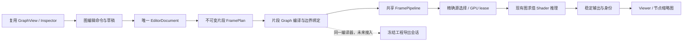

# 视频编辑器：渲染管线编辑器设计

## 1. 决策与状态

**状态：阶段 A 已实现；阶段 B–D 为待评审方案，尚未实现。** 本文描述当前代码边界及后续提案，不把规划能力写成已交付能力。

用户约束：**复用现有 OpenQuartz 节点编辑器；整体交互全面参考 DaVinci Resolve。** 不另写 Color 页专用画布，不复制原图应用控制器，不把 OpenQuartz 节点强行改成 Resolve 的 RGB/key 节点，也不引入 Qt、MLT 或第二个渲染引擎。

产品入口：视频编辑器内的 **Edit / Nodes** 两个工作区；中文名称为“剪辑 / 管线”。Nodes 是片段级渲染工作区，不是另开一个 `.quartz.json` 工程。时间轴、文档、撤销历史和 GPU Device/Queue 始终相同。

交互借鉴 Resolve Color 页：Viewer、Nodes、片段缩略条、mini-timeline、底部参数面板、效果库、对比与旁路。算法与端口继续采用 OpenQuartz 定义；界面相似不构成 Resolve 色彩科学、Parallel Mixer、OpenFX、跟踪、HDR 或调色精度对等承诺。

## 2. 源码核对与复用边界

| 当前依据 | 已有能力 | 本功能必须补齐 |
|---|---|---|
| `apps/open_quartz_slint/ui/components/graph_view.slint` | GraphNode/GraphEdge/GraphPort、节点拖动、端口连接、选区、缩放、Fit、缩略图 | 工作区宿主、深色主题参数、上下文菜单、串行插入/删除、节点旁路与状态 |
| `apps/open_quartz_slint/src/graph_view_model.rs`、`graph_clipboard.rs` | 节点投影、复制子图与ID重建逻辑 | 从原app的Project/选区/播放器所有权解耦；时间线文档作为唯一提交者 |
| `ui/components/inspector.slint`、`inspector_forms.rs`、`inspector_inference.rs`、`crates/slint_code_editor` | 类型化参数表单、Shader编辑、推理配置UI | 节点参数面板可嵌入布局、字段能力过滤、编辑事务适配，不新建第二套参数解释器 |
| `crates/open_quartz/src/project/model/node.rs`、`node_factory.rs`、`catalog.rs` | Graph及现有节点/端口/工厂/目录 | 片段边界绑定、允许节点策略、版本及颜色说明 |
| `apps/open_quartz_video_editor/src/document.rs` | schema1、ClipTransform、精确源入点、全工程事务与100条历史 | 片段持有Graph、schema2迁移、图命令、版本/复制规则 |
| `apps/open_quartz_video_editor/src/preview.rs:132–159` | 每帧意图生成固定 `video → Program Shader` 图 | 将片段图编译成核心Graph；保留现有contain-fit、变换和旧曝光语义 |
| 同文件 `run` | 同Device流水、prepare/commit、请求替换与稳定帧 | 图/参数/资源身份拆分，调图不重复打开视频；图内时间与源时间分离 |
| `execution/pipeline.rs` | prepare_graph、commit_graph、ExternalFrameInput、输出订阅 | 不承诺现有commit全面回滚：其后段仍有可失败的推理同步/视频同步；扩展图原子激活契约 |
| `execution/export.rs` | 无时钟硬件ExportJob | **没有视频编辑器多片段/效果导出UI闭环**；未来复用同一编译器，不能直接声称调用即可导出时间线 |

Slint GraphView/Inspector当前引用原app的浅色Theme；复用必须向组件注入颜色/宿主策略，而不是在视频编辑器复制一份文件改颜色。先在现有源码中抽出被两个真实消费者调用的组件/纯投影，必要时集中到同一个共享UI目录；不为本功能拆分渲染crate。

## 3. 达芬奇交互映射

主要参考 [Resolve Color官方介绍][resolve-color] 以及 [Resolve 20 Colorist Guide][resolve-guide] 的 Interface Review、Lesson 5/6/7。下表“目标”是本设计的产品范围，不代表本轮已具备全部功能。

| Resolve操作心智 | OpenQuartz对应设计 | 实现边界 |
|---|---|---|
| Color页工作区切换、可收起面板 | Edit / Nodes；左侧Media / Nodes标签共享素材库与节点目录；Viewer、Graph、统一右侧属性面板 | 同一窗口；页切换不另起播放器，不改变工程 |
| 点击片段缩略条进入该镜头 | 按时间轴顺序列出**片段实例**；Nodes图上方紧凑条可切clip，同素材多次使用显示多个实例 | 点击选择clip并定位到该片段，不编辑asset全局效果 |
| mini-timeline与片段范围 | Nodes页显示图上方clip条；完整时间轴持续在下方，同一播放头/帧映射 | 不建立第二套时间坐标 |
| 点击节点切换参数 | 单击GraphNode，右侧统一属性侧栏显示现有Inspector表单；Edit页同侧栏显示Clip属性 | 单击节点默认仍看最终片段输出，不自动改节目输出 |
| 输出端拖至输入端 | 保留GraphView现有拖线/点端口连接；增加兼容端口提示 | OpenQuartz类型验证；不能只按连线颜色接受输入 |
| 节点拖到线中插入 | 合法主图像路径悬停高亮，松手原子插入；Esc取消 | 只支持具备明确主image-in/out的节点；复杂节点打开连接选择，不猜端口 |
| Add Serial Before/After | 节点右键和工具栏菜单；选中模板后自动接线 | 自定义Shader串行命令默认创建具名image输入的pass-through模板 |
| 拖动节点布局、框选、缩放、Fit | 继续使用GraphView；补Resolve式中键平移及触控板等价操作 | 节点位置不影响执行顺序；布局不触发GPU重编 |
| Node Label、序号、缩略图开关 | 编号仅作显示，稳定NodeId作身份；保留名称编辑与缩略图展开 | 编号不作为连线/持久化引用 |
| 节点启用/禁用、全部旁路 | 节点持久化enabled；Viewer整体旁路仅用于比较 | 多输出/改变类型的节点不能隐式旁路，须有明确bypass映射 |
| 前后wipe、选中节点查看 | Viewer Final / Selected node / Before，以及可拖分隔线的Before/After | Viewer模式不会改变工程输出节点；Before保留同一时间、尺寸和变换 |
| 复制/应用grade、Gallery still | 复制图/参数、替换或追加到目标片段；抓取参考帧及管线快照 | 克隆而非隐式联动；覆盖前明确Replace/Append，不把中键误触变成静默批量覆盖 |
| Local Versions | 每片段命名版本、复制/切换、重命名 | 非活动版本也保存；切换是可撤销工程操作 |
| Parallel / Layer Mixer | 现有分支与Blend节点可手动构图；后续增加操作快捷入口 | 不将普通Blend命名为Resolve Parallel Mixer；两种算法不同 |
| Groups Pre/Post、Timeline级 | 后续作用域入口及明确的执行顺序 | 首个闭环只开放Clip；未实现的作用域不画成可点击空菜单 |
| Qualifier、Power Windows、Tracking、Scopes | 作为后续真实节点/工具能力接入同一参数区 | 不用无实现的色轮、曲线、示波器或跟踪按钮装饰界面 |

### 3.1 布局

1440×900建议布局。左侧媒体/节点目录用互斥标签切换；Nodes的效果按类别以双列方形图标卡片呈现。右侧节点Inspector复用Edit页片段属性侧栏，不与节点选择区争夺横向空间。

```svg
<svg xmlns="http://www.w3.org/2000/svg" viewBox="0 0 960 580">
  <g fill="none" stroke="var(--border)" stroke-width="1">
    <rect x="1" y="1" width="958" height="578" rx="7"/>
    <path d="M1 49H959 M1 87H959 M1 386H959 M1 430H959 M170 87V386 M410 87V386 M740 87V386"/>
    <rect x="185" y="110" width="210" height="202" rx="3"/>
    <rect x="425" y="124" width="70" height="48" rx="4"/><rect x="510" y="124" width="70" height="48" rx="4"/>
    <rect x="430" y="198" width="26" height="36" rx="3"/><rect x="500" y="188" width="72" height="58" rx="4"/><rect x="610" y="188" width="26" height="36" rx="3"/>
    <rect x="755" y="112" width="190" height="245" rx="4"/>
    <rect x="16" y="453" width="928" height="104" rx="3"/>
    <path d="M456 216H500 M572 216H610" stroke="var(--accent)" stroke-width="2"/>
  </g>
  <g fill="currentColor" font-family="sans-serif" font-size="13">
    <text x="18" y="31">OPENQUARTZ STUDIO</text><text x="370" y="31">Edit  /  Nodes</text>
    <text x="14" y="73">Media  |  Nodes</text><text x="185" y="73">Viewer</text><text x="425" y="73">Clip strip + Graph</text><text x="755" y="73">Properties</text>
    <text x="20" y="111">COLOR</text><text x="23" y="144">[◉] Invert</text><text x="93" y="144">[◉] Grade</text>
    <text x="23" y="184">[▧] Filter</text><text x="93" y="184">[◇] Distort</text>
    <text x="23" y="224">[ƒx] Custom</text><text x="23" y="270">grouped square tiles</text>
    <text x="220" y="215">Actual GPU viewer</text><text x="430" y="154">clip A</text><text x="515" y="154">clip B</text>
    <text x="500" y="221">Nodes graph</text><text x="775" y="116">Node Inspector</text><text x="775" y="143">Same sidebar slot</text>
    <text x="20" y="477">Full timeline</text><text x="20" y="505">Single project history</text><text x="18" y="572">Status · frame time · GPU path</text>
  </g>
</svg>
```

### 3.2 片段、播放头与编辑目标

- `activeClipId`是图编辑目标；`selectedNodeIds`是该图的节点选择。两者不能借用当前`selected_asset`推导。
- 从Edit进入Nodes：优先进入选中clip；若播放头不在其范围内，暂停并定位片段首帧；无选择则进入播放头所在片段。空隙显示黑色/无活动片段，不把前一片段的参数误应用到空隙。
- 点击片段条暂停、切换目标；若播放头已在该clip内保留帧，否则定位首帧。同asset的两个clip各自持有管线。
- 连续播放跨切点时，默认节点区跟随当前clip；首个参数拖动或图编辑动作暂停播放并锁定本次目标。不能在手指未松开时把参数提交给下一镜头。
- 切换工作区、节点选择、查看中间输出、Viewer wipe、面板尺寸/视口不写内容历史。切换片段先完成或取消当前编辑事务；Shader未提交草稿按clip/node保留，并显示明确状态。
- 单击节点只改变Inspector；右键“View selected node”显式切换中间预览，Viewer持续标注Node名称和“非最终输出”。同一帧节点缩略图不可显示来自另一clip的旧结果。

### 3.3 快捷键与焦点

Nodes工作区采用Resolve习惯，保留菜单等价入口与触控板路径：

| 快捷键 | 行为 | 适用焦点 |
|---|---|---|
| Option/Alt+S | 在选中节点后添加串行节点 | 节点画布 |
| Shift+S | 在选中节点前添加串行节点 | 节点画布 |
| Cmd/Ctrl+D | 持久化切换选中节点启用 | 节点画布；不是复制节点 |
| Shift+D | 临时切换整个用户管线旁路对比 | 非文字编辑区 |
| Cmd/Ctrl+C、V | 复制/粘贴选中子图 | 节点画布；文字区仍是文字剪贴板 |
| Delete/Backspace | 删除选中节点或连线 | 节点画布；时间轴仍lift片段 |
| Cmd/Ctrl+Z、Shift+Z | 工程级撤销/重做 | 非文字编辑区 |
| Space、←/→ | 播放/暂停与序列帧步进 | 非文字编辑区 |
| Esc | 取消当前连线/拖动/参数草稿或退出比较模式 | 最内层活动交互优先 |

原图app的快捷键默认不被视频编辑器策略覆盖。与Resolve不同，本应用保留**一个工程级撤销历史**，避免切片段后撤销找不到刚才的修改；界面显示动作与clip名称。不照搬Resolve共享节点不可撤销的例外。

## 4. 管线模型：复用Graph，不复制节点定义

### 4.1 作用域与边界

第一交付的每个clip拥有自己的管线；asset只保存媒体事实。新片段为直通：`Clip source → Clip output`。两端是宿主管理的现有核心节点投影，不创建新的SDK NodeType：

- Clip source：绑定本片段asset及精确源时间；不可删除、复制或修改文件路径。每次FramePlan决定来源，图中不另开自由运行播放器。
- 用户节点：现有Shader/Constant/Math及经过审核的catalog effects；使用现有端口和Shader解析结果。
- Clip output：唯一受保护的片段出口，接收一张图像，应用当前`ClipTransform`和contain-fit，再输出序列画布尺寸。不让多个Renderer窗口成为多个节目输出。
- 预览中间节点只改变需求的观察目标，不重接用户图、不改变持久化出口。

节点图先在源尺寸域处理，Clip output负责画布适配。改变尺寸的节点必须报告实际输出尺寸；出口按**上游实际尺寸**重新contain-fit，不能仍按原asset尺寸计算。预览和以后导出使用相同规则。

保留现有`ClipTransform`为出口配置唯一事实源，包括既有曝光字段；不在迁移时悄悄改其公式、clamp、采样顺序或alpha。新曝光节点是用户选择的新效果，不再写入出口的旧曝光字段。旧工程直通图必须逐像素等价于当前实现。

### 4.2 持久化草案（不是现有API）

`schema_version=2`，`Clip`增加`pipeline`。其内部数据结构采用以下职责，不再定义一份nodes/edges JSON协议：

| 字段 | 内容 |
|---|---|
| pipeline.version | 管线容器/编译策略版本 |
| pipeline.active_version_id | 当前管线版本ID |
| pipeline.versions[] | 稳定versionId、名称、`graph: open_quartz::Graph`、受保护source/output绑定、节点启用/旁路映射元数据 |
| 既有Clip.transform | 出口的空间/旧曝光设置；单一来源，不复制到graph.uniforms |
| Clip.effect_time_offset | 有符号有理数秒；split/trim保持效果连续，详见§6；不复制到asset |
| 编辑器视图状态 | clip/version独立的画布视口、节点选区、查看目标、面板尺寸；不参与渲染hash |

第一阶段可只有一个命名版本，但格式应允许后续版本管理。Graph中已有的节点位置按现有序列化保存；内容hash显式排除位置和label，独立layout revision处理拖动。禁止把wgpu纹理、编译结果、推理session、解码器、原生窗口句柄放进工程。

schema1读取时构造等价直通管线，保存仅写schema2；保留读取迁移，不保留双写和两套渲染路线。未知schema、节点实现版本或不支持的资源类型明确拒绝，不丢节点后保存“成功”。

资源绑定不从`Graph`中的任意文件字符串直接打开。Clip source只引用既有assetId；以后允许的外部image/model资源通过工程资源表及节点绑定保存，相对路径、内容身份和重定位遵守现有资产规则。复制图时同时复制资源引用但不复制解码/推理句柄；资源缺失阻止该图激活并定位节点，不以空纹理替代。首交付不开放自由媒体节点，因此无需伪造多源时间同步。

### 4.3 编辑/复制规则

- split：两个片段得到值相等但独立的管线副本；右片段源入点仍用当前精确tick/subtick算法。后续一边改图不影响另一边。
- move/trim：不改变管线内容；每个节点内的时间按§6定义，避免移动clip后动画跳动。
- Copy pipeline：复制用户图、静态参数与启用状态，不复制asset、源时间、空间变换、UI选择或GPU缓存；粘贴后使用目标clip的边界绑定。
- Replace：一次原子替换用户图；Append：只允许明确单image入口/出口的子图，接入出口之前。多入口子图必须让用户绑定，不自动选第一端口。
- Gallery still包含参考像素身份和用户图快照；应用为复制，不是共享可变对象。版本复制和选择都可撤销。
- 节点删除只有在主图像入口/出口唯一且类型兼容时可自动桥接；普通“断开并删除”仍保留，结果进入待连接草稿。分支/多输出删除不猜测合成顺序。

## 5. 文档事务与运行图激活

复用`EditorDocument::transact_at`，不得在嵌入的`open_quartz::Project`里再维护一套可保存历史。SDK Project若用于命令验证只能是短命候选/适配器；最终状态只进EditorDocument。

两种状态分开：

1. **Graph draft**：拖线未结束、未连接新节点、Shader语法错误、参数输入未确认。可显示错误和最后有效帧；不写正式工程、保存及导出不消费未提交草稿。保存前明确提示Apply/Discard/Cancel，不能静默漏存。
2. **Committed recipe**：验证通过的工程内容。预览工作线程准备/激活所需图，执行错误不回写工程；画面继续保留上一稳定帧并明确“旧帧/当前管线失败”。

普通参数滑动遵循Resolve的即时反馈：拖动期间合并最新候选，反馈不要求点击Apply；松手提交一次历史，Esc恢复原值。文本参数Enter/失焦提交合法值；源码保留显式Compile/Apply，因为不完整源码不能宣称可执行。快速连续修改只让最新候选有发布资格。

图拓扑/源码prepare成功后，按`clipId + versionId + expectedDocumentRevision + draftGeneration`提交。用户已切片段/撤销/重开则丢弃准备结果并释放资源。节点坐标拖动一次一条布局历史，不准备GPU图、不重开媒体。

核心`commit_graph`必须先把所有可失败阶段准备好，或提供完整回滚；现实现于session/render提交之后仍调用可失败的inference/video同步，不能把“prepare成功”等同真正原子激活。先修此契约再允许编辑器依赖“失败保持旧图”。

节点持久化enabled通过编译器按显式映射降低为直通连线，不执行该节点：仅主image输入/输出匹配的节点默认允许。源/出口、生成器、类型转换、多输出推理或Mixer没有可证明等价映射时不提供盲目Disable。Viewer全局旁路仅跳过用户效果，保留来源、源时间、出口变换/尺寸；这是显示比较，不污染保存内容或导出。

## 6. 执行与时间契约



### 6.1 时间不能混用

当前preview把`request.source_ns`传给`FrameStamp.timeline_ns`，对固定无动画图足够，但加System Time/Frame节点后会把素材PTS误当片段时间。

新FramePlan同时保存：`sequenceFrame/sequenceTime`、`clipLocalFrame/clipLocalTime`、`sourceTargetPts/timeBase`、实际解码PTS，以及独立`effectTime`。效果时间默认为片段放置时的0起点，但不直接等同当前clip-local：Clip持久化`effectTimeOffset`（有符号有理数秒），`effectTime = effectTimeOffset + clipLocalTime`；Time节点用该值，Frame节点用序列fps精确换算的向下取整帧值。split右片段offset加切点相对时长，trim-start同样按新旧入点差调整，move不改offset；因此单纯拆分/修剪/移动不会意外重启动画。该字段在schema2迁移及所有相关命令中一并更新，不借源PTS代替效果时间。

现有原生视频准备按`demand.input.stamp.timeline_ns`取帧。必须在核心需求中分离**逐源采样时间**和**效果求值时间**，或复用真正已准备的ExternalFrameInput注入。优先在共享流水内增加明确的逐源时间映射，不在UI线程另建解码循环。新增接口保持现有NativePlayer的默认同时间行为；不能更改全局FrameStamp含义而让原图app动画回归。

### 6.2 缓存与资源

- 不再使用当前`asset + width/height + ClipTransform`单一configured key。分别维护资源身份、拓扑/源码hash、参数hash、frame内容身份、显示target；仅参数变化不得stage_video重开文件。
- 同asset/clip切换仍校验指纹、stream、源epoch；回退seek使用现有精确游标，不把播放状态作为效果时间。
- Frame结果关联document revision、clip/version、recipe hash、draft generation、求值时刻、源PTS、输出target及规格。相同请求ID不代表相同图；跨clip迟到结果只能释放不能覆盖画面。
- Viewer、选中节点和缩略图来自同次帧图执行；优先最终输出，再选中节点，再可见缩略图。隐藏节点不持续抓帧；不得为每个缩略图重跑一次完整视频图。
- GPU纹理直接给Slint，消费者持有稳定lease。保留有界队列/预算/回收；比较模式最多增加明确受预算控制的参考帧，不借“对比”无限缓存整段。
- Before/After比较通过同源帧的两个观察分支（用户处理/直通）产生结果，共享解码和上游资源；Viewer wipe仅在UI消费已配对的同帧稳定输出。Selected node按节点真实尺寸显示并明确其颜色解释；若用于对比，先经过同一显示/尺寸适配，不把不同尺寸或不同源PTS的图直接当作前后对比。
- 未提交GPU工作可取消；已提交只撤销发布资格并等待真实完成，不提前释放。复杂图或AI未达实时显示状态，不偷偷用上一帧mask。
- 首交付排除Feedback、依赖wall-clock/mouse的System源和其他隐含历史节点；它们在任意seek和离线重放尚无本功能确定性契约。显式Time/Frame节点待时间拆分完成才开放。

## 7. 颜色、Alpha与节点能力

这是现有渲染图的编辑入口，不把目录中的`Color`分类等同专业调色引擎。

第一闭环标记为**SDR兼容模式**：继承现有解码/Shader encoded-space行为、实际目标格式和旧出口clamp；保持旧工程像素一致。不得在界面写DaVinci Wide Gamut、ACES、HDR或全程32-bit，除非真正贯通输入解释、节点运算域、中间纹理、显示及编码变换并通过oracle。

当前核心实际目标格式仅`Rgba8Unorm / Rgba32Float`，没有完整RGBA16F路径；32F过滤还受设备features约束。现有preview/readback/encode入口对Rgba8有明确要求，FrameSnapshotIdentity颜色/alpha来源也可能是Unknown。因此查看浮点中间节点前须经过明确的GPU显示转换，不能直接交给8-bit入口；逐节点颜色域及转换策略是新增契约，不能从enum存在推断已经做过颜色管理。

| 类别 | 接入原则 |
|---|---|
| 单image Shader/Filter/Color catalog | 复用当前工厂与解析；显示实现/版本、输入输出尺寸、颜色域说明 |
| Math/Constant | 保留现有类型端口，不伪装成RGB/key；NaN/溢出/非法维度按核心规则拒绝 |
| Blend/Mask | 明确输入A/B、mask、混合模式及alpha约定；旧encoded-space混合如实标识，不称线性调色 |
| 自定义Shader | 使用现有编辑器、端口检测、编译错误映射；定义clip-local时间，资源文件受工程绑定管理 |
| Inference | 复用现有typed输入输出与硬件capabilities；图像/蒙版/ROI/深度不能按颜色猜端口，设备不支持时明确报错 |
| 自由Video/Camera/Renderer窗口 | 不作为首期片段图普通节点开放；避免第二时钟、越过片段边界取帧或弹额外节目窗口 |

视频编辑器当前Cargo仅启用核心native-runtime/native-video，尚未接入原图app的完整推理配置/模型资源链路。阶段C须连同必要feature、模型资源准备、typed端口与预算/错误生命周期一起迁移到共享宿主适配；“核心支持七模型”不等于本app已能直接运行。

后续专业颜色阶段必须单独交付：输入transfer/primaries/range解释、固定工作域、浮点中间格式、显式域转换节点、alpha约定、只在输出端tone/gamut mapping。优先审查现有Rgba32f能力，而不是假定已有完整RGBA16F链路。premultiplied/straight转换必须在边界显式实现；不允许改节点目录名字就宣称颜色管理完成。

## 8. 实施顺序与完整交付边界

阶段 A 已于本实现闭环交付；下表 B–D 是**提案**，按依赖拆分，不是已承诺的排期。每个阶段先过用户评审，再实现；未评审能力不加入可见入口。

| 阶段 | 提案交付 | 进入条件 / 验收出口 |
|---|---|---|
| A：复用与片段图闭环（已实现） | 现有GraphView/Inspector复用；Edit/Nodes；片段图、schema2、工程历史、GPU预检和真实预览 | 已完成；红/蓝真实解码素材验证编辑、像素、片段隔离、失败保留和保存重开 |
| B：Resolve式高频操作 | 菜单/快捷键；拖线插入、重命名、删除桥接；持久化节点旁路和整图比较旁路；中间节点查看；Before/After wipe | 维持现有静态单图语义；证明事务一次提交、焦点隔离、同帧比较、原图app回归 |
| C1：时间与资源契约 | 明确序列时间、源PTS、效果时间、资源身份、图revision的独立键；只在契约稳定后开放适用的Time节点 | 先补时钟/异步竞争测试；跨切点、scrub、relink、undo及迟到GPU结果均不串帧/串片段 |
| C2：多输入图 | typed Blend/Mask等真实多输入节点、alpha约定及UI连线/预览 | 只做有明确端口/输出的算法；同帧mask像素oracle、错误类型拒绝、资源预算/生命周期通过 |
| C3：Inference节点接入 | 迁移视频宿主模型发现、设备选择、模型准备/释放、预算与错误呈现；只开放可验证的现有生产节点 | 不因核心库已有模型就假设可用；真实模型资源、失败、取消、设备丢失、切片段和GPU竞争完整闭环 |
| C4：版本与参考帧 | Clip Local Versions及Gallery still快照；Replace/Append明确操作 | 命名版本/快照持久化；切换是一条可撤销事务；跨片段复制深拷贝资源/图，失败保留目标 |
| D1：专业颜色基础 | 输入色彩元数据、浮点工作域、显式转换、alpha与输出变换 | 先定义格式/transfer/primaries/range及精度误差预算；提供独立已知色块、HDR/SDR与alpha oracle |
| D2：专业调色与Scopes | 只有真实算法实现后才开放Qualifier/Power Windows/Tracking/Scopes及参数面板 | 算法精度/交互、颜色管理、视口缩放与性能预算分别验收；不以占位UI或名称映射冒充功能 |
| D3：Groups与Timeline作用域 | 分层作用域和确定的执行顺序；明确Clip、Group Pre/Post、Timeline应用范围 | 跨层非交换效果验证顺序；工程schema、历史、复制/split与预览保持一致 |
| D4：视频编辑器导出 | 同一编译图及时间/颜色契约驱动整段硬件导出；保留当前独立Export API边界 | 预览/离线同配方；整段PTS/DTS、尾帧、取消、磁盘错误、资源释放及目标原子提交验收 |

C1必须先冻结时间/资源身份契约，才开放时间节点、Inference或多输入资源消费；遇到预检失败仍保留稳定旧帧。D4导出不得复用屏幕截图或另建wall-clock录屏路径，必须等待D1颜色/alpha及C1时间语义稳定。静态参数无需开放动画节点。

### 8.1 建议的实施顺序与评审问题

**建议顺序：B → C1 → C2 → C3 → C4 → D1 → D2/D3 → D4。** B只补高频静态编辑与比较；C1是开放时间节点、跨片段复用和异步资源节点的前置契约；C2和C3先后可在C1之后独立评审，但多输入与模型资源不可在契约前进入视频宿主。C4可在C1之后与C2/C3并行实现，但版本/快照的数据格式须先定。D4必须等D1的颜色/alpha语义和C1的时间/资源语义冻结；Scopes依赖真实颜色工作域，不与D1倒置。

阶段C的“AI”范围仅限接入已经存在且可在目标平台运行的生产节点；不包含训练、模型市场或新模型算法。Gallery先定义为本地静态帧+图快照，不承诺Resolve图库兼容。若相应真实资源、GPU能力或可判定的图像oracle尚不可得，则该阶段保持未开放，不以mock替代验收。

请评审时重点确认：

1. B是否先交付节点快捷操作/旁路，再做Viewer比较；还是希望将Before/After留到专业颜色阶段。
2. C阶段是否接受先冻结统一的时间/资源身份契约，再开放Time、多输入、Inference；这是建议的强依赖，可避免不同节点各自定义时间。
3. 是否认可Gallery/local version采用OpenQuartz自有、工程内可复制的静态快照，而非追求Resolve兼容。
4. D阶段是否纳入完整色彩管理与导出；若纳入，需另行确认目标色域/传递函数、输出编码器、硬件覆盖平台和容许误差后再冻结规格。

本文不承诺排期、平台矩阵或Resolve色彩科学等价。评审确认范围后再细化每阶段schema、API及测试夹具；本次不实现B–D能力。

## 9. 验收清单

1. **复用性**：两个app消费同一画布/投影/参数组件，原节点app的连接、拖动、Fit、保存和真实GPU回归保持通过；无第二套node/port协议。
2. **片段隔离**：同asset两个clip设不同图，来回选择/播放/切页不串参；split后两边可独立修改，trim保持精确源PTS。
3. **画面正确性**：用已知非交换效果验证顺序，不能用两个恒等节点验证；同帧独立oracle比对预览和实际图结果；空隙始终黑色。
4. **事务**：一次滑动/拖线/插入/粘贴/删除/版本切换只有一次历史；取消、过期revision、无效端口、编译错误不改旧图和redo；输入文字时快捷键不越域。
5. **失效与竞争**：编辑A图后立即选B、scrub/undo/relink，迟到结果不能覆盖B；准备失败/预算满/设备失败有节点定位与旧帧标识，不能静默黑帧或忽略节点。
6. **源复用**：连续改uniform及节点位置不重开decoder；观察真实资源统计/游标行为，而不是只测回调调用次数。
7. **输出与比较**：单击选节点仍看Final；显式中间预览标注目标；Before/After使用同源时间/同输出变换；关闭比较恢复Final且保存图不变。
8. **持久化**：schema1升级旧像素一致；schema2含节点代码/参数/边界/启用/版本；未知字段/能力明确拒绝；相对资源路径、指纹和relink保持正确。
9. **生命周期**：图切换/节点删除后Slint仍持有的GPU图像有效；有界缩略图/比较帧和预算回收；窗口关闭正常drain，不靠进程kill。
10. **界面**：1440×900和最小窗口下Viewer/Graph/参数区可用，拖分隔/收起不丢选区；与现有图编辑器一致的图标、tooltip和可访问标签，不能只验证截图里“有节点”。

## 10. 设计参考与明确差异

- [Resolve Color官方页面][resolve-color]：工作区、节点流、图库、效果参数、比较及Scopes。
- [Resolve 20 Colorist Guide][resolve-guide]：Interface Review（印刷页xx–xxiv）；Lesson 2串行节点/旁路；Lesson 5 Node Trees（181页起，区分Parallel/Layer及插线）；Lesson 6版本/Gallery；Lesson 7作用域。
- [现有视频编辑器设计](DESIGN.md)、[核心架构](../../docs/DESIGN.md)、[推理契约](../../docs/INFERENCE_ARCHITECTURE.md)是实现约束；历史提案与当前代码不符时，以当前代码及本设计明确的增量为准。

**明确差异**：复用OpenQuartz typed graph而非Resolve corrector节点；一个工程级撤销历史而非片段独立撤销；初期仅Clip域、SDR兼容模式。整体交互参考Resolve，不复刻品牌/图标/专有代码，不提供未实现的功能入口。

[resolve-color]: https://www.blackmagicdesign.com/products/davinciresolve/color
[resolve-guide]: https://documents.blackmagicdesign.com/UserManuals/DaVinci-Resolve-20-Colorist-Guide.pdf?_v=1757574010000
