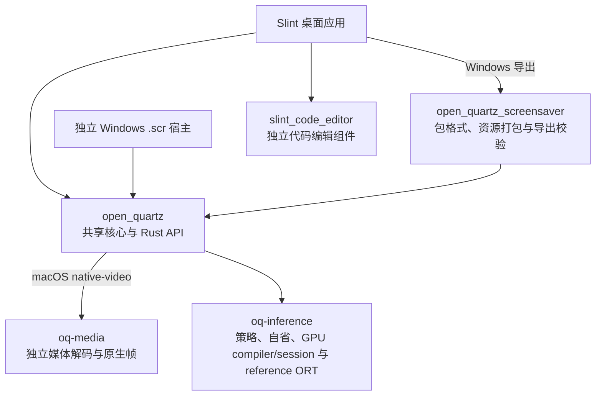
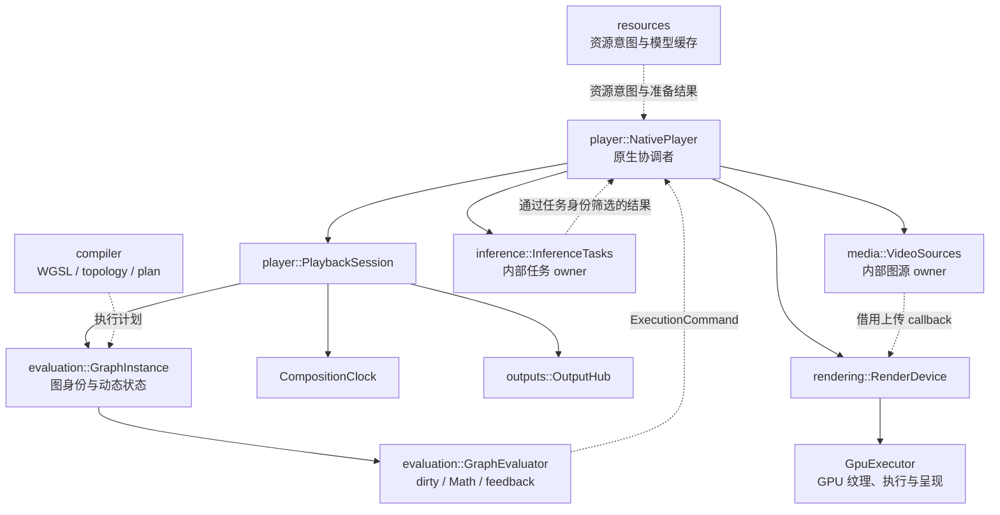
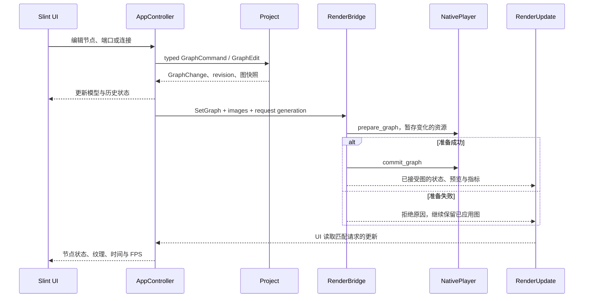
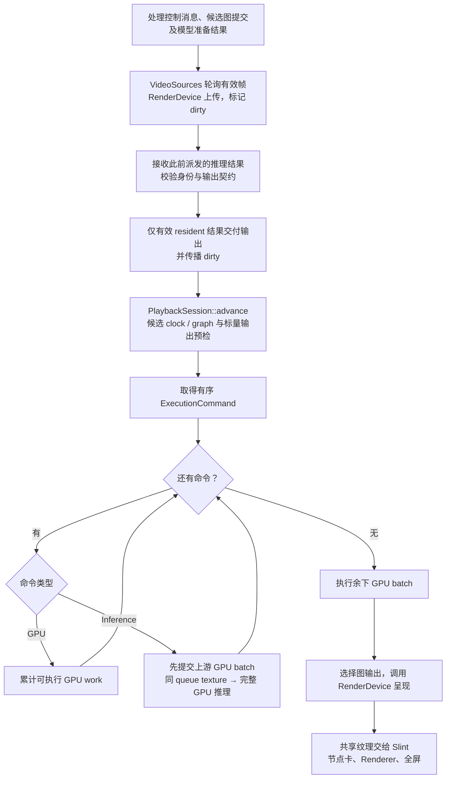
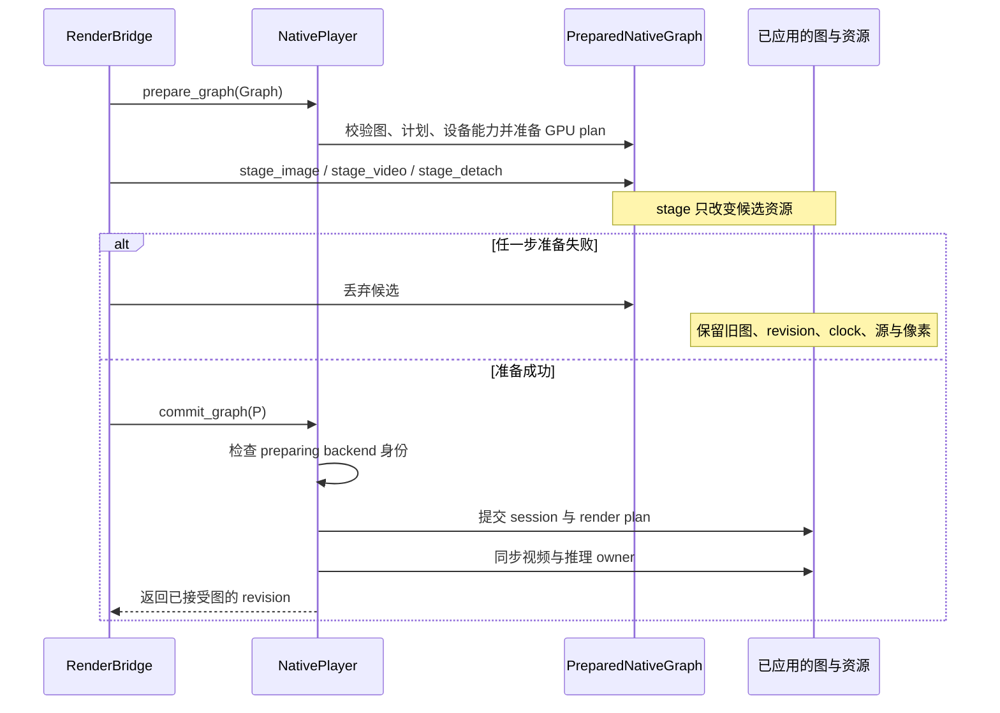
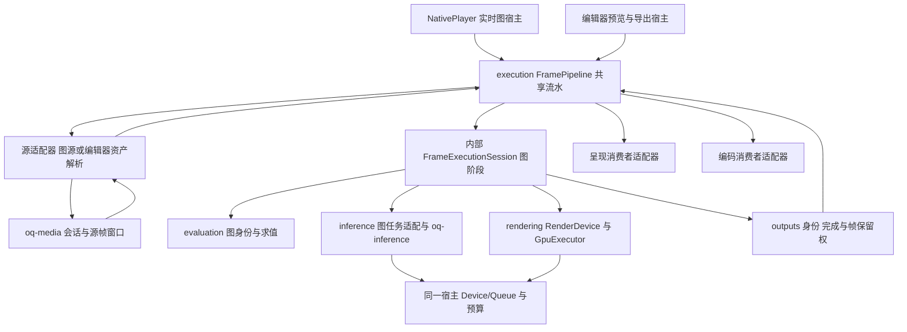

# Open Quartz 架构设计

本文描述当前 Rust/Slint 桌面应用、独立 Windows 屏保和共享 Rust 核心的实际架构。以模块所有权、线程边界和数据交接为主线；媒体与推理的实现及扩展边界分别见[媒体架构](MEDIA_CODEC_ARCHITECTURE.md)和[推理架构](INFERENCE_ARCHITECTURE.md)。[渲染与执行分离决策](#execution-rendering-split)单列尚未实施的目标架构，不能将其类型、流水或验收门槛读成已有实现。Web、Tauri、WASM 与语言绑定产品已退役，不属于本文架构。

阅读顺序：

- [系统总览](#architecture-overview)：产品、crate 与依赖方向。
- [模块与所有权](#module-ownership)：状态和资源由谁持有。
- [项目编辑与控制流](#control-flow)：界面操作如何成为已应用的图。
- [逐帧数据流](#frame-dataflow)：视频、求值、GPU 与推理的执行顺序。
- [输出与资源传递](#outputs)：订阅、共享纹理和显式读回。
- [图替换与生命周期](#graph-lifecycle)：准备、提交、播放控制和关闭。
- [线程与异步任务](#threading)：请求身份、迟到结果和释放规则。
- [能力与编译边界](#capabilities)：默认核心与可选设备功能。
- [渲染与执行分离决策](#execution-rendering-split)：同 crate 内抽离无时钟执行会话、稳定帧与有界流水；当前状态与迁移顺序。
- [独立屏保与发布](#deployment)：`.scr` 宿主和运行库布局。
- [架构约束与已知限制](#known-limitations)、[验证基线](#validation)、[源码索引](#source-map)。

## 系统总览

Open Quartz 用节点图组合 GPU Shader、CPU Math、硬件视频与 resident 推理。桌面负责编辑/窗口；`open_quartz` 负责图与播放适配；独立 `oq-inference/gpu` 拥有 GPU 模型编译、session 与硬件图像执行，ORT 命名 FP32 Tensor 仅供显式 reference/诊断。ONNX 是模型产物格式，不是生产后端。

下图箭头表示**编译依赖**，不是每帧数据流。Slint 应用和编辑器组件使用各自的 workspace；根 workspace 包含核心、媒体库、独立推理库、屏保打包库与屏保 stub。

| 组件 | 责任 | 边界 |
|---|---|---|
| `apps/open_quartz_slint` | 图编辑器、Inspector、文件交互、窗口、预览、模型准备与渲染线程桥接 | 消费核心规则，不重建 topology、dirty 或执行计划 |
| `open_quartz` | 项目、编译、求值、播放、输出、资源计划与设备能力 | 不依赖应用 UI；公共领域类型从 crate root 导出 |
| `oq-media` | 解码会话、帧元数据、原生帧及 lease；已落地 macOS VideoToolbox 后端 | 不依赖 OpenQuartz 图、NodeId、Slint 或 wgpu |
| `oq-inference` | ONNX 源自省、策略、`gpu` feature 的实际 GPU compiler/GpuImageSession；显式 reference Tensor/ORT adapters | 不依赖 OpenQuartz、NodeId/revision、Slint 或 oq-media；仅 gpu feature 引入 wgpu |
| `slint_code_editor` | cosmic-text 排版与编辑，Slint 输入和绘制，语法高亮、查找替换与本地历史 | 不依赖 OpenQuartz；Shader Apply 由应用提交 |
| `open_quartz_screensaver` | `.scr` 包格式、资源闭包与导出校验 | 可使用无设备核心，不启动桌面应用 |
| `open-quartz-screensaver-stub` | Win32 窗口、消息循环、Surface、包资源解压和独立执行 | 不依赖已安装的 Slint 应用 |

图语义采用一个实现 crate，通过模块和 capability feature 隔离职责。媒体与推理因具有独立可运行实现和依赖闭包而独立，编辑器与宿主因可复用组件或产品入口而独立；不增加仅转发接口的壳包。

## 模块与所有权

`open_quartz/src/lib.rs` 声明职责模块，并导出 `OpenQuartz`、`Project`、`Graph`、`ProjectNode`、`Port`、`Player`、`Resource`、`Output` 等公共类型。高级宿主接口位于各职责模块；`NativePlayer` 在启用 `native-runtime` 时也从 root 导出。

下图实线表示**持有或包含**，虚线表示**接口交接**。它描述 Slint 的原生执行路径；独立屏保的组合方式见[独立屏保与发布](#deployment)。

| 模块 / owner | 拥有的状态或实现 | 交接边界 |
|---|---|---|
| `project` | Graph、节点/端口/边、GraphEdit、不变量、Project、history/revision、catalog/layout/factory、屏保图变换 | typed 编辑命令与图快照；不拥有播放时钟或设备 |
| `compiler` | WGSL 解析/校验/生成、拓扑、可复用 `ExecutionPlan` | Graph → plan 与结构化节点错误；不保存 live graph dirty 状态 |
| `GraphEvaluator` | 共享的静态 nodes/plan，动态 dirty、Math 值与 feedback 状态 | `FrameInputs` → 有序工作命令；不执行上传、读回或 ORT |
| `GraphInstance` | applied Graph、revision、node generation、生命周期、待执行命令与 GraphEvaluator | 图替换、帧求值、身份校验；不持有 GPU、decoder 或 ORT session |
| `PlaybackSession` | GraphInstance、CompositionClock、OutputHub | 播放控制、时钟输入、求值与输出交付 |
| `NativePlayer` | 一个 PlaybackSession、RenderDevice，以及按 feature 启用的 VideoSources/InferenceTasks | 协调源上传、完成结果、命令执行和图输出呈现 |
| `OutputHub` | 输出契约、订阅、registry、presentation planner、resource registry、HostBackend 与 capabilities | typed 输出交付与独立的 presentation backend 接口 |
| `RenderDevice` | GpuExecutor、共享 wgpu Device/Queue、纹理/lease、显式读回、平台导入与呈现 | 执行 GPU work；不拥有图接受政策、视频源 map 或 ORT session |
| `VideoSources`（内部） | NodeId → NativeVideoSource 的 map、预览、播放控制与源替换 | 借用上传 callback，返回实际上传后变脏的节点；decoder/FrameLease 归媒体后端 |
| `InferenceTasks`（内部） | resident 模型/session、图任务身份与有效输出 | 图契约与 NodeId/revision 留在 OpenQuartz，GPU 图像执行归独立库；不派发生产 ORT host-image worker |
| `resources` | catalog、typed resource plan、模型下载/缓存/校验服务 | 表达资源意图和准备资源，不调度每帧求值 |
| `oq_inference::GpuImageSession` / `InferenceSession` | 前者执行 resident GPU 网络，后者保留显式 reference ORT/FP32 Tensor | 不拥有图/UI 身份；生产只用硬件图像路径 |

`GraphInstance` 的图快照和 `GraphEvaluator` 的静态 nodes/plan 使用共享 `Arc`；帧事务复制动态状态，不逐帧深拷贝 WGSL 源码。`VideoSources` 和 `InferenceTasks` 是核心内部 owner，不是新增的公共 root API。

模型事实与图任务契约分别建模：`inspect_onnx(model)` 无需 ORT，session `source_interface` 保留 IR/producer/model versions、domain、graph name、模型/图/值 descriptions/custom properties 和 opset imports。递归源类型包括 Tensor/SparseTensor/Sequence/Map/Optional/Opaque/Unknown，保留精确 dtype codes、UnknownRank 与 scalar 的区别、静态/符号/dynamic 维度及 denotation。Required/Optional/OverridableInitializer 输入、dense/sparse initializer 与 external-data 引用均可报告，不复制或加载权重。运行时 `ValueKind`/元素分类、metadata 与原始源声明分开；opset 从源解析，不以 ORT API 21 不支持查询作统一缺失理由，也不把 runtime model-version sentinel 当作源版本。产物 SHA-256/字节数/格式是独立事实。

typed `ImageTaskContract` 保留精确命名输入/选定输出、layout、preprocessing/resize/decoder、声明及实际 shape 约束；source facts 与 taskContract 分开报告。U²Net-P 七输出 `1959`–`1965`、显式 mask `1959` 与 COCO `[1,84,8400]` 契约仍保留，历史 reference 数值成功不表示这些模型可 resident 执行。生产仅 SR3，其他模型在 frame access 前拒绝；完整字段见[推理架构](INFERENCE_ARCHITECTURE.md)。

## 项目编辑与控制流

界面中的项目和渲染线程已接受的图具有不同生命周期。`Project` 是编辑、持久化和 undo/redo 的来源；渲染线程保存已经成功准备并提交的图。编辑成功不保证资源或 GPU 准备也成功。

应用层的责任是把用户意图转成核心命令、维护表单草稿和投影 UI 模型。节点工厂、类型/环校验、连接替换、history 和图序列化由 Rust 核心提供。拖动完成、Shader Apply 或一组节点编辑按各自事务提交，不能在 UI 重建另一套图规则。

项目/文件 I/O、图片与 framebuffer 准备、模型下载和 session 构建通过应用服务及后台任务完成。`resources::plan` 生成 typed resource intents，供视频与推理同步共用。视频源打开仍属于候选图的 stage 步骤，不能把该步骤描述为完全无 I/O 的渲染循环。

图与资源在宿主间以 Rust 类型交接；JSON 用于项目文件、屏保包元数据和部分诊断序列化。准备失败时，UI 可以保留用户已编辑的项目，并显示“旧图仍在执行”；不能把编辑 revision、UI 请求 generation 和渲染图 revision 当成同一计数器。

默认启动、New 和 Open 都处于停止状态。编辑节点不隐式 Play；用户显式 Play 后才消耗图的首帧工作。停止或暂停时选择视频可以单独解码并上传一个源预览，不推进 composition time，也不消耗 Shader/Renderer 首帧工作。

## 逐帧数据流

Slint 的 RenderBridge 在原生渲染线程上串行处理控制消息并调用 `NativePlayer::render_next`。运行、加载模型或等待视频预览时使用约 16 ms 的消息等待；这个调度间隔不等于实际渲染 FPS。

执行顺序由图计划和命令序列决定：

1. 上传当前视频源的有效帧，再将实际内容变更传播为 dirty。被替换的源不能继续提供旧帧。
2. 在推进本帧时钟之前处理有效输出。revision、generation、task id、输出契约与交付容量通过后才允许发布；不是 CPU 结果上传。
3. `PlaybackSession::advance` 使用候选 clock/graph 求值；整批标量输出通过契约和交付容量预检后提交。拒绝该批输出时保留可重试的时钟、dirty work 和交付状态。
4. 依次消费命令，遇到推理命令先提交此前累计的 GPU work，再获取其上游输入并派发任务，最后执行剩余 GPU work。缺少输入纹理的 GPU 命令等待资源就绪。
5. 选择图输出交给 RenderDevice，Slint 导入同一 Device/Queue 上的输出纹理。

图计划优先采用显式 Renderer 输出，也支持没有 Renderer 的末端纹理输入节点。资源尚在解码或推理时，可以暂时没有可呈现纹理；不能用空输出累计有效 Render FPS。

标量预检的事务范围不覆盖已经提交的 GPU work 或外部呈现。OutputHub backend dispatch 在候选状态提交后执行；GPU 执行、读回或 present 失败不意味着整帧设备状态自动回滚。

## 输出与资源传递

输出包含两个相关但不同的路径：

- `OutputHub` 处理 typed 输出契约、订阅、值/资源句柄、交付政策及可选 backend presentation。
- Slint 生产路径由 NativePlayer 选择图输出，再经 RenderDevice 呈现；RenderBridge 把 GPU 纹理交给 UI。普通节点卡、Renderer 和全屏预览共享纹理。

Slint 的图输出由 NativePlayer 交给 RenderDevice 呈现，当前生产路径没有向 OutputHub 挂载 HostBackend。OutputHub 保留独立的 backend presentation 接口及测试覆盖，不能把接口存在等同于已接管 Slint 显示。

| 路径 | 数据传递 | 当前实现边界 |
|---|---|---|
| CPU Math / 标量输出 | 值 → OutputHub → 订阅交付 | 契约与整批容量预检；支持 OnChange、Latest、Every 政策 |
| Shader / 预览 | GPU work → 输出纹理 → Slint texture Image | 同一 wgpu Device/Queue；实时预览不经 PNG/base64 |
| 视频输入 | hardware decoder frame/lease → GPU import/转换 → texture | 无 FFmpeg RGBA 软件 fallback；不支持的相机/Linux/无 D3D12 Windows 拒绝 |
| Slint 推理图像任务 | texture → GPU BT.601/resize224 → 四层 FP32 Conv/ReLU → PixelShuffle3/RGB → resident RGBA | 同 Slint wgpu30 Metal Device/Queue；无逐帧 CPU preprocessing/Tensor/readback/upload |
| PNG capture | 显式 GPU readback → 编码 → 文件 | 用户操作或验证使用；不作为普通预览通道 |

`OutputKey` 以 node/port 标识输出；`OutputState` 携带 graph revision、output generation、evaluation/content stamp 和 payload。payload 类型可以表达值、bytes、resource 或 tensor handle，类型存在不代表所有设备传输路径已接通。

GPU 纹理和原生帧通过 handle/lease 保持资源有效，但**普通 shader 的 GpuOutputHandle 是可变输出视图，不是不可变帧快照**；保留 Arc 不阻止后续执行覆盖像素。外部推理输出的池 slot lease 与普通 render target 的语义不能混同。异步编码/缓存所需稳定帧见[目标执行契约](#execution-rendering-split)。实际图像尺寸参与 Auto size 传播；Filter 自动尺寸沿声明顺序的连接输入传播，手动尺寸保留显式设置。composition time 表示图播放时间，Render FPS 统计有效图输出，不能用源视频 FPS 或屏幕刷新率替代。

生产仅 SR3 固定 224→672 网络 profile，任意源尺寸仍缩到 224 后执行，输出源尺寸 ×3；没有 window tiling 或大图全分辨率质量/提速承诺。模型文件/weights 解析与 initial upload、scalar controls 属于准备边界；文件图片/framebuffer 一次性 CPU decode-ingress 与初始上传允许，不能推广到逐帧像素。输出 lease 沿 `TextureHandle` / `GpuOutputHandle` / `RenderUpdate` / Slint 当前 handles 保留 owner；最多三槽，全部被消费者持有时显式 backpressure，释放后才复用。queue order/fences 保证提交与消费顺序。

## 图替换与生命周期

### 候选图的准备与提交

`PreparedNativeGraph` 持有候选 Graph/plan、暂存 GPU 状态、准备好的视频源和资源变化。准备过程不能覆盖当前纹理的像素；候选图片分配新纹理，未变化的资源可以继续共享。

准备与提交在同一渲染线程串行进行，token 被消费，且绑定原来的 RenderDevice backend。它不是跨设备资源，也不是通过持有 token 隐式锁定当前 revision 的长期事务。

视频纹理的失效有三条具体规则：

- 替换视频先成功打开新源，再清理候选中的旧纹理；打开失败不伤及旧源和像素。
- 显式 detach、删除节点或同 NodeId 从 Video 改为 Image 时，先移除候选旧视频纹理，再进行可选图片上传。
- 提交新源后，预览等待新源自己的实际上传，不能因同尺寸旧纹理仍存在而误判为就绪。

成功替换保留兼容的 dirty/feedback 与资源，更新需要失效的 generation/task 状态；被丢弃的候选释放自己拥有的资源。准备失败与已接受图的后续运行错误分别报告，不能因候选拒绝就清空仍有效的旧输出。

### 播放、暂停、停止与关闭

| 操作 | 状态与资源行为 |
|---|---|
| 准备图 | 建立可执行计划；应用在未请求播放时等待显式 Play |
| Play / Resume | 启动或恢复 composition clock 和连续媒体轮询；按 dirty 状态执行 |
| Pause | 冻结 composition time，暂停媒体轮询，保留图与预览 |
| Stop | 重置 clock/图播放状态，取消 pending 推理身份，暂停连续媒体轮询；保留重新 Play 所需配置 |
| close / dispose | 将 session 置为 disposed，清除图源与推理 owner 的配置，重置渲染输出 |
| owner Drop | 释放资源；GPU lease 必须持续到提交与消费者使用完成 |

停止/暂停的单帧视频预览是独立上传路径。它不调用 `render_next` 或 `start_playback`，也不推进 composition clock。

关闭使旧结果无法发布，不代表可以提前释放 GPU 或消费者仍使用的 lease。ORT worker 生命周期仅属于显式 reference/诊断，不是生产图路径。

## 线程与异步任务

| 执行上下文 | 主要责任 | 交接 |
|---|---|---|
| Slint UI thread | 窗口、输入、表单草稿、AppController、UI model 与共享纹理导入 | typed 控制命令下发，读取 RenderUpdate |
| RenderBridge render worker | NativePlayer、图准备/提交、播放控制、上传、GPU work、完成结果接收与呈现 | 协调者与 GPU 操作留在此线程，使用与 Slint 相同的 Device/Queue 实例 |
| 项目 / 文件 / 模型准备任务 | 文件/图片/framebuffer、下载/缓存、模型 topology/weights 解析与 GPU 初始化上传 | 携带请求身份，接受后挂到当前节点；不逐帧访问模型文件 |
| resident GPU inference | render worker 在同 Slint Device/Queue 提交 GPU 前处理/完整网络/后处理 | 无生产 host Tensor worker；输出以 lease 交付 |
| 媒体后端 | 平台源/decoder 与 frame lease | 向 VideoSources 提供有效帧，由上传 callback 借用消费 |

模型准备 ticket/cancel 与 GPU 输出 request/task、图 revision/node/session generation 分别控制接受和发布。模型替换、卸载、停止、关闭或过期结果不得恢复旧输出。先验证契约与交付容量，再发布 resident handle/dirty；取消发布不等于抢占已提交 GPU work，输出 owner 持续到所有消费者释放。

身份与时间字段各有用途：

| 字段 | 含义 |
|---|---|
| UI request generation | 一次界面请求及其状态回传；拒绝候选后仍可采用该请求号显示错误 |
| graph revision | 渲染 session 已接受的图版本；与 Project 编辑 revision 分开维护 |
| node generation | 同 NodeId 资源重建的身份，用于排除旧节点实例结果 |
| 模型 request ticket | 区分模型准备、取消、卸载与项目替换 |
| task id | 区分一次已派发推理及其当前 pending 身份 |
| `FrameStamp` | 提交输入的 epoch、frame、timeline_ns、deadline_ns |
| `ContentStamp` | 内容所属 epoch、timeline_ns 与可选 media_pts_ns |

完成结果保留原始提交 stamp，不能伪装成本帧新计算的内容，也不能只靠“帧号等于当前帧号”判断有效性。旧完成消息不得清除替代任务的 pending 状态。契约或 backpressure 拒绝必须发生在纹理修改、输出事件与 dirty 更新之前；这不提供 GPU 上传与所有后续操作之间的设备级回滚。

## 能力与编译边界

核心 `default = []`。项目编辑、catalog、WGSL 编译、拓扑/计划、纯求值、PlaybackSession/OutputHub 和纯推理 task/pre/postprocess 可以在无设备配置下使用。独立 `oq-inference` 默认也不启用 ORT，策略/元数据与实际 runtime 的依赖分开。

| Feature | 启用内容 | 依赖关系 |
|---|---|---|
| `gpu` | wgpu executor、纹理、读回与平台 GPU 能力 | 设备能力入口；WGSL compiler 不依赖它 |
| `native-runtime` | NativePlayer 与原生播放协调 | 蕴含 `gpu`；不自动启用视频、推理或下载 |
| `native-video` | NativeVideoSource、图源 owner 与平台媒体路径 | macOS 选择 `oq-media`；不强制 GPU 或 native-runtime |
| `native-video-d3d12` | Windows D3D12 视频细化路径 | 蕴含 `native-video` 与 `gpu` |
| `native-onnx` | 图推理适配与独立库 `gpu` resident 模型执行 | 名称保留；生产需要共享 GPU，ORT 仅显式 reference/诊断 opt-in |
| `model-cache` | 下载、哈希校验与缓存发布 | reqwest/sha2；不要求 ORT 或 GPU |

feature 与平台 `cfg` 共同约束实现。Slint 显式选择 native-runtime、native-video、native-onnx 和 model-cache；Windows 增加对应视频能力。项目编辑与屏保打包库可消费无设备核心。

生产政策为 MetalGpu / Metal、GPU placement / Device path，强制 RequireResident、AcceleratorOnly、Forbid CPU。UI 仅 Metal GPU / Auto Hardware；Auto 不准退到 ORT/CPU/CoreML EP。不支持模型/平台或旧 CPU 政策在 frame access 前明确拒绝。推理完成率、host completion wall、GPU 时间与 Render FPS 分开；没有真实 GPU timestamp 不伪造计时。

Cargo feature 是可加的，完整 workspace 中其他消费者可能重新打开设备依赖。因此，默认核心及独立 feature 的依赖闭包必须以独立 consumer 验证，不能从一次 workspace 构建推断。独立编辑器也应保持无 OpenQuartz normal/build dependency。

桌面直接调用 Rust 类型，不需要额外的 SDK C ABI/JNI 或语言 proxy。ORT、FFmpeg、AVFoundation/CoreVideo、Metal、D3D12/COM 等外部库与平台 FFI 仍属于设备后端的必要实现。

## 独立屏保与发布

### Windows 屏保

桌面导出选择 Renderer 并打包其非推理图所需图片、文件视频与运行库；相机为非确定性源，推理缺少合格 resident backend，相关图拒绝导出。包格式与资源闭包由 `open_quartz_screensaver` 管理。

独立 `.scr` stub 在自己的 Win32 loop/Surface 驱动 PlaybackSession/evaluation/GpuExecutor，不依赖 Slint。当前无合格 resident 推理 backend，推理导出与 stub 推理明确不可用，禁止同步 readback → CPU → upload；非推理 Shader/硬件视频导出保留。`/s`、`/p <HWND>`、`/c` 为独立运行/预览/配置入口。

### 桌面运行库与包布局

`npm run dev` 通过 `scripts/desktop.mjs` 准备运行库并启动 Slint；`npm run build` 生成 release binary 与 portable package。资源来源为应用自己的 `icons/` 和生成的 `runtime/`。

| 平台 | 产物 | 运行库位置 |
|---|---|---|
| macOS arm64/x64 | `.app` + ZIP | `Contents/Resources/runtime/`；binary 在 `Contents/MacOS/` |
| Windows x64 | ZIP | exe 同目录及 `runtime/`，包含 `.scr` stub |
| Linux x64/arm64 | tarball | executable-parent 的 `runtime/`；仍依赖系统桌面、字体与 GPU 库 |

运行库包含架构匹配的 FFmpeg、官方 ONNX Runtime 1.21.0、必要依赖、来源与许可证；Windows 还包含 DirectML 和 app-local VC++ DLL。Windows 的导入 DLL 需要在 `main` 前可解析，仅在 Rust startup 修改 PATH 不足以满足 loader。

开发脚本显式设置运行库环境；安装包按可执行文件/资源目录解析。必需资源缺失或下载/校验失败时终止打包。macOS 包包含图标和相机用途说明并做 ad-hoc 签名，尚未 notarize；Windows 包未签名。具体准备步骤见[开发指南](DEVELOPMENT.md)与[应用说明](../apps/open_quartz_slint/README.md)。

## 架构约束与已知限制

修改核心或宿主时需保持以下约束：

1. 项目编辑规则、WGSL、topology、dirty、feedback 和命令排序各有唯一 owner；UI 不复制执行语义。
2. 纯 compiler/evaluation 不依赖 live GPU、视频源、ORT session 或 UI。
3. Slint 与 RenderDevice 使用同版本 wgpu 和同一 Device/Queue 实例；GPU 上传、执行和呈现保持原渲染线程边界。
4. 图准备失败保留已应用图；过期异步结果在改变纹理和输出前被拒绝。请求身份、图身份和内容时间不可混用。
5. 实时绘制/推理 payload 仅 hardware buffer/texture；普通预览无 CPU 像素，capture/reference/test readback 必须显式 opt in。性能结论注明实际测量范围。
6. 资源释放遵守 worker、frame 与 GPU lease 的真实生命周期；取消发布不伪装成底层调用立即退出。
7. 默认依赖闭包和 capability 组合分别检查；覆盖率跟随生产实现，不通过降低阈值或扩大 exclusion 隐藏缺口。

| 限制 | 当前边界 |
|---|---|
| 公共 headless `Player` | 具备图、播放状态与输出 API，但尚未连接实际设备 driver；Slint 使用 NativePlayer |
| `Project::graph_mut` | 仍可绕过 revision/history；需要受控编辑语义的调用使用项目命令/事务 |
| 整帧回滚 | 标量预检和候选图准备有明确拒绝边界；已提交的 GPU/backend 操作没有通用回滚 |
| 推理数据通路 | 生产同 Slint Metal Device/Queue 的完整 SR3 GPU 网络；固定 224→672 profile 后输出源尺寸 ×3，不是 tiling。其他模型/平台拒绝；ORT/CPU/CoreML EP 仅显式 reference，不是 fallback |
| 媒体能力 | oq-media 的实际后端和平台覆盖以媒体文档为准；完整跨平台会话、编码与独立 Slint 播放器仍属后续方案 |
| 输入与辅助技术 | 原生编辑器的系统 IME、完整 screen-reader caret/selection 与 Windows/Linux 输入仍需实机验收 |
| 平台验证 | 相机、Windows/Linux GPU、独立 `.scr` 与移动端未完成本轮实机验证；移动端交付暂缓 |
| macOS 启动 | 早先出现过未解释的 winit startup abort，后续未复现，不能宣称原因已修复 |
| 覆盖率 | 默认与完整 native 的整体 100% gates 仍失败，见下节 |
| 按帧离线执行与流水 | 底层已有显式 FrameInputs/外部纹理接口，但 NativePlayer 仍耦合播放推进与呈现；精确取帧、稳定帧输出和跨阶段 credit 流水尚未形成完整契约，见下节 |

## 渲染与执行分离决策（目标架构，未实施）

### 决策与范围

**决定拆分职责与调用边界，不将 `open_quartz` 拆成渲染/执行两个 crate，不创建设备副本或新增仅转发的壳包。** 同 crate 的拟议 `execution::FramePipeline` 是 NativePlayer、编辑器预览和离线导出共同使用的流水入口，内部组合无时钟 `FrameExecutionSession` 图执行阶段，继续复用 compiler/evaluation/rendering/outputs。本轮只更新架构，未新增模块/API、移动生产代码或完成性能改造。

分离不是从零重做：`GraphEvaluator::run_frame(FrameInputs)` 已可接受显式时间；`RenderDevice::register_external_texture` 已能注入带 owner 的纹理；`GpuExecutor` 已明确只管 GPU 资源和命令编码。真正需要从 NativePlayer/PlaybackSession 组合中抽出的，是图执行生命周期、输入/推理依赖就绪、请求身份、输出完成和保留权；不能把 `GpuExecutor` 当作缺失的宿主调度器重写。

| 层 / 目标所有者 | 唯一责任 | 明确不负责 |
|---|---|---|
| 编辑语义：原图 Project / 新编辑器 EditorDocument、TimelinePlanner | 编辑事务；将指定序列帧或前瞻范围变成不可变需求 | decoder、GPU queue、完成等待 |
| 宿主策略：NativePlayer / 编辑器 PreviewScheduler、ExportJob | 唯一时钟、需求规划、媒体身份解析、实时/离线策略、截止时间与呈现/文件任务 | 自己实现 admission、水位、背压、跨阶段完成循环 |
| 核心 `execution::FramePipeline` | 需求窗口执行、源预取/就绪协调、credit admission、取消、阶段衔接、完成与消费者背压；驱动注入的源/输出适配器 | 推导 ClipId/时间线编辑语义、拥有 UI、另建媒体时钟、实现 codec |
| 内部图阶段 `FrameExecutionSession` | 组合 GraphInstance/GraphEvaluator、OutputHub 与 InferenceTasks；维护输入版本、图内依赖和稳定输出 | 另建一套跨阶段调度队列、推进 clock、打开文件/decoder、编码/mux |
| `rendering::RenderDevice` / GpuExecutor | shader/纹理/平台 GPU import、局部资源池、命令编码/提交、设备完成条件 | 源时间映射、全局任务优先级、因 UI 刷新决定计算时间 |
| 媒体 / 推理算子 / 消费者 | oq-media 管 codec 与原生帧；oq-inference 管网络执行；presenter/encoder 消费稳定输出 | 复制核心图状态或建立第二个媒体时钟 |

**NativePlayer 必须依赖 FramePipeline，而不是绕过它直接驱动 FrameExecutionSession。** 原图宿主将当前/前瞻图需求与实时政策交给共享流水；[编辑器宿主](../apps/open_quartz_video_editor/DESIGN.md#9-预览缓存与-gpu-生命周期)将时间线映射后的需求交给同一入口。每个播放/导出会话有独立 pipeline 状态，共享同一宿主 Device/Queue 和物理预算协调者；共享实现不等于把预览与导出塞进一个 latest-only 队列。

源适配器由宿主注入：原图使用现有 VideoSources 的实际资源映射，编辑器使用资产/序列映射；流水只依赖可执行源需求、就绪/错误回执与 lease，不依赖 app 或反向引用 EditorDocument。codec 状态仍由媒体 worker 持有，预取/查询/取消由流水调用适配器；编码/呈现适配器提供消费就绪、背压和释放通知。这里是已有两类消费者的职责契约，不要求先造通用任务图框架或空 trait。FrameExecutionSession 是内部图阶段，不另暴露给普通宿主组成绕过流水的第二条生产路径。

### 按帧接口、图状态与完成

流水入口的拟议 `submit(demand)` 接收宿主已映射的图/源需求、执行政策与 deadline，返回 Accepted(requestId) 或 WouldBlock（未接收的输入所有权返回），由内部事件驱动源预取→输入就绪→图阶段→消费者；`poll_completion` 只取回状态，不承担驱动流水的 UI tick。图阶段的 FrameRequest 至少包括图 revision、执行 epoch、请求 ID、显式内容时间/帧号/delta、输入内容版本与拥有者、目标图输出、尺寸/色彩/质量、时域状态身份。媒体时间保持源 rational/time base；只在现有 shader ABI 边界转为浮点 uniform。deadline 是调度信息，不参与内容时间推算或内容 hash。

接收请求不等于已产出帧。区分 Admitted、InputsReady、GpuSubmitted、GpuReady、ConsumerReleased；可取消请求对宿主只有一个完成/取消/失败终态，资源回收另由设备及消费者完成决定。只有本请求的所有图依赖已满足，才能交付它的输出；“某 NodeId 已经有一张纹理”不足以证明结果属于本帧。推理 adapter 的任务身份与该帧输入绑定，不复用旧蒙版冒充本帧计算。

GraphInstance、dirty、feedback 与输出 generation 不在多个宿主中复制实现。求值和计划变更按会话顺序执行；在途帧持有相应图/输入版本与资源，禁止后续请求改写仍会被早先 submission 读取的 uniform/纹理。feedback/时域算子必须声明历史依赖与 reset/preroll/checkpoint 规则，不能把多个时间点任意并发或仅靠修改 iTime 实现随机访问。首个剪辑闭环仅静态效果，但须明确拒绝尚不能随机求值的 recipe。

### 稳定帧与资源预算

在现有 `outputs` 资源协议上扩展稳定帧契约，而非重建第二套输出 registry；GPU 纹理实现留在 `rendering`，设备无关身份/生命周期留在 `outputs`，默认无 GPU 依赖的核心边界保持。稳定帧包含图/输入身份、内容时间、图像描述（颜色域、alpha、尺寸/格式）、ready completion、consumer lease。普通 live texture view 不能被异步编码队列当作帧保存；输出池 slot 保留或必要的 GPU detach copy 必须保证后续渲染不改写它。

沿用现有原生 FrameLease 和推理池 owner；区分“可读”“对象存活”“像素不被覆盖”“消费者已用完”四个条件。同 queue 的 GPU 排序可表达内部依赖时不加逐 pass CPU wait；跨 decoder/encoder/外部设备边界按平台完成协议同步，不能因共用 Device 就省略消费完成。稳定帧不等于每个节点每帧都复制：只在跨异步保留边界按预算保留/分配，发布最终输出前预留必要额度。

宿主为共享设备创建并注入一个物理预算协调者，多个 FramePipeline 会话向它申请额度；admission、水位和归还算法只有核心流水一份，宿主只配置优先级/份额/总额。共享原生资源按身份计费，不把同一 lease 的克隆重复计成两张图。额度同时限制 bytes、native surface/输出 slot、请求数与时间跨度。对一个能前进的最小工作单元先预留必要下游容量；拿不到则停留在调度队列、不占住全部解码表面等编码 slot。未知长度 codec 预滚/重排用独立硬上限分段推进，超限明确失败，不能假定“一输入一输出”。禁止持预算锁等待 GPU/codec/UI；未提交投机任务先退让，已提交工作持有资源直到真实完成。

### 预取和流水不是 UI 循环

内容求值与 UI 解耦不意味着逐帧串行：宿主规划未来需求，FramePipeline 按政策驱动 decoder 顺序推进/预热、内部图阶段和呈现/编码消费者。后台完成/水位变化由共享流水处理，UI timer 只刷新状态；NativePlayer 和编辑器均不复制此循环。scrub 的一个活动＋一个最新目标只限制交互意图，连续播放和导出各有独立、有界的在途窗口；具体窗口/水位和 codec 约束见[编辑器 §9](../apps/open_quartz_video_editor/DESIGN.md#9-预览缓存与-gpu-生命周期)及[媒体 §8.4](MEDIA_CODEC_ARCHITECTURE.md#84-前瞻取帧与阶段流水目标协议)。

共享 Queue 不保证 GPU 转换/推理/合成相互并行；目标是减少不必要的宿主等待并重叠 I/O、解码、GPU 与编码，实际设备重叠必须测量。预取缓解启动延迟/抖动，不能弥补长期吞吐不足；实时可降明确标记的预览质量或跳过过时呈现，但不能跳过必需的 codec reference/时域依赖；导出反压而不丢帧。

### 当前阻塞点、迁移顺序与验收

当前 `NativePlayer::render` 连在一起完成源轮询、时钟推进、图执行与呈现；`PlaybackSession` 合并图状态、clock 和 OutputHub；macOS 视频 worker 在 PTS 到来时发布单个当前帧；VideoToolbox importer 在转换提交后执行 `device.poll(Wait)`。这些是切分依据，不是已经修复的性能缺陷；尤其不能直接删除 wait 而不补 completion/lease 回收。

1. 先补 stable frame/输入版本/设备完成契约，证明旧输出在继续渲染时不被覆盖、小池可正确背压；不先抽空包或大规模改名。
2. 在 `execution` 接入共享 FramePipeline 和内部 FrameExecutionSession，将 NativePlayer 的 admission/源就绪/图执行/完成循环迁入；NativePlayer 留下实时 clock、需求映射、源/presentation 适配及政策，通过 pipeline 工作。PlaybackSession 的公共播放状态机复用同一无时钟图/输出状态实现，不再维护第二份执行状态；原先专用于旧组合的内部逻辑随调用方迁移后删除，不保留双路径开关。
3. 在真实媒体需求驱动和 surface 预算成立后，以非阻塞 completion 替换 importer 的宿主逐帧 wait；固定所属 worker/共享 Queue 规则保留，不借拆分无条件增加线程或设备。
4. 编辑器只接入时间线范围规划、资产源适配器及呈现/编码消费者策略，预取/水位/credit/取消/完成仍由核心 FramePipeline 实现；迁移原图 app、headless 消费者及屏保受影响路径，不将 Windows 未验证能力宣称为迁移成功。具体接口更改前查询所有调用方，保持公共产品行为并删除失效测试，不靠兼容别名掩盖两套实现。

具体落地顺序以[Phase 0～8 提交计划](../apps/open_quartz_video_editor/DESIGN.md#141-phase-提交序列与依赖)为唯一执行清单：Phase 1 稳定帧、Phase 2 NativePlayer 共享流水切换、Phase 3 精确取帧、Phase 4 预取/credit、Phase 5 实际硬件编码，之后接入新编辑器。每个实现 Phase 独立一个 commit，必须同时带新增行为的单元测试、真实 E2E 与按实际情况修订的文档；完成/提交纪律和现有红色 gates 的处理见[硬性协议](../apps/open_quartz_video_editor/DESIGN.md#142-每个-phase-的硬性完成与提交协议)。本轮只提交设计，不将上述 Phase 写成已实现。

验收必须同时有：无窗口显式时间/外部纹理执行；慢消费者下稳定帧不串像素；图替换/seek 后旧结果不发布；受限表面下无死锁/无泄漏；长 GOP/VFR 与切点预热；暂停/最终 scrub 正确；导出不丢帧且 drain 后提交。记录队列水位、阶段起止/等待、实际 PTS、deadline miss 和资源归还，证明多帧跨阶段在途，而不是用 UI FPS 或线程数冒充流水。当前只能确认底层能力与已识别限制，不把这些目标验收列为已通过；详细产品门槛见[编辑器验收](../apps/open_quartz_video_editor/DESIGN.md#15-回归与验收方案)。

## 验证基线

### 2026-11-09 resident SR3 性能优化

已先创建本地驻留切换基线提交 `e269dea`。随后将独立标量卷积改为每 workgroup 32 通道 × 32 像素、每线程 4×4 register tile、K=32 共享归约分块，并按已验证层几何专门编译；保持完整 FP32 网络、硬件驻留、三槽 lease 和无 CPU fallback。

同模型、同 GPU 图案、每种尺寸预热 10 次/采样 60 次，最终 GPU P50 为 4.34/4.42/4.74 ms；相对同次 CPU 往返路径为 3.20×/3.54×/4.76×，相对基线 GPU 为 10.22×/10.07×/9.46×。逐字节 max error 均 1，resident host image bytes 均 0。详情与持久 benchmark 命令见 [SR3 稳态性能验证](INFERENCE_ARCHITECTURE.md#sr3-稳态性能验证2026-11-09)。这是 submission-completion wall，不是 GPU timestamp/UI FPS；固定 224→672 profile，不宣称原生大图推理。

优化后验证：workspace 270、完整 native/backend 373（1 ignored）、桌面 79（2 opt-in ignored）、真实缓存模型/CPU reference 2 均通过；release Metal 稠密数值与 lease/device 生命周期 2 通过。重建后的真实 Slint 窗口在不存在的 ORT 路径下完成 GPU 8×8 → SR3 → 24×24 Renderer，Play/Pause 共享纹理正常、逐帧 host 四项 bytes 均 0：[画面](../test-results/slint-ui/resident-optimized-2026-11-09-playing.png)、[状态证据](../test-results/slint-ui/resident-optimized-2026-11-09-evidence.json)。本次没有重跑完整 UI/Shader suite、coverage 或 release 打包；下面 cutover 基线计数和覆盖率不冒充优化后重测结果。

### 2026-11-09 resident cutover 基线（优化前）

本轮 macOS / Apple M4 Pro 实测如下；2026-11-07 的 ORT/CoreML 记录仍单列为历史，不复用为本轮结果。版本仍 Unreleased。

| 范围 / 命令 | 实测结果 |
|---|---|
| `cargo test --locked --workspace` | 270 通过 / 36 suites |
| 完整 native 核心 + `oq-inference` | 372 通过 / 30 suites，1 ignored；包含输出池背压释放后重试与真实 Metal 数值/设备/lease 生命周期 |
| `npm run test:desktop` | 79 通过，2 opt-in ignored |
| opt-in `cached_` 桌面模型测试 | 2 通过；真实 SR3 graph-worker 与显式 CPU reference 像素比较 |
| 不存在的 `ORT_DYLIB_PATH` | 真实 SR3 graph-worker 1 通过；生产驻留路径不加载 ORT |
| `npm run check:rust-boundaries` | 通过；核心 API、feature 与独立推理契约/backend 边界 |
| `npm run test:desktop:ui` | 18/18；[真实窗口交互报告](../test-results/slint-ui/interaction-2026-11-09T08-05-44-801Z/report.html) |
| `npm run test:desktop:shaders` | 34/34；[真实窗口 Shader 像素报告](../test-results/slint-ui/shaders-2026-11-09T08-06-13-425Z/report.html) |
| SR3 原生窗口 smoke | GPU Shader 8×8 → 实际模型 → Renderer 24×24，Play/Pause 均显示共享纹理；不存在的 ORT 路径；[画面](../test-results/slint-ui/resident-2026-11-09-playing.png)、[状态/零传输证据](../test-results/slint-ui/resident-2026-11-09-evidence.json) |
| `npm run build` | macOS portable 包、运行库签名、`--help` 与 `dist-desktop/OpenQuartz-0.20.0b-macos-arm64.zip` 生成通过 |

`npm run test:sdk-coverage` 的测试全部通过，但两项整体 **100% gates 均失败**；未放宽阈值或既有排除范围。

| 范围 | 测试通过 | Lines | Functions | Regions | 100% gate |
|---|---:|---:|---:|---:|---|
| 默认核心 + 推理契约 | 142 + 16 | 96.96% | 96.07% | 97.00% | 失败 |
| 完整 native + 推理 backend | 223 + 27，1 ignored | 95.97% | 91.55% | 94.84% | 失败 |

上述窗口为静态源，仅提交一次推理、六次 compute dispatch；完成指 publication-ready，不是物理 GPU fence 完成；显示的 submission wall 不是 GPU 执行时间。没有据此声称实时视频模型吞吐、其他平台 resident 支持或完整分辨率大图质量。

本轮已观察 `resident_compare`：Apple M4 Pro / Metal，GPU 生成 8×8 texture（无 COPY_DST），完整网络输出 24×24，与显式 ORT CPU reference max/mean byte error 0/0；host image bytes 0，六 dispatch，scratch 26,292,224 B，weights 238,628 B。wrong-device 在 submit 前拒绝；三槽 pool 饱和及 released-lease 复用已观察。首个 completion wall 69.494292 ms **包括诊断 copy 与首次 pipeline compilation**，不是吞吐/GPU 时间/大图性能承诺。持久命令见[推理架构](INFERENCE_ARCHITECTURE.md#resident-数值与所有权证据)。

### 2026-11-07 ORT/CoreML 历史基线

以下仅为 2026-11-07 源自省、typed task contract 与 ORT CoreML EP 阶段的历史结果，不代表 resident cutover 验收。版本仍 Unreleased；不推断其他平台实机支持。

| 范围 / 命令 | 实测结果 |
|---|---|
| 默认 workspace | 270 项通过 / 36 suites |
| 完整 native 核心与 `oq-inference` backend | 362 项通过 / 31 suites |
| `npm run test:desktop` | 78 项通过 |
| opt-in 真实 SR graph-worker | 1 项通过；包含 source/runtime JSON、task contract 与 CoreML backend 输出 |
| 真实 catalog U²Net-P | 下载模型的 `input.1 [1,3,320,320]` 与全部 7 个输出 `1959`–`1965` 已自省；任务绑定 `1959`，409600 字节 RGBA 与直接命名调用 `1959` 的结果精确一致 |
| `npm run check:rust-boundaries` | 通过；默认/native feature 与独立推理依赖边界 |
| `npm run test:desktop:ui` | 18/18；[交互报告](../test-results/slint-ui/interaction-2026-11-07T08-00-55-697Z/report.html) |
| `npm run test:desktop:shaders` | 34/34；[Shader 报告](../test-results/slint-ui/shaders-2026-11-07T08-01-12-929Z/report.html) |
| macOS release 最终打包 | 通过；运行库、签名、`--help` 与 ZIP |
| release `coreml_compare` | 真实 super-resolution-3x；CPU reference 误差与实际 provider dispatch 已验证，见下 |

覆盖率同时计量 `open_quartz` 与独立 `oq-inference`，测试通过，但两项整体 100% gates 仍失败：

| 范围 | 测试 | Lines | Functions | Regions | 100% gate |
|---|---:|---:|---:|---:|---|
| 默认核心 + 推理契约 | 141 + 16 通过 | 97.10% | 96.06% | 97.07% | 失败 |
| 完整 native + 推理 backend | 219 + 20 通过 | 95.49% | 92.26% | 94.36% | 失败 |

阈值和既有 production exclusion 未放宽，独立库实际 runtime 仍计入门槛。旧 `customPath + params` 与 canonical 项目读取/保存、稳定 ID/资源 key、异步身份与完成校验边界保持；不修改像素 oracle 来接受失败。

比较模型 SHA-256：`85f36ff88cc504a24af5e0602148bc56a8aa09a58eca8c0da2756f3e8186035e`，输入 `[1,1,224,224]`，输出 `[1,1,672,672]`；max/mean absolute error 为 0.000496149 / 0.0000568557。独立 profiling session 单次调用记录 CoreMLExecutionProvider 3 个、CPUExecutionProvider 7 个执行事件；配置 CoreML/CPU，无 fallback reason。这是混合执行证据，不是 ANE-only 或驻留证明。确定性 `image_identity` fixture 用于接口/生命周期，不代替真实模型。

历史准备耗时 95.408833 ms；无 profiling 的 5 次 warmed median：CPU 13.401333 ms、CoreML/CPU 17.151125 ms。当时混合路径更慢，计时仅宿主 FP32 Tensor 调用；旧 CPU 默认已被生产 hardware-only 约束取代。临时 JSON/trace 不作为持久仓库报告链接。

相机、Windows/Linux GPU、独立 `.scr` 与移动端没有本轮实机证据。独立编辑器未修改，不复用历史测试数声称重跑；公开 headless Player driver 与 graph_mut history 限制仍在范围之外。

原生测试需要准备对应 FFmpeg/ORT 运行库；开发脚本配置环境，直接运行 Cargo 时按开发指南设置 `OPEN_QUARTZ_FFMPEG_PATH` 与 `ORT_DYLIB_PATH`。

## 源码索引

| 主题 | 入口 |
|---|---|
| 核心 root API 与 feature | [`lib.rs`](../crates/open_quartz/src/lib.rs)、[`Cargo.toml`](../crates/open_quartz/Cargo.toml) |
| 项目、命令、历史与节点工厂 | [`project/`](../crates/open_quartz/src/project/) |
| WGSL、拓扑与计划 | [`compiler/`](../crates/open_quartz/src/compiler/) |
| 图身份与纯求值 | [`evaluation/instance.rs`](../crates/open_quartz/src/evaluation/instance.rs)、[`evaluator.rs`](../crates/open_quartz/src/evaluation/evaluator.rs) |
| 播放会话与原生协调 | [`player/session.rs`](../crates/open_quartz/src/player/session.rs)、[`native.rs`](../crates/open_quartz/src/player/native.rs) |
| 输出、订阅与 presentation | [`outputs/`](../crates/open_quartz/src/outputs/) |
| GPU 执行、资源与平台导入 | [`rendering/device.rs`](../crates/open_quartz/src/rendering/device.rs)、[`executor.rs`](../crates/open_quartz/src/rendering/executor.rs)、[`videotoolbox.rs`](../crates/open_quartz/src/rendering/videotoolbox.rs)、[`dxgi.rs`](../crates/open_quartz/src/rendering/dxgi.rs) |
| 视频源与媒体后端 | [`media/sources.rs`](../crates/open_quartz/src/media/sources.rs)、[`native.rs`](../crates/open_quartz/src/media/native.rs)、[`oq-media`](../crates/oq-media/) |
| 推理图任务与独立 runtime | [`inference/tasks.rs`](../crates/open_quartz/src/inference/tasks.rs)、[`inference/pipeline.rs`](../crates/open_quartz/src/inference/pipeline.rs)、[`oq-inference/src/artifact.rs`](../crates/oq-inference/src/artifact.rs)、[`lib.rs`](../crates/oq-inference/src/lib.rs)、[`runtime.rs`](../crates/oq-inference/src/runtime.rs) |
| 资源计划、模型准备与缓存 | [`resources/plan.rs`](../crates/open_quartz/src/resources/plan.rs)、[`models.rs`](../crates/open_quartz/src/resources/models.rs) |
| 桌面控制与渲染桥 | [`app_controller.rs`](../apps/open_quartz_slint/src/app_controller.rs)、[`render_bridge.rs`](../apps/open_quartz_slint/src/render_bridge.rs)、[`inference_runtime.rs`](../apps/open_quartz_slint/src/inference_runtime.rs)、[`inspector_inference.rs`](../apps/open_quartz_slint/src/inspector_inference.rs) |
| 项目与文件服务 | [`services/`](../apps/open_quartz_slint/src/services/) |
| 独立代码编辑器 | [`slint_code_editor`](../crates/slint_code_editor/) |
| 屏保导出与独立宿主 | [`open_quartz_screensaver`](../crates/open_quartz_screensaver/)、[`native_host.rs`](../crates/open-quartz-screensaver-stub/src/native_host.rs) |
| 唯一 Shader catalog | [`project/shader_catalog.json`](../crates/open_quartz/src/project/shader_catalog.json) |
| 行为测试与原生 fixtures | owner 内 unit/coverage tests、[`核心 tests`](../crates/open_quartz/tests/)、[`fixtures`](../tests/fixtures/) |
| 构建与边界检查 | [`desktop.mjs`](../scripts/desktop.mjs)、[`check-rust-boundaries.mjs`](../scripts/check-rust-boundaries.mjs)、[`test-sdk-coverage.mjs`](../scripts/test-sdk-coverage.mjs) |

架构变更需同步相关总图、数据流、生命周期、能力矩阵与源码入口。详细运行命令见[开发指南](DEVELOPMENT.md)，应用行为见[Slint README](../apps/open_quartz_slint/README.md)，性能实验与平台扩展分别留在媒体、推理专项文档。
