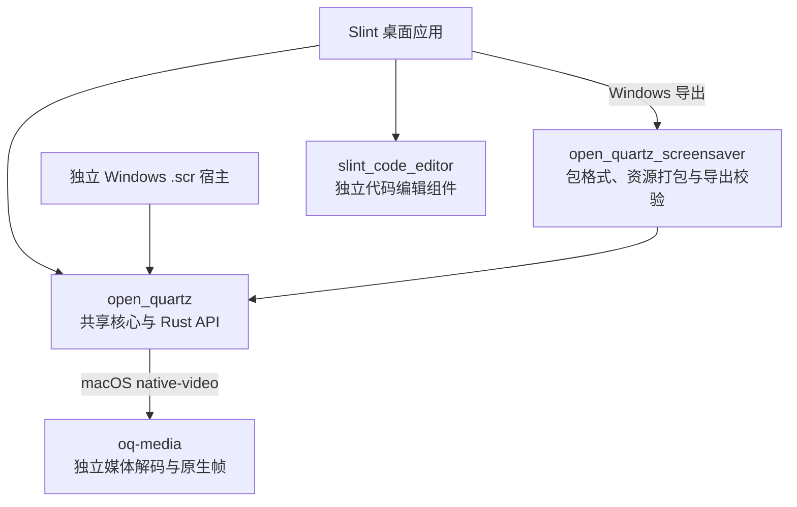
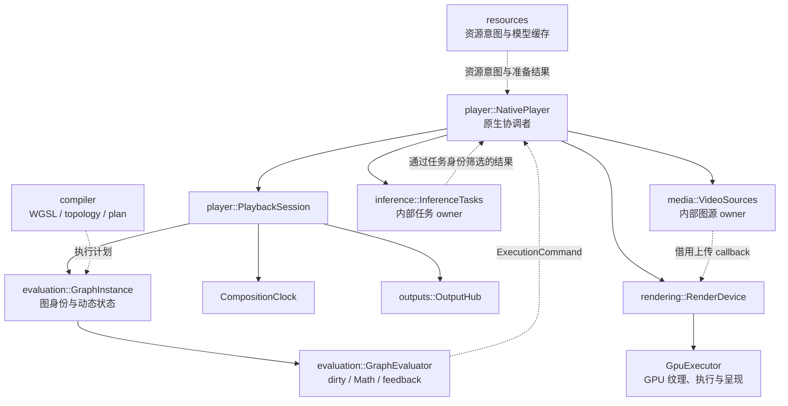
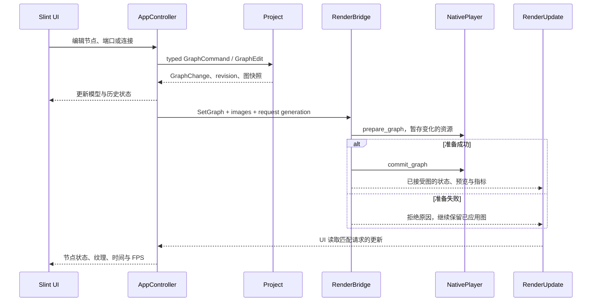
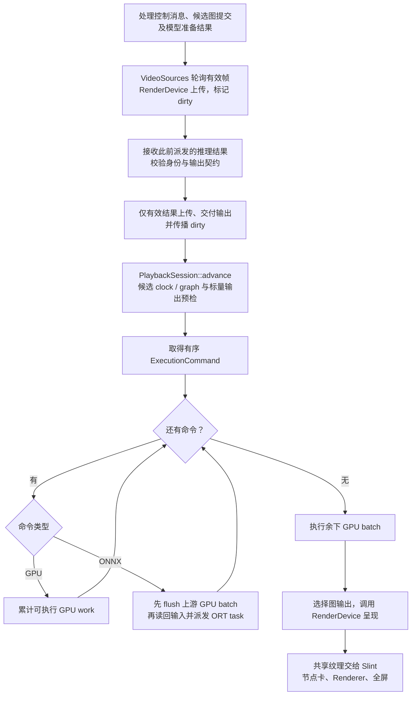
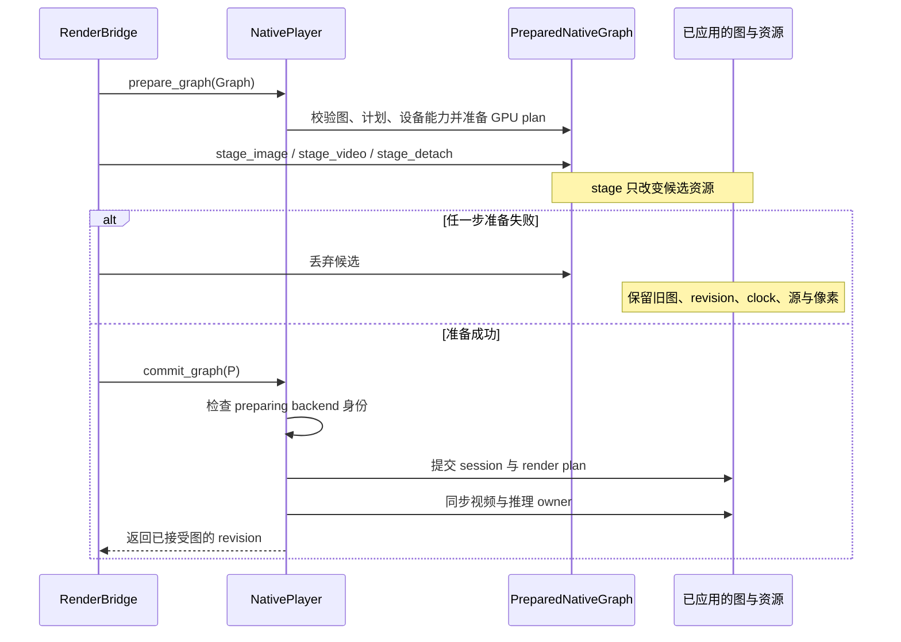
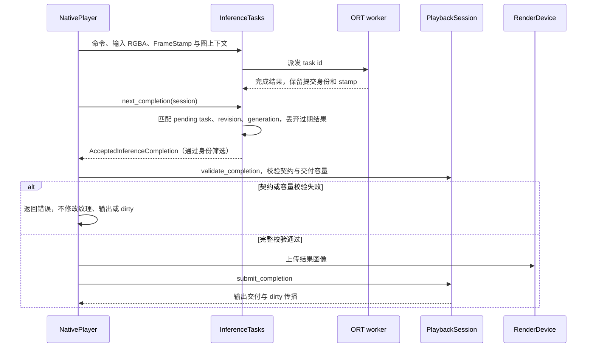

# Open Quartz 架构设计

本文描述当前 Rust/Slint 桌面应用、独立 Windows 屏保和共享 Rust 核心的实际架构。以模块所有权、线程边界和数据交接为主线；媒体与推理的后续方案分别见[媒体架构](MEDIA_CODEC_ARCHITECTURE.md)和[推理架构](INFERENCE_ARCHITECTURE.md)。Web、Tauri、WASM 与语言绑定产品已退役，不属于本文架构。

阅读顺序：

- [系统总览](#architecture-overview)：产品、crate 与依赖方向。
- [模块与所有权](#module-ownership)：状态和资源由谁持有。
- [项目编辑与控制流](#control-flow)：界面操作如何成为已应用的图。
- [逐帧数据流](#frame-dataflow)：视频、求值、GPU 与推理的执行顺序。
- [输出与资源传递](#outputs)：订阅、共享纹理和显式读回。
- [图替换与生命周期](#graph-lifecycle)：准备、提交、播放控制和关闭。
- [线程与异步任务](#threading)：请求身份、迟到结果和释放规则。
- [能力与编译边界](#capabilities)：默认核心与可选设备功能。
- [独立屏保与发布](#deployment)：`.scr` 宿主和运行库布局。
- [架构约束与已知限制](#known-limitations)、[验证基线](#validation)、[源码索引](#source-map)。

## 系统总览

Open Quartz 用节点图组合 GPU Shader、CPU Math、视频输入和 ONNX 推理。桌面应用负责编辑、窗口与交互；`open_quartz` 负责项目语义、编译、求值、播放状态、输出以及可选设备实现。桌面与独立屏保直接调用 typed Rust API。

下图箭头表示**编译依赖**，不是每帧数据流。Slint 应用和编辑器组件使用各自的 workspace；根 workspace 包含核心、媒体库、屏保打包库与屏保 stub。

| 组件 | 责任 | 边界 |
|---|---|---|
| `apps/open_quartz_slint` | 图编辑器、Inspector、文件交互、窗口、预览、模型准备与渲染线程桥接 | 消费核心规则，不重建 topology、dirty 或执行计划 |
| `open_quartz` | 项目、编译、求值、播放、输出、资源计划与设备能力 | 不依赖应用 UI；公共领域类型从 crate root 导出 |
| `oq-media` | 解码会话、帧元数据、原生帧及 lease；已落地 macOS VideoToolbox 后端 | 不依赖 OpenQuartz 图、NodeId、Slint 或 wgpu |
| `slint_code_editor` | cosmic-text 排版与编辑，Slint 输入和绘制，语法高亮、查找替换与本地历史 | 不依赖 OpenQuartz；Shader Apply 由应用提交 |
| `open_quartz_screensaver` | `.scr` 包格式、资源闭包与导出校验 | 可使用无设备核心，不启动桌面应用 |
| `open-quartz-screensaver-stub` | Win32 窗口、消息循环、Surface、包资源解压和独立执行 | 不依赖已安装的 Slint 应用 |

核心采用一个实现 crate，通过模块和 capability feature 隔离职责。独立组件因其可复用实现、依赖闭包或产品入口而独立，不增加仅转发接口的壳包。

## 模块与所有权

`open_quartz/src/lib.rs` 声明职责模块，并导出 `OpenQuartz`、`Project`、`Graph`、`ProjectNode`、`Port`、`Player`、`Resource`、`Output` 等公共类型。高级宿主接口位于各职责模块；`NativePlayer` 在启用 `native-runtime` 时也从 root 导出。

下图实线表示**持有或包含**，虚线表示**接口交接**。它描述 Slint 的原生执行路径；独立屏保的组合方式见[独立屏保与发布](#deployment)。

| 模块 / owner | 拥有的状态或实现 | 交接边界 |
|---|---|---|
| `project` | Graph、节点/端口/边、GraphEdit、不变量、Project、history/revision、catalog/layout/factory、屏保图变换 | typed 编辑命令与图快照；不拥有播放时钟或设备 |
| `compiler` | WGSL 解析/校验/生成、拓扑、可复用 `ExecutionPlan` | Graph → plan 与结构化节点错误；不保存 live graph dirty 状态 |
| `GraphEvaluator` | 共享的静态 nodes/plan，动态 dirty、Math 值与 feedback 状态 | `FrameInputs` → 有序工作命令；不执行上传、读回或 ORT |
| `GraphInstance` | applied Graph、revision、node generation、生命周期、待执行命令与 GraphEvaluator | 图替换、帧求值、身份校验；不持有 GPU、decoder 或 ORT session |
| `PlaybackSession` | GraphInstance、CompositionClock、OutputHub | 播放控制、时钟输入、求值与输出交付 |
| `NativePlayer` | 一个 PlaybackSession、RenderDevice，以及按 feature 启用的 VideoSources/InferenceTasks | 协调源上传、完成结果、命令执行和图输出呈现 |
| `OutputHub` | 输出契约、订阅、registry、presentation planner、resource registry、HostBackend 与 capabilities | typed 输出交付与独立的 presentation backend 接口 |
| `RenderDevice` | GpuExecutor、共享 wgpu Device/Queue、纹理/lease、显式读回、平台导入与呈现 | 执行 GPU work；不拥有图接受政策、视频源 map 或 ORT session |
| `VideoSources`（内部） | NodeId → NativeVideoSource 的 map、预览、播放控制与源替换 | 借用上传 callback，返回实际上传后变脏的节点；decoder/FrameLease 归媒体后端 |
| `InferenceTasks`（内部） | ORT sessions、pending、单调 task id、channels/workers、已接受的完成结果 | 接收命令、提交时 stamp 与 RGBA 输入；筛选任务身份后返回 envelope，完整输出契约校验由 NativePlayer 调用 PlaybackSession 执行 |
| `resources` | catalog、typed resource plan、模型下载/缓存/校验服务 | 表达资源意图和准备资源，不调度每帧求值 |

`GraphInstance` 的图快照和 `GraphEvaluator` 的静态 nodes/plan 使用共享 `Arc`；帧事务复制动态状态，不逐帧深拷贝 WGSL 源码。`VideoSources` 和 `InferenceTasks` 是核心内部 owner，不是新增的公共 root API。

## 项目编辑与控制流

界面中的项目和渲染线程已接受的图具有不同生命周期。`Project` 是编辑、持久化和 undo/redo 的来源；渲染线程保存已经成功准备并提交的图。编辑成功不保证资源或 GPU 准备也成功。

应用层的责任是把用户意图转成核心命令、维护表单草稿和投影 UI 模型。节点工厂、类型/环校验、连接替换、history 和图序列化由 Rust 核心提供。拖动完成、Shader Apply 或一组节点编辑按各自事务提交，不能在 UI 重建另一套图规则。

项目/文件 I/O、图片与 framebuffer 准备、模型下载和 session 构建通过应用服务及后台任务完成。`resources::plan` 生成 typed resource intents，供视频与 ONNX 同步共用。视频源打开仍属于候选图的 stage 步骤，不能把该步骤描述为完全无 I/O 的渲染循环。

图与资源在宿主间以 Rust 类型交接；JSON 用于项目文件、屏保包元数据和部分诊断序列化。准备失败时，UI 可以保留用户已编辑的项目，并显示“旧图仍在执行”；不能把编辑 revision、UI 请求 generation 和渲染图 revision 当成同一计数器。

默认启动、New 和 Open 都处于停止状态。编辑节点不隐式 Play；用户显式 Play 后才消耗图的首帧工作。停止或暂停时选择视频可以单独解码并上传一个源预览，不推进 composition time，也不消耗 Shader/Renderer 首帧工作。

## 逐帧数据流

Slint 的 RenderBridge 在原生渲染线程上串行处理控制消息并调用 `NativePlayer::render_next`。运行、加载模型或等待视频预览时使用约 16 ms 的消息等待；这个调度间隔不等于实际渲染 FPS。

执行顺序由图计划和命令序列决定：

1. 上传当前视频源的有效帧，再将实际内容变更传播为 dirty。被替换的源不能继续提供旧帧。
2. 在推进本帧时钟之前处理推理完成结果。revision、generation、task id 和输出契约通过后，才允许上传和交付。
3. `PlaybackSession::advance` 使用候选 clock/graph 求值；整批标量输出通过契约和交付容量预检后提交。拒绝该批输出时保留可重试的时钟、dirty work 和交付状态。
4. 依次消费命令，遇到 ONNX 命令先提交此前累计的 GPU work，再获取其上游输入并派发任务，最后执行剩余 GPU work。缺少输入纹理的 GPU 命令等待资源就绪。
5. 选择图输出交给 RenderDevice，Slint 导入同一 Device/Queue 上的输出纹理。

图计划优先采用显式 Renderer 输出，也支持没有 Renderer 的末端纹理输入节点。资源尚在解码或推理时，可以暂时没有可呈现纹理；不能用空输出累计有效 Render FPS。

标量预检的事务范围不覆盖已经提交的 GPU work 或外部呈现。OutputHub backend dispatch 在候选状态提交后执行；GPU 执行、读回或 present 失败不意味着整帧设备状态自动回滚。

## 输出与资源传递

输出包含两个相关但不同的路径：

- `OutputHub` 处理 typed 输出契约、订阅、值/资源句柄、交付政策及可选 backend presentation。
- Slint 生产路径由 NativePlayer 选择图输出，再经 RenderDevice 呈现；RenderBridge 把 GPU 纹理交给 UI。普通节点卡、Renderer 和全屏预览共享纹理。

Slint 的图输出由 NativePlayer 交给 RenderDevice 呈现，当前生产路径没有向 OutputHub 挂载 HostBackend。OutputHub 保留独立的 backend presentation 接口及测试覆盖，不能把接口存在等同于已接管 Slint 显示。

| 路径 | 数据传递 | 当前实现边界 |
|---|---|---|
| CPU Math / 标量输出 | 值 → OutputHub → 订阅交付 | 契约与整批容量预检；支持 OnChange、Latest、Every 政策 |
| Shader / 预览 | GPU work → 输出纹理 → Slint texture Image | 同一 wgpu Device/Queue；实时预览不经 PNG/base64 |
| 视频输入 | decoder frame/lease → 上传 callback → GPU 纹理 | macOS 原生面可直接供 GPU 导入/颜色转换；其他源保留各自软件或平台路径 |
| Slint ONNX 图像任务 | GPU readback → RGBA → ORT worker → 完成校验 → GPU upload | 有 CPU 搬运，不是端到端设备驻留推理 |
| PNG capture | 显式 GPU readback → 编码 → 文件 | 用户操作或验证使用；不作为普通预览通道 |

`OutputKey` 以 node/port 标识输出；`OutputState` 携带 graph revision、output generation、evaluation/content stamp 和 payload。payload 类型可以表达值、bytes、resource 或 tensor handle，类型存在不代表所有设备传输路径已接通。

GPU 纹理和原生帧通过 handle/lease 保持有效，直到提交与消费者使用完成。实际图像尺寸参与 Auto size 传播；Filter 自动尺寸沿声明顺序的连接输入传播，手动尺寸保留显式设置。composition time 表示图播放时间，Render FPS 统计有效图输出，不能用源视频 FPS 或屏幕刷新率替代。

## 图替换与生命周期

### 候选图的准备与提交

`PreparedNativeGraph` 持有候选 Graph/plan、暂存 GPU 状态、准备好的视频源和资源变化。准备过程不能覆盖当前纹理的像素；候选图片分配新纹理，未变化的资源可以继续共享。

准备与提交在同一渲染线程串行进行，token 被消费，且绑定原来的 RenderDevice backend。它不是跨设备资源，也不是通过持有 token 隐式锁定当前 revision 的长期事务。

视频纹理的失效有三条具体规则：

- 替换视频先成功打开新源，再清理候选中的旧纹理；打开失败不伤及旧源和像素。
- 显式 detach、删除节点或同 NodeId 从 Video 改为 Image 时，先移除候选旧视频纹理，再进行可选图片上传。
- 提交新源后，预览等待新源自己的实际上传，不能因同尺寸旧纹理仍存在而误判为就绪。

成功替换保留兼容的 dirty/feedback 与资源，更新需要失效的 generation/task 状态；被丢弃的候选释放自己拥有的资源。准备失败与已接受图的后续运行错误分别报告，不能因候选拒绝就清空仍有效的旧输出。

### 播放、暂停、停止与关闭

| 操作 | 状态与资源行为 |
|---|---|
| 准备图 | 建立可执行计划；应用在未请求播放时等待显式 Play |
| Play / Resume | 启动或恢复 composition clock 和连续媒体轮询；按 dirty 状态执行 |
| Pause | 冻结 composition time，暂停媒体轮询，保留图与预览 |
| Stop | 重置 clock/图播放状态，取消 pending 推理身份，暂停连续媒体轮询；保留重新 Play 所需配置 |
| close / dispose | 将 session 置为 disposed，清除图源与推理 owner 的配置，重置渲染输出 |
| owner Drop | 释放其资源；InferenceTasks 会 join 活跃 ORT workers |

停止/暂停的单帧视频预览是独立上传路径。它不调用 `render_next` 或 `start_playback`，也不推进 composition clock。

关闭使旧结果无法发布，不保证不可中断的底层调用立即退出。正在运行的 ORT worker 持有 `Arc` session 直到完成；`InferenceTasks::Drop` 可能等待这些 worker。GPU lease 同样必须活到提交与消费者使用结束。

## 线程与异步任务

| 执行上下文 | 主要责任 | 交接 |
|---|---|---|
| Slint UI thread | 窗口、输入、表单草稿、AppController、UI model 与共享纹理导入 | typed 控制命令下发，读取 RenderUpdate |
| RenderBridge render worker | NativePlayer、图准备/提交、播放控制、上传、GPU work、完成结果接收与呈现 | 协调者与 GPU 操作留在此线程，使用与 Slint 相同的 Device/Queue 实例 |
| 项目 / 文件 / 模型准备任务 | 文件服务、图片或 framebuffer 准备、下载/缓存校验、ORT session 构建 | 完成消息携带请求身份，接受后才能挂到当前节点 |
| ORT inference workers | 借助共享的 `Arc<Mutex<OnnxSession>>` 执行已派发的图像任务 | session handle 随任务进入 worker，通过 channel 返回 task id、提交时 stamp 与结果 |
| 媒体后端 | 平台源/decoder 与 frame lease | 向 VideoSources 提供有效帧，由上传 callback 借用消费 |

模型准备和逐帧推理是两种异步操作：模型请求通过 ticket/cancel 规则控制是否发布；帧推理由 InferenceTasks 的 pending/task id 管理。取消发布不等于立即终止下载、构建或 ORT 调用。

身份与时间字段各有用途：

| 字段 | 含义 |
|---|---|
| UI request generation | 一次界面请求及其状态回传；拒绝候选后仍可采用该请求号显示错误 |
| graph revision | 渲染 session 已接受的图版本；与 Project 编辑 revision 分开维护 |
| node generation | 同 NodeId 资源重建的身份，用于排除旧节点实例结果 |
| 模型 request ticket | 区分模型准备、取消、卸载与项目替换 |
| task id | 区分一次已派发推理及其当前 pending 身份 |
| `FrameStamp` | 提交输入的 epoch、frame、timeline_ns、deadline_ns |
| `ContentStamp` | 内容所属 epoch、timeline_ns 与可选 media_pts_ns |

完成结果保留原始提交 stamp，不能伪装成本帧新计算的内容，也不能只靠“帧号等于当前帧号”判断有效性。旧完成消息不得清除替代任务的 pending 状态。契约或 backpressure 拒绝必须发生在纹理修改、输出事件与 dirty 更新之前；这不提供 GPU 上传与所有后续操作之间的设备级回滚。

## 能力与编译边界

核心 `default = []`。项目编辑、catalog、WGSL 编译、拓扑/计划、纯求值、PlaybackSession/OutputHub 和纯 ONNX task/pre/postprocess 可以在无设备配置下使用。

| Feature | 启用内容 | 依赖关系 |
|---|---|---|
| `gpu` | wgpu executor、纹理、读回与平台 GPU 能力 | 设备能力入口；WGSL compiler 不依赖它 |
| `native-runtime` | NativePlayer 与原生播放协调 | 蕴含 `gpu`；不自动启用视频、ONNX 或下载 |
| `native-video` | NativeVideoSource、图源 owner 与平台媒体路径 | macOS 选择 `oq-media`；不强制 GPU 或 native-runtime |
| `native-video-d3d12` | Windows D3D12 视频细化路径 | 蕴含 `native-video` 与 `gpu` |
| `native-onnx` | ORT session 和 native pipeline | 不要求 GPU 或 HTTP |
| `model-cache` | 下载、哈希校验与缓存发布 | reqwest/sha2；不要求 ORT 或 GPU |

feature 与平台 `cfg` 共同约束实现。Slint 显式选择 native-runtime、native-video、native-onnx 和 model-cache；Windows 增加对应视频能力。项目编辑与屏保打包库可消费无设备核心。

Cargo feature 是可加的，完整 workspace 中其他消费者可能重新打开设备依赖。因此，默认核心及独立 feature 的依赖闭包必须以独立 consumer 验证，不能从一次 workspace 构建推断。独立编辑器也应保持无 OpenQuartz normal/build dependency。

桌面直接调用 Rust 类型，不需要额外的 SDK C ABI/JNI 或语言 proxy。ORT、FFmpeg、AVFoundation/CoreVideo、Metal、D3D12/COM 等外部库与平台 FFI 仍属于设备后端的必要实现。

## 独立屏保与发布

### Windows 屏保

桌面导出选择一个 Renderer，打包其图所需图片、文件视频、模型与运行库；相机不是确定性导出源，相关图拒绝导出。包格式与资源闭包由 `open_quartz_screensaver` 管理。

独立 `.scr` stub 解压包资源后，在自己的 Win32 消息循环/Surface 中直接组合 `PlaybackSession`、evaluation work、`GpuExecutor`、视频源和 ONNX session；它不经过 Slint 的 NativePlayer/InferenceTasks 路径。当前屏保的 ONNX readback → run → upload 在宿主循环中同步执行，不能套用 Slint 的异步时序图。`/s`、`/p <HWND>`、`/c` 对应独立运行、预览与配置入口，不启动主应用进程。实际 Windows 设备验收状态见[已知限制](#known-limitations)。

### 桌面运行库与包布局

`npm run dev` 通过 `scripts/desktop.mjs` 准备运行库并启动 Slint；`npm run build` 生成 release binary 与 portable package。资源来源为应用自己的 `icons/` 和生成的 `runtime/`。

| 平台 | 产物 | 运行库位置 |
|---|---|---|
| macOS arm64/x64 | `.app` + ZIP | `Contents/Resources/runtime/`；binary 在 `Contents/MacOS/` |
| Windows x64 | ZIP | exe 同目录及 `runtime/`，包含 `.scr` stub |
| Linux x64/arm64 | tarball | executable-parent 的 `runtime/`；仍依赖系统桌面、字体与 GPU 库 |

运行库包含架构匹配的 FFmpeg、官方 ONNX Runtime 1.21.0、必要依赖、来源与许可证；Windows 还包含 DirectML 和 app-local VC++ DLL。Windows 的导入 DLL 需要在 `main` 前可解析，仅在 Rust startup 修改 PATH 不足以满足 loader。

开发脚本显式设置运行库环境；安装包按可执行文件/资源目录解析。必需资源缺失或下载/校验失败时终止打包。macOS 包包含图标和相机用途说明并做 ad-hoc 签名，尚未 notarize；Windows 包未签名。具体准备步骤见[开发指南](DEVELOPMENT.md)与[应用说明](../apps/open_quartz_slint/README.md)。

## 架构约束与已知限制

修改核心或宿主时需保持以下约束：

1. 项目编辑规则、WGSL、topology、dirty、feedback 和命令排序各有唯一 owner；UI 不复制执行语义。
2. 纯 compiler/evaluation 不依赖 live GPU、视频源、ORT session 或 UI。
3. Slint 与 RenderDevice 使用同版本 wgpu 和同一 Device/Queue 实例；GPU 上传、执行和呈现保持原渲染线程边界。
4. 图准备失败保留已应用图；过期异步结果在改变纹理和输出前被拒绝。请求身份、图身份和内容时间不可混用。
5. 普通预览共享纹理，截图与当前推理输入显式读回；性能结论必须注明传输路径与实际测量范围。
6. 资源释放遵守 worker、frame 与 GPU lease 的真实生命周期；取消发布不伪装成底层调用立即退出。
7. 默认依赖闭包和 capability 组合分别检查；覆盖率跟随生产实现，不通过降低阈值或扩大 exclusion 隐藏缺口。

| 限制 | 当前边界 |
|---|---|
| 公共 headless `Player` | 具备图、播放状态与输出 API，但尚未连接实际设备 driver；Slint 使用 NativePlayer |
| `Project::graph_mut` | 仍可绕过 revision/history；需要受控编辑语义的调用使用项目命令/事务 |
| 整帧回滚 | 标量预检和候选图准备有明确拒绝边界；已提交的 GPU/backend 操作没有通用回滚 |
| 推理数据通路 | 当前图像任务仍有 readback/CPU/上传；通用平台后端与严格设备驻留见独立推理提案 |
| 媒体能力 | oq-media 的实际后端和平台覆盖以媒体文档为准；完整跨平台会话、编码与独立 Slint 播放器仍属后续方案 |
| 输入与辅助技术 | 原生编辑器的系统 IME、完整 screen-reader caret/selection 与 Windows/Linux 输入仍需实机验收 |
| 平台验证 | 相机、Windows/Linux GPU、独立 `.scr` 与移动端未完成本轮实机验证；移动端交付暂缓 |
| macOS 启动 | 早先出现过未解释的 winit startup abort，后续未复现，不能宣称原因已修复 |
| 覆盖率 | 默认与完整 native 的整体 100% gates 仍失败，见下节 |

## 验证基线

以下为 2026-11-06 职责重构完成时的本地基线，版本仍为 Unreleased。它记录该次运行结果，不代表每次文档修改都重跑，或远端 CI、其他平台和发布均已完成。

| 范围 / 命令 | 已记录结果 |
|---|---|
| 根 workspace：`cargo test --locked --workspace` | 234 项通过 / 34 suites |
| 完整 native 核心：native-runtime,native-video,native-onnx,model-cache | 315 项通过 / 30 suites |
| 独立 `native-onnx` / `native-runtime`，均 `--no-default-features` | 247 项 / 30 suites；279 项 / 28 suites |
| `npm run test:desktop` | Slint 73 项通过，含失败图替换保留资源和同尺寸视频像素替换 |
| `npm run test:desktop:ui` | 18/18；[交互报告](../test-results/slint-ui/interaction-2026-11-06T07-04-55-208Z/report.html) |
| `npm run test:desktop:shaders` | 34/34；[Shader 报告](../test-results/slint-ui/shaders-2026-11-06T07-05-10-565Z/report.html) |
| `npm run test:editor` | 10 项通过：5 syntax + 5 editing |
| `npm run check:rust-boundaries` | single-core API、default 与独立 feature 依赖边界通过 |
| `npm run build` | macOS arm64 runtime copy、ad-hoc 签名、`--help` 启动与 ZIP 通过 |

覆盖率脚本 `npm run test:sdk-coverage` 的测试全部通过，但两项整体 100% 门槛失败：

| 范围 | 测试 | Lines | Functions | Regions | 100% gate |
|---|---:|---:|---:|---:|---|
| 默认核心 | 134 通过 | 98.53% | 97.88% | 98.34% | 失败 |
| 完整 native | 201 通过 | 97.70% | 95.96% | 96.38% | 失败 |

阈值未放宽。RenderDevice、InferenceTasks 和 VideoSources 计入生产覆盖率；NativePlayer 协调文件及模型下载文件沿用脚本既有排除范围，具体规则以 [`test-sdk-coverage.mjs`](../scripts/test-sdk-coverage.mjs) 为准。功能测试通过不能替代覆盖率或平台设备验收。

原生测试需要准备对应 FFmpeg/ORT 运行库；开发脚本会配置环境，直接运行 Cargo 时按开发指南设置 `OPEN_QUARTZ_FFMPEG_PATH` 与 `ORT_DYLIB_PATH`。测试和 fixtures 随行为 owner 维护，显式保留像素、状态、迟到结果、资源释放和失败后重试断言。

## 源码索引

| 主题 | 入口 |
|---|---|
| 核心 root API 与 feature | [`lib.rs`](../crates/open_quartz/src/lib.rs)、[`Cargo.toml`](../crates/open_quartz/Cargo.toml) |
| 项目、命令、历史与节点工厂 | [`project/`](../crates/open_quartz/src/project/) |
| WGSL、拓扑与计划 | [`compiler/`](../crates/open_quartz/src/compiler/) |
| 图身份与纯求值 | [`evaluation/instance.rs`](../crates/open_quartz/src/evaluation/instance.rs)、[`evaluator.rs`](../crates/open_quartz/src/evaluation/evaluator.rs) |
| 播放会话与原生协调 | [`player/session.rs`](../crates/open_quartz/src/player/session.rs)、[`native.rs`](../crates/open_quartz/src/player/native.rs) |
| 输出、订阅与 presentation | [`outputs/`](../crates/open_quartz/src/outputs/) |
| GPU 执行、资源与平台导入 | [`rendering/device.rs`](../crates/open_quartz/src/rendering/device.rs)、[`executor.rs`](../crates/open_quartz/src/rendering/executor.rs)、[`videotoolbox.rs`](../crates/open_quartz/src/rendering/videotoolbox.rs)、[`dxgi.rs`](../crates/open_quartz/src/rendering/dxgi.rs) |
| 视频源与媒体后端 | [`media/sources.rs`](../crates/open_quartz/src/media/sources.rs)、[`native.rs`](../crates/open_quartz/src/media/native.rs)、[`oq-media`](../crates/oq-media/) |
| 推理任务与 session/pipeline | [`inference/tasks.rs`](../crates/open_quartz/src/inference/tasks.rs)、[`inference/`](../crates/open_quartz/src/inference/) |
| 资源计划、模型准备与缓存 | [`resources/plan.rs`](../crates/open_quartz/src/resources/plan.rs)、[`models.rs`](../crates/open_quartz/src/resources/models.rs) |
| 桌面控制与渲染桥 | [`app_controller.rs`](../apps/open_quartz_slint/src/app_controller.rs)、[`render_bridge.rs`](../apps/open_quartz_slint/src/render_bridge.rs)、[`onnx_runtime.rs`](../apps/open_quartz_slint/src/onnx_runtime.rs) |
| 项目与文件服务 | [`services/`](../apps/open_quartz_slint/src/services/) |
| 独立代码编辑器 | [`slint_code_editor`](../crates/slint_code_editor/) |
| 屏保导出与独立宿主 | [`open_quartz_screensaver`](../crates/open_quartz_screensaver/)、[`native_host.rs`](../crates/open-quartz-screensaver-stub/src/native_host.rs) |
| 唯一 Shader catalog | [`project/shader_catalog.json`](../crates/open_quartz/src/project/shader_catalog.json) |
| 行为测试与原生 fixtures | owner 内 unit/coverage tests、[`核心 tests`](../crates/open_quartz/tests/)、[`fixtures`](../tests/fixtures/) |
| 构建与边界检查 | [`desktop.mjs`](../scripts/desktop.mjs)、[`check-rust-boundaries.mjs`](../scripts/check-rust-boundaries.mjs)、[`test-sdk-coverage.mjs`](../scripts/test-sdk-coverage.mjs) |

架构变更需同步相关总图、数据流、生命周期、能力矩阵与源码入口。详细运行命令见[开发指南](DEVELOPMENT.md)，应用行为见[Slint README](../apps/open_quartz_slint/README.md)，性能实验与平台扩展分别留在媒体、推理专项文档。
