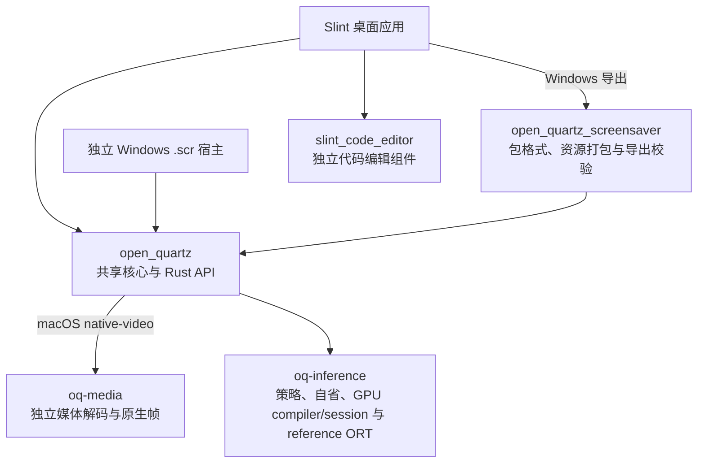
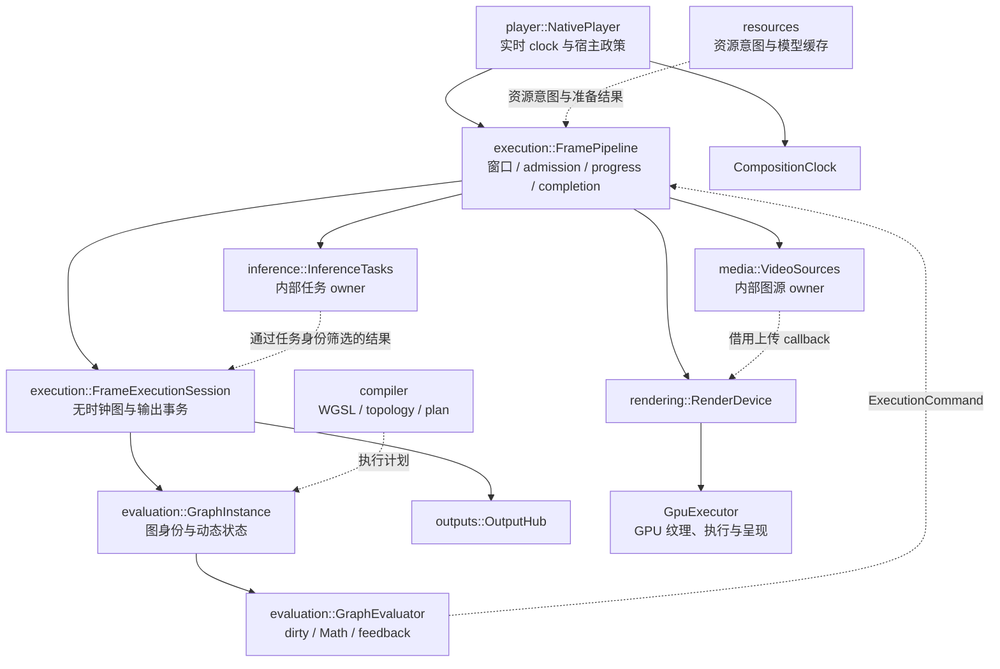
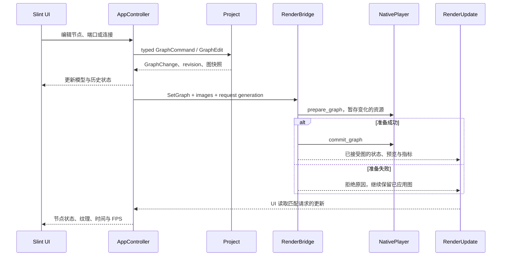
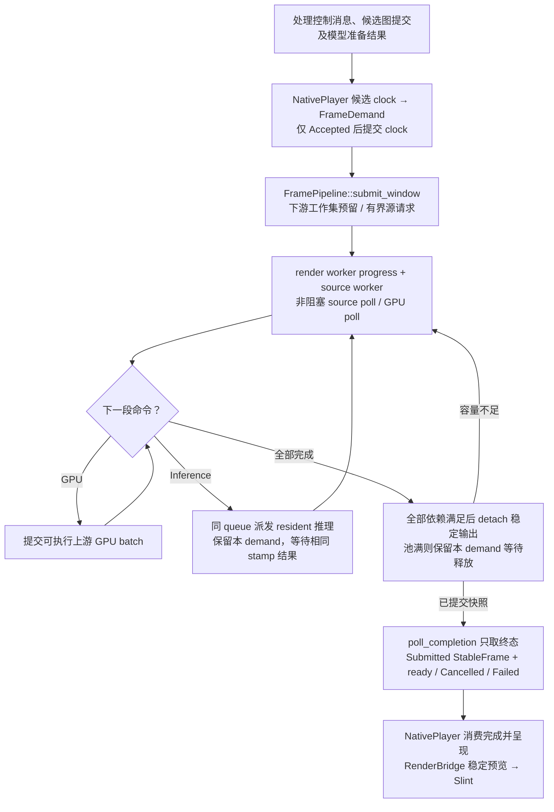
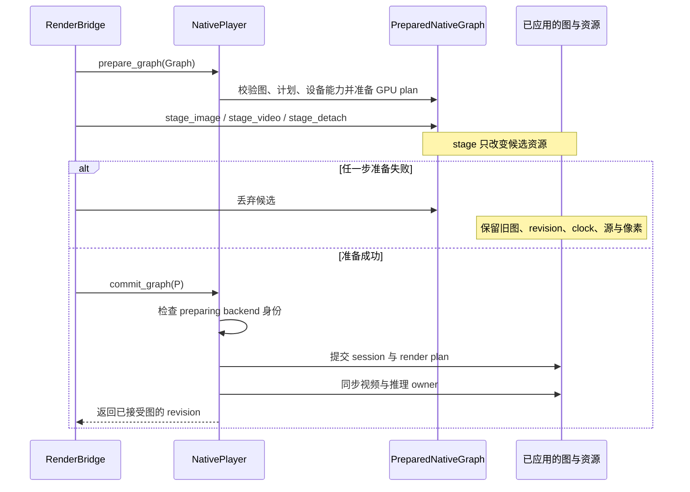
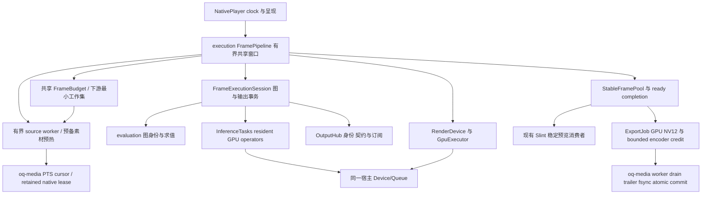

# Open Quartz 架构设计

本文描述Rust/Slint桌面、独立Windows屏保和共享Rust核心。[执行/渲染分离](#execution-rendering-split)当前包含稳定帧、共享FramePipeline/FrameExecutionSession、精确媒体PTS、有界预取/credit和Phase5无窗口硬件H264/MP4任务；真实验收及未通过coverage gates按阶段单列。媒体与推理详见[媒体架构](MEDIA_CODEC_ARCHITECTURE.md)、[推理架构](INFERENCE_ARCHITECTURE.md)。Web、Tauri、WASM与语言绑定产品已退役。

阅读顺序：

- [系统总览](#architecture-overview)：产品、crate 与依赖方向。
- [模块与所有权](#module-ownership)：状态和资源由谁持有。
- [项目编辑与控制流](#control-flow)：界面操作如何成为已应用的图。
- [逐帧数据流](#frame-dataflow)：视频、求值、GPU 与推理的执行顺序。
- [输出与资源传递](#outputs)：订阅、共享纹理和显式读回。
- [图替换与生命周期](#graph-lifecycle)：准备、提交、播放控制和关闭。
- [线程与异步任务](#threading)：请求身份、迟到结果和释放规则。
- [能力与编译边界](#capabilities)：默认核心与可选设备功能。
- [渲染与执行分离决策](#execution-rendering-split)：同 crate 内抽离无时钟执行会话、稳定帧与有界流水；当前状态与迁移顺序。
- [独立屏保与发布](#deployment)：`.scr` 宿主和运行库布局。
- [架构约束与已知限制](#known-limitations)、[验证基线](#validation)、[源码索引](#source-map)。

<a id="architecture-overview"></a>
## 系统总览

Open Quartz 用节点图组合 GPU Shader、CPU Math、硬件视频与 resident 推理。桌面负责编辑/窗口；`open_quartz` 负责图与播放适配；独立 `oq-inference/gpu` 拥有 GPU 模型编译、session 与硬件图像执行，ORT 命名 FP32 Tensor 仅供显式 reference/诊断。ONNX 是模型产物格式，不是生产后端。

下图箭头表示**编译依赖**，不是每帧数据流。Slint 应用和编辑器组件使用各自的 workspace；根 workspace 包含核心、媒体库、独立推理库、屏保打包库与屏保 stub。



| 组件 | 责任 | 边界 |
|---|---|---|
| `apps/open_quartz_slint` | 图编辑器、Inspector、文件交互、窗口、预览、模型准备与渲染线程桥接 | 消费核心规则，不重建 topology、dirty 或执行计划 |
| `open_quartz` | 项目、编译、求值、播放、输出、资源计划与设备能力 | 不依赖应用 UI；公共领域类型从 crate root 导出 |
| `oq-media` | 解码会话、帧元数据、原生帧及 lease；已落地 macOS VideoToolbox 后端 | 不依赖 OpenQuartz 图、NodeId、Slint 或 wgpu |
| `oq-inference` | ONNX 源自省、策略、`gpu` feature 的实际 GPU compiler/GpuImageSession；显式 reference Tensor/ORT adapters | 不依赖 OpenQuartz、NodeId/revision、Slint 或 oq-media；仅 gpu feature 引入 wgpu |
| `slint_code_editor` | cosmic-text 排版与编辑，Slint 输入和绘制，语法高亮、查找替换与本地历史 | 不依赖 OpenQuartz；Shader Apply 由应用提交 |
| `open_quartz_screensaver` | `.scr` 包格式、资源闭包与导出校验 | 可使用无设备核心，不启动桌面应用 |
| `open-quartz-screensaver-stub` | Win32 窗口、消息循环、Surface、包资源解压和独立执行 | 不依赖已安装的 Slint 应用 |

图语义采用一个实现 crate，通过模块和 capability feature 隔离职责。媒体与推理因具有独立可运行实现和依赖闭包而独立，编辑器与宿主因可复用组件或产品入口而独立；不增加仅转发接口的壳包。

<a id="module-ownership"></a>
## 模块与所有权

`open_quartz/src/lib.rs` 声明职责模块，并导出 `OpenQuartz`、`Project`、`Graph`、`ProjectNode`、`Port`、`Player`、`Resource`、`Output` 等公共类型。高级宿主接口位于各职责模块；`NativePlayer` 在启用 `native-runtime` 时也从 root 导出。

下图实线表示**持有或包含**，虚线表示**接口交接**。它描述 Slint 的原生执行路径；独立屏保的组合方式见[独立屏保与发布](#deployment)。



| 模块 / owner | 拥有的状态或实现 | 交接边界 |
|---|---|---|
| `project` | Graph、节点/端口/边、GraphEdit、不变量、Project、history/revision、catalog/layout/factory、屏保图变换 | typed 编辑命令与图快照；不拥有播放时钟或设备 |
| `compiler` | WGSL 解析/校验/生成、拓扑、可复用 `ExecutionPlan` | Graph → plan 与结构化节点错误；不保存 live graph dirty 状态 |
| `GraphEvaluator` | 共享的静态 nodes/plan，动态 dirty、Math 值与 feedback 状态 | `FrameInputs` → 有序工作命令；不执行上传、读回或 ORT |
| `GraphInstance` | applied Graph、revision、node generation、生命周期、待执行命令与 GraphEvaluator | 图替换、帧求值、身份校验；不持有 GPU、decoder 或 ORT session |
| `FrameExecutionSession` | GraphInstance、OutputHub、最近求值 stamp | 显式 FrameEvaluationInput → 图/标量输出事务与异步完成校验；无 clock、GPU、源或推理 session |
| `PlaybackSession` | 同一 FrameExecutionSession + CompositionClock | 为无设备/高级播放调用加入时钟和播放控制；不另实现图/输出状态 |
| `FramePipeline` | FrameExecutionSession、RenderDevice、VideoSources、InferenceTasks、稳定帧池、有界需求/终态窗口与共享FrameBudget | 显式demand admission、源预取、按序图求值、GPU/推理依赖与稳定输出completion；无clock |
| `NativePlayer` | 一个FramePipeline、CompositionClock与实时宿主输入 | 按低/高水位规划前瞻，启动prefill后建立播放时间，按deadline消费稳定完成；不保留第二执行循环 |
| `OutputHub` | 输出契约、订阅、registry、presentation planner、resource registry、HostBackend 与 capabilities | typed 输出交付与独立的 presentation backend 接口 |
| `RenderDevice` | GpuExecutor、共享 wgpu Device/Queue、纹理/lease、显式读回、平台导入与呈现 | 执行 GPU work；不拥有图接受政策、视频源 map 或 ORT session |
| `VideoSources`（内部） | NodeId → NativeVideoSource 的 map、预览、播放控制与源替换 | 借用上传 callback，返回实际上传后变脏的节点；decoder/FrameLease 归媒体后端 |
| `InferenceTasks`（内部） | resident 模型/session、图任务身份与有效输出 | 图契约与 NodeId/revision 留在 OpenQuartz，GPU 图像执行归独立库；不派发生产 ORT host-image worker |
| `resources` | catalog、typed resource plan、模型下载/缓存/校验服务 | 表达资源意图和准备资源，不调度每帧求值 |
| `oq_inference::GpuImageSession` / `InferenceSession` | 前者执行 resident GPU 网络，后者保留显式 reference ORT/FP32 Tensor | 不拥有图/UI 身份；生产只用硬件图像路径 |

`GraphInstance` 的图快照和 `GraphEvaluator` 的静态 nodes/plan 使用共享 `Arc`；帧事务复制动态状态，不逐帧深拷贝 WGSL 源码。`VideoSources` 和 `InferenceTasks` 是核心内部 owner，不是新增的公共 root API。

模型事实与图任务契约分别建模：`inspect_onnx(model)` 无需 ORT，session `source_interface` 保留 IR/producer/model versions、domain、graph name、模型/图/值 descriptions/custom properties 和 opset imports。递归源类型包括 Tensor/SparseTensor/Sequence/Map/Optional/Opaque/Unknown，保留精确 dtype codes、UnknownRank 与 scalar 的区别、静态/符号/dynamic 维度及 denotation。Required/Optional/OverridableInitializer 输入、dense/sparse initializer 与 external-data 引用均可报告，不复制或加载权重。运行时 `ValueKind`/元素分类、metadata 与原始源声明分开；opset 从源解析，不以 ORT API 21 不支持查询作统一缺失理由，也不把 runtime model-version sentinel 当作源版本。产物 SHA-256/字节数/格式是独立事实。

typed `ImageTaskContract` 保留精确命名输入/选定输出、layout、preprocessing/resize/decoder、声明及实际 shape 约束；source facts 与 taskContract 分开报告。U²Net-P 七输出 `1959`–`1965`、显式 mask `1959` 与 COCO `[1,84,8400]` 契约仍保留，历史 reference 数值成功不表示这些模型可 resident 执行。生产仅 SR3，其他模型在 frame access 前拒绝；完整字段见[推理架构](INFERENCE_ARCHITECTURE.md)。

<a id="control-flow"></a>
## 项目编辑与控制流

界面中的项目和渲染线程已接受的图具有不同生命周期。`Project` 是编辑、持久化和 undo/redo 的来源；渲染线程保存已经成功准备并提交的图。编辑成功不保证资源或 GPU 准备也成功。



应用层的责任是把用户意图转成核心命令、维护表单草稿和投影 UI 模型。节点工厂、类型/环校验、连接替换、history 和图序列化由 Rust 核心提供。拖动完成、Shader Apply 或一组节点编辑按各自事务提交，不能在 UI 重建另一套图规则。

项目/文件 I/O、图片与 framebuffer 准备、模型下载和 session 构建通过应用服务及后台任务完成。`resources::plan` 生成 typed resource intents，供视频与推理同步共用。视频源打开仍属于候选图的 stage 步骤，不能把该步骤描述为完全无 I/O 的渲染循环。

图与资源在宿主间以 Rust 类型交接；JSON 用于项目文件、屏保包元数据和部分诊断序列化。准备失败时，UI 可以保留用户已编辑的项目，并显示“旧图仍在执行”；不能把编辑 revision、UI 请求 generation 和渲染图 revision 当成同一计数器。

默认启动、New 和 Open 都处于停止状态。编辑节点不隐式 Play；用户显式 Play 后才消耗图的首帧工作。停止或暂停时选择视频可以单独解码并上传一个源预览，不推进 composition time，也不消耗 Shader/Renderer 首帧工作。

<a id="frame-dataflow"></a>
## 逐帧数据流

Slint RenderBridge在原生render worker串行处理控制消息并调用NativePlayer。源选择由有界source worker持有cursor；GPU转换、图求值和稳定快照仍在原Device/Queue。媒体ready、GPU completion与consumer释放发送合并Wake消息；16ms超时负责clock deadline与设备poll，不是UI刷新率或渲染FPS。诊断trace默认关闭，开启时保存有界512条阶段事件。



执行顺序由图计划和命令序列决定：

1. NativePlayer按低/高水位规划有界未来demand：request ID、graph revision、显式FrameEvaluationInput、目标输出。高级宿主可传入非零内容版本的ExternalFrameInput/StableFrame；源PTS始终来自实际选中presentation surface。
2. `submit_window`只在图目标/推理输出/稳定显示最小工作集和源请求都有预算时接受。临时满返回WouldBlock并归还原demand；非法/不可能工作集返回Rejected。共享admission门只串行化预留，不等待codec/GPU/UI。保留显式单帧`submit`，两入口使用同一图事务与progress实现。
3. 有界source worker沿同一decoder cursor预取；render worker按序激活demand并poll源ready，随后同queue提交转换/图/推理。已完成但未消费的终态仍占窗口，不把UI慢消费者变成无界缓存。
4. pipeline 按命令顺序提交上游 GPU work；遇到异步推理，在同一 demand 内等待其输入 stamp 对应的有效结果，再执行下游 Shader/Renderer。revision、generation、task、契约与交付容量在改纹理/发布前校验，不能以旧纹理冒充本帧依赖。
5. 全部依赖满足后detach到StableFramePool；Submitted仅指GPU工作已提交，`StableFrame.ready`独立表达完成。原生表面/wrapper保留到queue callback，取消不提前归还。NativePlayer按deadline呈现该StableFrame而非已超前执行的live texture；feedback类图只在实际到期时求值，解码可前瞻，暂停不投机推进未呈现时域历史。

图计划优先采用显式 Renderer 输出，也支持没有 Renderer 的末端纹理输入节点。资源尚在解码或推理时，可以暂时没有可呈现纹理；不能用空输出累计有效 Render FPS。

标量预检的事务范围不覆盖已经提交的 GPU work 或外部呈现。OutputHub backend dispatch 在候选状态提交后执行；GPU 执行、读回或 present 失败不意味着整帧设备状态自动回滚。

<a id="outputs"></a>
## 输出与资源传递

输出包含两个相关但不同的路径：

- `OutputHub` 处理 typed 输出契约、订阅、值/资源句柄、交付政策及可选 backend presentation。
- Slint 生产路径由 NativePlayer 驱动 FramePipeline；完成的目标输出已是稳定帧，RenderBridge 的 try_stable_preview 可复用该帧，其他选中大图/暂停预览仍按需 GPU detach 到有界 StableFramePool。节点卡仍共享 live texture，不将它作为异步编码/缓存帧。

Slint 的图输出由 NativePlayer 交给 RenderDevice 呈现，当前生产路径没有向 OutputHub 挂载 HostBackend。OutputHub 保留独立的 backend presentation 接口及测试覆盖，不能把接口存在等同于已接管 Slint 显示。

| 路径 | 数据传递 | 当前实现边界 |
|---|---|---|
| CPU Math / 标量输出 | 值 → OutputHub → 订阅交付 | 契约与整批容量预检；支持 OnChange、Latest、Every 政策 |
| Shader / 主预览 | GPU work → 稳定快照池 → Slint texture Image | 同一 wgpu Device/Queue；三槽/256 MiB；无 CPU 图像往返；macOS 原生纹理 drop guard 保 slot |
| 视频输入 | hardware decoder frame/lease → GPU import/转换 → texture | 无 FFmpeg RGBA 软件 fallback；不支持的相机/Linux/无 D3D12 Windows 拒绝 |
| Slint 推理图像任务 | texture → GPU BT.601/resize224 → 四层 FP32 Conv/ReLU → PixelShuffle3/RGB → resident RGBA | 同 Slint wgpu30 Metal Device/Queue；无逐帧 CPU preprocessing/Tensor/readback/upload |
| PNG capture | 显式 GPU readback → 编码 → 文件 | 用户操作或验证使用；不作为普通预览通道 |

`OutputKey` 以 node/port 标识输出；`OutputState` 携带 graph revision、output generation、evaluation/content stamp 和 payload。payload 类型可以表达值、bytes、resource 或 tensor handle，类型存在不代表所有设备传输路径已接通。

普通 shader 的 GpuOutputHandle 是 live view，Arc 不阻止后续覆盖；Phase 1 新增 rendering::StableFramePool/StableFrame 用 GPU copy 形成稳定快照，借用源不被消耗，slot/bytes 双限额，池满 WouldBlock。NativePlayer::try_stable_preview 对临时背压返回 None，监视器最小双帧工作集无法满足时报 Capacity；RGBA32F 快照保留精度但 Slint 主预览只接 RGBA8。outputs 的 FrameSnapshotIdentity/FrameImageDescription 不依赖 wgpu，源内容/颜色/alpha 不明时明确 None/Unknown；不是将旧帧标成本次时钟。详细行为与[Phase 1 证据](../apps/open_quartz_video_editor/DESIGN.md#144-当前实施记录与后续范围)相连；完整输入依赖绑定仍见[目标流水](#execution-rendering-split)。

SR3仍采用固定224→672网络profile，源图缩放入该网络、输出源尺寸×3；没有tiling或大图全分辨率质量/提速承诺。其他六个已支持的Metal catalog profile按各自任务契约运行，不由SR3的性能推导。模型weights/initial upload与一次性图片/framebuffer decode属于准备边界，不推广到生产逐帧CPU像素通道。输出lease随TextureHandle/GpuOutputHandle/Slint所有权保留，三槽推理池满时反压，释放后复用；Phase4再将这些应用输出资源接入共享FrameBudget。

稳定快照池和resident推理池分别保留局部slot上限，共享FrameBudget约束应用可观测物理资源。macOS快照用同Metal资源的受控wgpu alias附着native drop guard，Slint纹理clone也保留lease；最后consumer释放只发通知，安全owner域维护queue completion后才复用，禁止在wgpu析构器锁中重入queue。copy ready、consumer最后释放与GPU用完分别判断。暂停下pool满的最终预览保持pending，释放通知唤醒重试；其他平台native lease路径仍需各自实机验收。

<a id="graph-lifecycle"></a>
## 图替换与生命周期

### 候选图的准备与提交

`PreparedNativeGraph` 持有候选 Graph/plan、暂存 GPU 状态、准备好的视频源和资源变化。准备过程不能覆盖当前纹理的像素；候选图片分配新纹理，未变化的资源可以继续共享。



准备与提交在同一渲染线程串行进行，token 被消费，且绑定原来的 RenderDevice backend。它不是跨设备资源，也不是通过持有 token 隐式锁定当前 revision 的长期事务。

视频纹理的失效有三条具体规则：

- 替换视频先成功打开新源，再清理候选中的旧纹理；打开失败不伤及旧源和像素。
- 显式 detach、删除节点或同 NodeId 从 Video 改为 Image 时，先移除候选旧视频纹理，再进行可选图片上传。
- 提交新源后，预览等待新源自己的实际上传，不能因同尺寸旧纹理仍存在而误判为就绪。

成功替换保留兼容的 dirty/feedback 与资源，更新需要失效的 generation/task 状态；被丢弃的候选释放自己拥有的资源。准备失败与已接受图的后续运行错误分别报告，不能因候选拒绝就清空仍有效的旧输出。

### 播放、暂停、停止与关闭

| 操作 | 状态与资源行为 |
|---|---|
| 准备图 | 建立可执行计划；应用在未请求播放时等待显式 Play |
| Play / Resume | 启动或恢复 composition clock 和连续媒体轮询；按 dirty 状态执行 |
| Pause | 冻结 composition time，暂停媒体轮询，保留图与预览 |
| Stop | 重置 clock/图播放状态，取消 pending 推理身份，暂停连续媒体轮询；保留重新 Play 所需配置 |
| close / dispose | 将 session 置为 disposed，清除图源与推理 owner 的配置，重置渲染输出 |
| owner Drop | 释放资源；GPU lease 必须持续到提交与消费者使用完成 |

停止/暂停的单帧视频预览是独立上传路径。它不调用 `render_next` 或 `start_playback`，也不推进 composition clock。

关闭使旧结果无法发布，不代表可以提前释放 GPU 或消费者仍使用的 lease。ORT worker 生命周期仅属于显式 reference/诊断，不是生产图路径。

<a id="threading"></a>
## 线程与异步任务

| 执行上下文 | 主要责任 | 交接 |
|---|---|---|
| Slint UI thread | 窗口、输入、表单草稿、AppController、UI model 与共享纹理导入 | typed 控制命令下发，读取 RenderUpdate |
| RenderBridge render worker | NativePlayer、图准备/提交、播放控制、上传、GPU work、完成结果接收与呈现 | 协调者与 GPU 操作留在此线程，使用与 Slint 相同的 Device/Queue 实例 |
| 项目 / 文件 / 模型准备任务 | 文件/图片/framebuffer、下载/缓存、模型 topology/weights 解析与 GPU 初始化上传 | 携带请求身份，接受后挂到当前节点；不逐帧访问模型文件 |
| resident GPU inference | render worker 在同 Slint Device/Queue 提交 GPU 前处理/完整网络/后处理 | 无生产 host Tensor worker；输出以 lease 交付 |
| 媒体后端 | 平台源/decoder 与 frame lease | 向 VideoSources 提供有效帧，由上传 callback 借用消费 |

模型准备 ticket/cancel 与 GPU 输出 request/task、图 revision/node/session generation 分别控制接受和发布。模型替换、卸载、停止、关闭或过期结果不得恢复旧输出。先验证契约与交付容量，再发布 resident handle/dirty；取消发布不等于抢占已提交 GPU work，输出 owner 持续到所有消费者释放。

身份与时间字段各有用途：

| 字段 | 含义 |
|---|---|
| UI request generation | 一次界面请求及其状态回传；拒绝候选后仍可采用该请求号显示错误 |
| graph revision | 渲染 session 已接受的图版本；与 Project 编辑 revision 分开维护 |
| node generation | 同 NodeId 资源重建的身份，用于排除旧节点实例结果 |
| 模型 request ticket | 区分模型准备、取消、卸载与项目替换 |
| task id | 区分一次已派发推理及其当前 pending 身份 |
| `FrameStamp` | 提交输入的 epoch、frame、timeline_ns、deadline_ns |
| `ContentStamp` | 内容所属 epoch、timeline_ns 与可选 media_pts_ns |

完成结果保留原始提交 stamp，不能伪装成本帧新计算的内容，也不能只靠“帧号等于当前帧号”判断有效性。旧完成消息不得清除替代任务的 pending 状态。契约或 backpressure 拒绝必须发生在纹理修改、输出事件与 dirty 更新之前；这不提供 GPU 上传与所有后续操作之间的设备级回滚。

<a id="capabilities"></a>
## 能力与编译边界

核心 `default = []`。项目编辑、catalog、WGSL 编译、拓扑/计划、纯求值、FrameExecutionSession、PlaybackSession/OutputHub 和纯推理 task/pre/postprocess 可以在无设备配置下使用；FramePipeline 随 native-runtime 启用。独立 `oq-inference` 默认也不启用 ORT，策略/元数据与实际 runtime 的依赖分开。

| Feature | 启用内容 | 依赖关系 |
|---|---|---|
| `gpu` | wgpu executor、纹理、读回与平台 GPU 能力 | 设备能力入口；WGSL compiler 不依赖它 |
| `native-runtime` | NativePlayer 与原生播放协调 | 蕴含 `gpu`；不自动启用视频、推理或下载 |
| `native-video` | NativeVideoSource、图源 owner 与平台媒体路径 | macOS 选择 `oq-media`；不强制 GPU 或 native-runtime |
| `native-video-d3d12` | Windows D3D12 视频细化路径 | 蕴含 `native-video` 与 `gpu` |
| `native-onnx` | 图推理适配与独立库 `gpu` resident 模型执行 | 名称保留；生产需要共享 GPU，ORT 仅显式 reference/诊断 opt-in |
| `model-cache` | 下载、哈希校验与缓存发布 | reqwest/sha2；不要求 ORT 或 GPU |

feature 与平台 `cfg` 共同约束实现。Slint 显式选择 native-runtime、native-video、native-onnx 和 model-cache；Windows 增加对应视频能力。项目编辑与屏保打包库可消费无设备核心。

生产政策为 MetalGpu / Metal、GPU placement / Device path，强制 RequireResident、AcceleratorOnly、Forbid CPU。UI 仅 Metal GPU / Auto Hardware；Auto 不准退到 ORT/CPU/CoreML EP。不支持模型/平台或旧 CPU 政策在 frame access 前明确拒绝。推理完成率、host completion wall、GPU 时间与 Render FPS 分开；没有真实 GPU timestamp 不伪造计时。

Cargo feature 是可加的，完整 workspace 中其他消费者可能重新打开设备依赖。因此，默认核心及独立 feature 的依赖闭包必须以独立 consumer 验证，不能从一次 workspace 构建推断。独立编辑器也应保持无 OpenQuartz normal/build dependency。

桌面直接调用 Rust 类型，不需要额外的 SDK C ABI/JNI 或语言 proxy。ORT、FFmpeg、AVFoundation/CoreVideo、Metal、D3D12/COM 等外部库与平台 FFI 仍属于设备后端的必要实现。

<a id="deployment"></a>
## 独立屏保与发布

### Windows 屏保

桌面导出选择 Renderer 并打包其非推理图所需图片、文件视频与运行库；相机为非确定性源，推理缺少合格 resident backend，相关图拒绝导出。包格式与资源闭包由 `open_quartz_screensaver` 管理。

独立 `.scr` stub 在自己的 Win32 loop/Surface 驱动 PlaybackSession/evaluation/GpuExecutor，不依赖 Slint。当前无合格 resident 推理 backend，推理导出与 stub 推理明确不可用，禁止同步 readback → CPU → upload；非推理 Shader/硬件视频导出保留。`/s`、`/p <HWND>`、`/c` 为独立运行/预览/配置入口。

### 桌面运行库与包布局

`npm run dev` 通过 `scripts/desktop.mjs` 准备运行库并启动 Slint；`npm run build` 生成 release binary 与 portable package。资源来源为应用自己的 `icons/` 和生成的 `runtime/`。

| 平台 | 产物 | 运行库位置 |
|---|---|---|
| macOS arm64/x64 | `.app` + ZIP | `Contents/Resources/runtime/`；binary 在 `Contents/MacOS/` |
| Windows x64 | ZIP | exe 同目录及 `runtime/`，包含 `.scr` stub |
| Linux x64/arm64 | tarball | executable-parent 的 `runtime/`；仍依赖系统桌面、字体与 GPU 库 |

运行库包含架构匹配的 FFmpeg、官方 ONNX Runtime 1.21.0、必要依赖、来源与许可证；Windows 还包含 DirectML 和 app-local VC++ DLL。Windows 的导入 DLL 需要在 `main` 前可解析，仅在 Rust startup 修改 PATH 不足以满足 loader。

开发脚本显式设置运行库环境；安装包按可执行文件/资源目录解析。必需资源缺失或下载/校验失败时终止打包。macOS 包包含图标和相机用途说明并做 ad-hoc 签名，尚未 notarize；Windows 包未签名。具体准备步骤见[开发指南](DEVELOPMENT.md)与[应用说明](../apps/open_quartz_slint/README.md)。

<a id="known-limitations"></a>
## 架构约束与已知限制

修改核心或宿主时需保持以下约束：

1. 项目编辑规则、WGSL、topology、dirty、feedback 和命令排序各有唯一 owner；UI 不复制执行语义。
2. 纯 compiler/evaluation 不依赖 live GPU、视频源、ORT session 或 UI。
3. Slint 与 RenderDevice 使用同版本 wgpu 和同一 Device/Queue 实例；GPU 上传、执行和呈现保持原渲染线程边界。
4. 图准备失败保留已应用图；过期异步结果在改变纹理和输出前被拒绝。请求身份、图身份和内容时间不可混用。
5. 实时绘制/推理 payload 仅 hardware buffer/texture；普通预览无 CPU 像素，capture/reference/test readback 必须显式 opt in。性能结论注明实际测量范围。
6. 资源释放遵守 worker、frame 与 GPU lease 的真实生命周期；取消发布不伪装成底层调用立即退出。
7. 默认依赖闭包和 capability 组合分别检查；覆盖率跟随生产实现，不通过降低阈值或扩大 exclusion 隐藏缺口。

| 限制 | 当前边界 |
|---|---|
| 公共 headless `Player` | 具备图、播放状态与输出 API，但尚未连接实际设备 driver；Slint 使用 NativePlayer |
| `Project::graph_mut` | 仍可绕过 revision/history；需要受控编辑语义的调用使用项目命令/事务 |
| 整帧回滚 | 标量预检和候选图准备有明确拒绝边界；已提交的 GPU/backend 操作没有通用回滚 |
| 推理数据通路 | 已支持七个Metal catalog profile，同Slint Device/Queue驻留执行；SR3固定224→672后输出源尺寸×3，其他模型按独立契约。未知模型/其他平台拒绝；ORT/CPU/CoreML EP仅显式reference，非fallback |
| 媒体能力 | macOS已有硬解/精确cursor和硬件H264/MP4任务；完整跨平台会话/编码、独立Slint播放器仍属后续 |
| 输入与辅助技术 | 原生编辑器的系统 IME、完整 screen-reader caret/selection 与 Windows/Linux 输入仍需实机验收 |
| 平台验证 | 相机、Windows/Linux GPU、独立 `.scr` 与移动端未完成本轮实机验证；移动端交付暂缓 |
| macOS 启动 | 早先出现过未解释的 winit startup abort，后续未复现，不能宣称原因已修复 |
| 覆盖率 | 默认与完整 native 的整体 100% gates 仍失败，见下节 |
| 按帧离线执行与流水 | 同一FramePipeline供NativePlayer、headless ExportJob和Phase6编辑器预览使用；编辑器已有单轨剪辑/精确源时间映射/真实GPU监视器。完整效果、编辑器导出UI及跨平台精确source窗口未交付 |

<a id="execution-rendering-split"></a>
## 渲染与执行分离决策（Phase 1～6）

### 决策与范围

**拆分职责而不拆新crate/设备。**FramePipeline拥有窗口、水位、credit、取消与阶段推进；FrameExecutionSession继续只管理无时钟图/输出事务。Phase4在既有执行链路上分离source worker与非阻塞GPU提交，不建立替代NativePlayer的第二执行循环。

实际所有权以代码为准：FrameExecutionSession 只组合 GraphInstance/GraphEvaluator 与 OutputHub；FramePipeline 持有它以及 InferenceTasks、VideoSources、RenderDevice、稳定帧池、输入版本与在途请求。推理/source/render 资源没有搬进 session。PlaybackSession 是同一无时钟 graph/output owner 加 CompositionClock；NativePlayer 则拥有 pipeline + 自己的实时 clock，不再包一个 PlaybackSession 或复制旧命令执行循环。

| 层 / 所有者 | 当前责任 | 后续目标 / 明确不负责 |
|---|---|---|
| 编辑语义：原图 Project / EditorDocument、TimelinePlanner | 原图事务及独立编辑器单轨文档、历史、精确有理数片段映射、保存与relink | 指定帧→不可变需求；不拥有decoder/GPU queue |
| 宿主策略：NativePlayer / ExportJob / 编辑器Controller、PreviewBridge | NativePlayer实时clock；headless ExportJob范围/终态；编辑器唯一播放头/基础clock/最终意图交接 | 不复制pipeline；完整跨切点前瞻/吸附与导出UI仍后续 |
| `execution::FramePipeline` | 有界demand/terminal、下游工作集预留、源worker预取、输入版本、按序GPU/推理、取消和稳定输出 | 无UI/clock/codec；单个媒体PTS仅在唯一source语义成立时填写 |
| 媒体 / 推理算子 / 消费者 | oq-media PTS/cursor/native lease及硬编/mux；oq-inference resident执行；原图与编辑器Slint消费GPU稳定帧 | 媒体库不依赖图/wgpu/Slint；音频和完整NLE仍未交付 |
| `rendering::RenderDevice` / GpuExecutor | shader/纹理/平台 GPU import、局部资源池、命令编码/提交、设备完成条件 | 不负责源时间映射、全局调度或 UI 时钟 |

**NativePlayer、ExportJob与Phase6编辑器预览使用同一FramePipeline。**同backend共享FrameBudget；编辑器Slint与graph使用同Device/Queue。PreviewBridge只做单槽latest intent、ticket/revision屏障与worker交接，核心执行循环不复制。独立GPU缩略图最多六张，按共享预算持有不可变texture；正常路径无CPU图像回传。headless编码仍在真实queue completion后送codec，AVBuffer至消费callback归还credit。



Phase5新增`rendering::Nv12Converter`和`execution::ExportJob`，稳定帧保持Phase1独立copy/consumer/GPU完成契约。NV12显式SDR sRGB/alpha解释，BT709 limited，pool/实际AVFrame消费保持有界。文件任务拒绝source路径/硬链接目标；准备身份在poll及commit前重验。独占临时descriptor写入，错误/取消不提交；允许overwrite才可替换既有目标。原生B帧深度修复随锁定SDK源码/patch分发，不在宿主伪造DTS。

**当前源接入：**NativePlayer/ExportJob显式timeline_ns/epoch经per-source playback rate传VideoSources，macOS strict local file由有界worker持有oq-media Session精确选帧，owner仅request/poll并按实际ready导入同queue。禁止重开decoder或CPU pixel fallback。单源content stamp含实际media_pts_ns，多源不能伪造单scalar身份；Windows/D3D12仍是既有sequential路径，不从macOS推断精确source窗口支持。FrameExecutionSession不打开媒体或推演源时钟。

### 按帧接口、图状态与完成

**当前接口：**submit(FrameDemand)/submit_window共享同一求值与完成。窗口限制queued/terminal/稳定输出、水位、timeline span和共享credit；worker选实际PTS后owner按序GPU/推理/稳定copy。WouldBlock/Rejected归还输入。Phase6的document::source_time_ns保留分割/修剪产生的分数source tick，再由controller构造不可变需求；空隙提交真实黑色图，不把UI时钟冒充实际source PTS。

**当前完成：**每请求终态Submitted(StableFrame)/Cancelled/Failed；Submitted只表示GPU入队，ready另判。异步推理必须匹配原始不可变stamp。source epoch变化seek关键帧/preroll，EOF/未知PTS拒绝而非复用旧图。窗口已有worker/prefill/watermark/admission/wake；deadline只影响呈现比较，不修改内容stamp。ExportJob再经NV12 ready→encoder/drain→原子commit形成文件级终态。

GraphInstance、dirty、feedback 与输出 generation 不在多个宿主中复制实现。求值和计划变更按会话顺序执行；在途帧持有相应图/输入版本与资源，禁止后续请求改写仍会被早先 submission 读取的 uniform/纹理。feedback/时域算子必须声明历史依赖与 reset/preroll/checkpoint 规则，不能把多个时间点任意并发或仅靠修改 iTime 实现随机访问。首个剪辑闭环仅静态效果，但须明确拒绝尚不能随机求值的 recipe。

### 稳定帧与资源预算

Phase 1 已在 `outputs` 身份协议和 `rendering` GPU 资源上落地稳定帧；Phase 3 现在将可靠的单源 source PTS 与 composition evaluation stamp 区分保留，色彩/alpha 协商仍 Unknown。普通 live texture view 不能被异步消费者当作稳定帧；输出池 slot 保留或必要的 GPU detach copy 保证后续渲染不改写它。

沿用现有原生 FrameLease 和推理池 owner；区分“可读”“对象存活”“像素不被覆盖”“消费者已用完”四个条件。同 queue 的 GPU 排序可表达内部依赖时不加逐 pass CPU wait；跨 decoder/encoder/外部设备边界按平台完成协议同步，不能因共用 Device 就省略消费完成。稳定帧不等于每个节点每帧都复制：只在跨异步保留边界按预算保留/分配，发布最终输出前预留必要额度。

**共享预算：**FrameBudget按资源identity去重，克隆不重复计费；应用拥有的原生表面、图/feedback纹理、推理slot与稳定输出共享bytes/surfaces上限。窗口另限请求总量和时间跨度，admission先预留下游工作集，再请求源工作；credit随实际原生/GPU/consumer所有权归还。按用户确认的边界，不宣称可限制VT/driver/MPSGraph私有池或进程RSS；codec参考/重排需求与已持有presentation surface分列，不用输出帧数或虚构倍率冒报DPB bytes。取消在packet/frame/I/O边界协作，正在执行的原生decode须安全返回。

### 预取和流水不是 UI 循环

宿主只规划需求与呈现deadline，FramePipeline统一执行前瞻/水位/阶段完成。source worker允许解码未来帧，render worker按图/feedback顺序求值，稳定输出消费者可持有较早帧。Wake由source ready/GPU completion/最后consumer释放驱动，callback只发通知，不在原生析构器内重入GPU。scrub最新意图限制不套给播放窗口；完整编辑器映射和encoder见[编辑器§9](../apps/open_quartz_video_editor/DESIGN.md#9-预览缓存与-gpu-生命周期)。

共享 Queue 不保证 GPU 转换/推理/合成相互并行；目标是减少不必要的宿主等待并重叠 I/O、解码、GPU 与编码，实际设备重叠必须测量。预取缓解启动延迟/抖动，不能弥补长期吞吐不足；实时可降明确标记的预览质量或跳过过时呈现，但不能跳过必需的 codec reference/时域依赖；导出反压而不丢帧。

### 当前阻塞点、迁移顺序与验收

Phase2切换到共享执行、Phase3引入精确PTS cursor；Phase4再把cursor移入有界source worker并去除VideoToolbox逐帧host wait。使用同queue依赖和retained owner至completion，不把codec搬到rendering，也不复活latest-frame软件fallback。

1. **Phase 1/2 已实现：** 稳定帧、设备完成、有界池与共享单请求图执行；历史证据各自归属于原阶段。
2. **Phase 3 已实现（见下方本轮记录）：** oq-media 原始 time base/PTS/seekability/时长 metadata 与 `frame_at_ns`，FramePipeline 每个 admitted composition demand 先按 time/epoch 选并导入实际源帧，再执行图/推理/稳定快照。macOS VideoToolbox 消费同一个有序 cursor；无可信 PTS、过期 epoch、缺依赖或 EOF 明确失败。不承诺未知多视频混合内容只有一个媒体时间戳。
3. **Phase4实现与验收记录：** 有界窗口、低高水位、source/prewarm worker、共享credit、非阻塞import和资源释放唤醒；实际命令、计数与限制单列，不复用Phase3通过数。
4. **Phase 5 及编辑器待实现：** 硬件编码/封装，再接时间线范围规划、资产适配和消费者策略；屏保保持独立 loop。同一阶段的精确源访问只服务原图 timeline→single-file source 映射，不是 NLE clip editing。

具体顺序以[Phase 0～8 计划](../apps/open_quartz_video_editor/DESIGN.md#141-phase-提交序列与依赖)为准；每个实现 Phase 一个 commit，代码/单元/真实 E2E 与实际修订文档一同提交。[硬性协议](../apps/open_quartz_video_editor/DESIGN.md#142-每个-phase-的硬性完成与提交协议)保留，整体 coverage 红色不标为全部通过或发布。

完整后续流水验收仍须包含：长 GOP/VFR、精确 PTS 与切点预热，受限表面下无死锁/泄漏，暂停/最终 scrub 正确，导出不丢帧且 drain 后提交；记录水位、阶段起止/等待、deadline miss 与资源归还，证明多帧跨阶段在途。Phase 2 的显式时间、稳定帧和单请求依赖完成不等于这些目标已通过；详细门槛见[编辑器验收](../apps/open_quartz_video_editor/DESIGN.md#15-回归与验收方案)。

<a id="validation"></a>
## 验证基线

### 2026-11-12 Phase 6 原生视频编辑器

macOS/Apple M4 Pro上真实OpenQuartz Studio窗口13/13 case通过：sequence rational设置，VideoToolbox红蓝素材probe/import，GPU真实首帧及audio-present提示，两素材单轨放置、move释放后commit/undo/redo、双边trim、精确45帧split、lift、overlap不提交、拖动Esc撤销草稿、顺序play/pause、`.oqvideo.json`原子保存/关闭/重开、缺素材offline呈现、不同内容relink拒绝、匹配指纹relink恢复预览。独立PNG oracle核对红/蓝/黑画面；保存文件逐字段核对序列设置/范围/source PTS，媒体文件不是源码创建项目mock。详情和截图见[Phase 6报告](../apps/open_quartz_video_editor/DESIGN.md#144-当前实施记录与后续范围)。应用18单测+实际UI插桩综合line/function/region=90.38/88.21/88.78%；root workspace293、原Slint80/2 ignored、UI19和rust dependency boundaries通过。既有SDK100%仍红，最新default=98.02/95.86/97.99%、native=94.03/87.09/92.13%，scope未改；未发布。

产物与独立覆盖报告遵循仓库忽略规则，见`test-results/phase6/`。

### 2026-11-12 Phase 5 硬件导出

同FramePipeline的真实macOS source→GPU反色→NV12→VideoToolbox H264→MP4与CLI已运行；12帧范围/source PTS/尾帧/颜色由独立FFmpeg+ffprobe核对，24帧NTSC B-frame重排/小池背压与ENOSPC/取消/源变化/目标竞争有真实回归。根workspace294、native-video核心297、Slint80（既有ignored2）、交互19/19、Shader34/34、七模型Image+Video15/15通过。SDK100% gate仍失败（本Phase default line/function/region 97.85/94.83/97.69%，native94.02/87.04/92.11%），未放宽scope；媒体独立16 tests通过、coverage78.35/69.77/79.21%。命令/报告及失败修复见[Phase5记录](../apps/open_quartz_video_editor/DESIGN.md#144-当前实施记录与后续范围)。不发布，不将headless说成编辑器UI完成。

### 2026-11-12 Phase 4 有界前瞻与非阻塞阶段

FramePipeline窗口在source admission前预留图/推理/稳定输出工作集，Source worker持有精确cursor并支持prepared素材预热转移；GPU importer不再逐帧host wait，而保留AVFrame/CV wrappers/平面纹理至同queue completion。shared FrameBudget覆盖应用可观测的物理资源，按用户确认不冒报VT/driver/MPSGraph私有pool硬限额。独立metadata/局部cancel、最后consumer唤醒和反馈deadline顺序均由真实设备回归验证。

启动prefill调整的是独立presentation wall-clock offset，不能回写已接受FrameStamp；第3帧推理可能已经在途，改变deadline字段会破坏完整stamp匹配。阶段回归强制在waiting-inference时完成prefill，验证最终同一stamp/像素且只有一个终态。所有内容/求值身份保持原值，呈现deadline换算不伪造source PTS。

本轮native/backend504通过（1既有opt-in ignored），default workspace293，桌面80（2opt-in ignored），真实窗口19/19、shader34/34、最终七模型image/video窗口15/15与依赖边界通过。三轮真实VideoToolbox→GPU shader smoke在第1帧submitted与completion callback之间观测到decode4启动，生产CPU图像bytes=0；仅证明跨阶段在途，不宣称GPU timestamp/吞吐提升。命令、实际PTS/像素、trace、资源峰值和窗口报告见[Phase4实施证据](../apps/open_quartz_video_editor/DESIGN.md#phase-4有界前瞻与非阻塞流水)。

SDK scope/exclusions/100%阈值未改；最终default line/function/region=98.02/95.86/97.99%，native=94.21/87.53/92.27%。coverage tests通过但gates仍失败exit1、不发布；branch未instrument。oq-media独立硬解coverage lib3+decode7通过，78.46/70.00/79.96%，独立macOS CI报告不替代SDK门槛。


<a id="pre-phase3-coverage"></a>
### 2026-11-11 Phase 3 前覆盖率加固

这项覆盖加固于 Phase 3 开始前完成。它保留原有 default/native 两套 package/feature、排除范围和 line/function/region=100 门槛；`scripts/test-sdk-coverage.mjs` 在清理 profile 前保存两份 JSON，便于按函数/region复核。

| 配置 / 指标 | Phase 2 基线 | 本轮最终 |
|---|---:|---:|
| default lines | 96.11% | 98.37% |
| default functions | 95.30% | 96.99% |
| default regions | 95.96% | 98.45% |
| native lines | 90.11% | 96.23% |
| native functions | 83.40% | 90.35% |
| native regions | 84.54% | 94.52% |

真实修正与对应回归：

- `pause_cancels_without_advancing_feedback_resume_preserves_it_and_stop_resets_it` 首次在 Pause→Resume 返回旧 64 而非 128 红通道，说明 admission 已翻转 evaluator feedback index、取消却没执行 GPU。未提交 demand 取消时回滚 feedback read index/first-frame 状态，已提交 GPU 不回滚。真实 Metal 像素保留历史并可 stop/reset。
- `rejected_shader_replacement_keeps_deliverable_output_and_source_removal_fails_once` 和 staged-image case 发现 remove 后图仍 clean，错误地返回旧输出。直接/staged image/video removal 标记当前图源 dirty，缺依赖以失败终态结束；无关已删除节点的 cleanup 仍幂等。恢复上传后显示新绿帧，保留旧 lease 不变。
- `canonical_top_level_settings_survive_legacy_parameter_normalization` 发现 `onnxParams.targetSize/iouThreshold` 保存后成为 canonical params，盖过原顶层 128/0.6。typed NodeData 与宿主 strip-normalization 都在合并旧参数前尊重显式字段；原始/typed roundtrip/normalized 三条路径的资源意图一致。

新增行为覆盖包括：Every/Latest 与 presentation 后端失败事务、图/source/revision/epoch 原子拒绝、PreparedInferenceModel 文件解析→NativePlayer attach→mask 像素→关闭保留；CPU reference 的 scalar/多 dtype/Sequence/Optional/任务专属输出形状、真实 Gather 越界失败后有效重试和 profile 中 CPU provider；ONNX 图/权重/形状拒绝；原生 MPSGraph Conv mask、恒定 depth reduction、真实 ArgMax/Cast class map、非空检测的坐标/排序/跨类 NMS 与零检测、4× DepthToSpace profile resize 与三槽 backpressure。测试生成的小图不是原七模型数值验收，也不替代图像质量/吞吐测量；生产仍不使用 ORT/CPU fallback。

本轮实测 macOS / Apple M4 Pro / Metal，准备 runtime 后设置：

```sh
export OPEN_QUARTZ_FFMPEG_PATH="$PWD/apps/open_quartz_slint/runtime/ffmpeg"
export ORT_DYLIB_PATH="$PWD/node_modules/.cache/open-quartz/desktop-runtime-darwin-arm64/libonnxruntime.1.21.0.dylib"
npm run test:sdk-coverage
```

default 156+19、native 275+61 passed（另 1 既有 cached-model ignored）。命令退出 1 的原因仍是两个 100% gates，不是测试失败。[default 明细](../test-results/sdk-coverage/default.json)、[native 明细](../test-results/sdk-coverage/native.json)。default 剩余 105 lines/20 functions/135 regions，native 剩余 522/145/1177；函数包括 LLVM 对未走错误闭包的计数，不能将 line 接近 100% 写成所有指标接近 100%。当前未声明 branch coverage，报告没有启用 branch instrumentation。

其他实测：workspace 287 passed；桌面 80 passed/2 opt-in ignored；依赖边界通过。真实原生 Shader suite 34/34（包含反馈演化与暂停）通过，[报告](../test-results/slint-ui/shaders-2026-11-11T13-50-44-383Z/report.html)。原始 SR3 release example 1 warmup/3 samples 每尺寸，三种输出共逐字节对照 max error=1、resident host bytes=0，[数值 smoke](../test-results/sdk-coverage/resident-smoke.json)；此小样本仅正确性 smoke，不更新性能结论。另 `cargo test -p oq-inference --features gpu-diagnostics,ort catalog_behavior -- --test-threads=1` 的 4 项真实 native catalog 图通过，覆盖诊断 feature 的语义 logits 原图要求。没有重跑七模型完整独立 reference/UI、发布包或其他平台，不能沿用历史通过结果。

残余明确分三类：真实环境故障（adapter/device creation、poll/device loss、CoreVideo import、ORT loader/provider activation/configuration）、由更早模型/尺寸验证挡住的防御错误路径，以及尚未独立覆盖的 accessor/诊断/性能输出与部分 resident/CPU-reference 分支。**不是把后两类称为不可达**。Phase 3未修改coverage scope/阈值；复跑`npm run test:sdk-coverage`后 default line/function/region=98.37/96.99/98.45%，native=95.93/90.01/94.35%，全部coverage测试通过但既有100% gates仍失败（命令exit 1），不发布。Phase 4多帧credit与预取、Phase 5编码/封装未实现。

### 2026-11-12 Phase 3 精确媒体源时间

已在 Phase 2 单请求 FramePipeline 中实现 source request 到实际媒体 PTS 的闭环：NativePlayer 的 composition stamp/epoch 按 source playback rate 生成目标时间；macOS VideoToolbox exact source owner 在 pipeline 所属 worker 上使用 oq-media Session cursor，selected surface 导入同一 GPU owner 后才执行 graph/inference。向前沿 decoder 顺序消费，反向不连续用新 source epoch seek keyframe/flush/reorder/preroll；source timestamp 原样保留 rational，稳定输出在单视频源场景附带 source-relative actual PTS。硬件/cancellation/EOF 不回退CPU或旧纹理。

内建64×64 synthetic H.264 source-time fixture 的SHA-256与双独立oracle、严格边界case、完整测试命令/平台限制及 UI/report 都列在[Phase3实施记录](../apps/open_quartz_video_editor/DESIGN.md#phase-3精确-source-time)。VFR、2s nonzero start、B-frame/software-PTS+Y-marker pixel oracle与NativePlayer FramePipeline→GPU路径在Mac Metal通过。七模型实际 VideoToolbox image/video resident window回归15/15；这证明可见路径/旧consumer接续，不是对模型画质重新作数值reference或pipeline性能结论。

Phase 3不等于异步 seek/UI scrub、任意多 source NLE映射或多帧窗口；VideoToolbox GPU import wait留存，source owner同步精确读取。仍待Phase4 watermark/prefetch/credits/non-blocking completion，Phase5真实硬件 encoder/mux。PTS信息只在唯一source语义成立时填单个 `ContentStamp.media_pts_ns`，不对多视频mix冒报。
macOS Apple M4 Pro完整 native/backend suite 468 passed/1既有ignored；oq-media硬解定位E2E 6 passed；workspace 287 passed；desktop UI interaction 19/19；七模型 resident VideoToolbox image/video UI 15/15；Core API/feature dependency boundaries通过。完整测试命令与已知限制见上方Phase3实施记录。UI lane证明真实解码帧持续进入GPU inference并改变实际显示像素，不替代七模型CPU数值reference，也不代表跨平台seek能力。
### 2026-11-11 Phase 2 共享执行

NativePlayer 已走单请求 FramePipeline，PlaybackSession 复用无时钟 FrameExecutionSession 的图/输出状态。默认 workspace 275、完整 native/backend 405（1 ignored）、桌面 80（2 ignored）通过；真实交互 19/19、Shader 像素 34/34。不存在 ORT 路径下，原始 SR3 的 Shader/VideoToolbox 视频→Renderer 完成播放、暂停、源码替图/恢复与正常关闭，逐帧 host image/tensor bytes=0。[需求映射、命令、报告及完整限制](../apps/open_quartz_video_editor/DESIGN.md#phase-2共享执行与原图宿主切换)。

两个 SDK 100% coverage gates 仍失败：默认 line/function/region=96.11/95.30/95.96%，native=90.11/83.40/84.54%；迁入 execution 的代码纳入统计，未修改排除/阈值。未发布，未宣称 Phase 3 精确 seek 或 Phase 4 多帧窗口/credit 已完成。

### 2026-11-09 resident SR3 性能优化

已先创建本地驻留切换基线提交 `e269dea`。随后将独立标量卷积改为每 workgroup 32 通道 × 32 像素、每线程 4×4 register tile、K=32 共享归约分块，并按已验证层几何专门编译；保持完整 FP32 网络、硬件驻留、三槽 lease 和无 CPU fallback。

同模型、同 GPU 图案、每种尺寸预热 10 次/采样 60 次，最终 GPU P50 为 4.34/4.42/4.74 ms；相对同次 CPU 往返路径为 3.20×/3.54×/4.76×，相对基线 GPU 为 10.22×/10.07×/9.46×。逐字节 max error 均 1，resident host image bytes 均 0。详情与持久 benchmark 命令见 [SR3 稳态性能验证](INFERENCE_ARCHITECTURE.md#sr3-稳态性能验证2026-11-09)。这是 submission-completion wall，不是 GPU timestamp/UI FPS；固定 224→672 profile，不宣称原生大图推理。


优化后验证：workspace 270、完整 native/backend 373（1 ignored）、桌面 79（2 opt-in ignored）、真实缓存模型/CPU reference 2 均通过；release Metal 稠密数值与 lease/device 生命周期 2 通过。重建后的真实 Slint 窗口在不存在的 ORT 路径下完成 GPU 8×8 → SR3 → 24×24 Renderer，Play/Pause 共享纹理正常、逐帧 host 四项 bytes 均 0：[画面](../test-results/slint-ui/resident-optimized-2026-11-09-playing.png)、[状态证据](../test-results/slint-ui/resident-optimized-2026-11-09-evidence.json)。本次没有重跑完整 UI/Shader suite、coverage 或 release 打包；下面 cutover 基线计数和覆盖率不冒充优化后重测结果。

### 2026-11-09 resident cutover 基线（优化前）

本轮 macOS / Apple M4 Pro 实测如下；2026-11-07 的 ORT/CoreML 记录仍单列为历史，不复用为本轮结果。版本仍 Unreleased。

| 范围 / 命令 | 实测结果 |
|---|---|
| `cargo test --locked --workspace` | 270 通过 / 36 suites |
| 完整 native 核心 + `oq-inference` | 372 通过 / 30 suites，1 ignored；包含输出池背压释放后重试与真实 Metal 数值/设备/lease 生命周期 |
| `npm run test:desktop` | 79 通过，2 opt-in ignored |
| opt-in `cached_` 桌面模型测试 | 2 通过；真实 SR3 graph-worker 与显式 CPU reference 像素比较 |
| 不存在的 `ORT_DYLIB_PATH` | 真实 SR3 graph-worker 1 通过；生产驻留路径不加载 ORT |
| `npm run check:rust-boundaries` | 通过；核心 API、feature 与独立推理契约/backend 边界 |
| `npm run test:desktop:ui` | 18/18；[真实窗口交互报告](../test-results/slint-ui/interaction-2026-11-09T08-05-44-801Z/report.html) |
| `npm run test:desktop:shaders` | 34/34；[真实窗口 Shader 像素报告](../test-results/slint-ui/shaders-2026-11-09T08-06-13-425Z/report.html) |
| SR3 原生窗口 smoke | GPU Shader 8×8 → 实际模型 → Renderer 24×24，Play/Pause 均显示共享纹理；不存在的 ORT 路径；[画面](../test-results/slint-ui/resident-2026-11-09-playing.png)、[状态/零传输证据](../test-results/slint-ui/resident-2026-11-09-evidence.json) |
| `npm run build` | macOS portable 包、运行库签名、`--help` 与 `dist-desktop/OpenQuartz-0.20.0b-macos-arm64.zip` 生成通过 |

`npm run test:sdk-coverage` 的测试全部通过，但两项整体 **100% gates 均失败**；未放宽阈值或既有排除范围。

| 范围 | 测试通过 | Lines | Functions | Regions | 100% gate |
|---|---:|---:|---:|---:|---|
| 默认核心 + 推理契约 | 142 + 16 | 96.96% | 96.07% | 97.00% | 失败 |
| 完整 native + 推理 backend | 223 + 27，1 ignored | 95.97% | 91.55% | 94.84% | 失败 |

上述窗口为静态源，仅提交一次推理、六次 compute dispatch；完成指 publication-ready，不是物理 GPU fence 完成；显示的 submission wall 不是 GPU 执行时间。没有据此声称实时视频模型吞吐、其他平台 resident 支持或完整分辨率大图质量。

本轮已观察 `resident_compare`：Apple M4 Pro / Metal，GPU 生成 8×8 texture（无 COPY_DST），完整网络输出 24×24，与显式 ORT CPU reference max/mean byte error 0/0；host image bytes 0，六 dispatch，scratch 26,292,224 B，weights 238,628 B。wrong-device 在 submit 前拒绝；三槽 pool 饱和及 released-lease 复用已观察。首个 completion wall 69.494292 ms **包括诊断 copy 与首次 pipeline compilation**，不是吞吐/GPU 时间/大图性能承诺。持久命令见[推理架构](INFERENCE_ARCHITECTURE.md#resident-数值与所有权证据)。

### 2026-11-07 ORT/CoreML 历史基线


以下仅为 2026-11-07 源自省、typed task contract 与 ORT CoreML EP 阶段的历史结果，不代表 resident cutover 验收。版本仍 Unreleased；不推断其他平台实机支持。

| 范围 / 命令 | 实测结果 |
|---|---|
| 默认 workspace | 270 项通过 / 36 suites |
| 完整 native 核心与 `oq-inference` backend | 362 项通过 / 31 suites |
| `npm run test:desktop` | 78 项通过 |
| opt-in 真实 SR graph-worker | 1 项通过；包含 source/runtime JSON、task contract 与 CoreML backend 输出 |
| 真实 catalog U²Net-P | 下载模型的 `input.1 [1,3,320,320]` 与全部 7 个输出 `1959`–`1965` 已自省；任务绑定 `1959`，409600 字节 RGBA 与直接命名调用 `1959` 的结果精确一致 |
| `npm run check:rust-boundaries` | 通过；默认/native feature 与独立推理依赖边界 |
| `npm run test:desktop:ui` | 18/18；[交互报告](../test-results/slint-ui/interaction-2026-11-07T08-00-55-697Z/report.html) |
| `npm run test:desktop:shaders` | 34/34；[Shader 报告](../test-results/slint-ui/shaders-2026-11-07T08-01-12-929Z/report.html) |
| macOS release 最终打包 | 通过；运行库、签名、`--help` 与 ZIP |
| release `coreml_compare` | 真实 super-resolution-3x；CPU reference 误差与实际 provider dispatch 已验证，见下 |

覆盖率同时计量 `open_quartz` 与独立 `oq-inference`，测试通过，但两项整体 100% gates 仍失败：

| 范围 | 测试 | Lines | Functions | Regions | 100% gate |
|---|---:|---:|---:|---:|---|
| 默认核心 + 推理契约 | 141 + 16 通过 | 97.10% | 96.06% | 97.07% | 失败 |
| 完整 native + 推理 backend | 219 + 20 通过 | 95.49% | 92.26% | 94.36% | 失败 |

阈值和既有 production exclusion 未放宽，独立库实际 runtime 仍计入门槛。旧 `customPath + params` 与 canonical 项目读取/保存、稳定 ID/资源 key、异步身份与完成校验边界保持；不修改像素 oracle 来接受失败。

比较模型 SHA-256：`85f36ff88cc504a24af5e0602148bc56a8aa09a58eca8c0da2756f3e8186035e`，输入 `[1,1,224,224]`，输出 `[1,1,672,672]`；max/mean absolute error 为 0.000496149 / 0.0000568557。独立 profiling session 单次调用记录 CoreMLExecutionProvider 3 个、CPUExecutionProvider 7 个执行事件；配置 CoreML/CPU，无 fallback reason。这是混合执行证据，不是 ANE-only 或驻留证明。确定性 `image_identity` fixture 用于接口/生命周期，不代替真实模型。

历史准备耗时 95.408833 ms；无 profiling 的 5 次 warmed median：CPU 13.401333 ms、CoreML/CPU 17.151125 ms。当时混合路径更慢，计时仅宿主 FP32 Tensor 调用；旧 CPU 默认已被生产 hardware-only 约束取代。临时 JSON/trace 不作为持久仓库报告链接。

相机、Windows/Linux GPU、独立 `.scr` 与移动端没有本轮实机证据。独立编辑器未修改，不复用历史测试数声称重跑；公开 headless Player driver 与 graph_mut history 限制仍在范围之外。

原生测试需要准备对应 FFmpeg/ORT 运行库；开发脚本配置环境，直接运行 Cargo 时按开发指南设置 `OPEN_QUARTZ_FFMPEG_PATH` 与 `ORT_DYLIB_PATH`。

<a id="source-map"></a>
## 源码索引

| 主题 | 入口 |
|---|---|
| 核心 root API 与 feature | [`lib.rs`](../crates/open_quartz/src/lib.rs)、[`Cargo.toml`](../crates/open_quartz/Cargo.toml) |
| 项目、命令、历史与节点工厂 | [`project/`](../crates/open_quartz/src/project/) |
| WGSL、拓扑与计划 | [`compiler/`](../crates/open_quartz/src/compiler/) |
| 图身份与纯求值 | [`evaluation/instance.rs`](../crates/open_quartz/src/evaluation/instance.rs)、[`evaluator.rs`](../crates/open_quartz/src/evaluation/evaluator.rs) |
| 共享无时钟执行与有界流水 | [`execution/session.rs`](../crates/open_quartz/src/execution/session.rs)、[`pipeline.rs`](../crates/open_quartz/src/execution/pipeline.rs)、[`window.rs`](../crates/open_quartz/src/execution/window.rs)、[`window_tests.rs`](../crates/open_quartz/src/execution/window_tests.rs) |
| 播放会话与原生协调 | [`player/session.rs`](../crates/open_quartz/src/player/session.rs)、[`native.rs`](../crates/open_quartz/src/player/native.rs) |
| 输出、订阅与 presentation | [`outputs/`](../crates/open_quartz/src/outputs/) |
| 有界稳定输出与回归 | [`rendering/stable_frame.rs`](../crates/open_quartz/src/rendering/stable_frame.rs)、[`stable_frame_tests.rs`](../crates/open_quartz/src/rendering/stable_frame_tests.rs)、[`outputs/types.rs`](../crates/open_quartz/src/outputs/types.rs)；[Phase 1 验收记录](../apps/open_quartz_video_editor/DESIGN.md#144-当前实施记录与后续范围) |
| GPU 执行、资源与平台导入 | [`rendering/device.rs`](../crates/open_quartz/src/rendering/device.rs)、[`executor.rs`](../crates/open_quartz/src/rendering/executor.rs)、[`videotoolbox.rs`](../crates/open_quartz/src/rendering/videotoolbox.rs)、[`dxgi.rs`](../crates/open_quartz/src/rendering/dxgi.rs) |
| 视频源与媒体后端 | [`media/sources.rs`](../crates/open_quartz/src/media/sources.rs)、[`native.rs`](../crates/open_quartz/src/media/native.rs)、[`oq-media`](../crates/oq-media/) |
| 推理图任务与独立 runtime | [`inference/tasks.rs`](../crates/open_quartz/src/inference/tasks.rs)、[`inference/pipeline.rs`](../crates/open_quartz/src/inference/pipeline.rs)、[`oq-inference/src/artifact.rs`](../crates/oq-inference/src/artifact.rs)、[`lib.rs`](../crates/oq-inference/src/lib.rs)、[`runtime.rs`](../crates/oq-inference/src/runtime.rs) |
| 资源计划、模型准备与缓存 | [`resources/plan.rs`](../crates/open_quartz/src/resources/plan.rs)、[`models.rs`](../crates/open_quartz/src/resources/models.rs) |
| 桌面控制与渲染桥 | [`app_controller.rs`](../apps/open_quartz_slint/src/app_controller.rs)、[`render_bridge.rs`](../apps/open_quartz_slint/src/render_bridge.rs)、[`inference_runtime.rs`](../apps/open_quartz_slint/src/inference_runtime.rs)、[`inspector_inference.rs`](../apps/open_quartz_slint/src/inspector_inference.rs) |
| 项目与文件服务 | [`services/`](../apps/open_quartz_slint/src/services/) |
| 独立代码编辑器 | [`slint_code_editor`](../crates/slint_code_editor/) |
| 屏保导出与独立宿主 | [`open_quartz_screensaver`](../crates/open_quartz_screensaver/)、[`native_host.rs`](../crates/open-quartz-screensaver-stub/src/native_host.rs) |
| 唯一 Shader catalog | [`project/shader_catalog.json`](../crates/open_quartz/src/project/shader_catalog.json) |
| 行为测试与原生 fixtures | owner 内 unit/coverage tests、[`核心 tests`](../crates/open_quartz/tests/)、[`fixtures`](../tests/fixtures/) |
| 构建与边界检查 | [`desktop.mjs`](../scripts/desktop.mjs)、[`check-rust-boundaries.mjs`](../scripts/check-rust-boundaries.mjs)、[`test-sdk-coverage.mjs`](../scripts/test-sdk-coverage.mjs) |

架构变更需同步相关总图、数据流、生命周期、能力矩阵与源码入口。详细运行命令见[开发指南](DEVELOPMENT.md)，应用行为见[Slint README](../apps/open_quartz_slint/README.md)，性能实验与平台扩展分别留在媒体、推理专项文档。
