# Open Quartz 软件架构设计

> 当前产品：Rust/Slint 原生桌面与独立 Windows `.scr`；Web、Tauri fallback、TypeScript SDK、WASM 与 bindings API/feature 均已退役，不保留 opt-in 兼容入口。
>
> 当前仍为 Unreleased，未执行 tag 或远端发布。本次原生测试、boundary、真实窗口/Shader 与 macOS release 包通过；两项整体 100% coverage gate 均失败，实际百分比见 §7.8。先前 Phase 5/7、TS 704、Chrome 5/5 等仅为归档证据。真实相机、Windows/Linux（含 `.scr`）与 Android/iOS 仍需独立验收；一次未复现的 winit 启动 abort 保留为已知风险。
>
> 单一 `open_quartz` 按 project/player/resources/execution/inference/media 组织，源码根部仅 `lib.rs`，公共 Rust 类型继续 root 导出。当前 `execution` 仍是过渡性组合目录：上次将旧模块装入目录不足以完成职责设计。§7.5 记录证据与真实所有权方案，不声称已实施分拆。

## 0. 阅读指南

本文当前摘要优先回答：

1. Slint 与独立 `.scr` 如何直接消费 typed Rust 核心？
2. 项目领域、求值状态、播放会话与设备资源由谁拥有？
3. 为什么原生产品不需要 SDK 语言 FFI，而外部库/平台 FFI 仍必要？
4. `execution`/`Runtime` 的职责为何仍需重构，哪些限制尚未解决？
5. 哪些证据是历史记录，哪些本次验收仍待运行？

建议先读第 0 节、§7.3–7.8、原生 app README；§7.1–7.2 和第 1–6、8–12 节全部是归档的 Browser/Tauri 设计、审计或迁移证据。历史的“当前/目标/生产”、接口和命令不代表保留产品，也不推翻本次退役决定。

状态标记：

| 标记 | 含义 |
|---|---|
| **当前** | 生产路径已经使用 |
| **部分** | 类型或基础设施存在，但生产路径未完整接入 |
| **遗留** | 源码仍存在，但生产入口不再使用 |
| **目标** | 应收敛到的边界，不代表已实现 |

### 0.1 当前原生入口与所有权

`npm run dev` 经 `scripts/desktop.mjs` 准备原生运行库并启动
`apps/open_quartz_slint`；`npm run build` 构建 release 并生成 portable package。
这两条默认路径不编译 WASM、不运行 Vite、不要求 browser/WebView。

```text
Slint AppWindow / GraphView / Inspector
  -> Rust AppController -> open_quartz::Project / Graph commands / history
  -> ProjectIo worker   -> project/resource/model I/O + Windows screen saver export
  -> RenderBridge      -> open_quartz::execution::runtime::ExecutionRuntime
                         -> Runtime 状态/时钟/图计划 + GPU/视频/推理资源
                         -> shared wgpu Device/Queue -> Slint texture Image import
```

- `project` 拥有领域模型、项目、graph/history、catalog、layout 和节点工厂；`player` 拥有 Environment/OpenQuartz/Player/Output/Subscription；`execution` 拥有图调度、播放状态和设备执行。它们在同一核心 crate 内；Slint 只投影 UI，`RenderBridge` 管理执行线程、命令与 UI 更新，不在 UI 中重建 graph/inference policy。
- `ExecutionRuntime` 是原生应用直接使用的执行对象，位于 [`execution/runtime/execution.rs`](../crates/open_quartz/src/execution/runtime/execution.rs)；它与 Slint 使用同一组 wgpu 30 Device/Queue，持有 GPU executor 和显式启用的视频/推理资源。输出直接导入纹理，只有显式截图执行 readback。
- `Runtime` 仍组合时钟、revision/generation、dirty、输出订阅及异步完成等状态规则，由 `ExecutionRuntime` 直接组合；这只是当前机制，不是合理业务领域边界的证明。公开 headless `Player` 未接通真实设备 driver；`Project::graph_mut` 可绕过 revision/history，均未因本次退役解决。
- 文件/模型下载、缓存与校验放在 `open_quartz::resources::models` 服务模块，由 I/O/model worker 调用，不进入渲染循环。准备好的会话只有通过 request ticket 校验后才交给执行对象；迟到完成不能复活旧节点。项目和 Image/Framebuffer 文件处理继续留在应用 I/O worker。
- GraphView 将 Shader、Constant、Renderer 和 sampler 输出节点的实际共享 GPU 纹理导入原生卡片，显示分辨率并允许收起预览；实时预览不经过 PNG/base64，Renderer 侧栏复用 GPU 输出纹理。
- 原生 Shader 编辑器使用独立 `crates/slint_code_editor`：cosmic-text 排版/编辑与 Slint 公开 UI API，提供 WGSL/JSON/plain 高亮、行号、导航、查找替换和本地历史，源码仍显式 Apply。系统 IME、完整辅助技术和 Windows/Linux 输入验收仍有缺口。
- GPU Shader 编译错误保留结构化 `SdkError.node_id` 并经 execution / RenderBridge 回传；只有出错节点的状态灯变红，失败时清除旧预览。无关 ONNX 节点不因图执行错误被标为推理失败。
- 原生 Shader 菜单包含 7 个分类、34 个预设。AppKit 实际打开并取消了 FILE → Open 与 Save As 对话框；GUI 键盘验收边界见原生 app README。
- Windows `.scr` 导出复用共享 Rust screen saver 打包边界，明确选择 Renderer，设置中列出可公开 Image/Video 输入；相机图拒绝导出。独立 Win32 host 不依赖主应用进程。
- Web/Tauri 的源码、脚本和语言绑定已移除；没有 `dev:web`、`build:web`、`preview:web`、`dev:tauri` 或 `package:tauri` 入口，也没有 browser/WebView2 fallback。
- Desktop CI 的 Windows/macOS/Linux build/test 不代替真实 GPU、相机、原生窗口或 `.scr` 平台验收。本次当前结果待 §7.8 记录。
- Slint 到核心 Runtime 的图更新使用类型化 `Graph`，JSON 只用于项目/包持久化等数据格式。每次 SetGraph 的资源计划供视频配置和 ONNX 同步共用，保留 generation/ticket、取消、暂停预览、Stop/Play 与 GPU 帧 lease 的规则。

媒体子系统架构与实现边界见 [跨平台媒体编解码与 Slint 组件架构](MEDIA_CODEC_ARCHITECTURE.md)：独立 `oq-media` 已落地 macOS VideoToolbox 硬解、保留原生帧及 CoreVideo/Metal GPU 消费；完整跨平台会话、编码、独立 Slint 播放器组件仍为提案。
通用原生推理后端、统一设备资源契约及分阶段迁移方案见[推理架构设计](INFERENCE_ARCHITECTURE.md)。该方案明确区别当前 ORT CPU/DirectML 输入输出搬运与尚未实现的平台硬件驻留目标。

执行层收敛实施约定：

- 删除独立 native host crate；原生执行和模型服务归入 `open_quartz::execution::runtime` 与 `open_quartz::resources::models`，不保留同名兼容转发 crate 或 `PlayerHost` 包装。
- Slint 使用 `ExecutionRuntime`；独立 `.scr` 保留其 Win32 消息循环、Surface 和 Runtime/GPU/media/inference 组合。当前组合没有新增公开 Player driver 接线。
- Cargo native capabilities 与平台 cfg 隔离设备依赖；`default = []` 不拉入设备库。`bindings::wasm`、`web-bindings`、`browser` 与 JS/worker export 已删除，不是默认关闭的可选入口。
- 核心不反向依赖 UI；image/video/ONNX 意图与 generation policy 由 `open_quartz::resources::plan` 提供，不再有独立 host API crate。原生调用使用 typed planner。
- `RenderBridge` 的 worker 与共享设备边界保留；模型 worker Drop 设置取消标记，不能用阻塞 join 等待不可中断的构建/网络读取。执行对象退出继续清理 GPU/视频/推理任务。
- 本次应验收原生图输出、视频预览/替换、ONNX 取消/过期完成、AutoSize/计时/FPS、真实窗口交互、独立 native feature 与公共边界；不再构建 Web/Tauri/WASM 产品。Windows/Linux 实机结果需独立记录。
- coverage 按行为和实际生产模块归属，不能因合包删除 planner 或业务断言，也不降低既有 SDK 阈值。原 native_host 的设备/模型服务仍需真实 GPU、模型、缓存与生命周期测试。
合包前 macOS 回归记录（历史）：工作区 305 项测试、Slint 72 项测试、真实窗口交互 18/18、catalog Shader 像素用例 34/34、Rust 依赖边界及 WASM 编译通过；release 原生包构建、签名和启动自检通过。当时独立 execution 探针验证 2×2 ORT CPU 输出精确 RGBA、暂停/恢复/停止/卸载，以及 128×72 VideoToolbox 硬解蓝色像素、预览/播放/分离与正常退出。这些记录与 §7.8 的上一轮单核心验收都不验证本次职责/绑定清理。


### 0.2 打包与启动资源约定

`dist-desktop/` 输出按版本、平台和 host architecture 区分：macOS arm64/x64
`.app` + ZIP，Windows x64 ZIP，Linux x64/arm64 tarball（仍依赖系统桌面/GPU 库）。
macOS binary 在 `Contents/MacOS/open_quartz_slint`，运行库在
`Contents/Resources/runtime/`；其余平台及 dev binary 使用 executable-parent 的
`runtime/`。macOS bundle 包含 icon、`NSCameraUsageDescription` 并做 ad-hoc
签名；这不等于 notarization。Windows 包未签名。

运行库固定来自官方 ONNX Runtime **1.21.0** 分发而不是 Node 的 ORT 版本：
`libonnxruntime.1.21.0.dylib` / `onnxruntime.dll` / `libonnxruntime.so.1.21.0`。
Windows 使用官方 DirectML 包及其声明的 DirectML 1.15.4 依赖，同时包含 FFmpeg
shared DLL、VC++ app-local DLL 和 `open-quartz-screensaver-stub.exe`。FFmpeg 由
现有 helper 准备。必需资源缺失、架构不支持、下载/校验失败均中止，不产生静默残缺包。
Windows DLL 也必须放在主 exe 同目录：链接器导入在 `main` 前解析，仅在 Rust startup
修改 PATH 不够。开发入口设置 `ORT_DYLIB_PATH`、`OPEN_QUARTZ_FFMPEG_PATH` 和 PATH；
安装包启动按上述目录解析。依赖许可证、来源和 notices 随包保留。

源资源的唯一落点为 `apps/open_quartz_slint/icons/` 与准备生成的 `apps/open_quartz_slint/runtime/`（媒体 SDK、库、许可证及对应源码）；不再来自 `src-tauri/` 或 `public/`。macOS numeric bundle version 从 `package.json` 推导；Windows stub 从 `target/screensaver-stub/` 构建后暂存 app runtime。Shader catalog 唯一源为 `crates/open_quartz/src/project/shader_catalog.json`，native catalog 与 Shader automation 共用；根 `tests/fixtures/` 保留原生 fixtures。

### 0.3 下面历史审计的阅读边界

§7.1–7.2 与第 1–6、8–12 节全部保留为**退役前归档**。历史的“当前/目标/生产”、旧包/模块、TypeScript SDK、WASM、Tauri、WebView/TextureStream、性能预算和验证结果只解释当时迁移，不是当前接口或后续必须保留的承诺。当前实现与限制以本节、§7.3–7.8 和原生 app README 为准；Web/Tauri 已删除，而非声称其性能问题已修复。

---

## 1. 系统总览

> **归档范围：第 1–6 节。** 以下设计和图示记录退役前的语言 SDK / Browser / Tauri 架构；当时的“当前”不代表现行产品。

### 1.1 系统总览：Rust SDK 与语言 SDK 对称目标

这一节先画**目标架构**，再画**当前实现**。目标架构区分两个不同概念：

1. `open_quartz` 是完整的 Rust SDK。Native 业务、Tauri、Screen Saver 或其他 Rust host 可以直接使用 Rust SDK 的 domain/runtime/GPU/media/inference/presentation 接口开发，不需要经过 TypeScript。
2. TypeScript SDK 是给 Web/React 等 JavaScript 应用使用的浅层 domain facade；Worker、wasm-bindgen、Tauri IPC 是它内部的 transport/binding 实现，不是另一个业务层。

#### 目标架构：Rust SDK、TypeScript SDK 与桌面执行

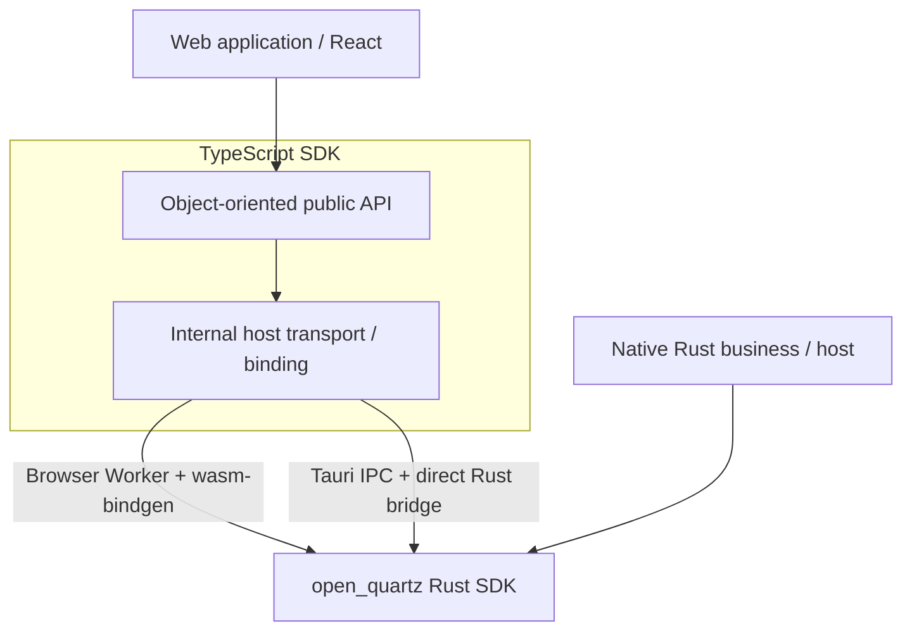

上图只表达大的软件栈关系。TypeScript transport/binding 属于 TypeScript SDK 内部，不是语言 SDK 与 Rust SDK 之间的独立产品层；本仓不保留 Android/Java/JNI glue。

TypeScript SDK 内部的目标链路为：

```text
React / Web UI -> React adapter -> TypeScript SDK
                                      ├-> Browser Worker -> wasm-bindgen -> Rust SDK
                                      └-> Tauri IPC -> direct Rust bridge -> Rust SDK
```

Native Rust 业务的目标链路为：

```text
Native Rust business / host -> open_quartz Rust SDK
```

Rust SDK 内部仍按以下方向组织：

```text
Rust SDK Runtime -> Engine -> GPU/media/inference/presentation contracts -> platform implementations
```

`open_quartz` 是包含实际实现的 Rust SDK。普通 root API 暴露 Project、Graph、Node、Port、Player、Resource、Output 等领域对象；Rust host 使用 `execution::{runtime,engine,gpu,shader,schedule,event}`、`project::catalog`、`resources`、`inference` 和 `media::native` 等 advanced 路径，设备模块受 feature 控制。执行类型不进入 TypeScript public proxy，模型和聚合实现保持内部可见性；完整当前布局见 §7.5–7.6。

#### 目标 SDK 的对象 API

```text
Rust SDK public object API:
  OpenQuartz / Project / Graph / Node / Port / Player / Resource / Output

TypeScript SDK public proxy API:
  OpenQuartzClient / Project / Graph / Node / Port / Player / Resource / Output
  internal: Browser Worker / wasm-bindgen / Tauri IPC / environment injection
```

TypeScript SDK 的 public 类图对应 Rust SDK public object graph，采用符合语言习惯的 Promise、iterator/stream 和 error mapping；不能引入 Rust public API 中不存在的业务层。浅 proxy、object cache、request/response、event dispatch 和序列化属于 SDK 内部实现，不反向塑造 Rust 业务 API。

目标总依赖为：

```text
Web application -> TypeScript SDK public proxy
                -> TypeScript SDK internal transport/environment
                -> Rust SDK public objects

Native Rust business -> Rust SDK public objects
```

Rust SDK 内部统一执行：

```text
Player -> internal Runtime -> internal Engine/Execution/GPU/media/inference/presentation
```

WASM Browser 路径中，Rust wgpu 直接拥有 WebGPU device/queue/pipeline/target 与 OffscreenCanvas surface；TypeScript internal 只提供 DOM video/camera、ImageBitmap transfer、ORT-Web、Worker wakeup 和 UI projection 等平台能力。Browser 与 Tauri 共用 TypeScript public API，Native Rust 应用直接消费 `open_quartz` root SDK 与 advanced execution modules。Environment/provider 属于核心内部平台适配，不进入普通 Project/Graph/Player 接口。

#### 当前实现：public Player 已切换，平台 transport 仍分叉

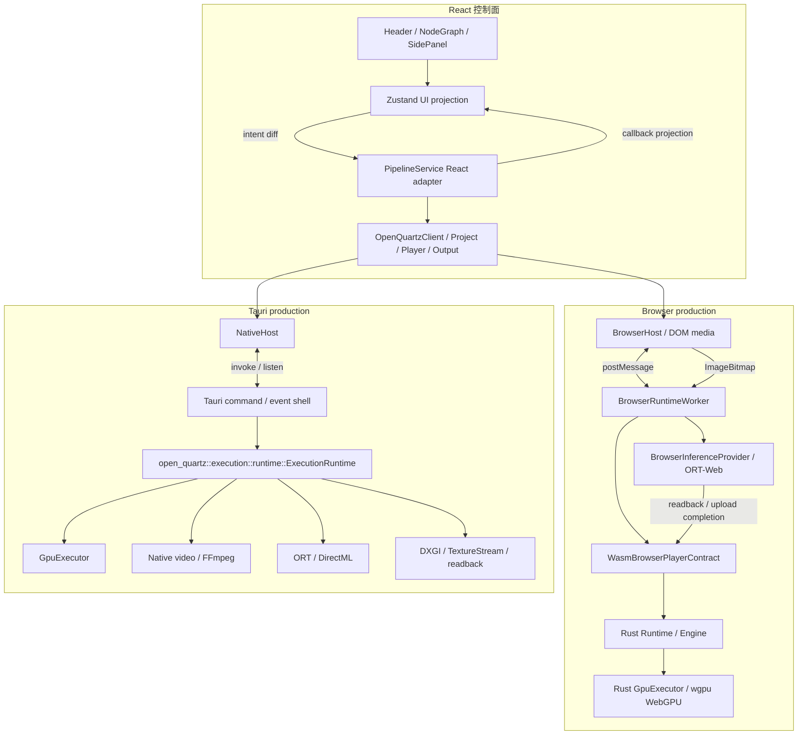

当前结论：

- Browser 不再生成或执行 TypeScript graph plan；Rust `Runtime/Engine/GpuExecutor` 持有 topology、clock、dirty、feedback、generation 和 shader GPU execution。
- Browser 的合理平台差异仍位于 TypeScript internal：DOM video/camera acquisition、`ImageBitmap` transfer、ORT-Web session、Worker timer 和 preview/capture 编码。
- Native 已使用共享 Rust Runtime/Player 语义；Tauri command/event、FFmpeg/ORT worker、DXGI/TextureStream 仍是 native host integration，不进入 public SDK。
- Browser 与 Tauri 对 UI 暴露同一个 TypeScript `Player`；host selection 位于 `OpenQuartzClient` internal，Component 和 Store 不处理 Worker/Tauri wire protocol。
- Android/Java/JNI 专用桥接已从本仓删除，不计作当前支持的 SDK 交付路径。

| 语义/模块 | Browser/WASM | Tauri/native | 当前结论 |
|---|---|---|---|
| public object API | TypeScript proxy → Rust object/binding | TypeScript proxy → Tauri/Rust Player | public surface 已统一 |
| lifecycle/clock/graph policy | Rust Runtime/Engine | Rust Runtime/Engine | 已共享 |
| GPU execution | Rust wgpu WebGPU | Rust wgpu native backend | policy 已共享，surface/interop 平台化 |
| media | DOM decoder → transferable `ImageBitmap` | FFmpeg/native decoder | 合理平台分叉 |
| inference | ORT-Web provider，completion 回 Rust | Rust ORT/DirectML worker | provider 分叉；stamp/generation contract 共享 |
| output/presentation | Rust output registry + Worker projection/readback | Rust output registry + Tauri event/TextureStream | contract 共享，transport 分叉 |
| performance | **存在已知问题** | 当前未在本次文档更新中发现同类阻塞 | Web 后续单独 profile/优化 |

两边不得共享的仍应只包括 DOM/Web APIs、FFmpeg/ORT session、GPU/window handle 和 transport；graph semantics、clock、generation、output contract 必须保持 Rust 唯一来源。

### 1.2 控制面与数据面

| 平面 | 数据 | 频率 | 所有者 |
|---|---|---:|---|
| UI intent | play/pause/stop、graph edit、selection | 低频 | React + Zustand |
| Runtime control | set graph、resource reconcile、capture | 低频/按编辑 | TypeScript `Player` + internal host |
| Frame work | clock tick、dirty、GPU submission | 每帧 | Rust Runtime/Engine/GpuExecutor；Browser Worker 或 native render thread 触发 |
| Runtime event | frame metadata、output metadata、error | 合并/限频 | Rust delivery → internal host → React adapter → Store |
| Pixel stream | GPU texture、TextureStream、preview/capture readback | 高频或按需 | Rust/platform host；Store 只保存 UI 投影 |
| Persistent project | nodes、edges、资源 descriptor/path | 保存时 | TypeScript `Project/Graph` + I/O boundary |

### 1.3 宿主选择不变量

`OpenQuartzClient.player()` 在内部只选择一次 host：

```text
checkIsTauri() == false -> BrowserHost
checkIsTauri() == true  -> NativeHost
```

`PipelineService` 只消费 public `Project/Player/Output`，不直接选择 Worker/Tauri transport。同一会话不得同时启动两套生产 host，也不得把 Browser host 当作 Native 的隐式 fallback。平台 fallback 只能发生在 host internal，例如 Native presentation 从 TextureStream 降级为 bounded RGBA readback。


---

## 2. TypeScript 模块依赖（迁移前审计快照）

本节保留 Phase 7 完成前的 TypeScript 目录与依赖审计；其中“当前”仅指审计快照时的实现。后续 cutover 的完成状态以 §10.1 为准，当前 Rust crate/module ownership 以 §7 为准。

### 2.1 迁移前依赖图

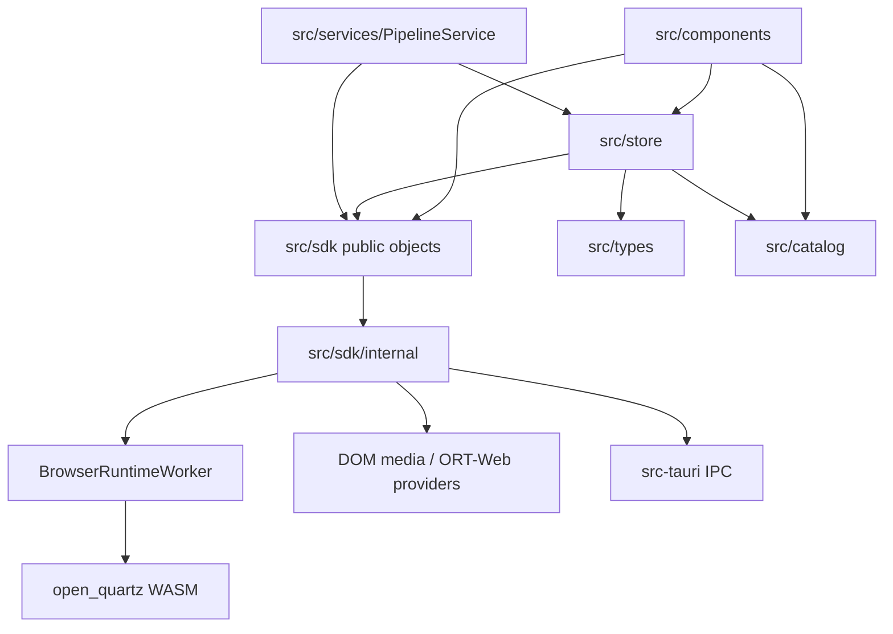

当前主干是 `components/store → PipelineService → TypeScript public objects → internal host → Rust`。旧 `src/engine/compositor.ts`、`executionEngine.ts`、`realtimeHost.ts` 和 `WebGPUBackend.ts` 已删除；Store 不再持有 model manager、ORT session、`MediaStream` 或 capture closure。`src/engine` 仅保留编辑器 shader 校验和 ONNX provider 所需的算法/ORT 封装，不拥有 graph topology 或逐帧 execution policy。

### 2.2 目录责任

| 目录 | 当前责任 | 边界 |
|---|---|---|
| `src/components` | 展示、用户输入、节点编辑、项目菜单 | 依赖 Store projection、public SDK 和 framework-neutral editor helpers；不依赖 SDK internal/transport |
| `src/store` | UI projection之外，仍含Graph mutation/node factory/connection rule/model准备 | 目标仅保存layout/selection/dialog/intent/result projection |
| `src/services` | React/Zustand adapter、presentation挂载、metrics与Player事件投影 | 拆小但保留framework职责；不定义跨平台业务policy |
| `src/sdk/OpenQuartzClient.ts`、`index.ts` | public facade；当前本地持有React Flow-backed Project/Graph snapshot | 改为Rust aggregate薄proxy；public export只含object/value/error |
| `src/sdk/internal` | Worker/Tauri/DOM transport，同时含ORT task和resource reconcile policy | 只保留不可替代platform capability和marshalling |
| `src/sdk/BrowserRuntimeWorker.ts` | frame wakeup、provider completion、output projection，同时扫描Graph建subscription/mapping | 只做timer/mailbox/provider/transport；observation intent来自Rust |
| `src/engine` | WGSL遗留materialization、ORT-Web inference与ONNX pre/postprocess、少量仅测试遗留 | 删除跨平台重复算法；只保留必要platform adapter或移入SDK internal |
| `src/catalog` | UI metadata与Math/ONNX执行descriptor、URL/defaults、legacy registry混合 | UI只保留label/category/icon/control；执行descriptor归Rust |
| `src/types` | project/domain/runtime/editor projection混合大DTO | 拆Rust domain schema、provider DTO和纯GUI projection |

### 2.3 当前生产类与已删除迁移类

| 类/模块 | 当前状态 |
|---|---|
| `OpenQuartzClient/Project/Graph/Node/Port/Player/Resource/Output` | public TypeScript SDK；生产使用 |
| `PipelineService` | React adapter；只调用 public objects |
| `BrowserHost` | main-thread internal transport 与 DOM media owner |
| `BrowserRuntimeWorker` | internal Worker host；调用 Rust `BrowserPlayer` |
| `NativeHost` | internal Tauri transport、event/TextureStream adapter |
| `WasmBrowserPlayerContract` | wasm-bindgen internal wrapper |
| `PipelineRuntime`、`BrowserPipelineRuntime`、`NativePipelineRuntime` | 已删除 |
| `Compositor`、`WebGPUExecutionEngine`、`WebGPUBackend`、`RealtimeHost` | 已删除；禁止回引 |
| `RuntimeBinding`、`WasmRuntimeContract`、`WasmEngineContract` | 已删除迁移接口 |

旧 public runtime surface 已清除，但 public object 仍未成为 Rust object 的真实 proxy；后续重点是继续把 domain/editor/resource/inference 规则下沉，而不是再增加 public runtime facade。

### 2.4 TypeScript 薄层专项审计

本次审计对 `src/sdk`、`engine`、`store`、`catalog`、`utils`、`services` 和 `screensaver.ts` 的非 GUI TypeScript 做了静态盘点，快照约 7,789 行。结论是：**执行内核下沉已经完成，但薄 TS SDK 只完成一半。**

| 区域 | 当前偏差 | 目标 |
|---|---|---|
| TypeScript public objects | `Graph` 自持 React Flow nodes/edges/revision；`Project` 用 TS serializer；`OpenQuartzClient` 不调用现有 Rust `OpenQuartz/Project` bindings | public object 是 Rust aggregate 的 async proxy/cache；public SDK 不导入 `@xyflow/react` |
| Zustand Store | `graphSlice/helpers` 持 connection type rule、node factory、ID counter、shader port更新、ONNX准备、Math/Renderer创建和 graph load/clear | Store 只保存 layout/selection/dialog/intent/output projection；Graph mutation 调 SDK command |
| Browser inference | TS 决定 task dispatch、tile/codec、pre/postprocess、threshold、overlay和 completion outputs | Rust 决定 task/tensor/pre/postprocess/output contract；TS 只调用 ORT-Web并回传 raw tensor/opaque result |
| Native host | 扫描完整 `ShaderNodeData` 并自行 reconcile image/video/ONNX resource | Rust Player产生 typed provider intent；TS只执行 Tauri/platform capability |
| Browser Worker | 扫描 graph 建 output subscription、renderer source和backend projection | Rust Output/Subscription 提供观察意图；Worker只做 timer、mailbox、provider和 transport |
| Project I/O | TS重复 project version、normalize、template strip/restore | Rust `Project::from_file/to_file` 唯一负责 domain serialization；TS只做 picker/download和React projection |
| Screen saver | TS重复 upstream traversal、resample node注入和edge rewiring | Rust SDK 提供 export/prepare transform；TS只做对话框、路径选择和host调用 |
| Catalog | Math执行公式、ONNX task/IO/defaults/URL与legacy registry混合在UI catalog | Rust拥有执行descriptor；TS catalog仅保留label/category/control presentation；删除第二registry |
| WGSL | `wgslCompiler.ts` 仍保留无人使用的pipeline/materialization代码 | 删除遗留，仅保留GUI编辑器需要的Rust validate调用和可选浏览器device diagnostics |
| 遗留代码 | TS topo sort、旧WebGL types、重复overlay和仅测试使用的Math compute仍存在 | 删除或替换为Rust contract/conformance test |

允许永久留在 TypeScript 的非 GUI 代码仅限平台边界：DOM media/camera、`ImageBitmap`/Worker、ORT-Web session调用、Tauri invoke/listen、WebView2 TextureStream、file picker/Blob download、React projection和必要的marshalling。判断标准不是文件是否位于 `src/sdk`，而是它是否只执行平台能力，且不定义跨平台业务语义。

目标依赖进一步收敛为：

```text
React components/store projection
  -> framework adapter
  -> thin TypeScript public proxy
  -> platform transport/provider
  -> Rust SDK objects and execution policy
```

以下依赖最终应为零：public SDK → React Flow；Store → execution/provider；Host → catalog/完整 Graph 业务字段；TypeScript → graph topology/Math公式/ONNX pre-postprocess/screen saver graph transform。

---

## 3. 核心对象关系

### 3.1 跨语言 public proxy 类图（目标）

跨语言类图只描述用户可见对象。TypeScript SDK 作为 Rust SDK public object 的 proxy，类图应基本对应；PipelineService、PipelineRuntime、Worker、JNI、Runtime、Engine、Execution、Compositor、GpuExecutor 都不属于这张 public 类图。

```mermaid
classDiagram
    namespace RustSDK {
        class RustOpenQuartz[OpenQuartz]
        class RustProject[Project]
        class RustGraph[Graph]
        class RustNode[Node]
        class RustPort[Port]
        class RustPlayer[Player]
        class RustResource[Resource]
        class RustOutput[Output]
    }

    namespace TypeScriptSDK {
        class TsOpenQuartz[OpenQuartzClient]
        class TsProject[Project]
        class TsGraph[Graph]
        class TsNode[Node]
        class TsPort[Port]
        class TsPlayer[Player]
        class TsResource[Resource]
        class TsOutput[Output]
    }

    RustOpenQuartz --> RustProject
    RustOpenQuartz --> RustPlayer
    RustProject *-- RustGraph
    RustProject *-- RustResource
    RustGraph *-- RustNode
    RustNode *-- RustPort
    RustPlayer --> RustOutput

    TsOpenQuartz --> TsProject
    TsOpenQuartz --> TsPlayer
    TsProject *-- TsGraph
    TsProject *-- TsResource
    TsGraph *-- TsNode
    TsNode *-- TsPort
    TsPlayer --> TsOutput


    TsOpenQuartz ..> RustOpenQuartz : proxy
    TsProject ..> RustProject : proxy
    TsGraph ..> RustGraph : proxy
    TsNode ..> RustNode : proxy
    TsPort ..> RustPort : proxy
    TsPlayer ..> RustPlayer : proxy
    TsResource ..> RustResource : proxy
    TsOutput ..> RustOutput : proxy

```

proxy 对应的是对象 identity、方法行为、lifecycle、error 和 observable result，不要求Rust 与 TypeScript共享相同的内存布局或通信 DTO。TypeScript internal 可以批量调用和缓存，但不得增加另一个 public runtime/business abstraction。

### 3.2 当前内部实现所有权（非 public SDK）

| 对象 | Browser owner | Native owner | 是否进入 Store/项目文件 |
|---|---|---|---:|
| Graph metadata | Rust Runtime/Engine；TS `Graph` 保存编辑 projection | Rust Runtime/Engine | 仅可序列化 snapshot |
| Composition clock | Rust `CompositionClock` | Rust `CompositionClock`；host 提供 monotonic `now_ns` | Store 仅投影 time/frame |
| GPU device/queue/target | Rust `BrowserGpuEnvironment/GpuExecutor` | Rust `GpuBackend/GpuExecutor` | 否 |
| Video decoder | `BrowserHost` 的 DOM `HTMLVideoElement` | native video/FFmpeg | 项目仅保存 source descriptor/path |
| Video frame transport | transferable `ImageBitmap`，单节点最多一个 in-flight | native frame/surface | 否 |
| ONNX session | `BrowserInferenceProvider`/ORT-Web | native ORT/DirectML resource | 项目仅保存 model descriptor/path |
| Output registry | Rust Runtime | Rust Runtime | 否 |
| Preview/capture bytes | Worker 按 output readback 并编码 data URL | bounded readback 或 TextureStream | Store 仅保存最近 preview URL/metadata |
| Renderer stream | Browser canvas/surface | WebView2 TextureStream，live video 留在 adapter | Store 只保存 `rendererStreamActive` boolean |

Native 与 Browser 已共享 composition policy；仍允许 host 持有平台 resource、provider session、surface 和 transport。Web 当前性能问题集中在这些平台数据路径，不能以重新引入 TS execution policy 作为优化手段。

### 3.3 Rust SDK public object graph（目标）

Rust SDK public API 的判断标准是“用户是否需要直接理解和操作这个对象”。若一个对象只用于调度、编译、计划、GPU 提交、transport 或 binding，它应留在 internal，即使源码中由一个大型 class/struct 实现。

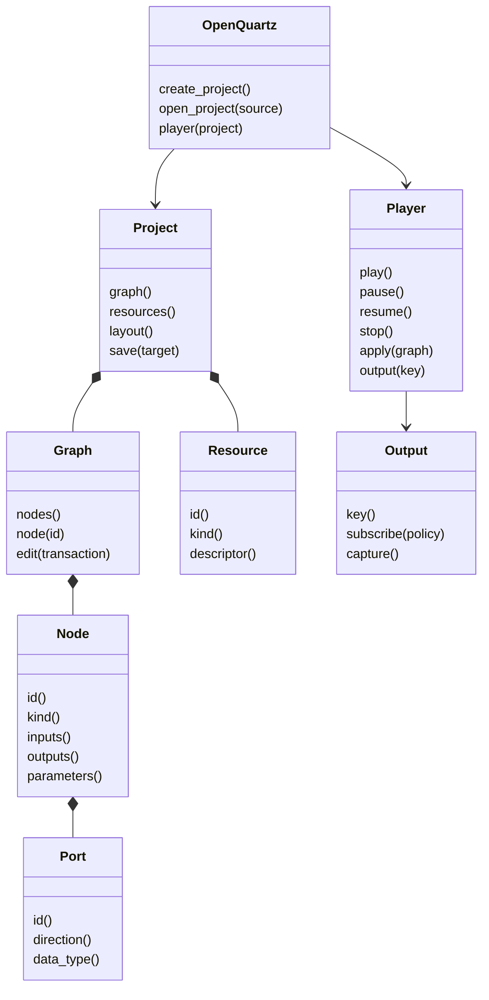

#### 3.3.1 Public、host integration 与 internal 分类

| 类别 | 对象 | 是否跨语言 proxy | 说明 |
|---|---|---:|---|
| 稳定用户接口 | `OpenQuartz`、`Project`、`Graph`、`Node`、`Port`、`Player`、`Resource`、`Output` | 是 | 用户直接创建、编辑、运行和观察 composition 所需对象 |
| Scoped public helper | `GraphEdit`、`NodeMut`、`PlayerBuilder`、`Subscription`、typed value/ID/error | 按语言习惯映射 | 服务 public object method，不形成新的业务层 |
| Host integration API | `EnvironmentBuilder`、`GpuProvider`、`MediaProvider`、`InferenceProvider`、`PresentationProvider` | 仅 SDK internal/高级 host 使用 | 为 Rust internal execution 注入平台功能；不是普通用户业务接口 |
| Rust internal | `Runtime`、`Engine`、`ExecutionEngine`、`ExecutionPlan`、`ExecutionCommand`、`Compositor`、`GpuExecutor`、clock、registry | 否 | 统一沉到 Rust；不出现在 TS public 类图 |
| Language internal | Worker/Tauri transport、wasm-bindgen binding、proxy cache、DTO | 否 | 属于 TypeScript SDK internal |

`PipelineHostRuntime`、`BrowserPipelineRuntime`、`NativePipelineRuntime`、`WasmRuntimeContract` 已作为迁移期 adapter 删除；当前 internal 使用 `BrowserHost`、`NativeHost`、`WasmBrowserPlayerContract`，且均不进入 public SDK export。

`Player` 取代 public `PipelineRuntime`/`RuntimeSession`。当前所谓 Session 的用户行为只有装载 Graph、播放控制、输入和 Output observation，与 Player 高度重合；同时保留 Player 和 Session 只会制造两个生命周期对象。内部仍保留 `Runtime`/execution session，未来若出现协作编辑、远程连接或认证上下文，应另建语义明确的 `WorkspaceSession`/`ConnectionSession`，不能重新把 execution runtime 暴露为 Session。

#### 3.3.2 Rust public API 形状

下面代码只表达用户价值和 ownership，不冻结最终命名：

```rust
let environment = Environment::native_defaults()?;
let sdk = OpenQuartz::new(environment);
let mut project = sdk.open_project(project_source)?;

let change = project.graph_mut().edit(|edit| {
    edit.update_node(NodeId::new("blur-1"), |node| {
        node.set_parameter("radius", Value::Float(12.0))
    })?;
    edit.connect(
        PortKey::new("blur-1", "output"),
        PortKey::new("renderer-1", "input"),
    )?;
    Ok(())
})?;

let mut player = sdk.player(project.graph())
    .with_resources(project.resources())
    .build()?;

let subscription = player
    .output(OutputKey::new("renderer-1", "output"))?
    .subscribe(OutputPolicy::latest(), output_consumer)?;

player.play()?;
player.apply(project.graph(), &change)?;
player.pause()?;
player.resume()?;
player.stop()?;
drop(subscription);
```

Rust public method 使用 typed Rust value、newtype ID、enum、trait、iterator/future、`Result<T, SdkError>` 和 ownership/lifetime。以下内容不得出现在 Rust business object method 中：

- JSON string 作为常规 graph/node/player 参数或返回值；
- Worker/Tauri request ID、event name、callback payload；
- wasm-bindgen type；
- React Flow node、DOM object、WebView event；
- `ExecutionPlan`、`ExecutionCommand`、GPU bind group 或其他 internal execution descriptor。

#### 3.3.3 Graph aggregate、GraphEdit 与 Project/Player ownership

Graph 是 public aggregate root。推荐的 Rust 形状是 closure-scoped transaction，而不是暴露可长期保存的 command list：

```rust
pub fn edit(
    &mut self,
    operation: impl FnOnce(&mut GraphEdit<'_>) -> Result<(), GraphError>,
) -> Result<GraphChange, GraphError>;
```

首版保持单一返回值：transaction 自定义业务值可以由调用者在 closure 外保存；public API 只返回后续 `Player::apply` 和 undo/redo 真正需要的 `GraphChange`。若未来出现明确场景，再增加 `edit_with_result<R>`，不要先让基本 API 泛型化。

`GraphEdit` 至少提供 `add_node`、`remove_node`、`update_node`、`connect`、`disconnect`。推荐 `update_node(id, closure)`，而不是让 `NodeMut` 长期占用 `&mut GraphEdit`：这样后续 `connect` 不会被 Rust mutable borrow 卡住，Node mutation 仍保持对象式 API。

```rust
graph.edit(|edit| {
    edit.update_node(blur_id, |node| {
        node.set_parameter("radius", Value::Float(12.0))?;
        node.rename("Background Blur")?;
        Ok(())
    })?;
    edit.connect(blur_output, renderer_input)?;
    Ok(())
})?;
```

原子性规则：closure 返回 `Ok` 后统一验证并 commit；返回 `Err` 或 unwind 时原 Graph 不变。第一版推荐对纯 metadata Graph 建立 draft/clone 后提交，优先保证正确性；live GPU/decoder/ORT resource 不属于 Graph，因此不会被复制。若大图 profiling 证明 clone 成本显著，再把内部实现替换为 operation journal/copy-on-write，不改变 public API。

transaction 内同步完成，不允许持有 `GraphEdit` 跨 `await`。文件读取、模型下载和 decoder 创建应先在 transaction 外完成；transaction 内只写入 resource descriptor/reference。一次 transaction 统一维护 identity、type compatibility、edge uniqueness、cycle/feedback rule、resource invalidation 和 execution invalidation，并返回 Rust domain `GraphChange`，但不公开 wire patch。

```text
Project
  ├-> Graph               executable node/edge/port semantics
  ├-> GraphLayout         position / expanded / groups / notes
  ├-> ResourceCatalog     public resource descriptors/references
  └-> ProjectMetadata

Player
  ├-> private applied/compiled Graph state
  ├-> private live resources
  ├-> private Runtime/Engine/Execution
  └-> public Output objects
```

- position-only layout edit 不调用 `Player::apply`，不增加 execution revision，也不重建 GPU/feedback resource。
- Project 不拥有 decoder、GPU texture、ORT session 或 presenter。
- Player 构建时复制/编译 Graph state，不长期借用 Project/Graph；Project 可继续编辑并创建多个 Player。
- Player 更新使用 `player.apply(project.graph(), change)`；`GraphChange` 允许 Rust internal 做增量更新，如何跨 Worker/Tauri 同步由 language SDK internal 决定。
- Output subscription 是 owned handle，不长期借用 Player 到阻止后续 mutable method；Player 关闭时 subscription 统一失效。

`Resource` 保留为 public object，但仅表示用户实际消费的 project resource：导入/替换图片、选择视频、选择 camera、绑定 ONNX model、查看 descriptor/状态。当前产品 UI 已经直接提供这些行为，因此完全隐藏 Resource 会迫使 NodeData 再次承载 path/data URL/model status。

public `Resource` 不等于 live runtime handle。建议拆成：

```text
Project Resource (public)
  id / kind / source descriptor / metadata / replace source / bind to node

Player live resource (internal)
  decoder / GPU texture / ORT session / generation / platform handle
```

如果后续确认用户只通过 Input/ONNX Node 操作资源，也可以让 `Node.resource()` 返回 Resource 而不提供顶层 catalog UI；但 Resource 类型本身仍有用户价值。GPU texture、decoder frame、ORT session、DXGI/DOM handle 永远不成为 public Resource。

#### 3.3.4 Execution environment：最小功能注入，不是业务接口

评估结论：WASM 需要部分 host integration，但不应把整个 GPU/execution engine 注入 TypeScript。

| 能力 | Rust/WASM 能否直接负责 | 目标处理 |
|---|---|---|
| WebGPU instance/adapter/device/queue/pipeline | 可以。当前 `wgpu` 已启用 `webgpu`；wgpu 27 可在 Worker 读取 `WorkerNavigator.gpu` | 由 Rust wgpu 创建和拥有，不注入 TS `WebGPUExecutionEngine` |
| Canvas/OffscreenCanvas surface | 可以由 wgpu 创建；wgpu 27 支持 `SurfaceTarget::Canvas/OffscreenCanvas` | TypeScript binding 在构建 Environment 时只传入 canvas target；Rust 管理 surface/render |
| ImageBitmap/VideoFrame 上传 | wgpu Web API支持 external image copy，但 DOM decoder/camera acquisition 受浏览器线程和对象生命周期限制 | TS internal 拥有 DOM source/frame acquisition；通过细粒度 `FrameSource`/opaque frame adapter 提供给 Rust |
| ORT-Web | 当前是 JavaScript library，Rust SDK 不能直接创建当前 ORT-Web session | 必须注入 `InferenceProvider`，除非未来替换为 Rust/WASM inference implementation |
| DOM/WebView presentation | DOM slot、HTMLVideoElement、TextureStream 属于 host | 注入 `PresentationTarget/Presenter` 或传 surface target；presentation policy 仍由 Rust internal 决定 |
| wakeup/timer | Browser event loop 属于 host | host 只实现 `FrameScheduler/Waker`；clock、deadline、play/pause policy 归 Rust Player/internal Runtime |
| file picker、camera permission、URL/blob resolution | 浏览器 UI 平台能力 | 由 language SDK internal resource resolver 提供，不进入普通 Project/Graph API |

因此 Environment 不应先定义一个包罗万象的 `GpuProvider`。推荐优先让 Rust wgpu 自己拥有 GPU；只对不可移入 Rust/WASM 的能力定义细粒度 host ports：

```rust
pub struct EnvironmentBuilder { /* advanced host integration */ }
pub trait FrameSource { /* acquire/release timestamped external frames */ }
pub trait InferenceProvider { /* model/task/completion */ }
pub trait PresentationTarget { /* surface/stream target */ }
pub trait FrameScheduler { /* wake at Rust-provided deadline */ }
pub trait ResourceResolver { /* host file/blob/device resolution */ }
```

这些 trait 的准确签名仍需在实现前做 spike，但边界已确定：Rust `Player`/internal execution 请求能力，host 提供实现；host 不接收 Graph 后自行执行。TypeScript UI 不直接调用 provider，Project/Graph/Node/Player public API 不出现 provider 类型。

```text
Native Rust host -> Environment::native_defaults() + optional presenter target
TypeScript SDK internal -> EnvironmentBuilder + browser-only host ports
```

`EnvironmentBuilder` 和 host ports 是 advanced host integration API。普通 composition 用户只使用 `OpenQuartz/Project/Graph/Player`；host integration 不得演变成第二套 PipelineRuntime。

#### 3.3.5 Rust internal execution 边界

目标内部关系：

```text
Player public facade
  -> Runtime internal
     -> Engine / Execution internal
        -> injected GPU/media/inference/presentation providers
```

- `Runtime` 负责 lifecycle、clock、generation、resource/output policy。
- `Engine/Execution` 负责 graph evaluation、plan、dirty/feedback、work ordering。
- GPU/media/inference/presentation 实现负责平台能力。
- `Compositor` 不作为独立 public 概念；其职责并入 Rust execution/presentation internal。
- Browser 不再保留第二个 TS `WebGPUExecutionEngine` policy object；TS 只保留注入 Rust 所需的平台 adapter。

#### 3.3.6 Threading、async、errors 与生命周期

- mutation 通过 `&mut self`、scoped edit 或内部同步明确串行化，不依赖隐藏 global singleton。
- 只有真正允许跨线程的对象实现 `Send/Sync`；GPU/window/DOM/platform handle 不伪装成通用线程安全对象。
- 异步加载和推理通过 Rust future/task/completion object 表达；internal Runtime 负责 stale generation 和 cancellation。
- public error 使用结构化 `SdkError`/error enum；不以 JSON string 作为 Rust API 错误。
- Output observation 使用 owned subscription；具体 callback/channel/stream adapter按语言和 thread affinity 提供。
- `Drop` 负责兜底清理，public `close/stop` 提供可观察、可返回错误的显式释放路径。

#### 3.3.7 待批阅的 public API 决策

| 决策 | 结论 | 原因 |
|---|---|---|
| SDK 根对象 | 保留 `OpenQuartz` | project/player factory、capability discovery；避免 global singleton |
| Player vs Session | public 只保留 `Player`；Session/Runtime 留 internal | 当前 Session 行为与 Player 基本重合；Player 对 play/pause/output 更直观 |
| Graph mutation | `Graph::edit` + closure-scoped `GraphEdit` + `GraphChange` | 原子维护 graph invariants；支持 Player 增量 apply；不暴露 wire command |
| Node mutation | `GraphEdit::update_node(id, closure)` | 避免 `NodeMut` 长借用阻止同 transaction 继续修改 graph |
| Node 多态 | `NodeKind`/typed descriptor + `Node` view | 当前类型集合相对封闭；避免过早 `Box<dyn Node>` |
| Player 与 Project | Player 拥有 applied state，显式 `apply(Graph, GraphChange)` | Project 可继续编辑；支持多个 player/offline/screen saver |
| Resource | public descriptor/object；live resource internal | 用户确实导入/替换/绑定 image/video/model，但不应接触 decoder/GPU/ORT handle |
| WASM GPU | Rust wgpu 直接拥有；只传 canvas/surface target | wgpu WebGPU/OffscreenCanvas 已支持，不需要注入第二个 TS GPU engine |
| WASM host integration | 只注入 frame source、ORT-Web、presentation、scheduler、resolver 等不可下沉能力 | 保持 Rust execution 唯一，同时满足浏览器平台约束 |
| Output | public `Output` + owned `Subscription` | 用户确实需要观察结果；internal registry/delivery 不暴露 |
| Thread model | Player 默认 single owner；按 environment capability决定 `Send` | 保留平台 thread affinity，避免虚假 `Sync` |

### 3.4 TypeScript SDK 是 Rust public object 的薄 proxy（目标）

| Rust public object | TypeScript proxy |
|---|---|
| `OpenQuartz` | `OpenQuartzClient` |
| `Project` | `Project` |
| `Graph` | `Graph` |
| `Node` | `Node` |
| `Port` | `Port` |
| `Player` | `Player` |
| `Resource` | `Resource` |
| `Output` / `Subscription` | `Output` / `Subscription` |
| `SdkError` | typed error |

TypeScript public proxy 可以调整语言命名和 async 形状，但不能增加 `PipelineRuntime`、`ExecutionEngine`、`Compositor` 等 Rust public graph 中不存在的业务对象。

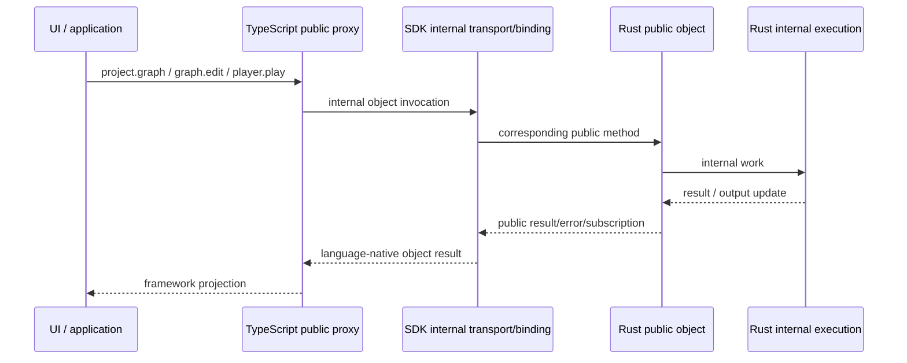

TypeScript SDK internal 拥有 Browser Worker、Tauri transport、wasm-bindgen、proxy cache 和 Browser capability adapters。Native Rust application 直接使用 Rust public object，不经过 proxy。

---

## 4. Store 监听与双向数据流

### 4.1 上层意图如何下沉

`App` 只创建一次 `PipelineService`。Service 将 Zustand state transition 投影为 public `Player` 操作：

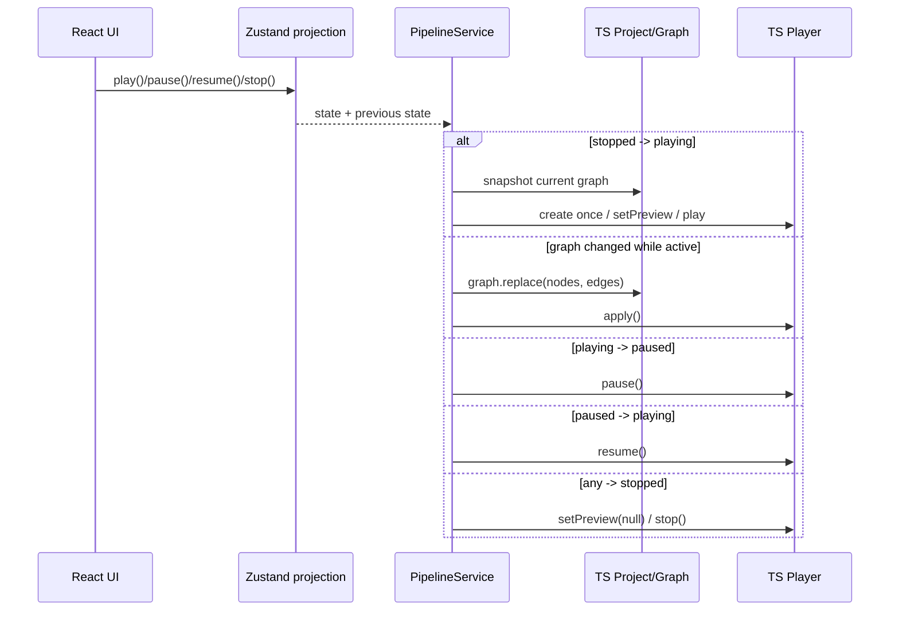

`PipelineService.operations` 串行化 async control，`generation` 拒绝 attach/detach 期间过期 Player 初始化。Host selection、Worker request 和 Tauri command 都在 TypeScript SDK internal。

### 4.2 下层状态如何上浮

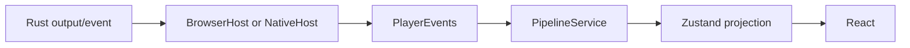

| 下层信号 | Adapter 处理 | Store projection |
|---|---|---|
| frame/time/fps | 最多约 10 Hz 更新 UI | `fps/currentTime/currentFrame` |
| preview/output image | stopped 后忽略迟到结果 | `outputPreviews[nodeId]` |
| typed output data | 直接投影 | `outputData[nodeId]` |
| output size | 更新 resolved size | node `resolvedWidth/resolvedHeight` |
| ONNX backend | 更新可观察 provider | node `onnxBackend/onnxNativeBackend` |
| node/runtime error | 归属 node 或 runtime | `nodeErrors` |
| renderer presentation/cadence | 窗口统计 | `rendererFps/rendererCadence` |
| TextureStream existence | adapter 持 live video，Store 只记状态 | `rendererStreamActive` |

Capture closure、Player、`MediaStream`、model manager、ORT session、texture 和 per-frame command 均不进入 Store。

### 4.3 监听模型的边界

1. **应用监听**：Store state diff → public Project/Player intent。
2. **runtime 监听**：Worker/Tauri/VideoFrame callback → `PlayerEvents` → Store projection。

每个 listener 必须在 `detach()/close()` 释放；Native 使用 `unlisten[]`，Browser 终止 Worker。Async inference completion 携带 graph revision、node generation 和 input/content stamp；preview/capture 仍需用当前 selection/subscription/lifecycle 拒绝迟到结果。

---

## 5. Language SDK ↔ Rust SDK 接口

### 5.1 Browser：public Player + internal Worker/wasm-bindgen

```text
React main thread
  OpenQuartzClient / Player
    -> BrowserHost (DOM media + Worker transport)
      ⇅ structured-clone postMessage
Dedicated Worker
  BrowserRuntimeWorker
    -> WasmBrowserPlayerContract
      ⇅ wasm-bindgen
Rust BrowserPlayerBinding -> Runtime/Engine/GpuExecutor
```

Main thread 请求仍包括 `initialize/play/update-graph/pause/resume/stop/set-preview/capture/close`；custom ONNX model 通过 transferable `ArrayBuffer` 注册。视频不是 RPC payload：`BrowserHost` 通过 `requestVideoFrameCallback`/timer 创建 `ImageBitmap`，每节点最多一个 in-flight frame，并使用 transferable postMessage。

Worker 每帧调用 Rust `BrowserPlayer.frame()`；Rust 返回 clock 和需要 host inference 的 task。Shader/feedback/renderer GPU work由 Rust wgpu 执行。ORT-Web provider 只处理 Rust 发出的 inference task，并用 graph revision、node generation、input/content stamp 提交 completion。

当前 Browser 边界仍有性能成本：

- renderer preview 最多约 15 Hz 执行完整 GPU readback、PNG 编码和 base64；
- ORT-Web 输入使用 `readOutputRgba()`，结果使用 `uploadRgba()`；
- video 使用 `createImageBitmap` + Worker transfer；
- Worker 以 `setTimeout` 驱动约 60 Hz frame loop。

这些路径已标为已知性能问题，暂不在本轮修复。后续必须先做 frame-time、readback、encode、postMessage 和 GC 分项 profile，再决定降频、订阅化、opaque GPU/tensor interop 或调度调整。

### 5.2 Native：public Player + Tauri internal host

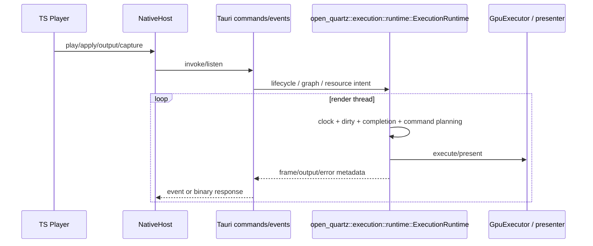

主要 command family 仍是 lifecycle、graph、image/video/ONNX resource、output readback、shared texture lease 和 diagnostics。Windows presentation 主路径为 DXGI shared texture → WebView2 TextureStream → adapter-owned `HTMLVideoElement`；失败时使用 bounded binary RGBA readback。高频 pixels 不经过 JSON event。

TypeScript `NativeHost` 是 SDK internal IPC transport，不是 Rust 执行层。Tauri command 调用 execution 内的 `ExecutionRuntime`，后者直接组合 `Runtime` 状态规则与 GPU/媒体/推理资源；不存在单独的 Rust NativeHost crate 或 PlayerHost 转发。

### 5.3 当前接口一致性

| 语义 | Browser | Native | 结论 |
|---|---|---|---|
| public object graph | TS proxy | Rust SDK / retained Tauri TS proxy | 领域对象语义共享 |
| lifecycle/clock/graph policy | Rust Runtime/Engine | Rust Runtime/Engine | 共享 |
| GPU execution | Rust wgpu WebGPU | Rust wgpu native | surface/interop 平台化 |
| inference | ORT-Web provider | ORT/DirectML | completion contract 共享 |
| output registry | Rust Runtime | Rust Runtime | 共享 |
| state transport | Worker events | Slint thread bridge / Tauri IPC | adapter 各自投影 |
| presentation | OffscreenCanvas/readback | Slint shared textures / TextureStream/readback | 合理平台差异 |

Android/Java/JNI glue 不在本仓实现和验收范围；不保留占位桥接或 Java 源码形状对齐检查。跨语言回归覆盖保留的 Rust/WASM/TypeScript 行为，public export 边界继续由 dependencyBoundary 测试验证。

---

## 6. 逐帧执行数据流

### 6.1 Browser frame

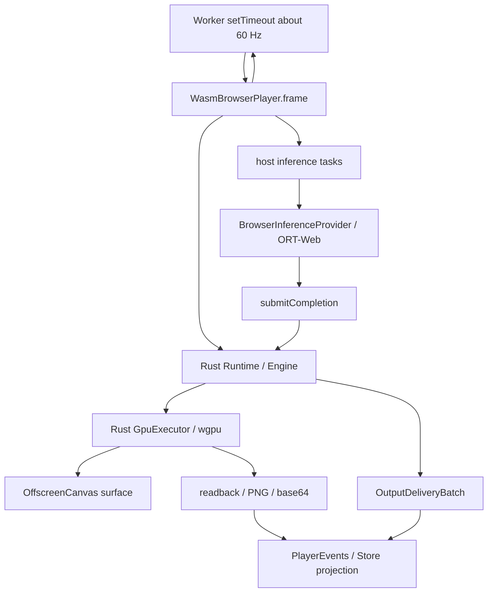

Rust 是 topology、clock、dirty、feedback、generation 和 GPU work 的唯一 owner。TypeScript Worker 只调度 frame、上传 external frame、运行 ORT-Web provider、drain delivery、编码 preview/capture。

#### 已知 Web 性能问题（暂缓）

功能 smoke、capture 和回归测试通过，不代表性能 gate 通过。当前已确认存在 Web 链路性能问题，但尚无 profile 证据将其归因于单一环节。本版本保留现状，不做快速 special case。后续优化需至少记录：Rust frame/GPU submit、GPU readback、PNG/blob/base64、ORT preprocess/inference/upload、`createImageBitmap`、postMessage、Worker scheduling 和 JS GC 的独立耗时与帧率影响。

### 6.2 Native frame

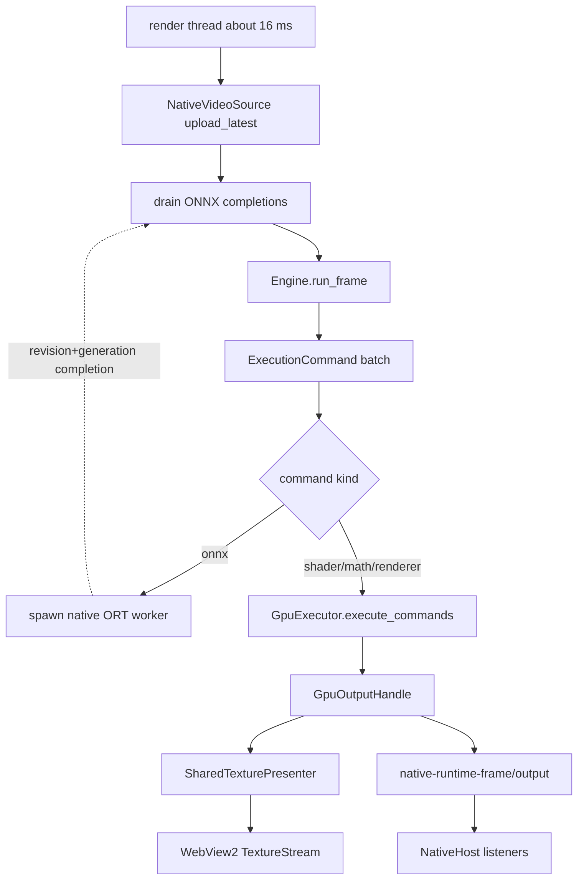

Native ONNX 当前需要 `GpuExecutor.read_output_rgba()`，在线程中执行 ORT，再 `upload_rgba()` 回 GPU；capability 明确为 tensor `cpu-copy`，不得描述成 shared wgpu/DirectML zero-copy。

### 6.3 Graph、资源和结果三条数据链

| 链 | 内容 | 生命周期 |
|---|---|---|
| Graph chain | node/edge/port/params | revision 管理；可持久化 |
| Resource chain | image/video/model descriptor → live object | node generation + host ownership；不可持久化对象 |
| Result chain | scalar/json/ROI/texture/presentation | output generation/stamp；Store 仅持 UI projection |

任何优化都必须说明自己改变的是哪条链。把 resource bytes 塞回 graph、把 GPU handle 写进 Store、或用 frame heartbeat 代替 typed output contract，都属于边界回退。

---

## 7. Crate 边界审查与重新设计

本节当前决策为 native-only 单核心与真实独立组件；§7.1–7.2 是迁移前归档，旧 package/path/行号只作历史证据。§7.3–7.7 描述当前布局、限制与尚未实施的执行所有权方案，§7.8 将本次待验证结果和旧结果分开。公开真实 Player driver 与 `Project::graph_mut` 收紧仍未完成；browser coordinator 随产品退役，不再是待提取项。

### 7.1 迁移前实现与审查依据

迁移前局部依赖为：`open_quartz → {open_quartz_sdk, open_quartz_execution, open_quartz_schema}`，`open_quartz_sdk → {open_quartz_execution, open_quartz_schema}`，`open_quartz_execution → open_quartz_schema`，macOS execution 另依赖 `oq-media`。当时不是四层彼此隔离的编译边界；这些旧核心包现已移除。

| 迁移前 crate / 产物 | 当时的实际实现 | 审查判断 |
|---|---|---|
| `open_quartz_schema` | Graph 校验、GraphEdit/command 事务、上游子图、ID、节点/端口、ProjectFile、错误；直接依赖只有 serde/serde_json | 有实质的领域图模型边界，名称容易被误读为仅有 DTO |
| `open_quartz_sdk` | Project/history/revision、节点工厂、layout/resources、屏保图变换，以及 headless Player/Output/Subscription | 有实际业务实现；与同一产品的 `open_quartz` 分成两个 SDK 包，收益不足 |
| `open_quartz` | crate root 重导出，另有 JSON/WASM binding、BrowserPlayer 设备执行组合 | Rust SDK 入口主要是壳；整个 crate 并非空包，binding 中还有必须保留的实际执行代码 |
| `open_quartz_execution` | WGSL/catalog、Engine/Runtime、GPU、video/ONNX、资源计划、模型下载缓存、browser GPU environment | 实质实现集中，但纯工具与平台重依赖没有隔离 |
| `oq-media` | VideoToolbox session、原生 frame lease、色彩元数据、取消与错误 | 小而真实的独立媒体库；不能按行数并回图引擎 |
| `open_quartz_screensaver` | `.scr` footer/manifest/resource 打包、校验、原子发布与读取 | 有独立格式与 I/O 行为，保留 |
| `open-quartz-screensaver-stub` | Win32 `/s`、`/p`、`/c`、窗口/Surface 与独立播放循环 | 独立可执行产品，保留；不是转发 lib |
| `slint_code_editor` | cosmic-text 编辑、排版、语法、剪贴板、Slint bridge | 无 OpenQuartz 依赖的可复用组件，保留独立 workspace |
| Slint / Tauri app | UI、窗口、权限、I/O worker、render thread、打包与启动 | 产品组合根，保留各自入口，不抽象成空 host crate |

迁移前证据（旧路径与行数）：`crates/open_quartz_schema/src/project.rs`、`crates/open_quartz_sdk/src/sdk.rs`、`crates/open_quartz/src/lib.rs`、`crates/open_quartz/src/ffi/browser_player.rs`、`crates/open_quartz_execution/Cargo.toml`。当时去掉独立 test 文件后的源码行数上界约为 schema 1,145、SDK 1,366、facade/binding 830、execution 12,768、media 226；仍含 inline tests，仅辅助判断，不作为拆包标准。

### 7.2 迁移前 Review 发现（按影响排序）

| 级别 | 发现与源码证据 | 影响 / 设计决策 |
|---|---|---|
| P1 | `open_quartz_sdk/Cargo.toml:9` 无条件依赖 execution；`sdk.rs:257` 的 shader 编辑和 `sdk.rs:1100` 的 headless Player 都进入该包；execution manifest 无条件声明 wgpu，非 WASM 目标无条件声明 ORT、reqwest、sha2，macOS 无条件启用媒体后端 | 仅做项目编辑也引入 GPU/网络/原生库编译闭包；用可测试的 feature 隔离纯工具与设备实现 |
| P1 | `sdk.rs:32` 的 Environment 仅有 capabilities，`:1098` 的 PlayerBuilder 只创建 Runtime，`:1143` 的 play 使用内部合成时刻推进；Slint/Tauri 则消费 `runtime/execution.rs` 中的 ExecutionRuntime；BrowserPlayerBinding 自己持有 Runtime+BrowserGpuEnvironment | 公共 Player 的 headless 状态行为不能证明真实播放；分别验证状态规则、设备执行与公开 API 的能力，明确时钟和驱动所有权 |
| P1 | `sdk.rs:395` 的公开 graph_mut 返回可直接修改的 Graph，schema 的 nodes/edges 也是 pub；`sdk.rs:144` 的公开 from_file 不执行 try_from_file 的校验 | `project.graph_mut().nodes.clear()` 可改变图却不递增 revision 或记录 history；独立 crate 并未守住聚合不变量。目标 API 通过 Project command/edit 提交，未校验构造和可变直通入口收为内部；现有特殊状态测试用私有 fixture 保留 |
| P1 | `scripts/check-rust-boundaries.mjs:132` 只验证 SDK 消费者不能直接 import 未声明的 execution，`:61` 检查 facade 路径缺失；这不验证传递依赖轻量或 production 所有权 | 保留 public export 检查，增加依赖闭包与真实驱动测试；禁止用“路径不可见”代替架构验收 |
| P2 | `open_quartz/src/lib.rs:7` 重导出 schema/SDK；`open_quartz_sdk/src/lib.rs:3` 又重导出 schema | 同一个 Rust SDK 有两个入口和重复维护点；将 SDK 实现并入 open_quartz，不保留兼容空 crate |
| P2 | schema 的 `project.rs` 拥有 Graph 事务，SDK Project 拥有 history 和高层 shader/node command；execution 的资源规划仍用 `Vec<Value>`，Slint `onnx_runtime.rs:393` 将 typed Graph 序列化后再反序列化 | 分清低层图不变量与高层项目事务；原生资源规划消费 typed Graph，JSON 兼容放在 binding 入口 |
| P2 | `resources/models.rs:10,228` 将文件缓存/会话准备与 ExecutionRuntime attach 放在一起；`wgsl/compiler.rs:6` 为一个 shader 常量反向 import GPU 模块 | 隐含模块依赖妨碍 feature 切分；会话接入归执行协调者，shader 源常量归 WGSL 模块 |
| P2 | `execution/src/engine/state.rs:50,61,75` 直接声明 wasm-bindgen 函数/Engine 类导出，GPU、ONNX 等子模块又整体 pub | 语言导出与执行实现混在一起，且可见性按目录放开；JS 类导出迁到 SDK binding，Rust 内部实现收紧为私有或 pub(crate)，只显式导出实际 host 需要的类型 |
| P2 | screensaver manifest 无条件依赖完整 facade，仅为 `lib.rs:121` 的项目导出变换；stub manifest 声明 facade，实际 native_host 直接组合 Runtime/GPU/video/ONNX | exporter 使用关闭设备 feature 的 SDK；stub 删除无用 SDK 依赖，保留独立 Surface 和 Win32 消息循环 |
| P2 | SDK/facade/exporter/Tauri 声明 Rust 1.77.2，却传递依赖声明 1.92 的 execution；stub 的 release profile 位于 root workspace 成员 manifest，会被 Cargo 忽略 | 实际工具链与配置声明不一致；根共享包统一按经 CI 验证的 1.92 基线声明，构建 profile 在实际 workspace 根配置 |

Engine、Runtime、ExecutionRuntime 并不是三个应简单合并的同义对象：Engine 管图计划、dirty、节点 generation 和待执行命令；Runtime 组合时钟、输出订阅和异步完成校验；ExecutionRuntime 组合设备、视频源与推理任务。保留这些模块职责，审查的重点是 adapter 中的设备调度和 binding 中的业务越界。

### 7.3 单一核心 crate，加真实独立组件与产品

`open_quartz` 同时拥有领域模型、SDK aggregates、纯工具、共享执行状态及可选设备实现。原 `open_quartz_schema`、`open_quartz_execution`、`open_quartz_sdk` 的实现与测试迁入该包；旧包、workspace member、依赖路径和调用方全部切换，不保留 compatibility alias、空壳或转发 crate。

| 当前 crate / 产物 | 拥有的实现 | 边界 |
|---|---|---|
| `open_quartz` | project、player、resources、execution、inference、media 的实际实现 | 唯一核心实现与 Rust root API 入口；源码根部仅 lib.rs，不依赖应用 UI |
| `oq-media` | 独立媒体会话、帧生命周期和元数据；当前实际后端为 VideoToolbox | 无 OpenQuartz graph/runtime/UI 依赖，macOS native video 选择性消费 |
| `open_quartz_screensaver` | `.scr` 包格式、资源打包/读取和导出校验 | 消费无设备核心 SDK；核心不反向依赖 exporter |
| `slint_code_editor` | 通用原生代码编辑组件 | 无 OpenQuartz 依赖，保留独立 workspace、示例和测试 |
| Slint app / `.scr` stub | 各自的 UI、窗口、Surface、启动、权限和发布产物 | 显式选择核心能力；stub 保留独立 Win32 loop，不依赖已安装主应用 |

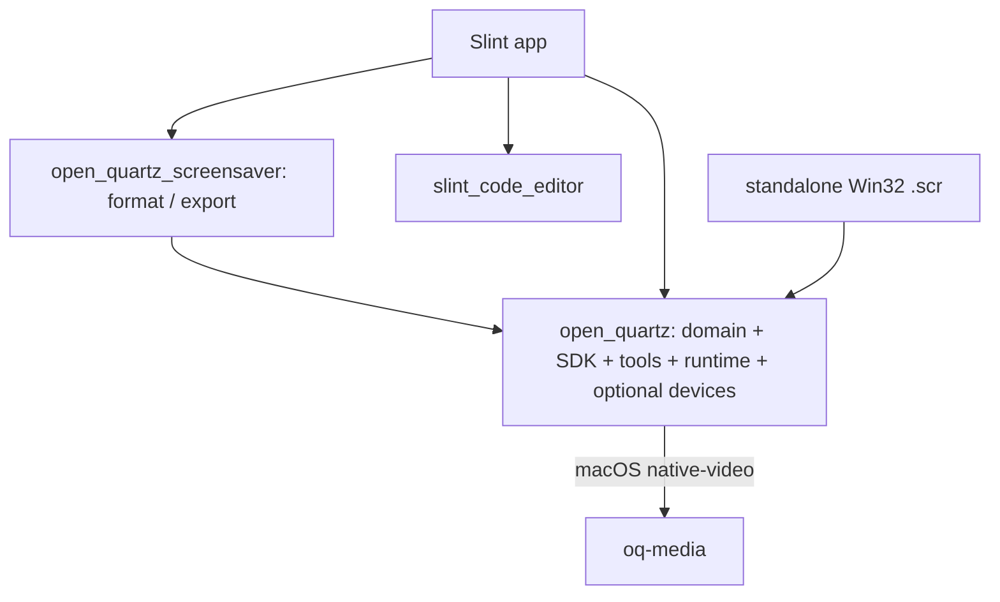

Slint、exporter、stub、媒体库和编辑器各有真实职责，保留独立 crate/workspace 或产品入口。Web/Tauri 与 WASM cdylib、JS/TypeScript object/browser/worker contract、`bindings`、`web-bindings`、`browser` feature 已删除；没有兼容 re-export、fallback 或可选 adapter。typed Rust root API 和原生 `Engine` 保留。

### 7.4 同一核心中的可选能力

feature 控制同一实现 crate 的模块和外部依赖，而不是转发到旧核心包。

| 能力 | 内容 / 依赖要求 |
|---|---|
| `default = []` | Graph/Project 编辑、serde、catalog、WGSL parser/compiler、Engine/Runtime 状态、clock/output、资源规划与纯 ONNX task/pre/postprocess；无 wgpu、ORT、FFmpeg、reqwest 或 UI 依赖闭包 |
| `gpu` | wgpu executor、纹理、readback、通用 presentation；WGSL 工具不反向依赖 GPU |
| `native-runtime` | 原生设备协调，蕴含 `gpu`，不自动启用 video、ONNX 或下载；相关资源字段/方法按能力编译 |
| `native-video` | 原生视频源和平台 worker；macOS 选择 oq-media/VideoToolbox；可独立用于 source/thumbnail，不强制 native-runtime |
| `native-video-d3d12` | Windows D3D12 video 细化能力，蕴含 native-video 与 gpu |
| `native-onnx` | ORT session 和 native pipeline；不要求 GPU 或 HTTP；纯 task/pre/postprocess 保持无设备可用 |
| `model-cache` | 下载、哈希校验和文件发布，显式启用 reqwest/sha2；不要求 ORT 或 GPU |

平台 cfg 与 feature 同时约束模块和依赖。项目编辑与屏保打包采用无设备配置；Slint 显式选择 native-runtime、native-video、native-onnx、model-cache，Windows 按需加 native-video-d3d12。Slint 与核心维持同版本 wgpu 和同一 Device/Queue 实例；不需要任何 SDK 语言绑定。

Cargo feature 可加性意味着同一构建图中的其他消费者可能重新打开设备能力。轻量闭包验收必须用独立 consumer invocation，不能用完整 workspace 构建图冒充默认配置；不支持的平台能力也不能产出可构造但无法工作的占位设备。

### 7.5 模块、调度与数据所有权

- `project` 保存领域模型与 Graph/GraphEdit、不变量、ID/Port/Node/ProjectFile/错误，以及 Project/history/revision、catalog、layout、节点工厂和 screen saver 图变换；`project::model` 为内部实现，公共类型由 crate root 显式导出。
- `player` 保存 Environment、OpenQuartz、headless Player/Output/Subscription；`resources` 保存资源 catalog、typed plan 与 `models` cache/download service。聚合实现不再集中到根部 sdk.rs，也不增加同名 compatibility wrapper。
- 当前 `Engine` 包装图 revision/generation、状态与待执行命令，`ExecutionEngine` 保存求值 dirty/Math/feedback；`Runtime` 和 `ExecutionRuntime` 又分别组合时钟/输出与设备资源。这些是现状，不表示职责边界已经设计完成，也不把 headless Player 的合成推进宣称为真实设备播放。
- Rust host 使用 `execution::{engine,runtime,gpu,shader,schedule,event}`、`project::catalog`、`resources`、`inference` 与 `media::native`。`execution::shader` 拥有 WGSL，`inference` 拥有 ONNX task/session/pipeline，`media::native` 拥有视频源与 worker；旧 advanced 根路径没有 alias。
- Slint render thread、I/O/model worker、共享设备、frame lease、ticket/generation、取消与迟到完成丢弃保持原所有权；文件服务不在渲染循环下载。JSON 仍可作为项目/包持久化格式，不再承担 Web/Tauri 产品 transport。

公开 `Player` 仍使用 headless Runtime 和内部合成推进，没有真实设备 driver 接线；`Project::graph_mut` 的可变直通仍能绕过 revision/history。二者需要单独行为收紧与验收，本次仅退役无消费者的语言/产品路径，不声称修复。

#### Execution/Runtime 职责复审与后续所有权方案

**先前目录装袋不足。Runtime 是运行机制，不是业务领域。** `execution/mod.rs` 只是将 engine/runtime/gpu/shader/schedule/event/logging 汇总到一个命名空间；它降低根目录噪声，却没有定义各自的修改原因、状态所有者或资源生命周期。把这些对象改名或再包一层 Runtime/Engine trait 也不能解决问题。

当前源码证据：

| 证据 | 实际混合职责 / 判断 |
|---|---|
| [`execution/mod.rs`](../crates/open_quartz/src/execution/mod.rs) | 只有模块声明与 feature gate，没有业务聚合边界 |
| [`runtime/api.rs` 的 `Runtime`](../crates/open_quartz/src/execution/runtime/api.rs#L49) | 同时持有 Engine、resource registry、output contracts/registry、CompositionClock、PresentationPlanner、HostBackend 和 capabilities；session、输出与后端机制混合 |
| [`runtime/execution.rs` 的 `ExecutionRuntime`](../crates/open_quartz/src/execution/runtime/execution.rs#L170) | 一个约 1,220 行的原生协调实现同时持有 GPU executor、Runtime、clock origin、视频源、ORT sessions、pending/completion workers、输出订阅、Windows presentation 与性能统计；资源上传、推理读回/提交和呈现控制也集中于此 |
| [`engine/state.rs` 的 `Engine`](../crates/open_quartz/src/execution/engine/state.rs#L54) 与 [`engine/executor.rs` 的 `ExecutionEngine`](../crates/open_quartz/src/execution/engine/executor.rs#L11) | 前者维护 applied graph、revision/generation、生命周期和命令，后者维护 plan、dirty、Math 值和 feedback；状态包装与求值层确有不同角色，不应只因名字相近便合并或重命名 |

后续应按真实职责切开实现与测试，再决定最少必要的文件/模块落点；下表是所有权方案，**尚未实施，不是新目录/API 名称**：

| 职责 | 唯一所有内容 | 不应拥有 |
|---|---|---|
| 编译 | WGSL 解析/校验、图 topology 与可复用 execution plan | playback clock、GPU/ORT/video live handles |
| 求值 | applied graph 的 dirty 传播、CPU Math、feedback 状态、按帧产生 typed work | 窗口/读回、文件下载、设备会话 |
| 播放 | 一个播放 session 的时间线、Play/Pause/Stop/close 与取消失效规则 | 具体解码器、GPU 呈现和 ORT worker 的实现 |
| 渲染 | GPU device/queue、纹理/lease、command 执行、显式 readback、presentation | 项目历史、模型下载、推理任务政策 |
| 推理 | task 派发、ORT session/worker、pending/completion/cancellation 与推理资源 | 媒体播放控制、图 UI、显示窗口 |
| 媒体 | video source/session/worker 与原生帧生命周期；独立 `oq-media` 继续拥有其后端 | NodeId、图 history、ONNX session |
| 输出 | typed output contract、subscription、registry 和 delivery/backpressure | graph evaluation、设备初始化、另一套播放时钟 |

允许一个**薄的播放协调者**按 typed 调用组合上述 owner，但不让它重新保存各组件已拥有的策略与资源实现。跨组件只共享明确的 graph revision、node generation 和 frame/content stamp，一次图替换、Stop/close 或资源替换后的迟到完成和旧 lease 必须按同一一致性规则失效。取消不能提前释放仍在设备上使用的资源。迁移应逐个转移生产调用方和 owning tests、删除旧组合中的重复状态与实现，不保留 shim，也不先造抽象 crate/trait。当前 `execution` 路径继续作为过渡布局，直到这些真实切分落地并有对应行为证据。

#### 桌面是否需要 FFI？

纯 Rust Slint 和独立 `.scr` 直接调用 root typed API 与 advanced host modules，不需要额外导出的 SDK C ABI、JNI 或语言桥；没有 JavaScript consumer，因此不需要保留 JS/WASM 值转换、导出或 IPC adapter。底层 graph/type/cycle 校验、WGSL 编译、catalog、资源意图和 ONNX typed 语义继续由 Rust 提供。

“不需要 SDK FFI”不等于没有外部库 FFI。ORT、FFmpeg、AVFoundation/CoreVideo、Metal、D3D12/COM 等调用仍是原生设备后端必要的实现细节；本次移除产品/语言边界不能删除这些原生实现。

### 7.6 当前源码落点

| 实现 | 当前位置 |
|---|---|
| 唯一根源文件与公共 Rust 导出 | [`src/lib.rs`](../crates/open_quartz/src/lib.rs)：只组织模块和 root 类型导出，源码根部无其他 .rs 文件 |
| 项目模型与目录语义 | [`project/model/`](../crates/open_quartz/src/project/model/)、[`project/catalog.rs`](../crates/open_quartz/src/project/catalog.rs) |
| Project/history/layout/factory/screen saver | [`project/mod.rs`](../crates/open_quartz/src/project/mod.rs)、[`history.rs`](../crates/open_quartz/src/project/history.rs)、[`layout.rs`](../crates/open_quartz/src/project/layout.rs)、[`node_factory.rs`](../crates/open_quartz/src/project/node_factory.rs)、[`screen_saver.rs`](../crates/open_quartz/src/project/screen_saver.rs) |
| Environment/OpenQuartz/Player/Output/Subscription | [`player/`](../crates/open_quartz/src/player/) |
| 资源目录、typed plan 与模型 cache/service | [`resources/`](../crates/open_quartz/src/resources/)、[`plan.rs`](../crates/open_quartz/src/resources/plan.rs)、[`models.rs`](../crates/open_quartz/src/resources/models.rs) |
| 图计划、运行状态、GPU、WGSL 与调度 | [`execution/engine/`](../crates/open_quartz/src/execution/engine/)、[`execution/runtime/`](../crates/open_quartz/src/execution/runtime/)、[`execution/gpu/`](../crates/open_quartz/src/execution/gpu/)、[`execution/shader/`](../crates/open_quartz/src/execution/shader/)、[`execution/schedule/`](../crates/open_quartz/src/execution/schedule/) |
| 事件与日志 | [`execution/event.rs`](../crates/open_quartz/src/execution/event.rs)、[`execution/logging.rs`](../crates/open_quartz/src/execution/logging.rs) |
| ONNX task/session/pipeline | [`inference/`](../crates/open_quartz/src/inference/) |
| Native video worker | [`media/native.rs`](../crates/open_quartz/src/media/native.rs)；独立后端库仍为 [`oq-media`](../crates/oq-media/) |
| Shader 唯一数据源 | [`project/shader_catalog.json`](../crates/open_quartz/src/project/shader_catalog.json)；native catalog 与 Shader automation 共用 |
| 核心契约测试 | 各职责目录中的 coverage/unit tests 与 [`tests/`](../crates/open_quartz/tests/)；保留活跃领域、SDK 与执行行为断言 |
| Slint app、图标与准备运行库 | [`apps/open_quartz_slint/`](../apps/open_quartz_slint/)、[`icons/`](../apps/open_quartz_slint/icons/)、[`runtime/`](../apps/open_quartz_slint/runtime/) |
| 原生 Shader fixtures | [`tests/fixtures/`](../tests/fixtures/)；根 tests 不再是 Web unit suite |

### 7.7 构建与消费边界

根 workspace、Slint workspace 与独立 editor workspace 各保留实际需要的 profile/lockfile。所有活动 manifests、lockfiles、源码 imports、coverage/boundary fixtures 与 CI 改用唯一 `open_quartz` 核心；历史审查和变更记录中的旧包名不代表兼容入口。编辑器继续无 OpenQuartz normal/build dependency。

不为目录整齐新增 provider-api/core/runtime-api 壳包。独立 `oq-inference` 仍是条件性提案：只有具备实际可用的 session/tensor/provider 实现、消除 graph/runtime 反向依赖并有独立测试时才提取；不把当前 ONNX 目录移动成空契约包，也不增加第二套图任务调度。

### 7.8 验证矩阵与证据状态

**本次 native-only 退役：下列功能/边界/产品检查通过；两项整体 100% coverage gate 均未通过。** 文档任务没有自行运行检查；表中仅记录主代理提供的本次结果，不复用旧测试数。已退役产品没有 Web/Tauri/WASM 验收门槛。执行/runtime 所有权方案尚未实施；这些结果不代表 public Player 已有真实 driver 或 graph_mut 已收紧。

| 当前门槛 / 命令 | 必须证明的行为 | 本次结果 |
|---|---|---|
| 默认/完整原生核心与根 workspace | 图/项目/typed API、Runtime 状态与真实独立 media/exporter/stub 行为保留 | 默认 `open_quartz` 216 项/28 suites、原生根 workspace 221 项/34 suites、完整 native feature 核心 284 项通过；未单独运行 native-onnx-only 测试 |
| 独立能力与 public boundaries：`npm run check:rust-boundaries` | default 与 native-runtime/video/onnx/model-cache 隔离；无旧 alias、bindings/browser feature/API；平台 cfg 按脚本范围 | 最终 native-only boundary rerun 通过；不等于 Windows/Linux runtime 或 `.scr` 实机验收 |
| Slint：`npm run test:desktop` | 原生应用状态、资源、模型取消/迟到完成与 typed planner 行为 | 72 项通过 |
| 真实窗口：`npm run test:desktop:ui` | graph/ports/history、共享纹理、AutoSize、播放时间/FPS、文件/资源交互；保留报告路径 | 18/18 通过；[本次交互报告](../test-results/slint-ui/interaction-2026-11-06T04-59-55-340Z/report.html) |
| Shader：`npm run test:desktop:shaders` | canonical Rust catalog 的每个 Shader、真实图像/连接与 GPU 像素 | 34/34 通过；[本次 Shader 报告](../test-results/slint-ui/shaders-2026-11-06T04-59-55-107Z/report.html) |
| 独立 editor：`npm run test:editor` | 组件无 OpenQuartz 依赖且编辑行为保留 | 10 项通过 |
| 覆盖率：`npm run test:sdk-coverage` | 当前 production owning modules 行/函数/区域门槛；不降低阈值或扩大 ignore 掩盖缺口 | 最终默认 lib 121、完整 native lib 170 项测试全部通过；两项整体 100% gate 均失败，百分比见下表 |
| 原生打包：`npm run build` | app icons/runtime 新路径、来源/许可证、架构匹配、package.json bundle version | macOS arm64 archive、ad-hoc 签名、runtime 与 `--help` startup 通过：`dist-desktop/OpenQuartz-0.20.0b-macos-arm64.zip`；`copy:ffmpeg` 使用 app-owned runtime；不代表 Windows stub 或搬迁实机验收 |
| 平台实机 | 相机权限/采集，Windows/Linux GPU 与 `.scr` `/s` `/p` `/c`、Surface/独立运行 | 尚未验收；逐平台记录，不以 macOS 或编译代替 |

最终 coverage 运行显式设置 `OPEN_QUARTZ_FFMPEG_PATH` 为 app-owned runtime 的 FFmpeg、`ORT_DYLIB_PATH` 为官方缓存运行库，再执行 `npm run test:sdk-coverage`。最初直接执行、未配置这些环境的 native coverage 有四项媒体 runtime fixture 失败；按原生脚本所需环境运行后测试全部通过，最终失败仅为覆盖阈值，不屏蔽失败或改变 ignore/阈值。模型运行库解析保留官方缓存路径 fallback。未单独执行 native-onnx-only 验收，完整 native 通过不替代该组合独立测试；Windows/`.scr` 与 Linux runtime 本轮未触及。

| 本次覆盖范围 | Lines | Functions | Regions | 结果 |
|---|---:|---:|---:|---|
| 默认核心 | 98.91% | 99.06% | 98.85% | 未达到整体 100% gate |
| 完整 native 核心 | 98.33% | 97.92% | 96.92% | 未达到整体 100% gate |
| project/player/resources catalog+plan | 100% | 100% | 100% | 子范围通过，不替代整体 gate |

默认配置的 pre/postprocess 因 browser-specific tests 退役存在覆盖缺口；完整 native 的 pre/postprocess/pipeline 达 100%。其余既存 GPU/video/provider 路径仍有缺口，未降低门槛或扩大 production exclusion。

#### 退役前职责分组与 bindings 清理结果（归档）

以下为上一阶段结果，**不是本次 native-only 产品验证**。当时默认核心 237、显式 `web-bindings` 243、workspace 317、Slint 72 与真实窗口 18/18 通过；[历史交互报告](../test-results/slint-ui/interaction-2026-11-06T03-56-10-150Z/report.html)。TS 704/tsc、Chrome 合约 5/5、WASM、Tauri library/render spike、binding/public boundary 及 release WASM SDK smoke 当时通过。Windows/Linux runtime 与 native release packaging 当时未重跑。

当时 test-only helpers 迁至 owning-test `support.rs`，沿用既有 `/tests/` filename filter；三项整体 100% coverage gate 均失败。历史百分比如下，不推导本次 coverage：

| 历史覆盖范围 | Lines | Functions | Regions | 当时结果 |
|---|---:|---:|---:|---|
| 默认核心 | 99.97% | 99.66% | 99.91% | 未达到 100% |
| 显式 `web-bindings` | 99.97% | 99.69% | 99.92% | 未达到 100% |
| 完整 native + `web-bindings` | 98.53% | 98.20% | 97.26% | 未达到 100% |
| project/player/resources catalog+plan 与当时 bindings | 100% | 100% | 100% | 子范围通过，不替代整体 gate |

#### 更早的单核心与 feature 隔离结果（归档）

以下继续记录更早布局的结果，不应当作本次结果。
迁移前审查基线：host API 收敛后 workspace 308、Slint 72、TS 704、类型检查、Rust boundary 与 WASM 编译通过。当时 `resources/plan.rs` 行/函数/区域均为 100%，execution 整体约为 98.13% / 97.37% / 96.50%，100% gate 失败于 GPU、VideoToolbox、native video 等实现，后续 package coverage 未执行。这些数值保留为迁移前证据。

**历史单核心与 feature 隔离验收结果（清理前布局）：**

| 范围 | 实测结果 |
|---|---|
| 核心与工作区 | 当时默认核心 230 项通过；完整 workspace 原有 308 项保留套件通过，另加下述两项针对性能力回归 |
| native-runtime 单独启用 | 禁用 ONNX/video 的请求明确拒绝；保留原 plan、revision、generation 与真实蓝色 GPU 输出，针对性回归通过 |
| native-onnx 单独启用 | 离线模型 transfer 与实际 scalar inference 通过，不依赖 GPU/HTTP |
| Slint | 当时 72 项测试、真实窗口交互 18/18 通过；[历史交互报告](../test-results/slint-ui/interaction-2026-11-06T02-36-13-880Z/report.html) |
| Web / 编译入口 | 当时 TS 704 项与 tsc 通过；browser/default wasm cargo check、独立 editor check、Tauri app --lib check 通过 |
| 独立 feature 闭包 | 当时修复依赖泄漏后，独立 default + 四个能力组合的边界脚本通过 |
| 实际浏览器 | 当时 Chrome 157 与匹配 driver 在临时目录运行，5/5 通过；修正旧 fixture 的 surface format 有效性/仅支持时优先 sRGB，以及 transfer 前初始化实际 OffscreenCanvas 2d context，保留像素断言 |
| 当时未重跑范围 | Windows/Linux runtime 与 release packaging 未重跑，不能据历史结果声称当前通过 |

历史 coverage 脚本分别运行默认与完整 native 两个 100% gate，未扩大 ignore 范围；**当时两项整体 gate 均失败**，保留 execution 覆盖缺口：

| 统计范围 | Lines | Functions | Regions | 结论 |
|---|---:|---:|---:|---|
| 默认核心 | 99.97% | 99.69% | 99.92% | 未达到整体 100% gate |
| 完整 native 核心 | 98.54% | 98.20% | 97.27% | 未达到整体 100% gate |
| 当时模块名 domain / sdk / ffi / planner（历史） | 100% | 100% | 100% | 清理前各模块达到要求；非当前目录或当前 coverage |
| Prepared 实现（从已排除 cache 文件移出后现已计量） | 96.55% | 100% | 97.06% | provider 平台分支尚有缺口 |

这些历史结果只验证当时的核心合并、能力隔离与既有行为保留，不验证本次退役，也不代表公开 Player 已接通真实 driver、Project graph_mut 已收紧或执行所有权方案已落地。browser coordinator 随产品退役，不再需要提取。


---

## 8. 优化后的边界审计（迁移前快照）

> **归档范围：第 8–12 节全部为退役前审计、规则、路线图与源码索引。** 其中“当前”指当时，不代表当前产品、路径、验证或继续维护 Web/Tauri 的承诺；当前规范与索引以第 0 节及 §7.3–7.8 为准。

本节的 TypeScript/Rust 审计表保留薄层 cutover 前的证据与建议；其中“当前”表示该审计当时的状态，不是本轮迁移后的状态。最新 crate/module 归属见 §7.3–7.6，当前完成度见 §10.1，本轮集成与 coverage 结果见 §7.8。

### 8.1 迁移前审计结论

迁移前的控制路径重构已消除了第二套 TypeScript graph/GPU engine，但“public proxy + platform adapter”仍偏厚，不能把 public 类名一致等同于薄 SDK 完成。

迁移前剩余问题分为四类：

1. **TypeScript 业务下沉（迁移前）**：TS local Project/Graph、Store mutation、Project I/O、screen saver transform、ORT task policy、resource reconcile和遗留算法当时仍需迁入Rust SDK。
2. **Web 数据路径性能**：功能正确但存在已知问题；本轮暂缓专项修复，后续单独 profile。
3. **Rust 模块与能力边界（当前）**：当前目录与 public advanced paths 见 §7.5–7.6；单核心职责清理本次验证通过，整体 coverage gate 结果独立记录于 §7.8。

### 8.2 迁移前逐项审计（历史快照）

| 边界 | 当时证据 | 当时状态 | 当时建议 |
|---|---|---|---|
| UI ↔ SDK | Component 经 Store/Service 调 public objects，但 catalog和部分editor helper仍直连 | **部分** | GUI只消费Rust-backed proxy和UI metadata |
| Store ↔ SDK | 无live object，但`graphSlice/helpers`仍实现Graph invariant、node factory、model准备和shader port mutation | **未完成** | mutation迁入SDK；Store仅保留UI projection/intent |
| Public proxy ↔ Rust | TS `Project/Graph/Node`自持React Flow snapshot和revision，未使用现有Rust object binding | **未完成** | public SDK禁止`@xyflow/react`并代理Rust aggregate |
| Service ↔ SDK | lifecycle经public Player；仍包含较多presentation/metrics projection | **部分** | 拆为小型framework adapter，不增加业务policy |
| Browser main ↔ Worker | DOM media/transport合理；Worker仍扫描Graph建立output subscription和renderer mapping | **部分** | observation intent由Rust Output/Subscription提供 |
| Browser execution/inference | shader/GPU在Rust；ORT task/pre-postprocess/output mapping仍在TS | **部分** | TS只运行ORT-Web，Rust拥有task/tensor/result语义 |
| Native execution/resource | Runtime语义共享；`NativeHost`仍扫描完整Graph reconcile image/video/ONNX | **部分** | Rust产生typed provider intent，host只执行平台调用 |
| Runtime ↔ binding | 当时 WASM FFI 位于 `open_quartz::ffi`，Android/Java/JNI glue 已删除（历史路径） | **保持边界** | 当前位置改为可选 bindings::wasm，见 §7.5 |
| Domain boundary | 当时 `open_quartz/src/domain` 为私有模块（历史路径），不依赖执行、binding 或 UI | **保持模块边界** | 当前模型位于 project::model；root 显式导出公共值类型 |
| Rust public visibility | 当时 root 为 SDK aggregates；advanced host 模块公开、设备按 feature 启用 | **历史单核心** | 当时 domain/sdk 私有；当前 project/player/execution 归属见 §7.5 |
| Output observation | Rust registry + public Output；host events 为 projection | **保持/部分** | presentation/multi-output仍可完善 |
| Web copy budget | shader GPU-only；preview/ORT/video 仍有显著 host cost | **未通过** | 暂缓修复，先建立 profile 基线 |
| Project/screen saver/catalog | TS重复version/normalize/graph transform/Math formula/ONNX registry | **未完成** | 迁Rust并删除重复来源 |
| TS遗留算法 | topo sort、旧WebGL types、shader pipeline materialization、重复overlay仍存在 | **债务** | 先做无调用清理并以Rust contract test替代 |


### 8.3 防回退规则

- Rust `Engine` 继续作为 topology、dirty、feedback、Math、generation 和 work ordering 的唯一来源。
- TypeScript provider 可持 DOM/ORT/session/transport，不得接收完整 Store 后自行 plan graph。
- `OutputDeliveryBatch`、stamp 和 generation 是 async/output consistency source；Worker/Tauri 只是 transport projection。
- 内部 `project::model` 不依赖执行、binding 或 platform；普通 SDK root 与 advanced host 模块分开，不向 TypeScript proxy 泄漏执行对象。
- Web 性能优化不得用重新引入 `Compositor/WebGPUExecutionEngine`、把 live object 放入 Store或让 UI 逐帧发 command 的方式实现。
- 平台类型如 `ImageBitmap`、ORT session、FFmpeg frame、D3D12 resource、HWND/Surface 必须留在 host/provider boundary。
- Public TypeScript SDK不得导入React Flow，也不得自行维护domain revision/invariant。
- Store只能保存GUI projection、layout、selection、intent和observable result；Graph command必须经过SDK。
- Provider/Host不得从catalog或完整Graph推导跨平台业务policy；Rust提供typed intent/request。
- 下沉任何行为前必须先建立回归，切换caller后才能删除TS实现和旧测试。

### 8.4 迁移前风险优先级（历史快照）

| 优先级 | 风险 | 当时决定 |
|---|---|---|
| P0 | TS public objects不是真实Rust proxy，Store仍持domain mutation | 下一阶段先完成Rust-backed object与Graph command cutover |
| P0 | Browser inference和NativeHost仍定义跨平台业务policy | 将task/resource intent下沉Rust，TS只保留平台执行 |
| P1 | Project I/O、screen saver、catalog和遗留算法重复 | 分小步迁移；每步先补Rust regression再删除TS实现 |
| P1 | Web frame/preview/inference/video性能不足 | 已记录并暂缓专项修复；迁移过程不得退化现有基线 |
| P2 | 单核心 feature 闭包及独立 consumer 验收 | 当时独立 default + 四个能力组合边界回归通过；本次结果独立见 §7.8 |
| P2 | 多output/presentation完整度 | 在真实产品需求下推进 |

---

## 9. 必须守护的架构规则

### 9.1 允许依赖

```text
components -> framework adapter / Store projection
framework adapter -> TypeScript SDK public Project/Graph/Player/Output proxy
TypeScript SDK public proxy -> TypeScript SDK internal transport/environment
Native Rust business -> Rust SDK public objects
TS internal -> Rust SDK public methods + host integration providers
Rust Player -> internal Runtime/Engine/Execution -> provider traits
platform implementation -> injected provider traits + platform APIs
```

### 9.2 禁止依赖

- component 直接调用 native GPU command、Worker/Tauri transport 或 environment provider；screen saver host integration 除外。
- public TypeScript SDK 暴露 `PipelineRuntime`、Runtime、Engine、ExecutionEngine、Compositor、binding、request ID、wire DTO 或具体 platform object。
- Rust SDK business API 按 Worker message、Tauri command、binding DTO 或序列化格式组织。
- TypeScript Browser 层保留 topology、plan、dirty、feedback、shader compilation policy 或第二个 execution engine。
- environment provider 暴露为 Project/Graph/Node/Player 的业务方法，或由 UI 逐帧驱动。
- Node/Port proxy getter 通过同步 IPC 逐属性读取，或 proxy 长期持有无生命周期保护的 native pointer。
- Store 保存 SDK client/player/proxy object、GPU texture、decoder frame、ORT session/tensor 或 per-frame command。
- 将 SDK class instance/native handle 序列化进 Project JSON。
- `execution` 依赖 `bindings::wasm`、Tauri、DOM 或具体 WebView event name。
- WGSL parser/compiler 依赖具体 GPU backend。
- Tauri shell 重建 composition clock、subscription registry、generation 或 presentation policy。
- 高频 pixel/frame 数据通过 JSON event 往返。

### 9.3 Change review 必答题

每个 runtime/性能 PR 必须回答：

1. 新状态由谁拥有？
2. 它属于 graph、resource 还是 result chain？
3. Browser 和 Native 是否产生第二套同义 policy？
4. 跨 JS/Rust 的是 command、event、stream 还是 bytes？频率和大小是多少？
5. listener/worker/session 在 stop/close/revision change 时如何释放或失效？
6. 是否改变 revision、generation、frame/content stamp？
7. fallback 是否通过 capability 显式可观察？
8. 是否新增逆向模块依赖？
9. 该能力属于 Rust SDK object API、TypeScript SDK public/internal，还是 framework adapter？
10. 新对象的 ownership、identity、stale/dispose 和线程语义是什么；是否把 internal communication 泄漏成了 public API？

---

## 10. 新架构落地计划

### 10.1 当前完成度与真实阻塞

Phase 7薄TypeScript convergence已完成。TypeScript public objects、Store Graph command、Project I/O、screen saver transform、catalog、Browser inference和host resource policy均已切到Rust-owned contract。领域、SDK和执行实现现统一位于 `open_quartz`；Rust模块职责与feature依赖边界见第7节，不能以crate数量或未验证的依赖闭包推断完成度。

当前剩余工作不再属于Phase 7业务语义下沉：

1. 干净 Windows VM 的 screen saver `/s`、`/p`、`/c` 手工验证，以及真实 video/ONNX 长稳仍未完成。
2. Web 已有可复现 benchmark；ORT tensor transfer、video ImageBitmap transfer 和 timer 调度需在真实 Browser API/GPU 环境继续 profile。

### 10.2 阶段状态

| Phase | 当前状态 | 说明 |
|---|---|---|
| 0 API | **完成** | public object API 与 WASM capability 已建立 |
| 1 Domain | **完成/部分深化** | typed IDs、Project/Graph/GraphEdit 已有；NodeData 仍有 editor/runtime projection 可继续拆 |
| 2 Player/Native | **完成主路径** | Tauri/SCR 使用 Rust Player/Runtime；platform host composition仍存在 |
| 3 WASM | **功能完成，性能未通过** | Rust wgpu Browser execution已生产使用；Web 性能问题已记录并暂缓 |
| 4 TypeScript execution cutover | **完成** | React adapter、App/ScreenSaver cutover、legacy TS execution删除 |
| 5 Android/Java/JNI | **已移除** | 专用 glue、源码与构建/对齐门槛已清理，不属于本仓产品 |
| 6 Boundaries | **单核心职责/绑定清理完成** | 当前分组、root-only lib.rs 与无 alias advanced 路径已实施并通过本次 functional/boundary/product checks；三项整体 coverage gate 失败，当前和历史证据分列于 §7.8 |
| 7 Thin TS convergence | **完成** | Rust-backed proxy、Store command、Project/screen saver/catalog/inference/resource policy下沉和TS遗留清理均已完成；Web剩余性能项已有benchmark基线 |

以下Phase 0–7条目保留为历史实施规格；后续工作以桌面产品、Windows实机验证和基于测量的Web性能优化为准。

### Phase 0：冻结 public object API，完成高风险 spike

**实现：**

1. 在 Rust 中先写 `OpenQuartz`、`Project`、`Graph`、`Node/Port view`、`PlayerBuilder/Player`、`Resource`、`Output/Subscription` 的 public signature、rustdoc、compile example 和最小可运行 in-memory behavior；不得提交 `unimplemented!()`、空方法或 JSON/wire facade 充当对象 API。
2. 明确 Runtime、Engine、ExecutionPlan、ExecutionCommand、GpuExecutor、registry 和 FFI 为 internal target；此阶段先建立模块边界和禁止新增 public re-export，不急于一次性收紧全部 visibility。
3. 冻结 `Graph::edit`、`GraphEdit::update_node`、`GraphChange`、Player ownership、Output subscription 和 Resource descriptor/live-resource 分层。
4. 做一个隔离 WASM spike，验证 Rust wgpu 在 Dedicated Worker 中完成 adapter/device、OffscreenCanvas surface、单 shader render 和 readback/capture。
5. 分别 spike `ImageBitmap/VideoFrame` frame delivery、ORT-Web provider round-trip、Rust deadline→host wakeup、DOM presentation target；记录哪些能力必须注入及其 thread/ownership/copy budget。

**验收 gate：**

- Native Rust 示例只出现 public object，不出现 Runtime/Engine/JSON/binding。
- public API review 表逐项确定用户价值、ownership、error、thread 和 close/drop 语义。
- WASM spike 证明 GPU 是否可由 Rust wgpu 直接拥有；provider signature 基于实测，不按现有 TS class 反推。
- 本阶段不改生产入口，不引入长期 feature flag。

### Phase 1：建立 Project/Graph/Resource domain model

**实现：**

1. 引入 typed `ProjectId/NodeId/PortId/ResourceId/OutputKey`，建立私有字段和受控 constructor/method，停止把 `Vec<ProjectNode>` public field 当 SDK API。
2. 将当前 `NodeData` 拆为 executable Node descriptor、`GraphLayout`、project `ResourceCatalog` 和 editor/runtime projection；position、expanded、download progress、resolved size 不进入 executable Graph。
3. 实现 closure-scoped `Graph::edit`。第一版以 metadata draft/clone 保证 rollback，commit 时统一校验 type、edge、cycle/feedback 和 resource reference，返回 `GraphChange`。
4. 建立 `.quartz.json` loader/serializer boundary。旧文件在 load 时一次性规范化为新 Project object；serializer 只从 Project object生成持久化格式。兼容转换不得进入 Graph/Player。
5. 将 screen saver graph slicing、project import/export、catalog node creation 改为调用 Project/Graph 方法，不直接修改 React Flow node data。

**验收 gate：**

- 现有 project fixtures 可 load→normalize→save→reload，graph semantics 和 resource references 不变。
- position-only/layout edit 不产生 executable `GraphChange`。
- GraphEdit 的失败、panic/unwind、cycle、类型不匹配、删除有引用 node 均保持原 Graph 不变。
- Rust domain module 不依赖 ffi、Tauri、DOM、React Flow 或 platform handle。

### Phase 2：实现 Player facade，先完成 Native clean cutover

**实现：**

1. 实现 `OpenQuartz::player(Graph)`、`PlayerBuilder`、`Player`；Player 内部组合现有 Runtime、Engine、GpuExecutor、resource/output registry，但这些类型不穿透 public API。
2. 实现 `Environment::native_defaults()` 和最小 host integration：native GPU/media/inference，以及由具体 host 提供的 presentation target。不要先建一个包罗万象的 backend trait。
3. 实现 public Resource descriptor/object、Player internal live resource reconciliation，以及 public `Output/Subscription/capture` facade。
4. 提取 Tauri 和 Screen Saver 共用的 native environment/Player implementation；Tauri 只保留 command/event/WebView2 shell，SCR 只保留 package、Win32 window/surface shell。
5. 迁移所有 Native/SCR caller 后，将 Runtime、Engine、GpuExecutor 的直接构造限制在 Rust SDK internal/test；删除 host 中重复的 clock、generation、resource/output policy。

**验收 gate：**

- 同一个 Native Rust example、Tauri host、SCR host 都通过 `OpenQuartz -> Project -> Player -> Output` 路径运行 shader、image、math、feedback、renderer、video 和 ONNX。
- Tauri/SCR 不直接构造 Runtime/Engine/GpuExecutor，不复制 video/ONNX scheduling policy。
- play/pause/resume/stop/apply/close 和 stale completion 在三个 Native consumer 上跑同一 conformance suite。
- screenshot、preview、presentation 都来自 public Output，frame heartbeat 不承载 output value。

### Phase 3：在隐藏 harness 中完成 Browser/WASM Rust execution

旧 Browser production path 在此阶段保持不变；新 Player path 只由测试/开发 harness 驱动。禁止在一个生产会话中同时运行旧 TS execution 与新 Rust execution，也禁止把旧路径做成 Player 的 runtime fallback。

**实现：**

1. 建立 wasm-bindgen internal object binding/handle table，只投影 Rust public object method；ExecutionPlan/command 不进入 TypeScript public API。
2. Rust wgpu 在 WASM 内拥有 device、queue、pipeline、target、feedback 和 shader execution；TypeScript 只传 OffscreenCanvas/surface target。
3. 实现细粒度 Browser host ports：DOM video/camera frame source、ORT-Web inference、frame scheduler/waker、resource resolver、DOM presentation。provider 不接收完整 Graph，不读取 Store/Catalog。
4. 将 Browser node matrix 逐项接入 Rust Player：shader/constant/math/feedback/image → video → ONNX → renderer/output/capture。
5. 建立同一 Project fixture 的 Native/WASM conformance：Graph behavior、output key/type、Player state transition、resource invalidation、frame/content stamp 和可比较像素结果。

**验收 gate：**

- Browser test harness 不导入 `src/engine/compositor.ts` 或 `executionEngine.ts`。
- shader/feedback/video/ONNX/renderer 的 browser smoke 全部通过 Rust Player。
- provider 只实现平台能力；topology、dirty、feedback、generation、output policy 只有 Rust 一份。
- **性能 gate 未通过**：普通 shader 保持 GPU-only、video 不经 JSON，但 renderer preview/ORT readback-upload/video transfer/Worker scheduling 仍存在已知性能问题；暂缓修复，待独立 profile。

### Phase 4：TypeScript SDK proxy、React adapter 与一次性生产切换

**实现：**

1. 建立 TypeScript `OpenQuartzClient/Project/Graph/Node/Port/Player/Resource/Output` proxy，与 Rust public object逐项对应；Worker/Tauri/wasm-bindgen、proxy cache 和 host selection 全部在 SDK internal。
2. 建立 React/Zustand adapter。React Flow node 由 Graph+Layout projection生成；Store 只保存 UI projection/selection/dialog，不保存 Player、MediaStream、capture closure、model manager 或 live resource。
3. 将 App、ScreenSaverApp、project menu、node editor、preview/capture 全部切换为 TypeScript public proxy。
4. 同一个 TypeScript Player 自动选择 Browser internal 或 Tauri internal；UI 不检测 Tauri、不调用 command name、不处理 Worker message。
5. 切换 gate 通过后，在同一阶段删除 `PipelineRuntime.ts`、public Browser/NativePipelineRuntime export、`RealtimeHost`、TS `Compositor/WebGPUExecutionEngine` policy、旧 Store ONNX/resource lifecycle 和相应 legacy tests。

**验收 gate：**

- `src/components`、`src/store` 不导入 `src/sdk/internal`、transport、binding、Tauri command 或 `src/engine` execution。
- TypeScript public export 只包含 Rust public object proxy、typed value/error 和 framework-neutral helpers。
- Browser 与 Tauri 使用同一 UI scenario 完成 open/edit/play/pause/apply/output/capture/close。
- production bundle 中不再存在第二个 TypeScript graph/execution policy；不存在旧 runtime fallback。

### Phase 5：Android/Java/JNI glue（已移除）

本仓不保留 Java SDK、C ABI 壳或 Java public proxy 源码形状检查。未来独立 Android 产品的 glue 应在对应产品仓中实现，不挂入本仓默认构建。

### Phase 6：删除迁移边界并用编译边界固化

旧 Phase 6 曾按 schema/execution/SDK/facade 拆包；第 7 节已取代该结构。当前以模块职责和 capability feature 固化单核心边界：

```text
open_quartz root          仅 lib.rs；public value/ID/error + Project/Graph/Player/Resource/Output
  project + player        模型不变量、项目与播放/输出聚合
  resources               catalog / typed plan / models cache/download service
  execution               engine/runtime/gpu/shader/schedule/event/logging
  inference + media       ONNX / native video
  bindings::wasm          可选 JS/WASM adapter；web-bindings，browser 增加设备组合
```

**实现与验收：**

1. domain 与 SDK 业务实现不依赖应用 UI 或平台 shell；binding 消费核心业务，advanced 执行模块不反向依赖语言适配。
2. dependency-policy CI 禁止 internal execution type从 public crate/root re-export。
3. public-proxy parity 检查 Rust/TypeScript object/method/error；internal conformance 检查行为，不要求共享 wire DTO。
4. 删除所有迁移 adapter、临时 conversion helper、dev feature flag 和已无 caller 的 legacy test；Project file version conversion仅保留在持久化 loader boundary。

### 10.3 切换策略与提交纪律

1. **保持一条生产路径。** Phase 0–3 的新 Browser Player 只在 harness 中运行；Phase 4 一次切换生产入口并删除旧路径。
2. **不以 shim 冒充完成。** 临时 adapter 必须有明确删除 Phase，不能从 crate root 或 TypeScript public index 导出。
3. **每阶段可独立验证。** 一个阶段只有在自身 gate 全部通过后才开始依赖它的下一阶段；narrow unit test 不能代替 Native/Browser smoke。
4. **先行为、后拆 crate。** ownership、Player、provider 和 Browser execution 行为稳定前，不做机械目录/包拆分。
5. **Project migration 只在 I/O boundary。** runtime、Graph、Player 和 language proxy 只看新 domain object，不携带 legacy field fallback。

### 10.4 总体验收矩阵

| 维度 | 必须证明 |
|---|---|
| Public API | Native Rust 用户只使用 OpenQuartz/Project/Graph/Node/Port/Player/Resource/Output |
| Graph | atomic edit、rollback、type/cycle rule、layout 不触发 execution |
| Player | lifecycle、apply、multi-player、close/drop、stale async completion |
| Resource | descriptor 与 live object 分离；replace/remove/generation/close 正确 |
| Output | value/preview/capture/presentation 统一由 Output/Subscription 观察 |
| Environment | Rust execution 请求能力；host provider 不拥有 graph/execution policy |
| Browser/Native | 同一 fixture 的 graph behavior、output schema、stamp 和可比较像素一致 |
| Language SDK | TS public proxy 对应 Rust public object，internal transport 可替换 |
| UI | framework 只依赖 public proxy，Store 无 live SDK/platform object |
| Cleanup | 无 PipelineRuntime、TS Compositor/WebGPUExecutionEngine policy、双 runtime 或 public wire DTO |
| Thin TS | public SDK不导入React Flow；Store无domain mutation；Host不扫描catalog/完整Graph；TS无跨平台算法重复 |
| Rust regression coverage | 除GUI和不可替代平台API外，所有可复用功能由Rust unit/contract tests直接防守 |

### 10.5 推荐 change-set 顺序

每个 change-set 都必须保持主分支可构建，并只在其 gate 具备足够证据时合入：

1. **API/spike change-set：** public signature review、WASM wgpu/frame/ORT/scheduler spike；spike 不进入 production path。
2. **Domain change-set：** typed IDs、Project/Graph/Layout/Resource、GraphEdit、project loader normalization。
3. **Player core change-set：** Player/Environment/Output facade 包装现有 Rust internal，实现 native defaults。
4. **Native host change-set：** Tauri 与 SCR 迁移到 Player，共享 native environment；删除 host direct Runtime/GpuExecutor orchestration。
5. **WASM execution change-sets：** Rust wgpu core、frame source、ORT-Web、presentation、scheduler，全部先落 hidden harness。
6. **TypeScript SDK change-set：** public proxy 和 internal object binding，不改 UI。
7. **Application cutover change-set：** React adapter/Store 切换，同时删除 PipelineRuntime、RealtimeHost、TS Compositor/WebGPUExecutionEngine policy 和旧 production tests。
8. **Compile-boundary change-set：** 最后拆 crate、收紧 visibility、启用 dependency CI 和 public contract tests。

不得把第 5–7 项压成“先加一层 proxy、底下继续永久运行旧 TS engine”的假迁移。TypeScript proxy 可以先合入但不能成为 production 入口，直到 Rust/WASM Player 通过 Phase 3 gate。

### 10.6 Phase 7：薄 TypeScript convergence

Phase 7不做一次性重写。每个change-set只迁移一个可观察contract，先建立回归，再切caller，最后删除旧TS实现。

| 顺序 | Change-set | Rust目标 | TypeScript最终保留 | 必须回归 |
|---:|---|---|---|---|
| 1 | 无生产caller遗留清理 | 复用现有topo/Math/WGSL/ONNX contracts | 删除TS topo、旧WebGL types、Math `compute`、unused shader materialization、legacy ONNX registry/重复overlay | 先确认生产引用为零；Rust对应单测；`npm test`与`cargo test --workspace` |
| 2 | Rust-backed public objects | Rust `OpenQuartz/Project/Graph/Node/Port`绑定支持aggregate snapshot、edit、revision、serialize | async proxy、snapshot cache和error mapping；React Flow projection移到framework adapter | 同一fixture的create/open/edit/save/revision/rollback Rust+TS conformance；App open/edit/save smoke |
| 3 | Graph command与Store瘦身 | Rust node factory、connect/disconnect/type invariant、shader port更新、remove cascade、GraphChange | selection/layout/dialog/intent/undo UI projection | 每个Store action先转为Rust behavior test；connection boundary、cycle/type、undo/apply regression；NodeGraph UI test |
| 4 | Project I/O与screen saver | Rust version normalize、template resolution、upstream subgraph、resample transform、manifest graph | file picker、Blob download、dialog和path selection | load→normalize→save→reload；export graph像素/节点fixture；SCR package tests；TS菜单/对话框test |
| 5 | Catalog执行语义下沉 | Rust Math descriptor/formula、ONNX task/IO/defaults/integrity、shader template contract | label/category/icon/control metadata | Rust catalog snapshot/behavior tests；public proxy parity；菜单渲染tests；删除第二registry |
| 6 | Browser inference瘦身 | Rust task dispatch、tensor descriptor、tile/preprocess/postprocess、threshold、NMS/segmentation、output mapping和completion stamp | ORT-Web session lifecycle与raw tensor marshalling | Rust task unit tests覆盖每个model family/boundary；Native/Browser tensor conformance；stale completion；Browser ONNX smoke |
| 7 | Host resource intent | Rust Player输出resolve/attach/detach/load/unload/present typed intent和generation policy | DOM/Tauri/WebView2具体调用及opaque handle | image/video/model replace/remove/stop/close tests；Browser/Native同fixture；platform smoke |
| 8 | Domain与核心边界 | 在单一 open_quartz 内保持 domain/SDK/执行职责，资源意图规划归入 `open_quartz::resources::plan`，设备能力由 feature 隔离 | GUI projection单独TS type | `cargo test --workspace`、独立 feature consumer/dependency tests、TS diagnostics、project compatibility fixtures |
| 9 | Web性能专项 | 在正确边界上优化readback/encode/tensor/video/scheduler | 必要Web API与instrumentation | 优化前后同一benchmark；像素/输出/stamp回归；不得以关闭功能换指标 |

**实施状态：已完成。** 九个change-set已按回归先行方式落地；Web性能项只记录可复现实测结论，未对缺少真实Browser API/GPU证据的ORT/video/scheduler路径宣称提升。

完成判据：

- `src/sdk` public surface不导入`@xyflow/react`，不自持domain invariant或独立revision。
- `src/store`不创建可执行node、不校验Graph连接、不下载/introspect模型。
- `BrowserHost/NativeHost`不导入执行catalog，不从完整Graph推导resource/task policy。
- TypeScript中不存在topology、Math执行公式、ONNX pre/postprocess、Project normalize或screen saver graph transform的第二实现。
- 除GUI和必须依赖DOM/Tauri/ORT-Web/WebView2的platform adapter外，功能变化应能由Rust tests直接定位失败。

### 10.7 每一步重构的回归协议

每个change-set必须按以下顺序执行，禁止“先删TS、最后补测试”：

1. **冻结行为**：列出要迁移的observable contract和edge cases。若行为目前只在TS，先保留/补characterization test；若Rust已有对应行为，先补Rust regression。
2. **Rust test先行**：为目标Rust API增加会在合理错误实现下失败的unit/contract test；覆盖success、boundary、invalid input、state transition、stale/dispose和serialization invariants。
3. **实现但不切生产**：完成Rust逻辑和binding/proxy，运行targeted Rust tests。
4. **跨语言conformance**：同一fixture经过Rust direct、WASM/TS proxy；比较Graph/result/output key、revision/generation、stamp和可比较pixels/tensors。
5. **切一个caller**：一次只迁一个Store action、provider task或host intent；运行对应TS component/adapter regression和实际smoke。
6. **完整gate**：至少运行`cargo test --workspace`、`npm test`、`npm exec -- tsc -b`和dependency checks；GPU/media/inference行为变更还要运行对应Browser或Native smoke。
7. **清理**：只有新路径通过完整gate后，才删除旧TS实现、legacy fixture和临时adapter；保留真正防守public behavior的tests。

每个PR必须记录“迁移前由哪个test防守、迁移后由哪个Rust test防守、还需要哪个platform smoke”。没有回归证据的代码搬运不算完成。

### 10.8 Rust 测试覆盖作为预期副产物

薄TS迁移完成后，一个重要副产物是：**几乎所有非GUI、非平台专属功能都可由Rust层unit/contract tests直接覆盖。** 这不是追求虚假的100%行覆盖，而是让业务功能的失败首先在Rust tests中出现，而不是依赖React/Worker/Tauri端到端测试才发现。

`open_quartz` 的 SDK aggregate 实现保留既有 **100% 硬门禁**要求。coverage 按 project/player/resources 等生产职责计量，test-only support 沿用既有 `/tests/` 排除，不扩大 production exclusion。WASM/TypeScript 测试验证 marshalling 和平台集成，不能替代 Rust contract coverage。本次三项整体 gate 均失败，聚合/资源计划/保留 bindings 子范围 100%；当前百分比与历史结果分列于 §7.8。

```bash
npm run test:sdk-coverage
```

测试归属遵循以下规则：

1. `project/`、`player/` 与 `resources/` 拥有 Project/Graph/Layout/node factory/Player/resource/output/screen saver 等业务契约测试。
2. `bindings/wasm/` 保留可选 JS/WASM marshalling 和目标平台组合测试，不重复防守聚合内部业务分支。
3. TypeScript Store/SDK tests只验证React Flow projection、transport、error mapping和语言conformance；任何跨平台业务断言必须先在Rust owning crate存在。
4. `execution`、`inference` 与 `media` 防守执行状态及设备生命周期，`resources::plan` 防守资源意图/generation，`project::model` 防守领域与持久化契约；测试按行为 owner 划分。

### 10.9 测试归属与 coverage gate

重构后的测试不按调用方目录归属，而按行为语义的 owner 归属：

| 层 | 必须覆盖 | 测试位置 | 不应重复承担 |
|---|---|---|---|
| 核心项目/播放/资源聚合 | Project/Graph/Layout、node factory、revision/history、Player lifecycle、ResourceCatalog、Output/Subscription、screen saver graph transform | `crates/open_quartz/src/{project,player,resources}/` 中的 coverage/unit tests 与 `crates/open_quartz/tests/` | 不承担 DOM、React Flow、Worker、Tauri |
| 核心执行与设备模块 | Runtime/Engine/GPU/WGSL/ONNX/video execution 与状态机 | execution/inference/media 中的 unit tests 与 `crates/open_quartz/tests/` | 不重复 aggregate 行为，不承担具体 DOM/Tauri/WebView2 调用 |
| 项目模型与资源计划 | wire names、serde round-trip、兼容性、public boundary、image/video/ONNX intent/generation | `project/model/`、`resources/plan_coverage_tests.rs` 与集成测试 | 不承担设备执行语义 |
| 可选 WASM adapter | binding marshalling、Browser GPU/environment composition | `bindings/wasm/` 与 browser contract tests | 不重复 SDK business contract；无桌面 C/JNI FFI 层 |
| TypeScript | React Flow projection、Store adapter、Worker/host transport、error mapping、UI interaction | `tests/sdk`、`tests/store`、`tests/components`、`tests/services` | 不再是跨平台业务规则的唯一防线 |

`npm run test:sdk-coverage` 保留 100% 硬 gate，独立 coverage test source 使用 filename filter 排除，不把测试代码计入分母。上一轮默认/完整 native gate 均失败、当时 domain/sdk/ffi/planner 均 100% 的数值属于**历史单核心证据**，不是当前目录或本次清理结果；完整原始数值及 Prepared 平台分支见 §7.8。

| 功能层 | 主要Rust测试 | 仍需语言/platform测试 |
|---|---|---|
| Project/Graph/Layout/GraphEdit | unit + property/invariant + serialization round-trip | React Flow projection与文件picker |
| node factory/catalog/Math/shader contract | table-driven/snapshot + parser/compiler behavior | 菜单、icon、编辑器interaction |
| Player lifecycle/resource/output | state transition、generation、subscription、stale/dispose | Worker/Tauri transport与surface |
| screen saver transform/package | graph fixture、manifest/package round-trip | Windows VM `/s`/`/p`/`/c` smoke |
| ONNX task/pre-postprocess | deterministic tensor/image fixtures、threshold/NMS/segmentation boundaries | ORT-Web/native provider availability与GPU interop |
| GPU execution | small deterministic texture/pixel fixtures | Browser/native adapter/device smoke |
| language proxy parity | Rust public contract fixture | TS marshalling、close/error/thread behavior |

最终测试金字塔应为：大量快速Rust unit/contract tests；少量TS GUI与platform adapter tests；更少但真实的Browser/Tauri/screen saver smoke。端到端测试验证集成，不能代替Rust对功能语义的直接覆盖。

### 专项状态：自包含 Windows Screen Saver Host

当前最小 capability profile 已切换为真正的 native host：

```text
Windows Screen Saver Control
  -> self-contained .scr
  -> Win32 /s or /p child window
  -> open_quartz::Runtime
  -> Engine -> GpuExecutor -> wgpu DX12
  -> direct DX12 wgpu Surface presentation
```

`.scr` 直接读取自身尾部的 version-3 manifest，初始化 `open_quartz` Rust SDK 和 GPU executor，并拥有窗口、Runtime、GPU device 与 presenter 生命周期；不启动 Tauri、WebView、React、`PipelineService` 或已安装的 OpenQuartz。

#### 已完成

- [x] 解除 `runtime -> ffi`、`wgsl -> gpu` 逆向依赖；Tauri Native 使用 canonical `Runtime`。
- [x] `open-quartz-screensaver-stub` 直接依赖 `open_quartz`，不依赖 `app` crate。
- [x] manifest 删除 `application_path`，magic/schema 升级到 version 3；旧包返回明确的版本错误。
- [x] `/s` 创建全屏 Win32 popup；`/p <HWND>` 创建并嵌入 native child window；`/c [HWND]` 保留纯 Win32 设置流程。
- [x] package 内嵌 graph manifest、Renderer ID、导出默认值和 exposed resource descriptors。
- [x] image override 只替换 resource path，不修改 graph topology/semantics。
- [x] shader、image、math、feedback、renderer、file-video、ONNX 共用同一 host；release host 实测 5,725,184 bytes（不含按图嵌入的资源）。
- [x] exporter 按实际 graph 收集 file video、FFmpeg、ONNX model、ORT 和 DirectML，写入带 offset/length/task 的资源闭包。
- [x] package/extraction 测试验证 version 3、自身前缀、资源 offset/length、runtime 环境路径和 manifest 回读。

#### Capability profile closure

- [x] Video profile：`NativeVideoSource` 已下沉到共享 crate；SCR package 内嵌文件视频和 FFmpeg，host 复用 loop/rate/pause/drop 生命周期。
- [x] ONNX profile：package 内嵌模型、ORT/DirectML；host 复用 Rust task preprocess/postprocess 与 DirectML→CPU fallback。
- [x] 导出器按 graph 实际节点选择资源，不需要的媒体/推理 payload 不进入 `.scr`。
- [x] native surface presenter：Renderer texture 通过 fullscreen blit render pass 直接进入 wgpu DX12 Surface，无逐帧 readback/GDI。
- [x] Camera profile 明确拒绝；导出时无法保存确定性的物理 camera source。

#### 验收状态

- [x] stub 无 `Command::new(app.exe)`、无 Tauri/app 依赖，直接构造共享 Runtime。
- [x] Rust/SCR tests 覆盖 graph plan、resource closure、runtime path extraction、mode parsing 和 package version 拒绝。
- [x] `/s`、`/p`、`/c` 均由 self-contained host 实现，退出路径显式销毁窗口并 drop media/session/GPU resources。
- [ ] 在未安装 OpenQuartz 的干净 Windows VM 手工验证移动后的 `.scr` `/s`、`/p`、`/c`。
- [ ] 用真实视频 graph 做 decode/loop/exit 长时间稳定性验证。
- [ ] 用真实 ONNX graph 做模型加载、provider fallback 与下游 GPU continuation 验证。

## 11. 性能与正确性不变量

### 11.1 高频路径

Browser：

```text
Worker timer -> WasmBrowserPlayer.frame -> Rust Runtime/Engine/GpuExecutor -> wgpu surface
                         ├-> OutputDeliveryBatch -> PlayerEvents
                         ├-> preview/capture readback -> PNG/base64
                         └-> ORT-Web task -> readback/inference/upload/completion
```

Native：

```text
render thread -> video/completion -> Rust Runtime/Engine -> GpuExecutor -> presenter
```

两条路径都禁止 UI 每帧发 command。Browser 的 timer/provider/readback 是 SDK internal host capability，不拥有 graph execution policy。

### 11.2 当前 copy 特征与性能状态

| 路径 | 当前 copy/同步特征 | 性能状态 |
|---|---|---|
| Browser shader | Rust wgpu texture/render pass，正常帧不做 CPU pixel copy | 需 profile frame/submit，但结构为 GPU-only |
| Browser renderer preview | 最多约 15 Hz：GPU readback → `Uint8Array/ImageData` → PNG blob → base64 → postMessage | **已知性能候选热点** |
| Browser capture | 显式 full output readback + PNG/base64 | 用户触发；可接受性待测 |
| Browser video | DOM decode → `createImageBitmap` → transferable postMessage → external texture copy | **已知性能候选热点** |
| Browser ONNX | GPU readback RGBA → ORT-Web → RGBA upload | **已知性能候选热点** |
| Native Windows file video | D3D12VA YUV surface import；无 CPU decoded RGBA 主路径 | 保持 |
| Native ONNX | GPU readback RGBA → CPU/DirectML ORT → GPU upload | 明确 cpu-copy tensor path |
| Native Renderer TextureStream | GPU shared texture bridge；无 CPU pixel IPC | 保持 |
| Native fallback preview | bounded RGBA binary readback | fallback only |
| Native screenshot | 显式 full-resolution RGBA readback | 用户触发 |

**决策：Web 性能问题先标记、暂不修复。** 下一轮必须先建立可重复的 Browser benchmark/profile，再决定方案；不得在没有数据时通过降低正确性、特殊 casing 或恢复 TS execution engine“优化”。

### 11.3 生命周期

- graph revision 改变时，旧 async completion 不得发布。
- node generation 改变时，旧 resource/result 不得复用。
- position-only edit 不应重建 GPU/feedback resource。
- STOP/close 必须停止 worker/listener/video/session/presenter lease。
- TextureStream fallback 不得启动第二个 graph runtime。

---

## 12. 架构验证与源码索引

### 12.1 验证方法（历史流程说明；本次结果见 §7.8）

仅文档更新至少执行：

1. Mermaid fence成对、图类型可解析；
2. 文档中的路径、类名、command/event名可在源码定位；
3. `npm exec -- tsc -b`无新增diagnostic；
4. 不重复运行与文档无关的GPU/模型/发布测试。

任何代码重构则必须遵守10.7回归协议。默认完整gate：

```text
cargo test --workspace
npm test
npm exec -- tsc -b
npm run check:rust-boundaries
```

按变更路径追加smoke：Browser GPU/ORT/video、Tauri/native或 screen saver。Targeted test可用于开发循环，但不能替代change-set完成时的完整gate。

自动边界检查应持续扩展：

- Rust public boundary：禁止public object引用binding、Tauri、DOM、wasm DTO或internal execution type；
- TypeScript thin boundary：public SDK禁止React Flow，Store禁止provider/execution，Host禁止catalog/完整Graph policy；
- public proxy parity：Rust/TypeScript对象、方法、error与observable behavior对应；
- internal conformance：WASM、Worker、Tauri对同一fixture行为一致，不要求共享wire DTO；
- duplicate policy detection：禁止TS topo、Math公式、ONNX pre/postprocess、Project normalize和screen saver transform重新出现。

测试迁移原则：TS-only业务每迁出一项，Rust层必须增加等价或更强的regression；删除TS test前确认其contract已由Rust test和必要platform test共同覆盖。目标结果是Rust unit/contract tests几乎覆盖全部非GUI功能，而TS tests集中于GUI与不可替代platform integration。

### 12.2 关键源码入口

| 主题 | 源码 |
|---|---|
| App/framework adapter | `src/App.tsx`、`src/services/PipelineService.ts` |
| TypeScript public object API | `src/sdk/OpenQuartzClient.ts`、`src/sdk/index.ts` |
| Browser main-thread internal host | `src/sdk/internal/BrowserHost.ts` |
| Browser Worker | `src/sdk/BrowserRuntimeWorker.ts` |
| Worker protocol | `src/sdk/browserWorkerProtocol.ts` |
| WASM internal wrapper | `src/sdk/WasmSdkClient.ts` |
| Browser ORT provider/resource | `src/sdk/internal/BrowserInferenceProvider.ts`、`src/sdk/internal/OnnxResourceRegistry.ts` |
| Native TypeScript internal host | `src/sdk/internal/NativeHost.ts` |
| Tauri command registration | `src-tauri/src/lib.rs` |
| Tauri commands/events / execution | `src-tauri/src/native_runtime.rs`、`crates/open_quartz/src/execution/runtime/execution.rs` |
| Native video | `crates/open_quartz/src/media/native.rs`、`crates/oq-media` |
| WebView2 TextureStream | `src-tauri/src/webview_texture_stream.rs` |
| Rust project model / aggregates | `crates/open_quartz/src/project/`、`crates/open_quartz/src/player/` |
| Rust public root | `crates/open_quartz/src/lib.rs` (only root source module) |
| Resource catalog, typed plan and cache | `crates/open_quartz/src/resources/` |
| Execution / inference | `crates/open_quartz/src/execution/`、`crates/open_quartz/src/inference/` |
| Browser Rust adapter/environment | `crates/open_quartz/src/bindings/wasm/` |
| Boundary CI | `.github/workflows/dependency-boundaries.yml`、`scripts/check-rust-boundaries.mjs`、`tests/sdk/dependencyBoundary.test.ts` |

### 12.3 当前基线总结

- **已实现并验证**：Rust-backed public object API、薄 TypeScript proxy 与 Rust-owned 图/项目/资源语义保留；单核心按 project/player/resources/execution/inference/media/bindings 分组，root 仅 lib.rs，advanced 路径不留旧 alias。桌面直接 typed 调用，Web 使用可选 bindings::wasm，Tauri 保留 JSON IPC。本次 functional/boundary/product checks 通过，但三项整体 coverage gate 仍失败；当前结果和历史单核心证据分列于 §7.8。Windows/Linux runtime 与 native release packaging 本次未重跑。
- **已测量、继续优化**：Web preview Blob编码优先使用`FileReader`并保留等价fallback；Worker复用逐帧typed array。Node benchmark只证明fallback parity与allocation差异，不代表Browser PNG、ORT或video生产性能；后续必须在真实Browser API/GPU上profile ORT readback-upload、video `ImageBitmap` transfer和timer/GC。
- **下一主线**：真实Browser/Native/Windows环境的功能、长稳和性能验证。
- **尚未完成**：干净Windows VM的screen saver `/s`、`/p`、`/c`手工验证；真实video/ONNX graph长稳验证；真实Browser ONNX和preview性能smoke。

后续任何性能或边界优化若改变上述状态，必须同时更新总图、逐帧数据流、copy 特征、阶段状态和源码索引。
