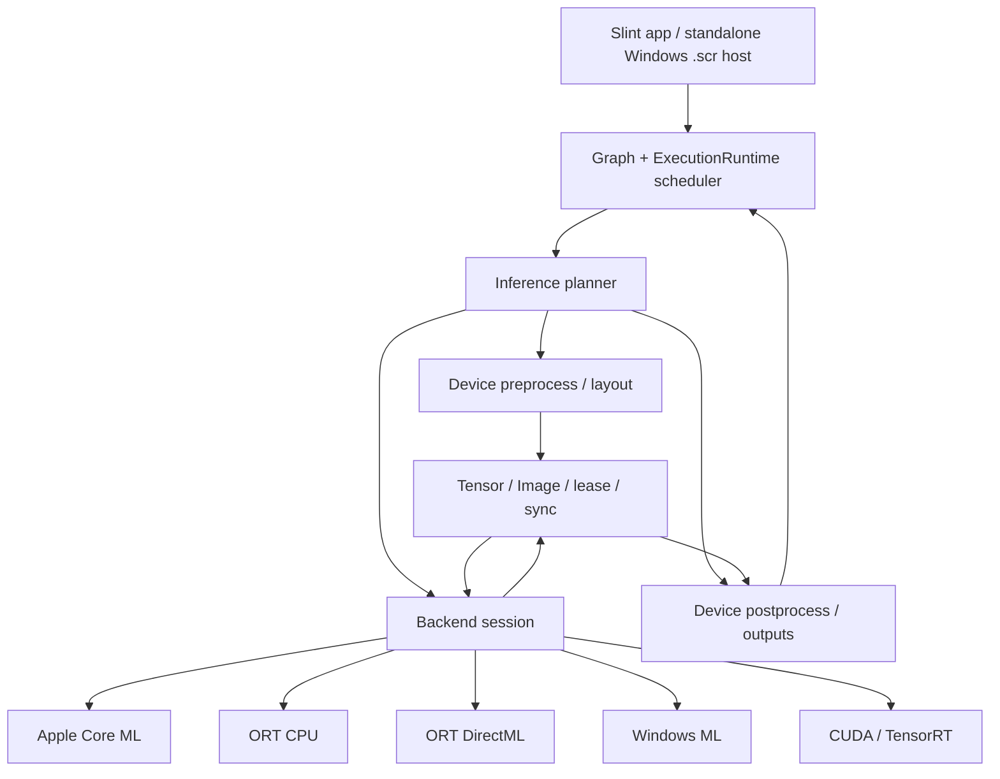

# 跨平台硬件推理架构

> 状态：**未来通用推理契约/后端拆分与硬件驻留仍是设计提案**；当前产品仅为 Rust/Slint 原生应用与独立 Windows `.scr`，不保留 Web/Tauri fallback、WASM/bindings 功能或 API。当前 ONNX task、ORT pipeline/session 与执行调度仍属于单一 `open_quartz` 核心，是等待真实所有权拆分的过渡实现，并非已完成的新布局或真实 public Player driver。尚未实现独立推理层、Core ML 后端、设备 Tensor I/O 或硬件驻留推理。本设计不承诺任意模型都能在任意硬件上执行，也不把 EP 注册成功视为模型实际由 GPU/NPU 执行。

## 1. 决策摘要

**ONNX 是跨平台模型交换格式之一；ONNX Runtime 是可选择的执行后端之一；二者都不是推理框架的公共边界。** OpenQuartz 应提供与具体运行时、图形 API 和厂商解耦的模型/任务/内存契约，再由执行方案选择器为实际设备组合适合的模型产物、后端、I/O 路径和前后处理。

设计决策：

1. **统一语义和生命周期，允许平台专用执行。** 所有后端遵守同一模型、Tensor/Image、异步请求、取消、结果和错误协议；不要求共用推理库或原生句柄。
2. **区分执行位置、数据驻留与任务语义。** “用了 GPU/NPU”不代表图像没有回 CPU；“没有 CPU readback”也不代表模型完全由单一加速器执行。
3. **执行方案是完整数据路径。** 选择 `源资源 → 预处理 → 推理 → 后处理 → 图像/结构化输出`，而非只选一个 EP。
4. **硬件驻留是可请求且可验证的约束。** 严格策略无法满足时必须失败或交由调用者选择显式放宽策略；禁止隐式 CPU 回退后继续声称满足硬件驻留。
5. **保留 ONNX；支持平台原生产物。** 同一逻辑模型可带 ONNX、Core ML 或后续其他打包执行产物。设备/系统特化缓存不视为用户模型源文件。
6. **媒体/图形/推理分别拥有其生命周期。** `oq-media` 拥有媒体会话和帧 lease，图形适配器拥有 GPU 纹理、队列和 fence，推理会话拥有执行后端；以显式 buffer lease 和完成依赖跨层传递数据。

“全硬件”不定义为没有设备内转换或复制。格式转换、布局变换和跨硬件队列同步可以是设备内操作。主要数据路径的验收要求是：不发生**未声明的设备→CPU 像素/Tensor 回传**。

## 2. 现状与问题

当前原生实现位于 [`inference/session.rs`](../crates/open_quartz/src/inference/session.rs)、[`pipeline.rs`](../crates/open_quartz/src/inference/pipeline.rs) 与 [`task.rs`](../crates/open_quartz/src/inference/task.rs)，公共 advanced 路径为 `open_quartz::inference`；[`execution::runtime::ExecutionRuntime`](../crates/open_quartz/src/execution/runtime/execution.rs) 管图和资源会话，[Slint 应用](../apps/open_quartz_slint/) 是原生桌面宿主，Windows `.scr` 保持独立宿主。模型下载/校验/缓存属于 `resources::models`，typed 意图属于 `resources::plan`。保留异步加载、ticket/generation/revision 失效、ONNX 任务与图执行解耦、取消/卸载生命周期，以及结构化 `roi`、`json` 和图像输出。完整当前分组以 [`DESIGN.md` §7.6](./DESIGN.md#76-当前源码落点) 为索引；职责所有权仍待实际拆分，不能把当前组合执行对象描述成已实现的目标 Player driver。

目前设备路径是明确的：

- `NativeOnnxProvider::default()` 是 CPU；macOS/Linux 只有 CPU 后端。Windows 可选择 DirectML，当前启用 CPU fallback。
- `ExecutionRuntime::schedule_onnx()` 从 GPU 纹理执行同步 readback，把 `Vec<u8>` 捕获到 worker；CPU 预处理生成 `Vec<f32>`，ORT CPU 或 DirectML 执行，CPU 后处理生成 RGBA，再由 `drain_onnx_completions()` 上传 GPU。
- `shared_onnx_wgpu_device` 明确为 `false`；`TensorRunner::run_f32(Vec<f32>, shape)` 不表达外部资源、设备归属或生命周期。
- DirectML 执行结果被标记为配置的 `directml` 或 `directml+cpu`，但这不是逐算子执行位置的证明；部分算子可能回落到 CPU。

所以当前产品是原生应用/独立屏保和原生 ORT 调用，不是跨平台 GPU/NPU 驻留推理。视频硬解也不会自动让后续 ONNX 节点共享 CVPixelBuffer：目前图输入在推理边界会读回 CPU。

## 3. 分层、依赖方向与所有权

以下图示及公共契约描述未来目标；除明确标注的当前 ORT 路径外，planner、设备 lease、驻留前后处理和平台后端均不表示当前 driver 已接线。媒体与推理分别达到自身验收门槛，媒体硬解结果不替代推理驻留证明。



**当前实现：** Slint 应用直接消费单一 `open_quartz` 核心的 typed Rust API；源码根部只有 `lib.rs`，公共 typed aggregates/value types 继续 root 导出。项目/播放分别归 `project`/`player`，资源 catalog/plan/models 归 `resources`，调度/设备归 `execution`，ONNX 归 `inference`，native video 归 `media`。Web/Tauri、`bindings::wasm`、`web-bindings`/`browser` 特性及其 JS API 不再作为保留入口。当前执行组合仍是过渡实现，不能据模块分组声称真实所有权拆分或 public Player driver 已落地。独立 `oq-media`、编辑器、exporter、stub 与各应用保留各自边界，不以清理为由合并，也不创建占位 crate。

原生 typed Rust SDK 不需要额外导出的 C/JNI/FFI 桥；这不意味着消除外部库/后端 FFI。ORT、FFmpeg、CoreVideo、Metal、D3D12 等必要调用仍属于媒体、推理与设备实现。

**有条件的未来提取：** 只有具备真实独立 session/tensor/provider 实现、可运行的 ORT adapter、独立测试并消除 graph/runtime 反向依赖时，才考虑把稳定推理契约与后端 adapter 从核心分离。不是先创建契约 crate 再等待实现。

```text
open_quartz (graph / SDK / Runtime / current ORT adapter / optional GPU interop)
     └─ future extraction only after independent implementation gate
          → oq-inference contracts + usable ORT adapter (conditional, not current)
               → optional platform adapters (Core ML / DirectML / CUDA / CPU)
```

依赖规则：若后续达到提取门槛，backend 可依赖 inference contracts 与其平台 runtime；公共 graph/SDK/UI 不直接依赖 ORT/Core ML/DirectML 具体类型。当前 `open_quartz` 的 `execution` 提供可选 wgpu import/export，`inference` 提供 ONNX task/session；平台 interop 可在 feature/cfg 私有模块中使用 wgpu HAL 与系统 API。project/player/execution/inference 是同一核心内的职责模块，不是已实现的独立 crate 依赖链。`oq-media` 保持独立并提供拥有的 `FrameLease`，不获得 ONNX 或 graph 依赖。

未来由宿主桥接 `FrameLease` 与推理 image lease，不复制媒体会话控制；这不是当前已接通的设备驻留数据路径。wgpu/HAL interop 提议留在核心的可选适配模块，只有其自身形成独立可运行实现时才考虑另一个实包。

本次原生单一路径清理保留 native Rust Engine 与 typed ONNX 前后处理、任务和资源规划，不保留 JS/browser/JSON worker exports 或对应绑定 API。原生测试/包/boundary 通过、两项整体 100% coverage gate 失败，见 [DESIGN §7.8](./DESIGN.md#78-验证矩阵与证据状态)；最终覆盖运行测试无失败，完整 native pre/postprocess/pipeline 为 100%，默认 pre/postprocess 因浏览器专用测试退役存在缺口。未单独执行 native-onnx-only 验收，模型运行库解析保留官方缓存路径 fallback。此前结果仅为历史证据；文档任务未自行运行检查。

未来抽取后的 inference core 自有 `RequestStamp { stream_id, epoch, sequence, timeline_ns, source_content_id }`，不是 OpenQuartz frame stamp 的类型别名。graph revision、node generation 和 NodeId 由 OpenQuartz execution 保存为 request ID→图上下文映射，不进入独立库依赖。库错误也不依赖 SDK `SdkError`，在宿主边界转换。

The model descriptor, task schema, and serialized project record **logical model identity and parameters**, not transient pointers, command queues, device addresses, or runtime session handles. The `open_quartz` resource store maps logical identity plus immutable model/version/configuration and selected execution plan to live sessions and caches.

## 4. Public contract

### 4.1 Model and task

Separate model identity from task semantics:

```rust
struct ModelRef {
    id: ModelId,
    version: ModelVersion,
    artifacts: Vec<ModelArtifactRef>,
    manifest: ModelManifest,
}

enum ModelArtifactFormat {
    Onnx,
    CoreMlPackage,
    BackendSpecific { backend: BackendId, format: String },
}

struct ModelManifest {
    inputs: Vec<TensorOrImageSpec>,
    outputs: Vec<TensorOrImageSpec>,
    task: TaskContract,
    preprocessing: PreprocessSpec,
    postprocessing: PostprocessSpec,
    accuracy: AccuracyProfile,
}
```

ONNX is the recommended portable interchange artifact when it expresses the model faithfully and target backends support it. A Core ML package is a permitted Apple artifact when conversion is verified. Backends must not silently mutate model semantics; conversion and quantization produce a separately identified artifact with a documented tolerance and source hash.

模型包与自定义模型是外部输入。验证 manifest/产物 hash、张量 rank 和尺寸上界、动态维 profile、权重与解压体积，并限制单节点内存、编译缓存和 in-flight 请求。任何转换器/执行后端均以隔离 worker 加载，报错/超时不在 UI 线程。允许 CPU fallback 时在 plan/UI 状态可见；strict policy 不得从不可信模型定义中降低。

Task adapters (detection, segmentation, depth, super-resolution, generic tensor model) own input/output naming, shape resolution, preprocessing, and postprocessing. `CoreML` or `DirectML` is not a task type. Existing `OnnxTask`, class labels, thresholds, and tiling policy move behind an equivalent task contract without changing saved projects in the first migration phase.

输入输出必须按模型的稳定名称绑定，支持多输入、多输出及共享 symbolic shape 约束；不得继续默认只取第一个 Tensor。`DType` 包括实际受支持的 FP32/FP16、整型/布尔及量化类型；量化描述声明 scale、zero-point、axis 和合法范围。每个轴区分固定、符号、范围/倍数约束；stride、byte offset、可访问容量用溢出检查验证。图像语义明确 RGB/BGR、alpha、range、transfer/primaries/matrix、旋转及像素布局。模型自省只证明结构，不自动推断可靠的 task、归一化、色彩或 tiling 语义；未验证的自定义模型必须补充 manifest，不能凭文件名猜测。

分块策略属于任务语义：只对声明可分块、具有明确 receptive-field/halo、边界和拼接规则的模型启用；不能把任意全局注意力/状态模型按 tile 切开后认为语义不变。显存不足时只能在验证过的 tile/shape/precision profile 内重规划；不自动改变精度、输出质量或回 CPU。模型 A→模型 B 可直接传 Tensor lease，不为每一节点强制 Tensor→RGBA→Tensor 往返；其 shape/layout/dtype/设备不兼容时，planner 显式插入转换，跨模型输出同样保留同步与所有权。

### 4.2 Tensor and image resources

```rust
struct TensorSpec { dtype: DType, layout: Layout, shape: ShapeSpec }
struct ImageSpec { pixel_format: PixelFormat, color: ColorSpec, dimensions: DimensionsSpec }
enum ResourceHandle { Cpu(CpuBufferLease), Device(DeviceBufferLease), Image(ImageFrameLease) }

struct DeviceBufferLease {
    allocation: Arc<dyn DeviceAllocation>,
    device: DeviceId,
    resource: ResourceDescriptor,
    ready: CompletionPoint,
}
```

```rust
trait NativeAllocation: 'static {
    fn device(&self) -> DeviceId;
    fn descriptor(&self) -> ResourceDescriptor;
    fn thread_affinity(&self) -> ThreadAffinity;
}

// The token is Send; the native allocation stays in its owning registry.
struct NativeResourceToken { device: DeviceId, slot: u64, generation: u64 }
trait BackendExecutor: Send + Sync {
    fn release(&self, resource: NativeResourceToken) -> ReleaseFuture;
}
```

`BackendExecutor` 是概念上的 executor/actor 抽象；非 `Send` 原生对象只存在于拥有者 registry 内，跨线程传 token。创建/import、访问/提交及 release 都由所属 executor dispatch。release 等待依赖完成点后销毁对象；后端关闭时 drain 或销毁整个 device/context generation，不得将未完成资源提前回收到 pool。

This is contract notation, not a mandate to expose trait objects or `Arc` in every public function. Implementations should use typed opaque handles and RAII owners.

Invariants:

- `Lease` 是线性/仿线性 owner：活 lease 阻止复用其 allocation。只读输入可借用；输出写入必须有独占写 lease。执行依赖完成点后，consumer 以自己的 completion point 返回资源；只有设备工作完成且最后 consumer 归还后，pool 才能复用。应用层取消/Future 丢弃不意味着 kernel 已停止或资源可释放。
- backend 声明 `NativeAllocation` 的访问/释放亲和性，不强迫所有原生对象 `Send + Sync`。native object 限定为 `Any` 或 backend executor；跨线程只传 `Send + Sync` 的 slot/generation token。创建、retain/import、使用、release 都由所属 executor dispatch。任何 handle 关闭前先 drain 依赖完成点；device/context 销毁推进 generation，让旧 lease 永不重新导入。
- `CompletionPoint` 是后端私有 event/fence/timeline token，含 device/context generation 和等待值。core 提供 poll/异步等待/依赖转交。仅在已验证 API 对之间直接导入；否则 plan 明列同步步骤。D3D12 resource state/queue ownership、CUDA stream、Metal completion/cache coherence 均由 adapter 管理。
- 静态输出优先预分配；data-dependent 输出使用后端分配并返回实际 shape 的 lease，或使用带最大 shape 的有界 pool。超上界报 `CapacityExceeded`；shape 不符合已编译 profile 报 `ReprepareRequired`，不自动改走 CPU 或 tile。
#### 形状/量化契约类型草图

```rust
enum DType { Bool, I8, U8, I16, U16, I32, U32, I64, U64, F16, BF16, F32 }
enum DimSpec { Fixed(NonZeroU64), Symbol { id: SymbolId, min: NonZeroU64, max: NonZeroU64, multiple_of: NonZeroU64 } }
enum Quantization { PerTensor { scale: PositiveFiniteF32, zero_point: i64 }, PerAxis { axis: usize, scales: Vec<PositiveFiniteF32>, zero_points: Vec<i64> } }
enum OutputShape { SameAsInput(usize), Fixed(Vec<NonZeroU64>), Symbolic(Vec<DimSpec>), DataDependent { maximum: Vec<NonZeroU64> } }
enum ThreadAffinity { Any, Executor(ExecutorId) }
```

此为语义而非当前 Rust API。共享 symbolic ID 表示相等约束；prepare 选一组具体输入 profile 并验证后端是否接受。quantization 明确 storage signedness、量化 granularity、per-axis 轴长、rounding/clamp 规则；转换/反量化只能作为 plan 中有精度预算的步骤。外部 strides、offset 与 capacity 需按 dtype 校验对齐及整数溢出。Unsupported dtype/layout/quantization/profile 必须让候选失败，不能由 adapter 私自“猜”转换。

“硬件驻留”分为两项可验证保证：`ApplicationResident` 表示宿主/框架不对声明的图像和 Tensor payload 做 CPU mapping、readback、upload（包括缩小后的输入和分块，不能以“小于全分辨率”绕过）；`BackendResident` 还要求提供程序内部所有这些 payload 均不经过 CPU Tensor/算子搬运的证据。未知内部行为只可报告 `ApplicationResident + backend_internal: Unknown`，不得升级为 `BackendResident`。设备内格式/layout 转换或 Metal↔ANE 等交接仍可能发生，另行统计，不能据此称完全零拷贝。

### 4.3 Execution policy and plan

```rust
struct ExecutionPolicy {
    objective: Objective,             // RealtimeLatency | Throughput | Power
    allowed_backends: BackendSet,      // Auto by default
    minimum_execution: ExecutionLevel,// Any | HardwareAccelerated
    data_residency: ResidencyPolicy,  // CpuTransfersAllowed | PreferResident | RequireResident
    fallback: FallbackPolicy,         // Explicitly allowed providers / fail
    precision: PrecisionPolicy,       // accuracy bound + allowed dtypes
    placement: PlacementPolicy,       // AllowMixed | RequireAcceleratorOnly
    residency_scope: ResidencyScope, // ApplicationBoundary | EndToEndBackend
    host_outputs: Vec<HostOutputPermit>, // named output + dtype/size bound + reason
}

struct ExecutionPlan {
    backend: BackendId,
    model_artifact: ModelArtifactRef,
    devices: Vec<DeviceId>,
    input_path: Vec<TransformStep>,
    execution_partition: Vec<ExecutionRegion>,
    output_path: Vec<TransformStep>,
    residency: ResidencyReport,
    unsupported: Vec<CapabilityGap>,
}
```

Planner selection is by **end-to-end path cost and feasibility**, not a hardcoded provider order. Candidate feasibility includes model/EP support, device interop, input dimensions/layout, required ops, precision and residency. Cost can use profiled latency/throughput/memory/transfer data; unmeasured costs remain unknown and do not justify an asserted “fastest” plan.

Distinguish policies:

- `Any` accepts CPU or accelerator execution.
- `HardwareAccelerated` 要求实际存在已验证的加速器计算区段；允许 CPU 分区，必须列明或标记内部位置未知。仅 provider 可注册而无法证明实际加速不满足该级别。
- `RequireAcceleratorOnly` 要求所有数据计算区段均在允许的 GPU/NPU 上；CPU 控制调度及模型/权重加载不算 Tensor 计算。无法观察或禁止 CPU 分区的后端拒绝该策略，不能把 Core ML 的 `ALL` 或 `CPUAndNeuralEngine` 当成满足证明。
- `RequireResident + ApplicationBoundary` 禁止框架对声明的 payload 进行 CPU 访问；`RequireResident + EndToEndBackend` 还要求可验证的后端内部驻留。CPU 预/后处理、provider CPU 分区所需中间张量传输同样受后一个约束检查。无法证明或资源路径不可用，准备即返回 `ResidencyUnsupported` / `PlacementUnverifiable`。
- 只有显式 `HostOutputPermit` 可把命名的检测框/标量等小规模结果传回 CPU，必须有字节上界；它不是任意“小数据”豁免，也不允许像素分块规避驻留策略。JSON 转换是该出口后的 CPU 操作。

Strict provider registration alone is insufficient: many EPs partition models and leave unsupported ops on CPU. Strict plan must query backend partition/capability data where available. If actual per-op placement is not observable, report `ExecutionPlacement::Unknown`; do not claim the model ran wholly on a GPU or NPU. Runtime provider failure may not silently weaken a strict plan.

`PlanId` 绑定源模型/产物哈希、完整 policy、后端/驱动/设备与上下文 generation、shape profile、前后处理版本及输入/输出内存域。状态为 `Candidate → Compiled → Validated → Active → Draining → Closed`；只有 Validated 可接收任务。`unsupported` 非空的候选不可直接成为 Active；硬约束失败的候选从成本排序中剔除。Unknown 成本按稳定偏好和显式迁移默认值择可行方案，不宣称最优；后台校准不得未经允许执行真实用户帧、量化、上传/下载或模型转换。运行中不逐帧切换后端；重选创建新计划并推进 generation、排空或隔离旧任务，fallback 要发布新 plan 和原因，且不得放宽调用者硬约束。

### 4.4 Session, invocation, result

```rust
trait InferenceBackend {
    fn probe(&self, request: &ModelRequest, devices: &[DeviceInfo]) -> ProbeResult;
    fn prepare(&self, plan: ExecutionPlan, artifact: ModelArtifact) -> PrepareFuture<SessionHandle>;
    fn submit(&self, session: &SessionHandle, request: InferenceRequest) -> Result<RequestId, SubmitError>;
    fn cancel(&self, session: &SessionHandle, request: RequestId) -> Result<(), CancelError>;
    fn next_completion(&self, session: &SessionHandle) -> CompletionFuture;
    fn unload(&self, session: SessionHandle) -> CloseFuture;
}

struct InferenceRequest {
    inputs: Vec<NamedResourceLease>,
    stamp: FrameStamp,
    cancellation: CancellationToken,
}
struct InferenceCompletion {
    request_id: RequestId,
    session_generation: u64,
    stamp: FrameStamp,
    outputs: Vec<NamedResourceLease>,
    metrics: ExecutionMetrics,
}
```

Exact object-safety/async Rust spelling is a later API review; the contract is asynchronous prepare/submit/completion, owned inputs, explicit cancellation, versioned session and frame stamp. A session must be reusable across frames; model load/compilation is not part of steady-state inference time. Session concurrency is backend-declared; ORT DirectML current restrictions (sequential execution and no concurrent `Run` on one session) must be obeyed by its adapter, not leaked into cross-platform application code.

`submit` 成功表示 Accepted 而非 Completed。每个 Accepted 请求恰好一个逻辑终态：Completed、Failed 或 Cancelled；队列拒绝不占用请求。取消是尽力停止或丢弃交付，不能承诺能抢占 GPU/ANE kernel；不得在 Cancelled 通知时提前释放仍被设备使用的输入/输出。`unload` 应为异步 drain/close：先拒绝新请求，推进 generation，取消 pending，等 in-flight 完成后在资源拥有者 executor 释放；UI 不阻塞等待硬件。超时、device lost 的资源进入隔离/设备销毁路径，不能超时后塞回池。session 共享按不可变模型与执行配置；有状态模型/KV cache/时序状态按流隔离，声明 reset/seek 语义，不复用到另一条视频流。

Errors distinguish unsupported model/artifact, unsupported operator or shape, unavailable backend, residency violation, precision violation, capacity/backpressure, cancellation, device loss, stale completion, preprocessing/postprocessing and runtime failure. Diagnostics carry the chosen plan and do not substitute invented output or silent fake fallback.

## 5. Model packaging and preparation

A logical model record contains stable ID/version, source/license/hash, tensor/image signature, task contract, color/layout/normalization, dynamic/static shape constraints, optional platform artifact references, accuracy tolerance and cache policy. Per-platform artifacts are optional, immutable, hash-bound derivatives. Application package or model store verifies source and derivative hashes before use.

Preparation phases:

1. Resolve model identity, source/cache/download and licence/size policy.
2. Verify source hash and inspect input/output signature.
3. Probe platform and device capabilities.
4. Select an exact feasible artifact/backend/residency plan; record why candidates were rejected.
5. Compile/convert/specialize off UI and render threads; key cache by source hash, converter/runtime version, artifact target, device/OS specialization where relevant, and precision/configuration.
6. Warm up when required and validate output shape/range and reference error.
7. Publish a `PreparedSession` only when every strict policy has been checked.

Core ML conversion is a build/model-preparation concern, not a mandatory shipping-time Python dependency. ONNX remains available as source/interchange. WinML and ORT DirectML are competing Windows adapters to evaluate, not aliases or simultaneous defaults. Existing official ORT 1.21 CPU package is a tested fallback artifact; it does not mean CPU fallback meets hardware-residency requirements.

## 6. Platform backend strategy

| Backend | Initial responsibility | Device-resident path / caveat |
|---|---|---|
| CPU ORT | Universal compatibility fallback and numerical baseline | CPU input/output; reports transfers/CPU backend truthfully |
| Apple Core ML | First Apple acceleration candidate; CPU/GPU/ANE scheduling selected by Core ML or requested policy | Image inputs/outputs should use IOSurface/CVPixelBuffer and Metal-compatible resources where the model interface allows. Core ML may internally partition across CPU/GPU/ANE; hardware preference does not guarantee ANE-only placement. Verify with compute plan/Instruments. Do not assert arbitrary Metal `MTLTexture` is directly bindable without an implemented interop path. |
| Windows DirectML/ORT | Preserve current supported option and prototype shared D3D12 resource path | Same `ID3D12Device` and compatible queue required for queue-sharing APIs; device tensor/I/O Binding plus explicit fences. Existing independent shared texture presenter does not automatically make inference share its resources. |
| Windows ML | Evaluate as the Windows model-dispatch/runtime option | Compare actual provider coverage, D3D12 tensor interop, deployment and redistributables with DirectML before choosing the stable default. |
| CUDA/TensorRT | Optional NVIDIA adapter when product deployment and package cost justify it | CUDA device Tensor/I/O Binding; D3D/Vulkan/wgpu interop is a separate explicit resource/synchronization adapter. Same GPU vendor alone is not same allocation. |
| Other EPs | Add only for identified shipping hardware/model requirements | Each declares artifact, operator, I/O resource and verification scope; never claim generic acceleration from API registration. |

浏览器推理不属于当前产品，也没有保留的 WASM adapter。若未来另立浏览器产品，WebGPU/ORT-Web 或浏览器媒体资源必须作为独立提案重新评审并单独实现、验收；任务语义可作为参考，但本设计不承诺现有 buffer 互操作或绑定 API。

## 7. Graph and real-time scheduling

Inference nodes remain graph nodes with named typed ports. Their preparation is asynchronous; unprepared/failed/unloaded sessions must not pretend to be ready. On each scheduled invocation:

1. The graph scheduler stamps graph revision, node generation, session generation, frame epoch/index/timeline and selected source content.
2. Device preprocess writes directly to the planned inference input resource where interop permits.
3. Backend submits with bounded queue depth and returns a request ID.
4. Completion leases outputs and synchronization dependency to the host.
5. Scheduler discards stale results before attaching resources or emitting outputs.
6. GPU postprocess/import runs without UI-thread blocking and marks downstream graph nodes dirty.

Realtime policy: configurable maximum in-flight requests per node (initial default one); replace/drop old pending frames before inference when the newest frame is more relevant. Never queue an unbounded backlog. Offline/quality policy: preserve every request or return explicit backpressure; do not silently drop.

Pause stops submission and preserves timeline/accepted completions by policy; Stop advances the session/task generation, clears output according to current app semantics and rejects late completions; source replacement/model replacement/device loss invalidate dependent frames. Resource leases outlive GPU commands that sample them. ONNX detection JSON may use a bounded CPU result, while image mask/depth/super-resolution stays on GPU when supported.

## 8. Observability and truthful performance claims

Per model/session report:

- logical model/version/hash, artifact and preparation/warm-up duration;
- planned and actual backend, device and precision;
- operator partition report when the backend exposes it, otherwise `Unknown`;
- source/output dimensions, dtypes/layouts and residency transitions;
- CPU→device/device→CPU bytes with reasons, GPU/device-side bytes when measurable;
- queue depth, accepted/dropped/stale/cancelled requests;
- preprocess, provider execution, postprocess, synchronization and end-to-end latency P50/P95;
- steady inference completions/sec, distinct input frames/sec and output/display cadence as **separate** metrics;
- peak resident/CPU memory and device-loss/recovery outcomes.

A repeated display of the last inference output increments render/display cadence, not inference FPS. “Hardware-backed” means hardware execution was actually reported or independently profiled; “resident” means the strict no-CPU-transfer contract was verified for the declared path. Unknown provider-internal copies or operator placement stay explicitly unknown.

Performance comparisons pin model hash, artifact, input sequence, shape, precision, device/OS, warm-up, concurrency, correctness tolerance and timing boundaries. Compare end-to-end path and stage times against both current CPU ORT and chosen backend; a standalone ORT latency is not a frame-pipeline result.

## 9. Migration plan

### Phase A — Contract and instrumentation, no default behavior change

- Add `InferencePolicy`, model/artifact manifest, resource descriptor/lease, completion stamp, capabilities and detailed error types in a framework-neutral crate/module.
- Wrap current CPU ORT/Windows DirectML path as adapters; retain task adapters and catalog/download behavior.
- Add per-stage timings, CPU transfer byte counters, actual backend/placement reporting and bounded queue statistics.
- Preserve saved project fields and explicitly mark legacy `preferDirectMl` semantics. Do not silently reinterpret old projects.

### Phase B — Device resource and conversion infrastructure

- Add owned device-resource leases and backend synchronization contract; add format/layout conversion kernels and bounded reusable pools.
- Create strict-policy preflight: unsupported interop, model ops, shapes or formats fails before accepting live requests.
- Add tests proving a strict plan cannot cross a CPU mapping path, transfer counters remain zero for declared image traffic, and session/device generations reject stale results.

### Phase C — Apple production backend

- Package/validate ONNX→Core ML artifacts for selected model families; retain ONNX+CPU fallback where allowed.
- Prototype Image `CVPixelBuffer`/IOSurface input-output and Metal handoff first; add tensor I/O only with real supported device backing.
- Confirm compute-unit usage/partition with Core ML profiling and instruments; measure conversion, prediction, handoff and end-to-end. Do not call Core ML “ANE-only” unless device evidence supports that claim.

### Phase D — Windows interop decision and backend

- Benchmark ORT DirectML queue-sharing/device tensor support against WinML for target models and package requirements.
- Implement same-device D3D12 resource and fence sharing only when ExecutionRuntime wgpu adapter identity and queue ownership are compatible; test adapter mismatch/device loss. Treat standalone DXGI shared presentation as a separate boundary.
- Expose fallback/strict policy explicitly. Keep current behavior until an acceptance-tested backend is selected.

### Phase E — Graph integration and product rollout

- Migrate ONNX-specific node/session intents behind generic inference intents while preserving legacy saved-project deserialization and visible model metadata.
- Add capability-aware model selection/diagnostics and UI choices only for verified plans.
- Enable platform backend per model family only after accuracy, residency, lifecycle, hardware and end-to-end performance gates pass. Keep a transparent CPU baseline and user-visible fallback where policy allows.

### Phase F — Additional devices

Add CUDA/TensorRT and other adapters only against a product support matrix, license/runtime packaging plan, model corpus and actual hardware acceptance. Do not make a universal cross-vendor buffer API on an untested assumption.

## 10. Acceptance gates

**Contract/correctness**

- Same graph/model/task returns outputs within declared per-model tolerance on CPU and each enabled backend.
- Shape, dtype, channel order, alpha, color space, normalization, stride and dynamic output dimensions are verified.
- Invalid model, unsupported op, unavailable backend, strict residency violation, cancellation, device loss and capacity saturation produce typed, observable errors.
- Load/unload, project replacement, model replacement, pause/stop, source replacement, cancel and late completions never publish a stale texture/event.

**Device and residency**

- Backend is required by policy and actual hardware usage is confirmed; if operator placement is opaque, report `Unknown` rather than full accelerator execution.
- Strict-resident path proves no application CPU mapping/readback/copy of full image/tensor payload; separately classify small structured-result CPU output.
- Queue/fence ownership and disposal are tested under delayed GPU work, resource-pool reuse and device shutdown.

**Performance**

- Compare warmed P50/P95 end-to-end latency and throughput on identical model hash, input sequence, shape and output correctness.
- Count inference completions separately from rendered repeats and dropped source frames.
- Measure peak memory and bounded in-flight work; report CPU and device transfer bytes by stage.
- Require a measured product improvement for the chosen objective. Otherwise retain the simpler backend and document the result.

**Cross-platform**

- Apple Silicon Core ML、Windows 选定后端与 CPU fallback 按各自阶段独立验收；浏览器不计入当前产品支持矩阵，未来单独立项时另定 adapter 验收。
- Per-platform package/license/cache/runtime relocation, clean environment launch and model lifecycle are verified.
- No claim of Windows/Linux/mobile/CoreML/ANE support from macOS CPU or UI tests alone.

## 11. Decisions deliberately deferred

- `oq-inference` 仅在 §3 的真实独立实现门槛满足后考虑在本仓提取；独立仓库、公开发布和拆分后端包须待独立消费者及兼容性验收。当前不创建契约占位 crate，也不宣称已完成无 OpenQuartz 依赖的推理实现。
- Which platform model artifacts are committed versus produced in a separate reproducible conversion pipeline; decide per licence and artifact size.
- Whether Apple deployment guarantees macOS 12+ MLProgram/Core ML modes or retains older OS variants.
- 首轮 policy 层级确定为：框架默认 → 项目默认 → 节点显式覆盖，解析为不可变 effective policy 后才准备；调用者硬约束只能显式修改，不能由低层 fallback 放宽。新实时图推荐 `HardwareAccelerated + PreferResident`，旧项目保留 legacy-compatible effective policy；`RequireResident` 和 `RequireAcceleratorOnly` 均为可独立选择的严格模式。新默认启用前必须完成 §10 验收，不静默改变旧项目行为。
- Which Windows backend (DirectML or WinML) becomes primary; decide using model/operator support, resource-sharing capability, deployment requirements and measured end-to-end results.

These are explicit follow-up gates, not permission to silently claim support. Until a selected backend passes the corresponding gates, current CPU/native behavior remains the compatibility path and its transfers remain visible.

## 12. 首个实施闭环与退出条件

首个验收对象必须含两类模型：一个 **identity/tiny deterministic** 模型验证 buffer/sync/精度协议，以及一个现有目录中的真实 **image→image** 模型（mask、去噪或风格等）验证优化价值。首轮评审具体锁定模型文件哈希、许可、静态输入 profile、FP32 CPU reference 和允许 FP16 误差；不得只用 identity 报告产品提速。

1. 先在现有模块验证 Session/Tensor/provider 的独立所有权和可运行 ORT CPU adapter，支持命名多输入/输出、同步 CPU lease 和异步外壳；达到 §3 门槛后才提取真实 `oq-inference`，执行现有图回归并保持行为与存档兼容。
2. 对现有 CPU 路径增加阶段时间、payload 字节数、推理完成数、排队和 generation 指标，得到真实 baseline。
3. Apple 原生 Core ML adapter 准备图像 I/O，先证明 Metal 输入 → Core ML → 可供 Metal 采样的结果；若某模型只能输出 CPU MultiArray，严格驻留计划应拒绝该模型，不伪造设备张量。
4. 在受控源/输出格式下跑离屏像素 reference，再用视频 → 预处理 → 模型 → 后处理 → Renderer 真窗口及无窗口离线流程验证。即时模式只替换 pending，离线模式保持所有帧；读回 reference 发生在独立测试出口，不混入驻留吞吐计时。
5. 压低资源池上限、延迟 GPU 工作，换源、暂停、取消、卸载、关闭、device loss；证明 stale completion 不发布且资源不提前复用。

进入默认生产路径的门槛是：精度通过、资源所有权通过、实际硬件计算证据通过、所请求驻留级别通过、相同目标的端到端收益通过。某项失败就记录具体 gap，保留之前可用方案。Windows/Linux 的支持是独立后续里程碑，Apple 结果不代替其他平台验收。模型 artifact 准备可早于 GPU interop 基础设施，二者在端到端验证合并，不要求为抽象完备而先实现所有后端。

## 13. 参考与证据级别

以下是架构参考，不代表当前锁定 ORT 1.21.0 运行库已经具有相同版本的所有 API；实施时核对实际头文件、运行库、设备和 OS，并固定对应测试矩阵。

- [ORT I/O Binding](https://onnxruntime.ai/docs/performance/tune-performance/iobinding.html)：默认 CPU 输入/输出可能引起 provider 内搬运；绑定设备不自动证明任意 EP 支持外部资源。
- [ORT Device tensors](https://onnxruntime.ai/docs/performance/device-tensor.html)：CUDA 与 DirectML 原生 allocation 包装及 I/O 绑定，不是跨平台统一指针契约。
- [DirectML EP](https://onnxruntime.ai/docs/execution-providers/DirectML-ExecutionProvider.html)：自定义 DML device/queue、同父 D3D12 device、执行并发约束；最新文档说明 DirectML 处于 sustained engineering，Windows 新功能转向 WinML。
- [Core ML EP](https://onnxruntime.ai/docs/execution-providers/CoreML-ExecutionProvider.html)：operator、shape、compute-unit、模型缓存选项；配置名称不保证 ANE-only，也不证明当前发布包启用了该 EP。
- [Apple：Core ML 集成与异步预测](https://developer.apple.com/videos/play/wwdc2023/10049/)：模型准备、设备特化缓存、并发限制和 Instruments 的实际设备执行观察。
- [Apple：ML Program 与计算精度](https://developer.apple.com/videos/play/wwdc2021/10038/)：模型格式、精度和 CPU/GPU/ANE 分区，不以纯 native 应用作为纯加速器执行证明。
