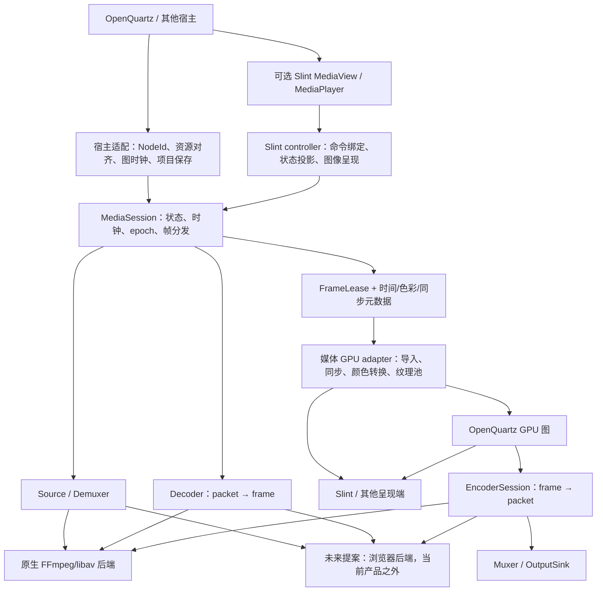
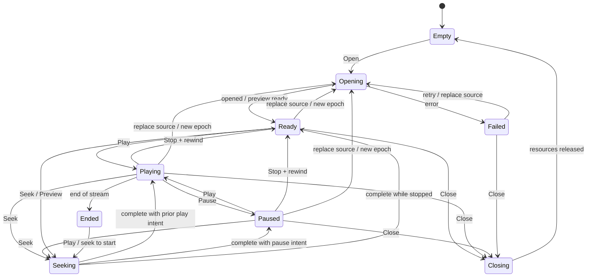

# 跨平台媒体编解码与 Slint 组件架构设计

> 状态：完整跨平台会话/编码/Slint 组件仍为提案，§17.1 首轮 macOS 验收为历史。当前生产实时图只接受 hardware buffer/texture，不允许软件 RGBA fallback；下面未来可选政策不放宽此约束。本轮 resident cutover 的实测计数、画面与未通过覆盖率门槛见 [DESIGN](DESIGN.md#validation)，旧结果不得复用。当前产品仅 Rust/Slint 与独立 .scr。
> 2026-11-12 架构更新：Phase 3 已在原图 macOS 文件路径接入单 demand 精确 source-time 选择；`oq-media` 保持无图/无UI/wgpu依赖，source cursor 由 `NativePlayer` render worker owner。时间戳与VFR/B-frame/GPU独立oracle见[Phase 3 验收](../apps/open_quartz_video_editor/DESIGN.md#phase-3精确-source-time)。预取source window/watermark/credit、异步媒体完成、跨平台seek、编码和完整Slint媒体组件仍未实现。

## 1. 决策与目标

**采用“独立 Rust 媒体核心 + 原生 FFmpeg/libav 后端 + 平台 GPU 帧适配 + 可选 Slint 组件”的架构。**

命名采用 `oq-media`，Rust 导入名为 `oq_media`，目录为 `crates/oq-media`。`oq` 表示 OpenQuartz 出处，不代表依赖；OpenQuartz 是消费者，而不是媒体公共 API 的组成部分。未来实际拆分 GPU/Slint 集成包时沿用 `oq-media-wgpu` / `oq-media-slint`，当前不创建空包。

可以做成 Slint 组件，但分成两个层次：

- `MediaSession` 提供打开、预览、播放、暂停、定位、状态、帧订阅等可复用 Rust 能力，不依赖 Slint，也不知道 OpenQuartz 节点、项目和图历史。
- `MediaView` / `MediaPlayer` 提供 Slint 显示和交互，绑定已有会话或图输出，不自己再创建一个解码器。编码通过独立 `EncoderSession` / `ExportJob` 完成，不要求屏幕上存在一个播放器。

`MediaCodec` 风格适合底层 **压缩包 ↔ 原始帧** 的接口。完整文件播放还包括解封装、时钟调度、帧交换和显示；完整导出还包括编码、封装和输出 I/O。不能把这些职责都藏在一个 `Video` widget 的 `source` 属性后面。

当前 macOS 文件视频接入 VideoToolbox，Windows 图视频需要 D3D12 硬件路径；无合格硬件路径时拒绝。Linux、未支持相机、Windows 无 D3D12 不走 FFmpeg RGBA fallback。完整进程内跨平台会话/编码仍按独立阶段验证。本文浏览器/WebCodecs/Slint Web 仅为当前产品外未来提案；移动端仍延期。

成功标准：一份媒体只解码一次，多处预览复用；控制和状态只有一个所有者；是否硬解、是否 CPU 回传都能报告；图计算和视频时钟明确分离；编码可无窗口运行；平台特性与公共核心解耦。

## 2. 当前实现与应保留的行为

| 现状 | 代码依据 | 设计影响 |
|---|---|---|
| Rust `NativeVideoSource` 管理文件/摄像头、解码线程、暂停恢复和帧槽 | [`media/native.rs`](../crates/open_quartz/src/media/native.rs)，advanced 路径 `open_quartz::media::native` | 提取为媒体后端，不让 UI 拥有解码生命周期 |
| Windows 图视频要求 D3D12VA，硬件初始化/解码失败不能切到 FFmpeg RGBA CPU-upload | `media/native.rs` 的平台源选择 | 无 D3D12 明确拒绝，不将软件执行冒充硬件 |
| macOS 文件使用 oq-media/VideoToolbox；Linux/未支持相机拒绝实时图接入 | `media/native.rs`；§17.1 为首轮历史证据 | 不从已删除的软件路径推断当前 fallback |
| FramePipeline 持有 VideoSources 的图源 map/lifecycle，借用 upload callback 上传帧并返回 dirty/尺寸变化 | [`execution/pipeline.rs`](../crates/open_quartz/src/execution/pipeline.rs) → 内部 [`media/sources.rs`](../crates/open_quartz/src/media/sources.rs) → [`rendering/device.rs`](../crates/open_quartz/src/rendering/device.rs) | NodeId 与图源映射留在 OpenQuartz adapter，oq-media decoder/session 不接收 NodeId；FrameExecutionSession 不持有媒体资源 |
| Slint 与 RenderDevice 共用同一 wgpu Device/Queue，NativePlayer 在原 render worker 驱动 FramePipeline::progress | [`render_bridge.rs`](../apps/open_quartz_slint/src/render_bridge.rs)、[`player/native.rs`](../crates/open_quartz/src/player/native.rs) 与 `execution/pipeline.rs` | pipeline 无 clock/UI；共享 UI/GPU 不意味着解码设备天然一致，不为提取创建设备实例 |
| Windows 管理解码 fence、NV12/P010、纹理子资源及必要 GPU detach copy | [`rendering/dxgi.rs`](../crates/open_quartz/src/rendering/dxgi.rs)；[当前索引](./DESIGN.md#source-map) | 保留同步/lease，新接口不能只传纹理指针 |
| 停止/暂停时选择文件，解码并上传一帧，显式 Play 才连续播放 | `open_preview` / render worker pending preview | 迁移必须保留：不启动整图、不消耗开始位置、同尺寸替换不串旧图 |
| 初期曾草拟 execution/media 外部帧/导入器桥接 | 旧抽象没有生产实现且仓内无消费者，现已删除 | 不与 `oq-media::FrameLease` 或 Metal GPU importer 并存，不保留第二份跨平台帧/同步契约 |
| FFmpeg 打包不同：Windows 固定 shared 9.0.2 snapshot；其余由 installer 提供 executable | [copy-ffmpeg.mjs](../scripts/copy-ffmpeg.mjs)，目标资源目录为 [`apps/open_quartz_slint/runtime/`](../apps/open_quartz_slint/runtime/) | 统一 libav 前必须确定 ABI、构建矩阵和分发资源 |
| 当前 macOS worker 按 PTS 等待后发布单个当前帧，GPU importer 转换后 `device.poll(Wait)` | [`media/native.rs`](../crates/open_quartz/src/media/native.rs) 与 [`rendering/videotoolbox.rs`](../crates/open_quartz/src/rendering/videotoolbox.rs) | 现有实时路径不是完整预取流水；窗口 admission、受控 slot 和设备完成先落实，再替换宿主等待，不能仅删除同步 |

**Windows 当前代码不能直接视作跨设备、全色彩已验收的基线。** 本次源码核查还发现：Slint shared device 以默认 feature 集合创建，而 NV12/P010 外部纹理使用需要相应 device features；FFmpeg D3D12VA 自行创建设备，没有显式按 host adapter LUID 对齐；现有转换 shader 对 NV12/P010 共用写死的 10-bit/BT.709 limited 公式，未传递 AVFrame 色彩元数据，色度中性偏移也需校正验证。这些是 A/C 阶段必须关闭的正确性缺口，不在本轮设计中顺手改代码，也不把 macOS RGBA 像素回归当作 Windows 硬解证明。

当前没有完整音频播放、A/V 同步和通用视频编码导出引擎。PNG 截图和 `.scr` 打包不等于视频编码。设计中的 `MediaPlayer` 第一版必须明确为视频范围；音频是后续有独立验收的能力，不以静音播放冒充完整媒体播放器。

## 3. 软件分层与依赖方向

以下是未来完整媒体会话/编码/组件的分层提案，不表示图中所有接口或驱动已接入当前产品。`oq-media` 独立拥有媒体帧生命周期，不依赖 graph/ONNX；媒体硬解、推理硬件驻留与 UI 呈现必须分别验收，不能互相替代。



逻辑层与初始物理包不必一一对应。建议先建立以下三个真实交付单元，不先造十个空 crate：

| 提议包/模块 | 内容 | 禁止依赖 |
|---|---|---|
| `media_core`（暂名） | 会话、Source/Demux/Decoder/Encoder/Muxer 协议、时间与色彩描述、帧租约；内部原生 `ffmpeg`、`platform` 模块；浏览器模块仅为产品外未来提案 | Slint、open_quartz 的 domain/SDK/NodeId、UI 文件选择器 |
| `media_wgpu`（暂名） | 与固定 wgpu 版本配套的设备协商、硬件帧导入、YUV/色彩转换、GPU encoder 输入适配、完成通知 | Slint、应用 Controller、项目历史 |
| `slint_media`（暂名） | `.slint` 控件、Rust controller、可选共享 wgpu presenter、标准控制条；独立示例 | OpenQuartz graph/SDK、默认把所有 decoder/encoder 编入 |
| 现有 OpenQuartz 宿主模块 | `NodeId ↔ SessionId`、图 tick、资源 intent、图输出导出、权限/文件选择 | 不在其中复制 FFmpeg 解码实现 |

`media_core` 逻辑协议部分应可不启用 FFmpeg、wgpu、浏览器依赖而测试。初期 backend modules 可以共包，稳定后根据链接大小和分发需要拆包。FFmpeg 类型仅存在于后端，不从公共协议泄漏 `AVFrame*`。GPU 适配器是可选依赖；软件解码、离线编码、命令行和其他 UI 可独立使用核心。

当前职责：NativePlayer 拥有 composition clock/单文件 source identity 与策略，FramePipeline 在 admitted demand 内调 `VideoSources::upload_frames_at`。macOS strict file source 使用 `oq-media::Session::frame_at_ns` 同 cursor 精确选择/保留 VideoToolbox surface，并将实际 source-relative PTS 传到稳定输出；窗口、预取/credit 与非阻塞 decoder/output queue 仍属 Phase 4。oq-media 仍不接收 NodeId/graph/Slint/wgpu；VideoToolbox importer沿用既有GPU提交/owner同步。PlaybackSession 只组合无时钟 FrameExecutionSession，不复制媒体帧状态或另建设备。

当前通用推理实现与图适配边界见[推理架构](INFERENCE_ARCHITECTURE.md)，本轮核心、真实模型、窗口/Shader、独立依赖与原生包结果统一见 [DESIGN 验证基线](./DESIGN.md#validation)。独立推理库的 ORT 验证不替代媒体硬解、设备驻留或其他平台验收；相机/Windows/Linux/.scr/移动端未实测，公开 Player driver/graph_mut 限制未改变。

无需导出 SDK 桥不意味着移除必要的外部库/后端 FFI：FFmpeg、ORT、AVFoundation/CoreVideo、Metal、D3D12/COM 等原生调用仍保留在媒体、推理与设备实现中。

**公共类型只定义一次。** 未来 media_core 是 SessionId/epoch、命令/事件、时间/色彩元数据、源能力与 frame lease 的唯一 owner；media_wgpu 拥有依赖 wgpu 的 GpuFrameLease。已有 oq-media 媒体所有权保留；VideoSources 映射图源，RenderDevice 消费 retained frame 并管理 GPU 资源，经同步 upload callback/lease 交接，NativeVideoFrame 借用不逃逸 callback。媒体公共契约不反向引用 SDK/domain/求值类型。早期 execution::media facade 已删除，不恢复 alias/re-export/wrapper 或第二套帧类型；未来媒体核心不依赖 OpenQuartz/Slint/wgpu，可选 GPU adapter 单独承担 wgpu 依赖。

## 4. 对象、所有权与来源

| 对象 | 唯一所有者/职责 | 生命周期 |
|---|---|---|
| `MediaService` | 创建会话、后端能力探测、设备注册、调度资源预算 | 一个宿主/执行环境；不强制全局单例 |
| `MediaSession` | 当前 source、decoder、播放状态、播放位置、时钟、队列、epoch | 一次媒体消费会话，可换源 |
| `SourceResource` | 文件/内存/流/浏览器资源访问能力与关闭逻辑 | 引用计数或显式关闭；会话持有有效引用 |
| `FrameLease` | 解码表面及元数据的受控引用；最后消费者完成后归还池 | 跨 decode、GPU conversion、encode、presentation |
| `GpuFrameLease` | 某 GPU device 上已准备好的图像/平面、submission 和 release | 实际 GPU 使用完成且消费者释放后归还 |
| `EncoderSession` | 编码配置、输入队列、时间戳重排、packet 输出 | 独立于播放；可无窗口 |
| `ExportJob` | 封装、输出 sink、进度、取消和最终 commit | 一次完整导出任务 |
| `MediaView` | 某会话/图输出的一个订阅者与显示区域 | UI 存活期间；不默认拥有 source |

同一路视频在节点缩略图、Inspector 和 fullscreen 展示：**同一个 Session/图输出，多个 View**。隐藏缩略图仅取消该 view 的呈现订阅；不会停止仍被图/其他 view 使用的媒体。相同文件被用户作为两个独立节点打开，不自动合并播放位置；是否共享只读 demux/cache 是后续优化。

摄像头来源是实时采集资源，不等同于文件解码。先复用现有 FFmpeg 采集实现；以后可以接系统采集 API，但帧/能力契约保持一致。申请相机权限、枚举和系统选择器由宿主完成，核心只使用已授权资源。静默生成缩略图不能自行打开摄像头。

`SourceSpec` 不只有路径：

- 原生文件：授权后的路径/文件句柄；打开、seek、长度由 source adapter 提供。
- 内存：拥有者引用和字节视图，不能把临时借用交给后台线程。
- 浏览器文件：`File`/`Blob` 的不透明注册 token，无原生绝对路径语义。
- URL/网络流：显式启用的协议、超时、取消和 seekability；不是第一阶段默认支持所有 FFmpeg protocol。
- camera/live：设备 capability token、实时属性，不承诺 seek/loop。

项目持久化保存 source 描述和用户选项，不保存 SessionId、GPU handle、权限对象、当前硬解状态。运行状态不反写成源码配置。Source resolver 负责重开和缺失资源错误；公共组件不默认写项目。

## 5. 核心协议与能力协商

以下为形状提案，落地时先用最小实现验证；不是保证 ABI 稳定的 Rust 定义：

```rust
struct SessionKey { id: SessionId, source_epoch: u64 }
struct RequestKey { session: SessionKey, request_id: u64 }
struct MediaTime { ticks: i64, time_base: Rational }

enum HardwarePolicy { Prefer, Require, Disable }
enum CpuTransferPolicy { Allow, Forbid }
enum Usage { PreviewOnce, Realtime, Offline }

struct OpenOptions {
    decode: HardwarePolicy,
    cpu_transfer: CpuTransferPolicy,
    usage: Usage,
    video_stream: StreamSelection,
    queue_budget: QueueBudget,
    device_preference: DevicePreference,
}

enum MediaCommand {
    Open { request: RequestKey, source: SourceResource, options: OpenOptions },
    Play { request: RequestKey },
    Pause { request: RequestKey },
    Stop { request: RequestKey },
    Seek { request: RequestKey, position: MediaTime, mode: SeekMode },
    Preview { request: RequestKey, position: MediaTime },
    SetRate { request: RequestKey, rate: f64 },
    Close { request: RequestKey },
}

enum MediaEvent {
    Opened { request: RequestKey, session: SessionKey, streams: StreamInfo, actual: ActualPipeline },
    CommandCompleted { request: RequestKey, state: SessionState },
    CommandCancelled { request: RequestKey, reason: CancelReason },
    StateChanged { session: SessionKey, state: SessionState },
    FrameReady { session: SessionKey, timeline_epoch: u64, sequence: u64 },
    SeekCompleted { request: RequestKey, actual_position: MediaTime },
    PreviewReady { request: RequestKey, actual_position: MediaTime, sequence: u64 },
    PathChanged { session: SessionKey, actual: ActualPipeline },
    Failed { request: Option<RequestKey>, error: MediaError },
    Closed { session: SessionKey },
}
```

传帧走受预算限制的数据通道，`FrameReady` 只发通知，不把所有画面塞进状态事件。状态快照可合并，Open/Seek/Close/失败等终态事件不可无声丢失。命令不是发出即成功，UI 等待 request 对应的完成/失败。换 source 增加 `source_epoch`，seek、loop discontinuity、重置时间线增加 `timeline_epoch`；旧帧/旧事件均按两种 epoch 丢弃和释放，不能染到新源。

SessionId 与所有 epoch 由 MediaService/session actor 分配，UI 不自行递增；会话 handle 提供提交命令和读取快照的方法，封装上述协议。Open replacement 的请求身份与被替换 epoch 明确区分，完成时返回新 SessionKey。取消使用 request id 确认，不能只靠丢旧帧而漏报请求终态。

`Opened.request` 关联提交时的旧身份，`Opened.session` 携带 actor 分配的新 source epoch；这一不可合并的终态事件是客户端切换 SessionKey 的唯一确认依据。首次创建由 MediaService 先分配 Empty session handle，再提交 Open。后续命令使用最新已确认的 key；过期 key 的命令返回 StaleSession 终态，不能静默执行到新源。

每个被接受的请求恰好有一个终态（完成/失败/取消），专门的 Opened、SeekCompleted、PreviewReady 是相应请求的完成事件，不能同时再发第二个 CommandCompleted；Play/Pause/Stop/SetRate/Close 等使用通用 CommandCompleted。StateChanged/FrameReady 是订阅通知，不替代请求确认。PreviewReady 的帧结果在有预算的数据通道按 request 关联领取/释放；UI 不再使用时必须释放，不让一次截图请求永久占用 surface。

不对公共 trait 统一写死 `Send + Sync`：原生解码一般由 worker 独占，浏览器 WebCodecs、Slint Image 和部分平台对象有线程/执行域约束。协议/元数据可跨域，平台资源通过执行域绑定的 lease 在允许的域使用。Web 实现可运行在专用 Worker 或主线程本地执行器，不为保持 trait 外形给 JS 对象做不安全 Send。

能力分为三个阶段，不能只返回 `hardware = true`：

1. **可枚举能力**：当前 FFmpeg 构建、OS、浏览器暴露哪些 decoder/encoder/格式。
2. **打开时协商**：特定 codec/profile/level/bit depth、尺寸、颜色空间、目标 GPU、usage 是否可用。
3. **实际使用结果**：真正选中的后端、硬件是否生效、输出 memory kind、是否发生 CPU 回传或 GPU copy、降级原因。运行中变化发出 `PathChanged`。

例如 `decode=Require` 只要求硬解，不代表禁止硬件帧回传；需要同时设置 `cpu_transfer=Forbid`。当导入失败时，后者必须返回结构化失败，不能偷偷下载 RGBA。`Prefer + Allow` 可以回退，保留可观察原因和实际路径。UI 普通用户默认 Prefer；详细诊断放状态面板，不把设备术语塞进选文件流程。

`ActualPipeline` 至少含 decoder 名、codec/profile、硬解确认方式、GPU/adapter identity、输出表面类型、pixel format、转换路径、copy counters、fallback reason。Web 的 `hardwareAcceleration` 只是偏好提示，无法确认的硬解状态报告 `unknown`，不能伪造为 true。

## 6. 帧表示、同步和颜色

### 6.1 帧契约

`FrameLease` 必须拥有或引用实际资源所有者，外部不能构造裸 handle 假帧。至少包含：

- `SessionKey`、`timeline_epoch`、sequence、PTS、duration、原 time base；时间可能缺失，必须可表达 unknown。DTS 属于压缩 packet，不用解码时间冒充显示 PTS。
- coded size、visible crop、sample aspect ratio、rotation/orientation、interlace 属性。
- format、bit depth、平面布局、stride/offset；硬件表面还需 platform-specific descriptor。
- color primaries、transfer、matrix、full/limited range、chroma siting、可选 HDR metadata；未知值可标记 assumed，并报告所用默认值。
- decoder owner、ready sync、consumer completion / release token、device identity。

公共 memory kind 是受控的 `CpuPlanes` / `NativeSurface` / `BrowserFrame` 等，不是可序列化 `u64` 或 fd 数组。Windows COM/CVPixelBuffer/AVFrame/OwnedFd 由平台模块 RAII 保持；Linux DMA-BUF descriptor 必须覆盖 objects、layers、planes、DRM fourcc、modifier、fd ownership、offset 和 pitch。不能用现有只有一个裸 handle 的 `ExternalVideoPlane` 假装已覆盖所有 DMA-BUF。

### 6.2 GPU 互操作

**ready 与 reuse 是两件事。** 等待解码完成只保证可以读，不保证解码器不会在下一帧复用表面。保留 `ID3D12Resource` 引用也不必然保留 codec 的 surface pool slot。必须持有正确的 AVFrame/pool 引用直到所有消费者完成，或使用明确计数的 detach copy。当前 H.264 detach 路径应保留到实测证明可以安全减少。

GPU adapter 接收受控 lease，验证 decoder 和渲染 adapter、device、格式/usage/plane layout 匹配，安排解码→颜色转换→图→显示/编码之间的同步。不要让 UI 线程等待 fence；原生 host/队列负责等待或使用 GPU 原生同步。

默认输出是宿主设备上的、受帧池管理的 RGBA 纹理，便于现有 Shader 和 Slint 消费。该阶段允许一次可计量的 GPU YUV→RGBA pass；目标为 **无 CPU 像素回传**，不是保证没有 GPU copy 或转换。若图以后支持直接 YUV 输入，可作为独立优化。

多消费者的租约要等实际 GPU submission 完成才能归还，不以“Slint 已收到 Image”或“Rust 变量释放”作为 GPU 完成。Slint 1.18.1 的纹理 Image 不提供任意导入 lease 的通用消费完成协议：优先转换进宿主控制的显示纹理池，验证 Slint 与 host 的队列排序、呈现保留和回收机制；池大小有界，不能靠无限保留帧避免闪烁。若无法证明采样完成，零 CPU presenter 尚未通过门槛，必须显式选用受支持的拷贝呈现路径或拒绝严格模式。

2026-11-11 Phase 1 已实现图输出的独立 StableFramePool（三槽/256 MiB 默认、slot/bytes 双限额）与 NativePlayer 稳定主预览，不修改 oq-media 原生帧类型。macOS 用受控 Metal texture alias 的 native drop guard 让 Slint Image/缓存的 texture clone 保 slot；原子释放通知由池维护转换为 queue completion，不在原生析构中重入 wgpu。实际窗口部分绘制没有触发原窗口 AfterRendering，故不能仅靠 notifier 回收。生产无 CPU 图像回传，但新增 GPU detach copy 需要计量；其他平台的 lease/notifier 方案尚未验收。源时间/完整同帧依赖与预取仍为后续 Phase，详见[Phase 1 实现/证据](../apps/open_quartz_video_editor/DESIGN.md#144-当前实施记录与后续范围)。

OpenQuartz 仍由 `RenderBridge::initialize` 创建共享 wgpu Device/Queue，并注入图与 presenter。独立播放器示例可由 Slint adapter 创建同类 shared context，再注入核心；不会让 `MediaView::new` 隐式创建另一个 GPU。设备丢失时提升 GPU generation，停止使用旧纹理、释放/取消待提交作业，重新协商或明确失败。

GPU 创建必须先汇总 Slint renderer、图执行和媒体导入所需的 **optional features**，与 adapter 实际支持取交集并显式 request；要求 NV12/P010 的 importer 只在对应 device feature 已启用时可选。严格模式缺特性即失败，可回退模式重新选择受支持路径。若某 source 在设备创建后才暴露新格式，不能给既有 Device 追加 feature；由已协商能力决定转换/回退或明确重建整个设备上下文。无需把无条件启用所有 feature 当作解决方法。

### 6.3 色彩策略

硬件帧进入 GPU 不保证颜色正确。统一 YUV 转换层必须依据 metadata 选择 BT.601/709/2020、limited/full range、NV12/P010 取样和 transfer。不得按平台写死所有视频为 BT.709 limited。旋转/crop、非方像素属于内容呈现，编码也需保留或显式烘焙。

第一版画面输出保持与现有图兼容的 SDR RGBA8；10-bit 源可以解码，但转换到 RGBA8 时需报告精度转换。PQ/HLG 输入未经 tone mapping 支持前返回不支持，或由显式配置选择经验证的 SDR tone map；不能把 P010 可读当作 HDR 正确。HDR/线性 float 图、音频同步、色彩管理显示均独立验收。

## 7. 平台后端计划

| 平台 | 解码/编码候选 | 帧交换候选 | 当前事实 / 门槛 |
|---|---|---|---|
| Windows | 解码沿用 D3D12VA；编码按 FFmpeg 实际支持探测 NVENC/QSV/AMF 等，不预设 D3D12VA 是编码器 | D3D12 / NV12 / P010 / fence；必要时 GPU copy | 当前已有解码路径。验证 adapter LUID、surface 生命周期、codec/profile 与 encoder device 互操作 |
| macOS | FFmpeg VideoToolbox 解码及 `*_videotoolbox` 编码 | CVPixelBuffer → CoreVideo Metal texture planes → host wgpu | §17.1 为首轮解码/导入历史证据；本次原生回归与包结果见 DESIGN 验证基线。编码、完整会话和跨设备语义仍需独立实现与验收 |
| Linux | 优先 VAAPI；可选 Vulkan Video，按设备追加 QSV/CUDA | VAAPI 导出 DRM PRIME/DMA-BUF → Vulkan；或同设备 Vulkan 帧；CUDA 需额外互操作 | 不承诺一个 backend 覆盖所有 GPU。DRM node/PCI identity、modifier、external memory/semaphore、驱动支持分别探测 |
| Android | FFmpeg MediaCodec 或直接系统 adapter；编码按平台能力 | Surface/AHardwareBuffer/外部纹理 | 设计保留，实施按用户既有优先级延后；无桌面子进程假设 |
| iOS | VideoToolbox | CoreVideo/Metal | 设计保留；静态链接、权限、应用生命周期、分发单独评审 |
| Browser（当前产品之外的未来提案） | 若另立浏览器产品，再评估 HTMLVideoElement/getUserMedia 或 WebCodecs decoder/encoder | ImageBitmap/VideoFrame、Worker 和 WebGPU 的资源交换均须重新实现并独立验证 | 没有保留的 browser session 或 WASM API；container demux/mux、codec、权限、帧释放和 Slint Web presenter 均不计入当前支持 |

统一的是提议中的核心接口、数据契约、错误与统计；不强求所有平台用相同硬件 API。原生以 FFmpeg/libav 为主。若未来另立浏览器媒体实现，应让媒体元素或 WebCodecs 独占同一 session 的时钟/解码所有权，不并行运行第二个播放时钟；不支持的精确 frame export/离线编码能力缺省关闭。此提案不保留旧浏览器宿主或迁移接口。

每平台选择至少返回 `supported / unsupported / unavailable / unknown` 和原因，编译进 backend 不等于设备运行支持；`ffmpeg -hwaccels` 也不证明某文件实际走了硬解。编码和解码使用不同 capability 表。

## 8. 线程、队列与时钟

### 8.1 执行域

- UI 线程：只发命令、消费状态快照、请求呈现，不打开 codec、不探测大文件、不等待 GPU、磁盘或线程 join。
- 原生媒体 worker：拥有 demux/codec 状态。初版可每活跃 session 一个有界 actor；再按实测决定 worker pool，不默认每个 view 一个线程。
- GPU host：拥有导入/转换/图执行队列和 GPU 回收。FrameLease 经受控队列到达它；实际完成后回收。
- 编码/封装 worker：消费图输出或原始帧，编码输出 packet，写入 sink；独立于 UI 帧率。
- Web：能力允许时用专用 Worker；不阻塞浏览器主事件循环，不使用原生阻塞 `std::thread`/`recv` 模型。

命令通道有界，Seek 可合并为最新意图，但每个被取消请求有终态；Close/取消优先处理，不能饿死在帧队列之后。阻塞 FFmpeg I/O 使用 interrupt/cancel + deadline，UI 不等待 worker 无限退出。后端对象在所属执行域析构，取消并不允许提前释放仍被 GPU/encoder 使用的资源。

### 8.2 背压与分发

`QueueBudget` 同时限制 frame count、估计字节、GPU surfaces 和时间跨度；数值由最小原型测量后固定默认，不把“队列有界”只写成注释。

| 模式/消费者 | 队列策略 | 不允许的行为 |
|---|---|---|
| 停止状态 PreviewOnce | 输出选定时刻一张可显示帧，结束解码活动 | 长期解码然后丢帧、启动整图 |
| 实时图 | 按唯一外部时钟的源时间需求窗口提前解码，呈现取合法 PTS；可跳过过期显示帧并报告 drop/late | 无界积压、将 latest-only 显示槽当解码预取队列、按 UI 是否可见停止图输入 |
| 缩略图 / Inspector / fullscreen | latest-only，复用 session 或图输出 | 各自创建 decoder、PNG/base64 实时传图 |
| 离线导出 | 有界排队，无静默丢帧；满时反压上游 | 使用 latest-only 槽导致漏帧 |
| 实时录制 | 编码预算独立，超预算按显式策略丢帧/失败，记录时间线 | 静默阻塞 UI 或无限积压 |

多消费者由 broker 管理，UI 慢不阻塞离线编码；但持有 lease 的慢消费者会占池资源，需取消订阅/租约超时策略和可测预算。帧内容失效前必须等待实际完成，超时不能强行重用正在访问的表面；应中止消费者并按后端安全退出流程处理。

### 8.3 时钟与定位

播放器拥有单调 composition/source 时钟；原图 OpenQuartz 用 `CompositionClock` 生成 demand 时间，Phase 3 macOS 文件源通过 same-owner `Session::frame_at_ns` 映射到实际流 PTS。本阶段时钟为 composition timeline（NativePlayer 每次 Play 从0启动），文件 source origin 单独保留；`pts_ns` 是相对 source origin 的实际展示时间。

`SourceInfo` 公开 selected stream index、rational time base、start_pts、duration_pts、avg rate 与 seekable；容器 duration 可在准确换算成 stream-relative duration 后补充缺失的流时长。`VideoToolboxFrame.timestamp()` 保留原始 decoded `AVFrame.pts` 及 time_base；既有 `pts_ns()` 返回 checked rescale 的 source-relative actual presentation time。

`frame_at_ns(target_ns,timeline_epoch)` 接受非负 source-origin-relative ns，返回第一张实际 presentation PTS≥target 的 frame/actual_pts。顺序前向沿同一 decoder cursor；重复/同一已选展示时刻复用 retained FrameLease；epoch 提升后的回退 seek 前关键帧、flush B-frame reorder，再向前解码/丢弃 preroll。无真实 origin/decoded PTS、旧 epoch、同 epoch 回退、EOF 明确错误或 None，不按 FPS/wall time 猜实际媒体PTS。Host负责播放速度和显式loop周期间隔；media API不混淆 source epoch 和 composition epoch。

选帧在所属 NativePlayer/render worker 同步调用，选中 VideoToolbox lease 后导入 GPU，再执行同一 demand 的图/推理。PreviewOnce只请求源相对帧0，第一次正式 Play 的更高 timeline epoch重新从播放目标选帧，不消耗/估算源PTS。此为阻塞单帧正确性切片，不提供异步 SeekCompleted、UI scrub、source window/prefetch或多帧 credit；Phase 4才扩为有界窗口与唤醒。


### 8.4 前瞻取帧与阶段流水（Phase 4 目标协议）

`oq-media::Session::frame_at_ns(target_ns, epoch)` 给出的source cursor选择契约：Item为actual PTS≥target的第一张presentation surface，保留原始`(pts,time_base)`和source-relative `actual_ns`；相同/早于cached-selected目标复用lease，EOF为None。NativePlayer pause preview从source origin选择，不推进正式composition epoch。向后discontinuity提升source epoch，使用stream timebase向下seek前一keyframe，flush并presentation-order discard；顺序cursor继续推进。缺失PTS不通过`avg_frame_rate`推测。`SourceInfo.duration_ns`优先stream duration，若缺失则用 container duration 换成相对 start origin 的 checked ticks；无可靠duration则loop host发现实际EOF后新epoch seek回源头。媒体核心不自行做loop。Phase3读取在所属worker同步执行，不提供多帧/source window/非阻塞Future。

窗口先在 decoder 支持的前关键帧定位，解码必要 reference/B-frame reorder，保留覆盖目标区间的 presentation frames；source PTS/time base 与区间上界独立于输出帧率。预滚、DPB、重排和 EOF 确认可能需要读超出需求区间，不能把未显示帧一概跳过；读入/表面预算达到硬上限时需反压或明确失败，而非无界预滚。源时间相同的多个输出采样可共享 lease，预算按真实资源身份计费。

宿主提前调度下一素材的 open/probe/seek/首帧，媒体层执行原生游标准备；预算允许时当前与下个 cursor 共存。启动 prefill 与运行中的低/高水位以 presentation 时间、帧数、bytes、native surfaces 同时限制；不能照抄另一引擎固定 buffer=25。具体默认值在目标硬件的 codec/分辨率/首帧与阶段延迟测量后写入配置和验收记录；不能用无界缓存掩盖延迟。高水位停止投机解码，低水位通知补充需求，seek/source epoch 变化淘汰失效未提交工作。

宿主对解码、GPU、推理输出、呈现和编码统一协调物理预算，每阶段有自己的有界队列。一个最小可前进工作单元先获得必要下游 credit，decoder 内部 reference pool 和 encoder reorder 另计；未知 0..N 输出用有界增量推进。编码器满时反压到图 admission/解码窗口，禁止拿满全部表面再等待永远拿不到的输出 slot。慢显示消费者不能阻断独立导出状态机，但共享设备仍有资源争用，需保留导出最低前进额度或显式暂停预览，不能声称天然无干扰。

允许 decoder 准备未来帧、GPU 处理较早帧、presenter/encoder 消费更早帧。FrameExecutionSession 的内容/版本就绪与硬件 ready sync 分开；转换/图计算提交返回的是设备完成条件，不是自动 GpuReady。现有 VideoToolbox importer 用 retained AVFrame + wrapper 保留到 completion，并在 host 等待转换完成；替换此 wait 时必须保留这些 owner 至真实完成，在同 queue 有序依赖或合法跨设备同步成立后才允许消费，不得因取消/timeout 释放在途表面。

图稳定输出和原生 FrameLease 是相邻但不同契约：媒体库保原生 surface，GPU 适配器将其映射到统一图像描述和稳定输出池；不能在媒体 crate 再定义一套依赖 wgpu/NodeId 的帧类型。首阶段禁止 CPU 图像回传，平台无法提供所需互操作就拒绝；独立媒体产品未来可选策略不放宽 OpenQuartz 约束。

需要测量冷启动/切点预热、长 GOP/VFR、缓存命中与实际 seek 次数、decode/GPU/encode 的起止与等待、buffer 低/高水位、surface 占用、过期任务回收及 export 前进性。小池/慢消费者下正确性和有界性先通过，再以真实时间线证明阶段重叠；线程数、UI 刷新率、纯模型吞吐都不能替代端到端流水证据。详细判据见[编辑器真实媒体验收](../apps/open_quartz_video_editor/DESIGN.md#152-真实媒体与-gpu)。

本目标按[实施 Phase 计划](../apps/open_quartz_video_editor/DESIGN.md#141-phase-提交序列与依赖)落地：Phase 3 精确源时间访问，Phase 4 窗口/水位/非阻塞完成，Phase 5 真实编码与封装。每 Phase 的 codec/时间/队列错误路径单元测试及真实硬件端到端场景随实现提交，记录样本许可/hash、实际 PTS、独立解码预期和资源回收证据；不将模拟 codec、过往截图或 unavailable runner 算作通过。设计、默认水位、支持矩阵与 build identity 按实测在同一 Phase commit 修订。

## 9. 会话与导出状态机



图仅展示主要转移；Opening/Seeking/Ended 等任意非 Empty 状态都接受 Close，换源也可打断 Opening/Seeking。过渡状态记录 `requested_playback`，异步完成不能覆盖用户刚发出的 Pause/Stop。Stop 定义为停止并将正式起点重置到零，保留可显示帧/可选重新生成零时刻预览；Pause 保留位置。错误后保留 UI 配置，但不可继续显示“当前源”的旧 epoch 图像。loop 在 EOF 后提升 timeline epoch 并重新定位，不作为失败。

文件替换可准备新源成功后原子切换；若选择立即换源则及时清旧显示。两种策略应在 API 显式指定，OpenQuartz 初版保持现有换源语义，不将失败的旧源画面标成新源 ready。

`EncoderSession` 独立状态：Created → Configuring → Running → Draining → Completed，任意活动态可 Cancelling → Cancelled 或 Failed。`flush/drain` 与 seek 的 decoder reset 不是一个动作。关闭录制要先 drain delayed packets、写 trailer、完成 sink，然后才报告 Completed；取消可丢弃临时产物并清理，不能把 Cancel 当作成功文件。

## 10. 编码、封装与导出

### 10.1 分开低层 codec 和高层文件任务

- `Decoder`：压缩 `Packet` → 原始 `FrameLease`，不负责文件选择或显示。
- `Encoder`：原始 frame → 编码 packet，codec 实际能力独立协商。
- `Demuxer/Muxer`：容器与流元数据、extradata、time base 和 packet 顺序；不能把 H.264 packet 直接写入 `.mp4` 就认为成功。
- `ExportJob`：持有 OutputSink、编码与封装会话、外部图帧生产者、进度与取消；提议供原生 CLI、Slint app 使用，产品外浏览器适配另行评审。

FFmpeg send/receive 是 0..N 输出协议，正确处理 EAGAIN、EOF 与 drain；不能假设一次 send 一定对应一帧/一个包。B-frame 使 DTS/PTS 不同，交给 muxer 的 timestamp 需重标度且符合流约束。

底层 codec 不必暴露 FFmpeg send/receive 细节，但要保留等价的背压语义：`try_push_packet/try_push_frame` 返回 Accepted 或 WouldBlock（未接受时将输入所有权返还给调用者）；`poll_frame/poll_packet` 区分 Item、Pending、EndOfStream、Error；`finish_input` 发起 drain，只有输出 EndOfStream 后才能结束。原生 poll 由 worker 唤醒，Web adapter 用异步回调驱动，不能用 UI 忙轮询。

`EncoderConfig` 至少包括 codec/profile、尺寸、bit depth、颜色、帧时间策略（CFR/VFR）、bitrate/quality、keyframe interval、latency/reorder budget、`HardwarePolicy`、CPU transfer policy 与目标 surface/device。`EncodedPacket` 拥有压缩字节和 codec configuration 版本，包含 stream id、PTS/DTS、duration、time base、keyframe flag。Muxer 在流参数/extradata 可用后写 header，在 drain 后写 trailer；动态分辨率/codec config 改变若容器不支持则分段或显式失败，不能中途悄悄改变已建 encoder。

### 10.2 GPU 图输出到编码

```text
图输出 lease + PTS/duration
  → encoder adapter 协商 input surface/device/format
  → GPU RGBA → NV12/P010（需要时）
  → encoder 保留输入直到实际消费完成
  → packets（codec config、PTS/DTS、keyframe）
  → muxer → OutputSink → 完成后的最终文件
```

不能因为 Windows 的解码器支持 D3D12VA，就宣称有通用 D3D12 硬件编码。NVENC/QSV/AMF/VideoToolbox/VAAPI 等编码路径各自探测，能否消费现有 GPU 图像又是一层能力。默认 Prefer 允许明确报告的 GPU copy、或 CPU readback 后编码；`CpuTransferPolicy::Forbid` 必须拒绝不满足的路径。

OpenQuartz 离线导出由独立图执行会话提供固定时间步的帧，不跟随 UI 帧率；导出开始时冻结可重现配置/资源快照，或明确禁止中途编辑。依赖摄像头、实时鼠标/时钟、异步推理等非确定源必须指定实时录制或给定可重放输入，不能承诺确定离线结果。

首个编码切片建议是 **视频无音轨的 H.264 + MP4**，明确标注无音频，8-bit SDR；codec/container/硬件支持先探测，不承诺所有平台都能输出此组合。FFmpeg native backend 自己完成 mux；浏览器 WebCodecs 不提供 demux/mux，要引入经过评估的容器适配器，或报告尚不支持。音频直通/remux 也需要 seek/rate/clip 对齐，不能作为“顺手复制音轨”。

原生文件导出写 sibling 临时文件，成功写 trailer、关闭并按平台策略提交后才替换最终目标；覆盖许可和目标路径由宿主决定。浏览器 sink 写入授权 FileSystemWritable 或有大小预算的下载 Blob，不能把完整大文件无界累积在内存。写满、取消、关闭窗口和 codec 失败都保留结构化终态。

## 11. Slint 可复用组件设计

### 11.1 组件分工

| 组件/对象（提议） | 用途 | 所有权 |
|---|---|---|
| `MediaView` | 显示一个 session 或图输出，fit/crop、占位/错误、可访问性描述 | 仅订阅，不拥有解码器；可多个 view |
| `MediaPlayer` | `MediaView` + 控制条、位置/播放意图回调 | 绑定外部 session；不自动打开 source |
| Rust `MediaController` | 把 Slint 命令转到会话，投影状态和帧，处理 UI 生命周期 | 明确 session owner 或 borrow 模式；线程安全投递 |
| `ExportProgress`（后续） | 显示现有 job 的进度与取消入口 | 不负责从 UI pixels 编码 |

独立应用可以由提议的 `MediaController::open` 创建自己拥有的 session；OpenQuartz 绑定原生宿主创建的 session 或处理后的图输出。两者使用同一控件，不通过一个神秘布尔值决定是否再启动一条解码链；这些组件尚未实现。

### 11.2 拟议 Slint API

```slint
// API 草案，不是已实现的组件。
export component MediaPlayer inherits Rectangle {
    in property <int> session-handle: -1;
    in property <bool> controls-visible: true;
    in property <bool> enabled: true;
    in property <string> label: "Video";
    // fit 类型为组件枚举：contain / cover / stretch。
    callback play-requested();
    callback pause-requested();
    callback stop-requested();
    callback seek-requested(float); // 界面秒数，Rust 边界转换成 rational time
}
```

`session-handle` 是窗口/adapter 注册表中的 UI token，不是可序列化媒体身份，也不是原生资源 handle。默认不设置 `source: string` 自动开文件：跨原生文件/浏览器 Blob/图输出的来源由 Rust controller 解析。后续可提供明确拥有 session 的便利 wrapper，但不得在已有 session 上重复解码。

controller 投影 `state`、`position`、可选 `duration`、`seekable`、`video-size`、`has-frame`、`error` 与低频统计。高频帧更新直接使用 presenter，不对每个 frame 重建整棵 UI model。状态是输出，控件发 intent；禁止 `playing <=> session.playing` 导致双向重入。

独立组件需文档声明 Rust+Slint 版本与 renderer 支持，先提供不依赖 OpenQuartz 的示例；与 CodeEditor 一样在本仓孵化，组件使用说明中英双语随包放置。当前仅设计文档，不创建空 widget crate。`.slint` 导出不等于 C++/解释器绑定已完成；这些绑定以后单独定义。

### 11.3 呈现与无障碍

- 优先 GPU image presenter：同设备纹理、正确生命周期、显式 frame sequence 驱动重绘；保留现有 Slint 对 WGPU Image 非自反相等的处理，不能依赖 `Image == old_image` 判断有没有新画面。
- 当前锁定 Slint 1.18.1 的 `Image::try_from(wgpu30::Texture)` 接受 `Rgba8Unorm` / `Rgba8UnormSrgb`，要求同时有 `TEXTURE_BINDING` 和 `RENDER_ATTACHMENT` usage；NV12/P010 解码表面不能直接作为 Slint Image。颜色转换与显示池配置必须满足该契约，编码用的 YUV surface 不应硬塞给 UI。
- 当前生产实时图不允许 CPU presenter/fallback；若未来设计独立离线/诊断软件 presenter，必须显式 opt in，不能接入实时硬件图。禁止默认每帧 PNG/base64。
- 内置控制条使用 Slint 标准 Button/Slider，支持键盘、焦点、标签、seekable 禁用态，错误/加载状态有可读文本。帧不可访问不等于控制条可省略无障碍。字幕、音轨、音量与播放速度菜单属于以后明确声明的能力。
- fullscreen 使用宿主提供的窗口/区域，重绑同一个 FrameSubscription；切换不重新打开 source、不重置播放位置。
- Slint Web 的 GPU presenter 和框架无障碍限制需独立验收，不能由 native 共享纹理方案推导出已支持。

## 12. OpenQuartz 迁移接口

```text
SDK Project（持久化 source 与选项）
  → HostResourceIntent
  → 内部 media::sources::VideoSources：NodeId → NativeVideoSource / source lifecycle
  → upload callback → rendering::RenderDevice（shared frame / GPU input）
  → evaluation::GraphInstance / GraphEvaluator dirty + GPU work
  → output lease
  → 节点/Inspector/fullscreen 的 Slint presenter
```

RenderBridge 桥接 Slint UI/render thread，NativePlayer 用同 wgpu30 Device/Queue 输出 texture。PreparedNativeGraph 持有 prepared video handles 与新图片 texture，候选失败保留旧 source/pixels，UI request generation 与 accepted revision 分开。frame/output lease 持续到 GPU/消费者结束；TextureHandle/GpuOutputHandle/RenderUpdate/Slint 当前 handles 保留 owner，三槽 resident pool 不复用被持有输出，饱和 backpressure。独立 .scr 推理导出/stub 明确不可用，CPU forbidden；非推理 Shader/硬件视频导出保留。旧 full-native315/Slint73 是历史修复记录，不是当前验收。

独立 oq-media 已拥有 retained FrameLease 与 macOS VideoToolbox 后端；OpenQuartz VideoSources 拥有图源与播放策略，NativeVideoSource 管平台 source/worker，RenderDevice 拥有 GPU 导入。NativePlayer 提取不改变公开 Player driver 或 graph_mut 限制。提议的 media_core 返回帧/状态，不知道节点或 SDK command。应用运行库仍在 [`runtime/`](../apps/open_quartz_slint/runtime/)，Shader 唯一源仍为 [`project/shader_catalog.json`](../crates/open_quartz/src/project/shader_catalog.json)。**历史删除记录：** 旧 open_quartz_execution::media 外部帧 facade 无生产消费者，合包前已删除；不恢复第二份 ExternalVideoFrame/sync/importer 契约。未来新协议须由实际平台实现验证，不先留空抽象。

当前生产不保留 FFmpeg 子进程 RGBA 软件 fallback。文件图片/framebuffer 一次性 CPU decode-ingress 与 initial upload 仅为显式准备边界；逐帧 decoded pixels、GPU 推理 source/output 不能经 CPU。capture/reference/test 的 readback 只能 opt in。推理为同 Slint Metal queue 的完整 SR3 网络，ORT/CPU/CoreML EP 仅显式 reference；详见[推理架构](INFERENCE_ARCHITECTURE.md)。

浏览器迁移不属于当前产品或本轮实施。若未来另立浏览器媒体提案，必须重新定义宿主、背压、资源释放与时间戳契约；接收时的 `performance.now` 不能当作 VFR 媒体 PTS。WebCodecs 的 demux/mux 和精确帧控制也须单独验证，不从旧 BrowserHost/Worker 路径推导当前支持。

## 13. 构建、运行库与许可

统一进程内 FFmpeg 不是仅把 Windows dependency 改成全平台：

1. 固定各平台 libav 主版本/ABI、最低 OS、架构、编译器与 Rust binding 支持；先验证现有 `ffmpeg-next 9` 的目标与上游构建能否共同使用。不直接链接任意系统 libav 或把 trunk 文档当作固定版本保证。
2. 选择可重现的 FFmpeg 构建 profile，记录 enabled codecs、hardware APIs、libavcodec/format/util/swscale 需求和编码器来源；`swresample` 等仅在音频阶段引入。
3. macOS dylib rpath、架构、codesign；Windows DLL/VC runtime、FFmpeg headers 与运行库 ABI；Linux soname/rpath、系统 GPU driver 和设备权限；移动端 framework/static linking 均单独验证。
4. 当前 installer 的 FFmpeg executable 并不附带所需 libav SDK。新部署必须包含库和正确 notices，不在运行时未提示地依赖开发机 Homebrew/system FFmpeg。
5. 构建 profile 决定 LGPL/GPL/nonfree 与 codec 外部依赖条件；现有 executable notices 不能直接复制给新分发。只发布与实际构建一致的许可、来源、修改和重链接/源码材料。编码器专利或分发问题按所选技术和分发场景评估，不因 Rust 包 MIT 就推断所有依赖 MIT。

本次只设计，不下载新运行库、不改变现有许可证选择、不发布产物。

## 14. 错误、诊断与恢复

`MediaError` 至少包括 stage（resolve/probe/demux/decode/import/convert/present/encode/mux/write）、source epoch/request、backend、code、message、recoverability、fallback attempts。应用可附 NodeId；核心错误本身不依赖 NodeId。日志避免默认写入完整私有路径/授权 URL，用户诊断时可提供脱敏来源。

观测至少覆盖：decoded/presented/dropped frames、queue depth/bytes/surfaces、actual PTS/late、decode/transfer/convert/encode latency、CPU download/upload bytes、GPU copy bytes、surface wait、fallback reason、first-frame latency、取消完成耗时、线程/内存/句柄数量。`cpu_copy_bytes` 不能只计算 RGBA Vec 长度就代表所有拷贝；需要每个 transfer site 计数并声明不可测部分。

恢复分三类：

- 打开失败/无硬解：按 policy 换后端；报告实际路径；不循环重试每一帧。
- 正常运行中 decoder/device 失败：停止旧 epoch、排空/安全释放、重新协商；是否继续时间线须可观察。不能显示旧图并持续报告 playing。
- 非法容器/格式/权限/输出写入失败：终态失败，保留可重试配置；导出不提交最终文件。

对于摄像头断开、页面挂起、系统休眠/后台和 GPU device lost，host 提交 suspend/resume 或 close，取消超时有上限。帧租约的释放回到后端线程，不能让 UI 销毁阻塞等待 codec。

## 15. 实施阶段与放行条件

| 阶段 | 交付 | 放行条件 |
|---|---|---|
| A. 契约与兼容提取 | 最小 `media_core`，当前 RGBA/D3D12 后端通过同一 session facade；独立 headless 示例 | 保持当前首帧、Play/Pause/Stop、loop/替换、节点/Inspector/fullscreen；没有 UI 反向依赖；一个资源一个 owner |
| B. macOS VideoToolbox POC | 固定 libav 构建；真实硬解帧映射到 Metal/wgpu；正确 lease/sync/color | 实际硬解确认、无 CPU 像素回传计数、正确画面；多路/seek/替换/长跑资源稳定；失败可解释，不只做编译 |
| C. Windows 收敛与 Slint 组件 | 现有 D3D12 路径迁入、双实例独立 MediaPlayer 示例与共享 session 多 view 示例 | 不复制 decoder；surface pool/fence/adapter/同尺寸替换、seek、fullscreen 通过；独立包可消费；中英使用说明 |
| D. Linux 后端 | 首先一个明确设备/driver 矩阵的 VAAPI→Vulkan 实现，再扩展其他路径 | DMA-BUF modifier/plane/fd/sync、device mismatch、无 GUI/headless 测试；不能宣布 Linux 全 GPU 通用 |
| E. 编码导出 | 独立 EncoderSession/Muxer、首个无音频 SDR 导出；OpenQuartz 图输出接入 | 解码回读检查导出文件、PTS/DTS、drain、取消、磁盘失败、无窗口运行和 CPU-transfer policy |
| F. 产品外 Web / 移动端 / 音频 | 各自按独立产品需求与排期选择，不默认一并开工；Web 不属于当前产品 | 浏览器 demux/mux/权限/Worker/帧释放与 Slint Web presenter；移动真机生命周期；音频/A-V 同步各自验收 |

A 阶段把 B/C 所需的最小 Slint presenter POC 一起做，C 才将 API 整理成可复用公开组件；不以等待 widget 完成阻塞硬件帧验证。编码协议在 A 中保留边界，真实编码实现到 E，未实现时返回 Unsupported，不能用 PNG 导出代替。

每阶段有独立成果，不承诺未经测量的工期。平台后端、codec 和 GPU import 可以分别处于 experimental/verified，不因为核心统一就把所有平台标为支持。公共发布条件至少是声明支持的平台/renderer 真正验收、资源和许可可分发、API 与错误/线程契约稳定、示例脱离 OpenQuartz 构建通过。

## 16. 验证矩阵

| 维度 | 必需验证 |
|---|---|
| 数据正确性 | H.264/HEVC 起步，8/10-bit、NV12/P010、601/709/2020、full/limited、旋转/crop、stride、VFR/B-frame、短文件/损坏文件；HDR 不支持时明确拒绝 |
| 硬解真实性 | 实际 decoder/frame memory type + 平台确认；Hardware Require 不支持即失败，CPU transfer Forbid 遇 readback 即失败 |
| 资源与同步 | 压低 decoder surface pool、延迟 GPU/encoder、解码器快速复用、multi-view、换源后旧帧、seek 中 Close、device lost、跨 GPU；无花屏/UAF/fd 泄漏 |
| 时钟 | pause 后位置稳定、resume 正确、Stop 回起点、loop discontinuity、seek actual result、速率变化、外部图 clock、不按帧数假定 VFR 时间 |
| 首帧预览 | stopped/paused 打开 red/white/gray 同尺寸替换，真实 GPU 像素与节点/Inspector 同步；不启动图、不丢首次 Play；无源后 worker 空闲 |
| 队列 | 慢 UI 不拖累 graph/encoder，离线无丢帧，实时超预算可观察；内存/GPU surface 和取消时间均有上限 |
| 编码 | 真实文件可重解码、frame count/时间/颜色正确、B-frame drain、不写完整 trailer 不报成功；取消、磁盘满、权限错误不替换原文件 |
| UI | 独立 Slint demo、同 session 多 view、多 session、主窗口/fullscreen 来回、键盘/辅助技术控制条、窄窗口、renderer 变化 |
| 平台/构建 | macOS arm64/x64、Windows目标、Linux明确驱动矩阵；固定 ABI runtime 搬迁运行、无开发环境路径；产品外 Web 若另行立项，独立验证无 native dependency 泄漏 |
| 性能 | 先测 1080p/4K，8K 作为独立高负载；CPU、首帧、decode→graph→present P50/P95、drop、GPU/CPU copy bytes、内存与长跑；同源软解 baseline 对比 |

单元测试验证状态/epoch/队列/时间数学；平台集成测试验证真实解码与像素；原生窗口测试验证绑定和显示；长跑测试验证资源回收。Mock 不能证明硬解、零 CPU 回传或 GPU 同步。Windows/Linux 未有真实设备结果时明确标未验收。

## 17. 第一轮实施切片

设计后的第一轮应做一个能审查的闭环，而不是同时启用全部平台：

1. 提取 Session/FrameLease/ActualPipeline 的最小契约，用当前 Windows/RGBA 路径保持行为一致，写无 Slint 的 decode-to-frame 示例。
2. 在 macOS 固定并验证可分发的 libav，打开一份真实 H.264，确认 VideoToolbox 硬件路径和实际 CVPixelBuffer 格式。
3. 将该帧通过 CoreVideo/Metal 接到宿主 wgpu，生成同一帧的颜色正确纹理，显示到最小 Slint view；证明同步/lease、CPU transfer 计数及关闭释放。
4. 接回 OpenQuartz 的 stopped thumbnail 与显式 Play/Pause/Stop，继续复用原生选择文件和 GPU 像素回归；未通过时保留明确标识的既有 fallback。

只有这个闭环证明成立，才扩大多路视频、seek/复杂格式并稳定 Slint API。对于硬件帧转换和编码共享，应以实际设备与后端约束决定优化，不先承诺所有平台全程“零拷贝”。

### 17.1 首轮实现与验收（历史证据）

以下保留 2026-11-03 首轮实施记录，其中“已验证”“当前”和命令/结果均指当时基线，不是本次原生单一路径退役的验收；本次结果与剩余门槛见 [DESIGN 验证基线](./DESIGN.md#validation)。

- `crates/oq-media` 不依赖 Slint、OpenQuartz 图或 wgpu；macOS `videotoolbox` feature 提供文件解封装、严格硬解、保留 AVFrame/CVPixelBuffer 的帧 lease、PTS、source/timeline epoch、reset、取消及 I/O deadline。独立示例：`cargo run -p oq-media --features videotoolbox --example decode -- VIDEO`。
- `scripts/prepare-media-sdk.mjs` 校验并构建 FFmpeg 8.1.1 的 LGPL-only 动态 libav SDK。随包提供对应源码、硬解约束补丁、许可证及构建选项；不依赖 Homebrew。补丁让 H.264/HEVC 都要求 VideoToolbox 硬件解码；未验证的 libav 构建不能声称硬解成功。原 FFmpeg executable 保留为独立的相机/软件 fallback。
- `NativeVideoSource` 在 macOS 文件路径优先使用该后端；CoreVideo/Metal 平面导入宿主同一 wgpu device，GPU 完成 YUV/range/transfer → SDR sRGB RGBA 转换。提交完成前保留帧与导入资源；不通过 CPU 映射、`hwdownload` 或 RGBA pipe 上传硬件视频帧。GPU 色彩验收的显式 readback 不属于播放路径。
- 已验证 H.264 8-bit NV12、HEVC 10-bit P010、BT.601/709 full/limited-range 的红/蓝 GPU 像素；B-frame drain、取消、reset 后首帧 PTS、旧帧 lease 存活、HDR/linear transfer 拒绝。未指定的色彩信息标为 assumption；接受 BT.709/BT.470BG primaries 及 BT.709/SMPTE170M/sRGB transfer。BT.470BG 经线性 RGB 色域转换输出 sRGB；真实容器/SPS 色彩冲突 MP4 的首帧和独立 Video 播放已验证。HDR、非方形像素、旋转/display matrix、crop 等未实现语义明确报错，不通过软件 fallback 掩盖。
- 真实 Slint/Metal 窗口验证 stopped 首帧、显式 Play、Pause/Resume、Stop 以及图 Renderer 的共享 GPU 输出。`npm run build` 生成的原生 ZIP 已在工作区外解压，清除 FFmpeg/ORT/DYLD overrides 后通过 LaunchServices 打开，实际播放 128×72 视频；证据保留于忽略目录 `test-results/media-hardware/`。
- 历史首轮回归结果：`cargo test -p oq-media --features videotoolbox --locked` 通过 3 项；当时执行层及 NativeHost 回归通过 233 项，真实 Slint 窗口自动化 17/17 通过。独立 `decode` 示例实际解出 12 帧 128×72 HEVC/P010，报告 `hardware: Some(true)`。当时回归同时删除了旧覆盖率测试修改全进程 FFmpeg 环境变量的实现断言，避免并发用例丢失运行库路径；这些结果不验证后续核心职责/绑定清理。
- 这不是整个设计的完成声明：Windows 仍使用原 D3D12/RGBA 路径，Linux/相机仍使用既有后端；尚未实现独立 `MediaView`/`MediaPlayer`、任意 seek、编码导出或全平台统一控制协议。Intel macOS、Windows/Linux 实机、1080p/4K 性能与长跑仍未验收；后续 8K 专项结果见下一条。
- macOS NV12 性能修复：SDK 的解码输出由 OpenGL 兼容改为 Metal 兼容，构建/缓存标识与运行时校验切换为 `oq-vt-hw2-metal`。8K 实验、单变量根因证据、正式 SDK 复测及历史 Tauri 链路口径见 [`oq-media` 文档](../crates/oq-media/README.md#8k-性能与-opengl-兼容慢路径)；此前 8-bit 约 50 FPS 的记录不是硬件极限。


## 18. 参考与证据性质

- [FFmpeg hardware contexts](https://www.ffmpeg.org/doxygen/trunk/hwcontext_8h.html)：设备/帧抽象、transfer/map；统一 API 不保证所有平台直接互操作。
- [FFmpeg hardware decode example](https://www.ffmpeg.org/doxygen/trunk/hw__decode_8c_source.html)：展示硬解及向 CPU 传输，说明硬解与无 CPU 回传是不同能力。
- [FFmpeg send/receive encoding and decoding](https://www.ffmpeg.org/doxygen/trunk/group__lavc__encdec.html)：EAGAIN、0..N 输出、drain/EOF 协议。
- [FFmpeg VideoToolbox frame context](https://www.ffmpeg.org/doxygen/trunk/hwcontext__videotoolbox_8h.html)：CVPixelBufferPool、像素格式与色彩属性。
- [Apple CVMetalTextureCacheCreateTextureFromImage](https://developer.apple.com/documentation/corevideo/cvmetaltexturecachecreatetexturefromimage(_:_:_:_:_:_:_:_:_:))：平面映射、Metal-compatible pixel buffer、GPU 完成前必须保留强引用。
- [FFmpeg DRM descriptors](https://www.ffmpeg.org/doxygen/trunk/hwcontext__drm_8h.html)：object/layer/plane，不能压缩为无所有权的 fd 数字。
- [WebCodecs specification](https://www.w3.org/TR/webcodecs/)：当前产品之外的浏览器提案参考；不要求实现特定 codec，不提供完整容器播放器。
- [Slint Web platform](https://docs.slint.dev/latest/docs/slint/guide/platforms/web/)：当前产品之外的浏览器呈现提案参考；不表示保留或已实现 Slint Web 产品。

外部 FFmpeg trunk/Slint latest 文档仅为架构依据；实施以锁定源码和实际证据为准。§17.1 是首轮硬解历史，本轮 native 提取结果见 [DESIGN 验证基线](./DESIGN.md#validation)。编码器/跨平台完整会话仍未实现或验收，架构图不作实现证据，browser 只属于未来另立项提案。
