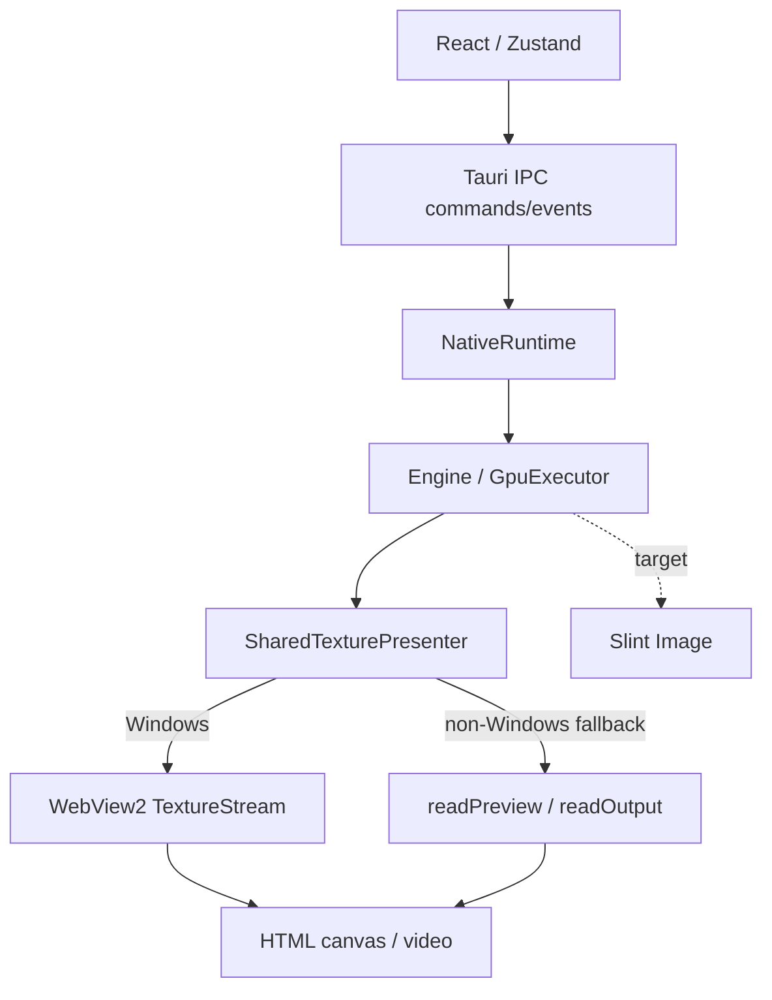
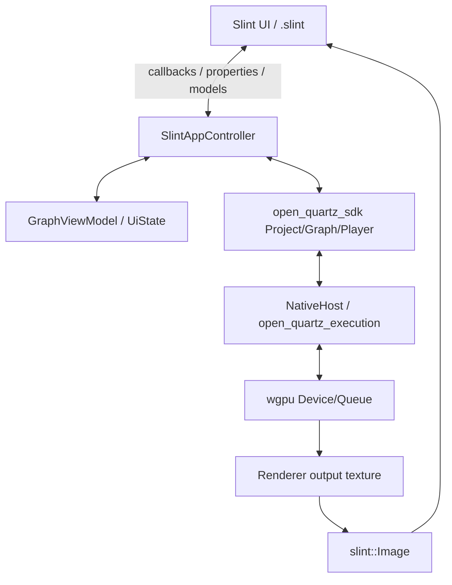
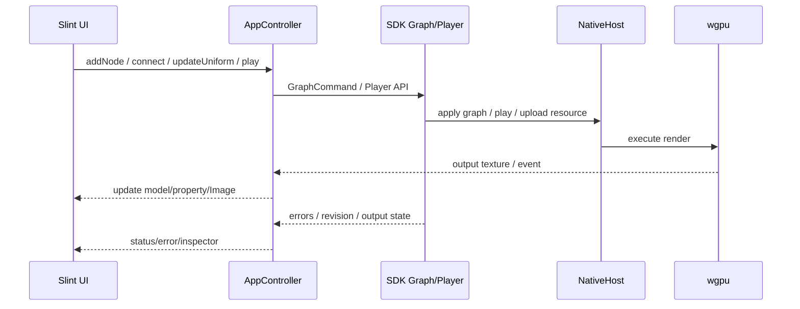
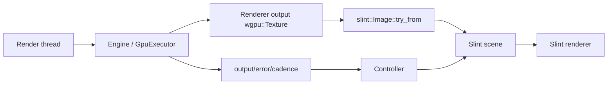

# Open Quartz Slint UI 重构方案

> 状态：Phase 2/3 及 Phase 4 首切片（Inspector、名称/输出尺寸、WGSL Apply）已完成 macOS 原生验收；离屏交互、Metal 像素、原生 AX/指针/键盘、800×540 滚动可达性均已验证；尚未切换默认入口
>
> 基线：v0.20.0b（2026-10-25）
>
> 关系：本文是独立的 Slint 迁移方案，不替代 [`DESIGN.md`](./DESIGN.md)。当前生产架构、所有权和性能状态仍以 `DESIGN.md` 为准；本次 Phase 2 实现保留 Tauri 发布路径，待跨平台验证和发布门槛完成后再回写 `DESIGN.md`。
>
> 结论：Slint 是当前同时覆盖 Windows/macOS/Linux/Android/iOS 的可行 Rust UI 候选，但不能直接全量重写。先验证“渲染器与 Slint 共享 wgpu device，并把输出纹理直接导入 Slint”这一条；验证通过后，再按阶段迁移节点图、Inspector、WGSL 编辑器和移动端。

## 0. 结论摘要

| 问题 | 结论 |
|---|---|
| Slint 能否覆盖五个原生平台 | **可以**：Windows、macOS、Linux、Android、iOS 都支持 Rust；iOS 在 1.18.1 已走 Metal GPU |
| 能否消除 WebView 纹理传输 | **目标可以**：Slint 与渲染器共享 `wgpu::Device/Queue`，用 `Image::try_from(texture)` 直接导入；必须在五个平台分别验证 |
| 是否有现成 WGSL 编辑器 | **没有**：Slint 只有纯文本 `TextEdit` 和只读 `StyledText`，富文本编辑 issue #2723 仍 open |
| 是否有现成节点图 | **没有**：需要基于 Slint 图元重写，触摸、连线、缩放都要自己做 |
| Web 是否保留 | **v1 不保留**：Slint WASM 走 WebGL，且 wasm 上外部 wgpu 纹理导入尚未落地；Web 需要独立方案 |
| 是否建议立即全量迁移 | **不建议**。先做独立 spike；通过后再决定是否投入节点图和编辑器 |
| 当前最优先动作 | 统一 `wgpu 27 → 29/30` 与 Rust 1.92，然后做共享纹理 spike |

本方案的推荐路径是：

```text
Phase 0  方案/授权/版本决策
Phase 1  wgpu 升级 + Slint 共享纹理 spike
Phase 2  抽出 Tauri-free NativeHost + Slint 应用壳
Phase 3  节点图读/编辑
Phase 4  Inspector + WGSL 编辑器
Phase 5  预览/ONNX/视频
Phase 6  Android/iOS 交付
Phase 7  切换与 Web 评估
```

任何阶段失败，都保留现有 Tauri 应用作为可发布路径，不做“半迁移”双维护。

---

## 1. 目标与非目标

### 1.1 目标

1. **UI 原生化**：主窗口、节点图、Inspector、菜单、对话框和预览全部由 Slint/Rust 渲染，不依赖 WebView DOM。
2. **渲染零拷贝**：渲染器输出的 `wgpu::Texture` 直接进入 Slint 场景，不再经过 GPU readback、PNG/base64、`ImageData` 或 WebView2 TextureStream。
3. **平台统一**：Windows、macOS、Linux、Android、iOS 使用同一套 Rust 业务和 Slint UI；平台差异只留在窗口、文件、相机、权限和打包层。
4. **保留核心语义**：`open_quartz_sdk`、`open_quartz_execution`、`open_quartz_host_api` 的 graph/engine/GPU/ONNX 语义不变；迁移只新增 host 组合和 UI projection。
5. **可回退**：新应用独立成 crate，旧 Tauri 应用在切换前保持可构建、可发布。
6. **可验证**：每一阶段都有性能、功能和平台验收，不以“能启动”代替完成。

### 1.2 非目标

- 不在 v1 追求 Web 功能对等。
- 不在 v1 追求 CodeMirror 级 WGSL 编辑体验。
- 不重写 graph topology、GPU execution、ONNX pre/postprocess 或 Project schema。
- 不把节点图/编辑器逻辑塞进 Slint DSL；Slint 只负责视图和输入。
- 不替换 Windows `.scr` screen saver host；只迁移导出入口。
- 不在 spike 阶段迁移全部 UI。
- 不为了“纯原生”而自研完整文本编辑器后再验证渲染路径；顺序必须是渲染优先。

### 1.3 成功标准

| 维度 | 成功标准 |
|---|---|
| 渲染 | 五个平台至少四个做到主 Renderer 输出无 CPU readback；iOS 若暂不可用，必须有明确结论和回退 |
| 帧率 | 1080p、典型 graph 下稳定 60 FPS；窗口缩放和侧栏预览不引起主循环抖动 |
| 功能 | 项目打开/保存、节点增删连、Inspector、Shader 编辑、预览、ONNX、视频输入达到可发布最低集 |
| 结构 | 新 UI 不依赖 Tauri/WebView/DOM；核心 crate 不出现 Slint 类型 |
| 测试 | 核心 Rust 回归全绿；新 UI 有组件/截图/平台 smoke；边界检查禁止双实现 |
| 授权 | Slint 授权完成法律确认；分发物包含所需署名/许可证 |
| 回退 | Tauri 应用在切换前仍可构建；spike 失败不需要回滚核心仓库 |

---

## 2. 当前状态

### 2.1 当前 UI 组成

当前 UI 是 React 19 + Zustand + React Flow + CodeMirror 6，组件约 3,800 行。

| 区域 | 当前文件 | 主要职责 | 迁移难度 |
|---|---|---|---|
| App 壳 | `src/App.tsx` | Header + NodeGraph + SidePanel + 隐藏 runtime canvas | 低 |
| Header | `src/components/Header.tsx` | File/Source/Math/Shader/ONNX/Renderer 菜单、撤销/重做、清空、播放控制、FPS/时间、项目名、窗口控制、Save As、Screen Saver 对话框 | 中 |
| 节点图 | `src/components/NodeGraph/index.tsx` | React Flow、连线、选择、删除、复制/粘贴、重连、MiniMap、Controls、Background | **高** |
| 节点卡片 | `src/components/NodeGraph/nodes/*` | Shader/Input/Constant/ONNX/Math/Renderer 六类节点、端口、状态灯、内联预览 | 高 |
| 连线 | `src/components/NodeGraph/edges/CustomEdge.tsx` | Bezier 边、选中、删除 | 中 |
| Inspector | `src/components/SidePanel/index.tsx` | 可调宽侧栏、错误、折叠区、Shader/System/Ports/Math/ONNX/Renderer/Framebuffer/Video/Sampling/Preview | **高** |
| WGSL 编辑器 | `src/components/SidePanel/ShaderEditor.tsx` | CodeMirror 6、WGSL 高亮、naga 解析 + GPU 编译诊断、400ms 提交防抖 | **高** |
| 端口面板 | `src/components/SidePanel/PortInspector.tsx` | 标量/向量/矩阵/采样器输入、输出类型、颜色标识 | 中 |
| ONNX 面板 | `src/components/SidePanel/OnnxPanel.tsx` | 模型状态、下载进度、阈值、检测/分割结果 | 中 |
| 预览/灯箱 | `src/components/SidePanel/index.tsx`、`ImageLightbox.tsx` | 内联预览、全屏、保存截图、视频缩略图 | 中 |
| 导出对话框 | `src/components/ScreenSaverExportDialog.tsx` | Windows `.scr` 导出、Renderer 选择、输入暴露 | 低 |
| Screen Saver 播放器 | `src/components/ScreenSaverApp.tsx` | 全屏播放、鼠标/键盘退出 | 不迁移到主 UI |

### 2.2 当前呈现链路



当前可验证事实：

- Windows 主 Renderer 已走 DXGI shared texture → WebView2 TextureStream，正常帧无 CPU pixel copy：`src-tauri/src/native_runtime.rs:978-999`、`src-tauri/src/webview_texture_stream.rs`。
- 非 Windows 在 `src-tauri/src/native_runtime.rs:366-375` 关闭 shared texture 能力，前端退回 `readPreview(..., 960)` + `putImageData/drawImage`，每帧 GPU readback：`src/sdk/internal/NativeHost.ts:571-597`、`src/services/PipelineService.ts:229-243`。
- 侧栏预览约 5Hz（200ms 节流）：`src/sdk/internal/NativeHost.ts:782-785`。
- Browser 路径约 15Hz PNG/base64：`docs/DESIGN.md:1514`。
- Native ONNX 仍是 GPU readback → CPU ORT → 上传，换 Slint 不会消除：`docs/DESIGN.md:1519`。

### 2.3 Tauri / DOM 耦合点

这些是迁移时必须替换或重新实现的边界，不是简单“换个 UI 库”。

| 耦合点 | 当前实现 | Slint 方案 |
|---|---|---|
| Host 命令 | 约 34 个 `#[tauri::command]`：GPU、视频、ONNX、模型、screen saver | Rust 直接调用 host/controller，不再有 IPC |
| 事件 | Tauri `emit/listen`：frame、output、model progress、cadence | Rust channel + `slint::invoke_from_event_loop` |
| 纹理传输 | WebView2 TextureStream + `<video>` | `Image::try_from(wgpu::Texture)` |
| 预览 | data URL / canvas / `` / `<video>` | `Image` + `SharedPixelBuffer` / 纹理 |
| 文件对话框 | `@tauri-apps/plugin-dialog` + HTML file input | `rfd`（桌面）或平台 document picker（移动端） |
| 窗口 | `getCurrentWindow()` 拖动/最小化/最大化/关闭 | Slint `Window` / 平台窗口适配 |
| 节点图 | React Flow | Slint 自绘 GraphView |
| 编辑器 | CodeMirror 6 | Slint `TextEdit` v1；自研编辑器为后续选项 |
| 状态 | Zustand + Immer + React hooks | Rust `AppController` + Slint models/properties |
| 屏幕保护 | Tauri `.scr` host + WebView | 保留独立 `.scr` host；UI 只调用导出服务 |
| 打包 | Tauri/npm | Cargo + Android/iOS 工程 + 平台资源 |

### 2.4 现有 Rust 侧规模

| 文件 | 行数 | 说明 |
|---|---:|---|
| `src-tauri/src/native_runtime.rs` | 2,028 | 当前 native host 组合、GPU/视频/ONNX/presentation 入口，Tauri 耦合最重 |
| `src-tauri/src/webview_texture_stream.rs` | 1,052 | Windows WebView2 TextureStream；Slint 路径不需要 |
| `src-tauri/src/native_video.rs` | 915 | Tauri 侧视频/相机集成 |
| `src-tauri/src/screen_saver.rs` | 756 | Windows screen saver host/导出 |
| `crates/open_quartz_execution` | 约 12,100 | Runtime/Engine/GPU/ONNX/媒体核心，应尽量不动 |

---

## 3. 目标架构

### 3.1 分层



原则：

1. **Slint 只做视图**：不在 `.slint` 里维护 graph 规则、拓扑、资源生命周期。
2. **Rust 是唯一业务层**：UI 回调只发送 intent，由 `AppController` 调用 SDK/host。
3. **单向数据流**：UI → controller → domain；domain/event → controller → Slint model/property。
4. **纹理不经过 UI 模型**：renderer output 作为 `slint::Image` 直接绑定到 `Image` 元素。
5. **异步不阻塞 UI**：下载、ONNX、视频、文件 I/O 在工作线程；结果通过事件循环合并。

### 3.2 新应用 crate

建议先以独立目录落地，稳定后再决定是否并入 workspace：

```text
apps/open_quartz_slint/
├── Cargo.toml
├── build.rs
├── ui/
│   ├── app.slint
│   ├── theme.slint
│   ├── components/
│   │   ├── top_bar.slint
│   │   ├── graph_view.slint
│   │   ├── node_card.slint
│   │   ├── inspector.slint
│   │   ├── code_editor.slint
│   │   └── dialogs.slint
│   └── icons/
├── src/
│   ├── main.rs
│   ├── app_controller.rs
│   ├── graph_view_model.rs
│   ├── render_bridge.rs
│   ├── preview_bridge.rs
│   ├── platform/
│   │   ├── desktop.rs
│   │   ├── android.rs
│   │   └── ios.rs
│   └── services/
│       ├── file_service.rs
│       ├── model_service.rs
│       └── video_service.rs
└── tests/
```

新增/抽取两个 Rust 边界：

- `open_quartz_native_host`（建议新增）：把 `src-tauri/src/native_runtime.rs` 中与 Tauri 无关的 GPU/视频/ONNX/presentation 组合抽出来，Tauri 和 Slint 共用。**不能把 host 逻辑复制到新 app**。
- `open_quartz_slint`（新 app）：只依赖 sdk/host/execution，不依赖 `tauri`、`wry`、`webview2-com`、`js-sys`。

### 3.3 单向数据流



关键约束：

- 拖拽节点时只更新 UI 的 `x/y`，松手或节流后再提交持久化；不要每帧发 graph command。
- Graph 变更使用 revision；旧 projection 不能覆盖新 revision。
- 输出事件按 node/output generation 合并；UI 只消费最新可见帧。
- 预览只对选中/可见节点订阅；不可见节点降频或暂停。
- UI 线程不做 GPU wait、文件 I/O、ONNX 推理或大 JSON 解析。

### 3.4 状态归属

| 状态 | Owner | 说明 |
|---|---|---|
| Project/Graph/Node/Edge | `open_quartz_sdk` | 唯一 domain source of truth |
| 节点位置 | UI + project | 拖拽时 UI 持有；持久化仍进 Project |
| 选择、视口、折叠、面板宽度 | Slint/UI | 不需要进 SDK |
| 运行状态、FPS、时间 | `Player`/host | UI 只投影 |
| 输出/错误 | controller | 按 nodeId 聚合；不写回 graph |
| 预览像素/纹理 | controller + Slint | 不经过 base64/data URL |
| 文件路径、模型路径 | controller/service | 平台层负责权限和路径 |
| 撤销/重做 | SDK Graph | UI 只显示可用性 |

### 3.5 线程与事件

| 线程/执行器 | 职责 |
|---|---|
| Slint UI 线程 | 输入、动画、属性更新；禁止阻塞 |
| Render thread | graph frame、GPU submit、present |
| ONNX worker | session/run、pre/postprocess |
| Model/download worker | 网络、校验、写盘 |
| Video worker | 解码、相机帧、缩略图 |
| File worker | 项目/图片/模型读取 |

跨线程只传值/句柄；Slint 更新统一通过 `slint::invoke_from_event_loop` 或 controller 的事件队列。不要从 render/ONNX 线程直接改 Slint 属性。

---

## 4. 平台策略

### 4.1 平台矩阵

| 平台 | Slint 支持 | 目标渲染路径 | 风险 |
|---|---|---|---|
| Windows | 稳定 | winit + wgpu；共享 device + texture import | 低/中 |
| macOS | 稳定 | Metal；共享 device + texture import | 中 |
| Linux | 稳定 | Vulkan/GL；Wayland/X11；共享 device | 中 |
| Android | Rust 支持 | Vulkan；共享 device + texture import | **中/高** |
| iOS | Rust only；1.18.1 Metal | Metal；外部 wgpu 纹理导入需 spike | **高** |
| Web | WASM + WebGL | 不能复用外部 wgpu 纹理路径 | **不纳入 v1** |

### 4.2 Web 决策

**决策：v1 不把 Web 作为交付目标。**

原因：

- Slint WASM 当前是 Winit + FemtoVG + WebGL，不是 WebGPU。
- wasm 上 `Image::try_from(wgpu::Texture)` 外部纹理导入被 `cfg` 排除；相关 PR #11580 仍是 draft。
- Slint 官方明确不推荐用它构建通用 Web 应用；无 DOM、可访问性受限。
- 当前 Browser 路径本身已有已知性能问题，不能把 Slint Web 当成性能修复。

如果未来必须支持 Web，应作为独立项目评估：独立 Web UI、WebGPU/Canvas 呈现、WASM ONNX，而不是把原生 Slint 应用直接编译到浏览器。

### 4.3 移动端策略

- Android：Rust + Slint；需要 `android-activity` 生命周期、权限、文件选择、相机权限、后台/恢复、软键盘。
- iOS：Slint 目前只支持 Rust；需要 Xcode 工程、Metal/wgpu 验证、文件/相册权限、后台策略。
- 移动端不是桌面 UI 的等比缩小：
  - 节点图以双指缩放/单指平移为主；
  - Inspector 改为底部抽屉/全屏页；
  - 文本编辑使用系统虚拟键盘和 IME；
  - 菜单改为弹出层；
  - 文件/模型选择使用平台 document picker。
- v1 可以只保证“能打开、能播放、能改参数、能保存”；完整节点编辑可后置。

---

## 5. 渲染集成

这是整个迁移的**第一优先级**。如果这条不成立，Slint UI 的其他工作没有意义。

### 5.1 版本基线

| 项 | 当前 | Slint 1.18.1 目标 |
|---|---|---|
| Slint | 未引入 | 1.18.1 |
| Rust | `rust-version = 1.77.2` | **1.92**（Slint 1.18.1 MSRV） |
| wgpu | 27 | **30**（29 为 fallback） |
| naga | 27 | 与 wgpu 同步 |
| Slint wgpu feature | 无 | `unstable-wgpu-30` + `renderer-femtovg-wgpu` |

事实：

- Slint 1.18.1 只提供 `unstable-wgpu-29` / `unstable-wgpu-30`。
- Slint 1.17 已把 `unstable-wgpu-27/28` 替换为 29。
- 若必须保留 wgpu 27，只能固定 Slint 1.16.x；但 iOS 的 GPU 质量和后续修复不足，不适合作为最终目标。
- 因此 **iOS 目标实际上强制要求 wgpu 29/30 升级**。
- 仅启用 `unstable-wgpu-30` 不够：Slint 默认可能仍选 OpenGL femtovg renderer，运行时报 `WGPU 30.x rendering is not supported with an OpenGL renderer`；必须同时启用 `renderer-femtovg-wgpu`。Windows DX12 已在 `spikes/slint-render-spike` 验证。

建议：

1. 先在独立 change-set 把 `open_quartz_execution`、`src-tauri` 的 wgpu/naga 从 27 升到 30，跑完整回归。
2. 再用 Slint 1.18.1 做 spike。
3. 不建议用 Slint 1.16.1 + wgpu 27 做长期方案；最多作为 Windows-only 的快速概念验证，且验证结果不能直接代表最终栈。

### 5.2 共享 wgpu Device/Queue

目标初始化顺序：

```rust
let instance = wgpu::Instance::new(/* ... */);
let adapter = instance.request_adapter(/* ... */).await?;
let (device, queue) = adapter.request_device(/* ... */).await?;

slint::BackendSelector::new()
    .require_wgpu_30(slint::wgpu_30::WGPUConfiguration::Manual {
        instance,
        adapter,
        device: device.clone(),
        queue: queue.clone(),
    })
    .select()?;
```

要求：

- Slint 和渲染器使用**同一个** `Device/Queue`；不能各建一个。
- Renderer 输出纹理的 usage 至少包含 `TEXTURE_BINDING` 和 `RENDER_ATTACHMENT`。
- 选择 Slint 支持的格式（如 `Rgba8Unorm`），在 spike 中验证 sRGB、alpha、色彩空间。
- 纹理尺寸、mip、sample count、array layer 必须匹配。
- 纹理生命周期由 controller 持有；Slint `Image` 只引用，不负责销毁 GPU 资源。

### 5.3 纹理导入

```rust
let image = slint::Image::try_from(renderer_texture)?;
window.set_renderer_image(image);
```

约束：

- 只在主 Renderer 或可见预览上导入；不要为每个节点每帧创建 `Image`。
- 侧栏/缩略图可降频到 5–10Hz；全屏/主 Renderer 跟随渲染帧。
- `try_from` 失败时只能走有界 `read_preview` 回退，不能恢复每帧 base64。
- 不要从 UI 线程做 `map_async`/`poll` 等待 GPU。
- 多窗口/全屏切换时重新绑定纹理，不要复用已释放的 `Image`。

### 5.4 目标呈现链路



与当前 Windows TextureStream 的差别：

- 当前：`wgpu texture → DXGI shared handle → WebView2 TextureStream → <video> → canvas`。
- 目标：`wgpu texture → slint::Image → Slint renderer`。
- 目标路径没有跨进程/跨沙盒句柄，也没有 `<video>` 元素。

### 5.5 Spike 验收矩阵

| 平台 | 必测 | 通过标准 |
|---|---|---|
| Windows | DX12、窗口缩放、全屏 | 无 readback；60 FPS；颜色正确 |
| macOS | Metal、Retina、窗口缩放 | 无 readback；60 FPS；颜色正确 |
| Linux | Vulkan（Wayland/X11 至少一种） | 无 readback；无 validation error |
| Android | Vulkan、生命周期、旋转 | 纹理导入成功；前后台恢复不崩 |
| iOS | Metal、Retina、前后台 | 纹理导入成功；若失败，记录明确原因和回退 |
| 全部 | device loss、resize、关闭 | 无泄漏、无死锁、无旧帧覆盖 |

---

## 6. UI 组件映射

### 6.1 总表

| 当前 React | Slint 目标 | 迁移方式 | 风险 |
|---|---|---|---|
| `App.tsx` | `AppWindow` | 直接重写 | 低 |
| `Header.tsx` | `TopBar` + `MenuPopup` | 菜单状态改为 Rust/Slint property | 中 |
| `NodeGraph/index.tsx` | `GraphView` | 自绘画布 + 手势 + 命中测试 | **高** |
| `NodeGraph/nodes/*` | `NodeCard` 组件 | 六类节点统一 shell + 变体 | 高 |
| `CustomEdge.tsx` | `EdgeLayer` | `Path`/Bezier + 选中/删除 | 中 |
| `SidePanel/index.tsx` | `InspectorPanel` | `ScrollView`/`ListView` + 折叠区 | 高 |
| `ShaderEditor.tsx` | `CodeEditor` | v1 `TextEdit`；后续自研 | **高** |
| `PortInspector.tsx` | `PortList` | 标量/向量/矩阵输入组件 | 中 |
| `OnnxPanel.tsx` | `OnnxInspector` | 状态/阈值/结果列表 | 中 |
| `ImageLightbox.tsx` | `PreviewOverlay` | `Image` + 全屏层 | 低 |
| `ScreenSaverExportDialog.tsx` | `ScreenSaverDialog` | 仅 Windows 显示 | 低 |
| `ScreenSaverApp.tsx` | 不迁移 | 保留独立 `.scr` host | 低 |

### 6.2 TopBar

需要保留的功能：

- 项目名显示/双击重命名；
- File：Load、Save、Save As、Export as Screen Saver；
- Source：System、Constants、External；
- Math：分类/操作；
- Shader：模板/预置分类；
- ONNX：目录/自定义模型；
- Renderer 新增；
- Undo/Redo/Clear；
- Play/Pause/Resume/Stop；
- FPS、时间；
- 桌面窗口控制（Windows/Linux）；
- macOS 交通灯留白/拖动区域。

实现建议：

- 菜单用 Slint `PopupWindow` 或自绘覆盖层；不要在 Slint 里重建 React 的 hover 子菜单状态机。
- 菜单项数据由 Rust 提供 `VecModel<MenuItem>`，避免在 `.slint` 中硬编码 catalog。
- 窗口拖动/最小化/最大化/关闭通过 Slint window API + 平台适配；macOS 保留原生交通灯。
- 快捷键集中到 Rust controller，避免 Slint 和平台菜单各维护一套。

### 6.3 GraphView

目标能力：

- 平移/缩放（鼠标滚轮、触控板、双指）；
- 节点选择、框选、多选；
- 节点拖动、吸附/网格；
- 端口连线、重连、删除；
- 边选中、删除；
- 复制/粘贴；
- Fit view、MiniMap、Controls；
- 背景网格；
- 节点内联预览/状态灯；
- 移动端长按/拖拽/双指。

实现建议：

- 第一阶段用 Slint 图元自绘：`TouchArea` + `Flickable`/手势 + `Path` 边 + `NodeCard` 组件。
- 节点位置/尺寸由 Rust `GraphViewModel` 提供；Slint 只渲染可见节点。
- 连线命中测试和合法性由 Rust/SDK 负责；Slint 只显示颜色/临时线。
- 100 节点先过关；300 节点作为上限压力测试。若 Slint 元素树撑不住，再评估“wgpu 渲染 graph texture + Slint overlay”方案。
- 不建议把 React Flow 放进 WebView 作为长期方案；它会让五平台交付重新分叉。

### 6.4 Inspector

当前 Inspector 是选中节点的动态折叠区。目标拆成：

- `NodeHeader`：类型、label、删除、状态；
- `ErrorBanner`；
- `Section` 可折叠容器；
- 专用 section：Shader、System Source、Ports、Math、ONNX、Renderer、Framebuffer、Video、Sampling、Preview；
- `Preview` 使用 `Image`，不再使用 `/<canvas>/<video>`。

实现建议：

- section 列表由 Rust 生成 `VecModel<SectionDescriptor>`；内容用 Slint 条件组件切换。
- 面板宽度/折叠状态属于 UI state；不需要进 SDK。
- 预览只订阅选中节点；切换选择时取消旧订阅。
- 错误文本、cadence 指标用 property 更新，不重建整个 panel。

### 6.5 预览与灯箱

- Renderer 输出：`Image::try_from(texture)`。
- 图片输入：解码为 `SharedPixelBuffer`，用 `Image` 显示。
- 视频缩略图：解码首帧为 `SharedPixelBuffer`；播放预览用纹理或降频帧。
- 全屏/灯箱：Slint 覆盖层 + 同一 `Image` 源；不要重新 readback。
- 截图：用户触发时才 readback + PNG 编码；不在热路径。

### 6.6 对话框

| 对话框 | Slint 方案 |
|---|---|
| Save As | Slint 文本输入 + 确认/取消；路径由平台文件服务处理 |
| Screen Saver Export | Windows-only Slint 对话框；导出调用 Rust service |
| ONNX 模型选择 | 平台文件选择器 + 进度/状态 |
| 错误/确认 | Slint 通用 `AlertDialog` 组件 |
| 图片灯箱 | Slint 覆盖层 |

### 6.7 Screen Saver

- 保留 `crates/open-quartz-screensaver-stub` 与 Windows `.scr` host。
- Slint 主应用只负责“导出请求”对话框；导出逻辑复用现有 Rust/JSON 生成。
- `.scr` 播放器仍用原生 host，不依赖 Slint 主窗口。
- Screen saver 的输入文件读取、设置对话框和退出逻辑继续走 Windows 专用路径。

---

## 7. 关键子系统

### 7.1 Graph projection

- `GraphViewModel` 持有 `VecModel<NodeView>` / `VecModel<EdgeView>`。
- `NodeView` 是 Slint 可消费的扁平结构：id、type、label、x/y、width/height、status、ports、preview handle。
- domain 变更后做增量更新：新增/删除/替换单个节点，不整表重建。
- 拖拽中的位置由 UI 临时覆盖；提交时再写回 Project。
- 端口类型、连接合法性、错误状态来自 SDK，不在 Slint 里重算。
- 节点内联预览不要塞进 `NodeView` 的字符串字段；用 `Image`/纹理句柄。

### 7.2 节点图编辑

三个候选：

| 方案 | 说明 | 结论 |
|---|---|---|
| A. Slint 图元自绘 | `TouchArea`/`Flickable`/`Path`/`NodeCard`；Rust 命中测试 | **推荐先做** |
| B. wgpu 渲染图 + Slint overlay | GPU 画背景/边/节点，Slint 叠加控件 | 仅在 A 性能不足时评估 |
| C. WebView React Flow | 复用现有节点图 | 违反纯原生目标；移动端不可接受 |

A 的验收：

- 100 节点/150 边：稳定 60 FPS，拖动无明显延迟；
- 300 节点：可用（允许降级，如 LOD/隐藏端口）；
- 连线/重连/删除无悬挂边；
- 触摸和鼠标都能完成基本编辑；
- 视口变换与节点命中测试一致。

### 7.3 WGSL 编辑器

当前 CodeMirror 能力：

- WGSL 语法高亮；
- 行号、当前行、选择、撤销；
- naga 解析错误；
- GPU 编译诊断（行/列/长度）；
- 400ms 提交防抖、750ms lint 防抖；
- 预置 shader 只读。

Slint 现状：

- `TextEdit`：纯文本、多行、选择、剪贴板、IME、滚动；**无 per-token 高亮**。
- `StyledText`：只读富文本/Markdown 子集；**不可编辑**。
- 富文本编辑 issue #2723 仍 open；官方明确短期不做代码编辑器。
- 社区有 `slint-codeeditor` 原型，但不是生产级编辑器。

候选：

| 方案 | 优点 | 缺点 | 结论 |
|---|---|---|---|
| A. `TextEdit` v1 | 最快、IME/移动端可用、风险低 | 无语法高亮；体验退化 | **v1 采用** |
| B. 自研 Slint 编辑器 | 纯原生、可控 | 光标/选区/IME/撤销/滚动/无障碍成本极高 | 后续评估，不在首版 |
| C. 桌面 WebView + CodeMirror | 体验最好 | 五平台分叉、移动端很脏、违背目标 | 仅作应急 fallback |
| D. 等 Slint 上游 | 无自研成本 | 时间不可控 | 跟踪 #2723 |

**决策：v1 用 `TextEdit` + Rust/naga 诊断 + 错误列表/行标记；不把透明 `TextEdit` 叠 `StyledText` 当生产方案。** 如果 v1 体验不可接受，再启动自研编辑器，且必须先做独立原型和性能/IME 验收。

诊断路径：

- 输入停止后 300–500ms 防抖；
- Rust `naga` 解析；
- 可选的 GPU 编译验证（复用现有 compiler）；
- 错误通过 property/model 显示在编辑器下方或行标记；
- 预置 shader 只读。

### 7.4 预览与输出

当前输出是 data URL；新 UI 不应继续使用 base64。

建议新增/使用：

- `PreviewFrame`：`SharedPixelBuffer` 或 `wgpu::Texture` + 元数据（width/height/format/generation）。
- Renderer 主输出：纹理导入。
- 图片/视频缩略图：RGBA buffer。
- 截图：显式 readback + 编码，仅用户触发。
- 订阅按 nodeId/output/generation 去重；旧帧不得覆盖新帧。

### 7.5 文件 I/O

当前依赖 Tauri dialog + HTML file input。Slint 核心不提供 Tauri `plugin-dialog` 等价物。

建议：

- 桌面：`rfd` 或平台原生 dialog。
- Android/iOS：平台 document picker / photo picker / security-scoped URL。
- 统一抽象 `FileService`：
  - open project；
  - save/save as；
  - open image/video/model；
  - 最近文件；
  - 路径/URI 权限。
- 项目 JSON 解析继续用 Rust SDK；不要在前端重写 normalize。
- 保存用临时文件 + 原子替换，避免崩溃损坏。

### 7.6 ONNX

当前 `src-tauri` 负责模型下载、读取、ORT 配置；UI 通过 Tauri command 调用。

目标：

- 新增 `ModelService`（Rust）：下载、校验、缓存、读取、删除、进度事件。
- 复用 `open_quartz_execution` 的 ONNX session/task/pre/postprocess。
- `NativeHost` 负责 `load_model/unload_model/capabilities`。
- UI 只显示状态/进度/结果，不直接读文件系统。
- 移动端模型路径/权限/内存限制单独测试。

### 7.7 视频/相机

当前 `src-tauri/native_video.rs` 和 DOM `<video>` 参与预览。Slint 没有 DOM video。

目标：

- 视频解码继续在 Rust/native video 层；输出帧/纹理给 renderer。
- 相机枚举、权限、设备选择由平台服务负责。
- 缩略图解码为首帧 RGBA。
- 播放节奏由 Player/clock 控制，不由 UI 定时器控制。
- 移动端需要相机权限、前后台暂停、方向变化处理。

### 7.8 剪贴板、快捷键、窗口

- 节点复制/粘贴：Rust 侧维护 graph clipboard；文本剪贴板用 `arboard` 或平台 API。
- 快捷键：Rust controller 统一处理；避免 Slint 和平台菜单重复绑定。
- 窗口控制：Slint window API + 平台适配；Windows/Linux 自绘按钮，macOS 保留原生交通灯。
- 拖动区域：Slint `TouchArea` 调 `start_drag`/平台窗口 API。
- 全屏/灯箱：Slint 覆盖层，不创建新 WebView。

### 7.9 Screen Saver

- 保持 `.scr` host 独立。
- 导出服务输入：project JSON、renderer node、exposed inputs、输出路径。
- 主 UI 只在 Windows 显示导出入口。
- 导出后不启动第二个 graph runtime。
- `.scr` 播放路径继续使用 native host；不要依赖 Slint 主应用进程。

---

## 8. 迁移阶段

### 8.1 阶段表

| 阶段 | 范围 | 退出条件 |
|---|---|---|
| Phase 0 | 方案评审、授权、版本决策、spike 设计 | 本文通过；license 有结论；决定是否升级 wgpu |
| Phase 1 | wgpu 27→30 + Slint 共享纹理 spike | Windows/macOS/Linux/Android 至少三个通过；iOS 有结论 |
| Phase 2 | 抽出 Tauri-free NativeHost；Slint 应用壳；项目 I/O | 能打开/保存项目；空 graph 可启动；Tauri 仍可构建 |
| Phase 3 | GraphView 读/编辑 | 100 节点可编辑；连线/删除/撤销/保存正确 |
| Phase 4 | Inspector + WGSL v1 + 预览 | 选中节点可改参数/Shader；预览无 base64 |
| Phase 5 | ONNX + 视频 + 截图 + Screen Saver 导出 | 功能达到桌面最低发布集 |
| Phase 6 | Android/iOS 打包与触摸 UI | 至少一个移动端可安装、打开、播放、保存 |
| Phase 7 | 切换默认入口；Web 评估 | 旧 Tauri 降为 fallback 或删除；文档回写 |

### 8.2 Phase 0：决策，不写大代码

- 确认 Web 是否放弃。
- 确认 v1 是否接受“纯文本 TextEdit 编辑器”。
- 确认节点图是否必须完整对等。
- 确认 Slint 授权路径。
- 确认最低 OS/设备矩阵。
- 确认是否先升级 wgpu 30。
- 建立 spike 分支/目录，不碰主 UI。

### 8.3 Phase 1：先证明纹理，不碰 UI

Spike 范围：

- 一个最小 Slint window；
- 复用现有 renderer 输出或生成一个测试纹理；
- 共享 device/queue；
- `Image::try_from`；
- resize、全屏、关闭；
- 记录 readback/帧率/CPU。

**不要**在 Phase 1 做节点图、编辑器、文件对话框或移动端完整 UI。

### 8.4 Phase 2：Host 抽取与应用壳

- **已实现**：新增 `crates/open_quartz_native_host`，Tauri 的 `NativePlayerHost` 已抽为无框架依赖的 `NativeHost`；Tauri 保留 IPC、事件、worker 和 WebView2 presentation 适配。
- **已实现**：新增 `apps/open_quartz_slint` 独立 workspace，使用 Slint 1.18.1 + wgpu 30；应用壳包含 TopBar、显式路径项目打开/保存、只读 graph projection 和 renderer output 区域。
- **已实现**：Slint render bridge 创建共享 wgpu `Device/Queue`，同一组句柄交给 `NativeHost::from_shared_wgpu` 和 Slint `WGPUConfiguration::Manual`；输出通过 `slint::Image::try_from` 导入，不走 readback/base64。
- **已实现**：项目文件由 `open_quartz_sdk::OpenQuartz` 在 worker 线程解析/校验，保存使用 `Project::to_file()`；无效输入保留当前项目并显示错误。
- **限制**：Phase 2 仍是只读 graph；节点编辑、Inspector、资源绑定、原生文件选择器和移动端适配不在范围内。Linux/Android/iOS 验证按当前计划后置。
- **macOS 验收**：Apple M4 Pro / Metal 上 `cargo check`、`cargo build` 和 Slint app 单测通过；默认 640×360 graph 通过共享 `Device/Queue` 和 `Image::try_from` 正确显示，窗口从 1180×760 缩放到 900×650 后输出保持正确。已实际验证 SDK Save/Open、缺失文件错误保持当前项目、空 graph 启动和原生窗口干净关闭。
- **回归验收**：`cargo test --workspace` 276 tests / 45 suites 通过；`cargo test -p open_quartz_native_host --all-features --offline`、`cargo check -p app --lib` 通过。CI 以 `macos-latest` 编译 Slint app。
- **已知工具链问题**：wgpu-core 30 的 debug-only lock tracer 与 Slint thread-local backend 在 macOS 存在 TLS 析构顺序冲突；仅对 Slint app 的 dev profile 关闭 `wgpu-core` debug assertions，release 原本不启用该 tracer，OpenQuartz/Slint/app assertions 不受影响。
- **下一步**：按当前优先级暂缓 Linux，进入 Phase 4 macOS Inspector/编辑器；移动端手势后补。

### 8.5 Phase 3：节点图

- **已实现首切片**：Slint 空间画布按 Project 坐标放置节点，以 `Path` 绘制 Bezier 边；支持单选、拖动预览和滚动访问完整世界坐标。
- **Rust-owned mutation**：拖动低于 3px 只选择；有效拖动在松手时只提交一次 `GraphCommand::SetNodePosition`，不重启 Renderer；同位置提交不会增加 revision。
- **已实现第二切片**：按真实端口行投影节点高度与边端点；点击输出再点击输入建立/替换连接，点击已连接输入或边中点选中连线，提供删除、重连和取消。重连可更换源或目标，旧边直到 SDK 原子事务成功才被替换；类型不兼容、cycle 或不存在的端口不会丢失旧边。
- **撤销/重做**：复用 SDK graph history；移动、连线、重连、删除和整组粘贴均可恢复，新成功编辑清空 redo，失败/no-op 不清空；打开项目重置当前编辑历史，fixture 构造不作为用户操作撤销。拓扑历史更新 NativeHost，纯布局历史不重启 Renderer。
- **持久化与错误路径**：坐标和连接通过 SDK `Project::to_file()` 保存并可重载；项目 I/O 期间禁用并拒绝选择、拖动、连线与历史操作，避免旧 project 或旧 save snapshot 覆盖编辑。
- **已实现第三切片**：−/+ 按 1.25 倍缩放，手动范围 1%–200%，100% 重置保持视口中心（受边界约束）；Fit View 按紧致 graph bounds 和反向 Bezier 控制点范围居中适配，激活后随窗口/graph bounds 变化重算，空图禁用。视口不写 Project、不增加 revision、不进入 history；打开项目重置缩放和滚动。节点/端口/边/拖动共用比例，拖动换算回世界坐标且 3px 阈值保持屏幕单位；低于 25% 隐藏标签，仅显示概览几何。
- **已实现第四切片**：Shift-click 多选切换、Select all 和图区域 Command/Ctrl+A/C/V；Rust-owned graph clipboard 快照选中节点及内部边，粘贴重映射节点/端口 ID、保留节点数据及相对布局，每次成功整体偏移再增 40 世界单位，整组作为一次 SDK revision/history。失败保留项目/redo/偏移；Copy 空选择不覆盖旧剪贴板。剪贴板跨项目 Open 保留，不占用系统文本剪贴板、不复制外部资源；路径框文本快捷键不被截获，I/O busy 拒绝操作。拖动仍仅移动当前节点，并在松手时选中该节点，不提供组拖动。
- **已实现第五切片**：右下 MiniMap 按同一 padded world bounds 显示全部节点和当前可见世界框，随 scroll/zoom/Fit/窗口 resize 更新；点击或拖动可居中主视口并按边界 clamp、恢复 graph keyboard focus。空图或完整 graph 已可见（含 Fit View）时隐藏，位置避开滚动条；操作不写 Project、不进 history。
- **性能基线**：确定性的 100 节点/150 边和 300 节点/450 边 graph。Apple M4 Pro 上，临时离屏 harness 将真实 Slint tree 通过与应用相同的 FemtoVG/wgpu 30 后端渲染到 1180×760 Metal texture，每组预热 1 帧后同步测 30 个 full frames。release：100 节点 projection 75µs，frame mean 2.326ms / p95 2.523ms（429.9 FPS）；300 节点 projection 271µs，mean 2.825ms / p95 3.338ms（354.0 FPS）。debug 分别 mean 20.574ms（48.6 FPS）和 28.127ms（35.6 FPS）。另以 release AppKit 原生窗口和 `SLINT_DEBUG_PERFORMANCE=refresh_full_speed,console` 验收 swapchain/event-loop：100 节点首个报告 59 FPS 后稳定 60，300 节点首个报告 51 FPS 后稳定 60；macOS 原生 60 FPS gate 通过，不外推其他硬件/平台。
- **基础验收**：Slint app 29 tests 通过，覆盖真实多端口端点、负坐标边界、平移不变及反向 Bezier fit bounds、位置/连线持久化、no-op revision、重连与占用输入替换的单步历史、类型/cycle 错误原子性、剪贴板边界及 stress/CLI。临时 Slint 软件指针 smoke 通过选择/连线/历史/I/O 和缩放交互验证；80%/125% 拖动换算、3px 屏幕阈值、缩放后端口命中、200% 滚动后缩至 160% 的中心锚点、1%/200%、300 节点负坐标图的 Fit/resize/空图/Open 重置均通过。
- **第四切片验收**：Slint app 29 tests 通过，增加剪贴板快照隔离、任意端口 ID 重映射、仅内部边、重复粘贴 ID/偏移、整组撤销重做与持久化、失败保留目标/redo/偏移。临时真实 Slint 指针/键盘 smoke 通过 Shift 切换、多选/复制/粘贴、单步 Undo/Redo、文本框快捷键隔离、busy guard、SDK Save/Open 和跨项目粘贴；已检查 1180×760、800×540 截图。将 shader/renderer 子图复制到空项目后，真实 NativeHost 在 Apple M4 Pro/Metal 上输出 640×360 GPU 纹理，确认重映射后的端口仍可执行。
- **第五切片验收**：临时 Slint 软件指针 smoke 在 300 节点图验证 MiniMap 首尾区域点击/拖动定位、zoom/Fit 视口框、整体负坐标平移、1180×760/800×540 resize、空图/完整可见时隐藏、再次放大后出现、graph focus 与 Project/revision 不变；导航后首尾节点均可选择。所有临时 smoke/perf harness 已移除。
- **macOS 原生验收**：release app bundle 的 1180×760 Retina AppKit 窗口可由 ScreenCaptureKit 和 AX 树观测；100 节点图完成全选、Copy、100→200 节点 Paste、单步 Undo、zoom/Fit。真实 shader→renderer 项目显示共享 640×360 Metal 纹理；通过 AX action 选中节点/边/端口，删除 renderer 边后 NativeHost 报缺失输入并清图，Undo 后恢复纹理，重复端口连线保持 no-op revision。300 节点/450 边 Fit View 原生截图通过。原生验证补齐 node header、port、edge、MiniMap 的 VoiceOver default action；节点语义层不吞端口子控件且 busy 状态正确。最终复核无 blocker。
- **待验证**：Linux/移动端运行时与移动端手势；按当前优先级后置，不阻塞 macOS Phase 4。
- 移动端手势在桌面原生窗口稳定后补。

### 8.6 Phase 4：Inspector 与编辑器

- **已实现首切片**：单节点 Inspector 显示 ID、类型和只读端口；名称编辑适用于所有节点，Shader/Constant 支持 Auto size、1–8192 输出尺寸；Shader 支持纯文本 WGSL 编辑及固定底部 Apply。名称/尺寸复用 SDK `UpdateNodeData`，源码走 `UpdateShaderCode`，不复制 parser/port 规则。
- **草稿与错误语义**：各字段组独立 Apply，不覆盖其他组草稿；Discard 恢复提交值。草稿未提交时禁用并拒绝 graph 选择/编辑/历史及 Open/Save，I/O busy 禁用 Inspector。SDK 拒绝连线失效的端口变更时保留项目/revision/history/草稿；可提交的语法错误保留 `parseError` 并展示，源码修复后清除。GPU 编译错误仍由 NativeHost runtime status 显示。
- **历史与渲染**：每次有变化的 Apply 仅一条 SDK history，no-op 不增加 revision；名称不重启 Renderer，源码/尺寸及其 Undo/Redo 更新 NativeHost。提交值与解析错误随 SDK Save/Open 往返，草稿不自动持久化。
- **已验证**：Slint app 32 tests 通过；临时离屏真实控件 smoke 覆盖文本输入、Apply、选择/多选、草稿保护、Undo/Redo、busy guard、异步 Save/Open、解析错误/修复，检查 1180×760 和 800×540 截图。经同一控制器修改尺寸和源码后，Apple M4 Pro/Metal NativeHost 输出 96×48 共享纹理，单像素读回红色 RGBA `[255,0,0,255]`。临时 smoke 已移除，生产显示仍无 readback。
- **原生窗口通过**：以 AppKit/AX 实测名称 Apply、WGSL Apply、源码 Undo/Redo、连接端口移除拒绝并保留草稿、Discard、宽度步进至 641×360、SDK Save/Open；JSON 保留名称/源码/尺寸/端口 ID/连线，截图显示真实红色共享纹理。修复输出图片 preferred height 挤压 Inspector：两面板显式分配 preferred height，Renderer 最小高度 120px。
- **窄窗口与真实输入通过**：800×540 客户区（含 AppKit 标题栏为 800×572）内，用 macOS HID 指针选择 Shader/Renderer、聚焦文本、点击 Apply/Discard，滚轮双向滚动至 WGSL。Command+A 与键盘输入替换名称草稿及源码，不触发 graph 全选；指针 Apply 蓝色源码后，641×360 真实 Metal 输出由红变蓝，独立名称草稿仍保护 graph/file 操作。Discard 名称草稿后切换节点返回，已提交蓝色源码保留。截图确认源码可见、固定底部 Apply 及蓝色输出。此前工具焦点阻塞通过直接 HID 与正确滚动坐标绕过，未向生产代码加入输入绕过逻辑；本首切片原生验收完成。
- **后续 Phase 4 切片**：uniform/Port 编辑、Sampling/Framebuffer/Video 表单、只读 ONNX 状态及编辑器体验评估。当前不提供 CodeMirror 级高亮/行内 GPU 诊断，也未切换 Tauri 生产入口。

### 8.7 Phase 5：运行时功能补齐

- ONNX 下载/推理/结果；
- 视频/相机；
- 截图；
- Screen Saver 导出；
- 错误/cadence/状态栏。

### 8.8 Phase 6：移动端

- Android 工程、权限、生命周期；
- iOS 工程、Metal/wgpu 验证；
- 触摸节点图/Inspector 抽屉/虚拟键盘；
- 安全区/旋转/前后台；
- 移动端最低功能集。

### 8.9 Phase 7：切换

- 新 app 达到发布门槛后，才切换默认入口。
- 旧 Tauri 保留一个版本作为 fallback。
- 更新 `DESIGN.md`、README、构建脚本和 CI。
- 删除不再使用的 WebView/TextureStream 路径前，确认没有发布分支依赖。

### 8.10 分支与回退

- 新 app 独立 crate/目录，主分支可同时构建。
- 核心 crate 的改动保持 additive；不把 Slint 类型带进 core。
- 每个 Phase 独立 PR，避免“一次性大迁移”。
- 任何 Phase 失败，停止后续 Phase，不把半成品合入默认路径。

---

## 9. Spike 验收细则

### 9.1 最小示例

```text
Slint Window
  ├─ Image { source: root.rendererImage }
  └─ Text { text: "frame/readback/ms" }

Rust:
  - create wgpu 30 instance/adapter/device/queue
  - create renderer output texture
  - render a known pattern or reuse existing renderer
  - slint::Image::try_from(texture)
  - update on frame
```

### 9.2 必测项

- 共享 device/queue 成功；
- 纹理格式/颜色正确；
- resize 后纹理重建；
- 窗口最小化/恢复；
- 全屏/退出；
- 关闭时无泄漏/死锁；
- 连续运行 10 分钟无 validation error；
- CPU 无每帧 pixel copy；
- 记录 GPU submit、present、frame time。

### 9.3 停止条件

出现以下任一情况，暂停迁移并回退到 Tauri 呈现优化：

- Slint 无法与现有 renderer 共享 device/queue；
- 纹理导入需要每帧 readback 或额外跨进程 copy；
- iOS 无法导入且没有可接受回退；
- 性能明显低于当前 Windows 路径；
- Slint 授权不可接受；
- 节点图原型在 100 节点下无法达到可用帧率；
- wgpu 升级导致核心回归不可控。

### 9.4 交付物

- spike 分支/目录；
- 平台测试记录；
- 帧率/CPU/内存数据；
- 纹理格式/颜色结论；
- iOS/Android 可行性结论；
- go/no-go 建议；
- 更新本文的“验证结果”小节。

---

## 10. 风险与缓解

| 风险 | 影响 | 缓解 |
|---|---|---|
| wgpu 27→30 升级破坏 renderer | 高 | 独立 change-set；先跑完整核心回归；保留 29 fallback |
| Slint `unstable-wgpu-*` API 不稳定 | 中 | 锁定 minor 版本；封装 render bridge；升级前跑 spike |
| iOS 外部纹理导入不可用 | 高 | Phase 1 优先验证；失败则 iOS 用有界 readback 或延后 |
| Android 生命周期/权限复杂 | 中 | 单独 Phase；先保证播放/保存，不追求完整编辑 |
| Slint 无代码编辑器 | 高 | v1 `TextEdit`；自研编辑器独立立项；WebView 仅应急 |
| 节点图性能/交互不达标 | 高 | 100 节点 gate；LOD/虚拟化；失败则保留 React Flow |
| 文件/相机/模型移动端权限 | 中 | 平台 service 抽象；早期真机测试 |
| 双 UI 长期维护 | 高 | 明确切换/删除条件；禁止在旧 UI 加新功能 |
| 授权不合规 | 高 | Phase 0 法律确认；About/许可证/署名 |
| UI 测试不足 | 中 | Slint 组件/截图测试 + 平台 smoke + 手工回归 |
| 无障碍退化 | 中 | 桌面优先键盘/屏幕阅读器；Web 不承诺 |
| 范围蔓延 | 高 | 每 Phase 明确非目标；spike 不写业务 UI |

---

## 11. 测试与 CI

### 11.1 核心

- 现有 `cargo test --workspace` 必须保持全绿。
- wgpu 升级后重点跑：
  - `open_quartz_execution` 的 GPU/presenter/preview/runtime contract；
  - native video/ONNX；
  - `open_quartz_sdk` graph/domain；
  - Tauri 旧路径 smoke。
- 新 host 抽取后，Tauri 和 Slint 共用同一 host contract test。

### 11.2 Slint UI

- 组件级：菜单、Inspector section、Port 输入、对话框。
- 截图回归：TopBar、NodeCard、Inspector、空态/错误态。
- 行为测试：选择、拖动、连线、撤销、保存/加载。
- Slint 测试后端/截图 API 在 Phase 0 确认；不稳定时至少保留手工 smoke。
- 移动端：虚拟键盘、旋转、前后台、权限拒绝。

### 11.3 边界检查

新增检查：

- `open_quartz_slint` 不得依赖 `tauri`、`wry`、`webview2-com`、`js-sys`。
- core/execution 不得依赖 `slint`。
- UI 不得直接解析 project JSON 或重算 graph 规则。
- 预览路径不得重新出现 base64/data URL 主路径。
- 不允许第二套 topology/ONNX pre-postprocess/Project normalize。

### 11.4 性能

建立可重复 benchmark：

- 1080p 典型 graph；
- 100/300 节点 graph；
- 侧栏预览开关；
- 视频/ONNX 同时运行；
- 窗口 resize/全屏；
- 记录 frame time、CPU、GPU、内存、readback 次数。

### 11.5 CI 矩阵

| 任务 | 平台 |
|---|---|
| 核心 Rust tests | Linux（现有）+ Windows/macOS 定期 |
| Slint 编译 | Windows/macOS/Linux |
| Android build | Linux/macOS |
| iOS build | macOS |
| UI screenshot | 桌面至少一个 |
| 授权/署名检查 | 全平台 |

---

## 12. 工作量与决策

### 12.1 粗略规模

以下只表示相对规模，不是日历承诺。

| 工作项 | 规模 | 备注 |
|---|---|---|
| wgpu 27→30 + Rust 1.92 | M/L | 取决于 API 变更面 |
| Slint 共享纹理 spike | S/M | 关键 gate |
| Tauri-free host 抽取 | M/L | 影响旧应用，但必须做 |
| 应用壳 + 项目 I/O | M | 文件对话框是平台工作 |
| TopBar/菜单/对话框 | M | 大量细节 |
| GraphView 读/编辑 | L/XL | 最大 UI 风险 |
| Inspector | L | 表单/预览/状态多 |
| WGSL 编辑器 v1 | M | `TextEdit` + 诊断 |
| 自研 WGSL 编辑器 | XL | 不建议首版 |
| ONNX/视频/截图 | L | 复用核心，平台差异多 |
| Android/iOS 交付 | L | 打包/权限/生命周期 |
| 测试/CI/文档 | L | 不能省 |

### 12.2 决策清单

在进入 Phase 2 前必须回答：

1. Web 是否明确放弃？
2. 是否接受 v1 纯文本 WGSL 编辑器？
3. 节点图是否必须 100% 对等，还是允许先读/后编辑？
4. Slint 授权选 GPL、Royalty-free 还是商业许可？
5. 最低 Windows/macOS/Linux/Android/iOS 版本？
6. 移动端 v1 的最低功能集是什么？
7. 是否允许为了 Slint 升级 wgpu/降低旧 Tauri 支持？
8. 旧 Tauri 应用保留多久？

### 12.3 推荐结论

**推荐先做 Phase 0/1，不直接承诺全量迁移。**

- 如果 Phase 1 证明共享纹理在 Windows/macOS/Linux/Android 可行，且 iOS 有明确结论，Slint 方向成立。
- 如果节点图原型能达到 100 节点可用、WGSL `TextEdit` 可接受、授权可解决，再进入 Phase 2。
- 如果任一硬门槛失败，保留 Tauri/React，优先修非 Windows 呈现路径，而不是继续 UI 重写。
- Web 不作为本轮目标；如果未来必须支持，另立项目。

---

## 13. 源码索引

### 13.1 当前

| 主题 | 源码 |
|---|---|
| React 应用壳 | `src/App.tsx` |
| Header/菜单/传输控制 | `src/components/Header.tsx` |
| 节点图 | `src/components/NodeGraph/index.tsx` |
| 节点卡片 | `src/components/NodeGraph/nodes/*.tsx` |
| 连线 | `src/components/NodeGraph/edges/CustomEdge.tsx` |
| Inspector | `src/components/SidePanel/index.tsx` |
| WGSL 编辑器 | `src/components/SidePanel/ShaderEditor.tsx` |
| 端口面板 | `src/components/SidePanel/PortInspector.tsx` |
| ONNX 面板 | `src/components/SidePanel/OnnxPanel.tsx` |
| 预览/灯箱 | `src/components/SidePanel/index.tsx`、`src/components/ImageLightbox.tsx` |
| 状态 | `src/store/index.ts`、`src/store/graphSlice.ts`、`src/store/graphAdapter.ts` |
| SDK public API | `src/sdk/OpenQuartzClient.ts` |
| Native host TS | `src/sdk/internal/NativeHost.ts` |
| Pipeline/projection | `src/services/PipelineService.ts` |
| Tauri commands | `src-tauri/src/lib.rs` |
| Native runtime | `src-tauri/src/native_runtime.rs` |
| WebView2 TextureStream | `src-tauri/src/webview_texture_stream.rs` |
| Native video | `src-tauri/src/native_video.rs` |
| Screen saver | `src-tauri/src/screen_saver.rs`、`crates/open-quartz-screensaver-stub` |
| GPU presenter | `crates/open_quartz_execution/src/gpu/presenter.rs` |
| GPU preview/readback | `crates/open_quartz_execution/src/gpu/preview.rs`、`readback.rs` |
| wgpu 版本 | `crates/open_quartz_execution/Cargo.toml`、`src-tauri/Cargo.toml` |
| 架构基线 | `docs/DESIGN.md` |

### 13.2 目标

| 主题 | 建议路径 |
|---|---|
| Phase 1 spike | `spikes/slint-render-spike` |
| Slint app | `apps/open_quartz_slint` |
| Slint UI | `apps/open_quartz_slint/ui` |
| AppController | `apps/open_quartz_slint/src/app_controller.rs` |
| Graph projection | `apps/open_quartz_slint/src/graph_view_model.rs` |
| Render bridge | `apps/open_quartz_slint/src/render_bridge.rs` |
| Tauri-free host | `crates/open_quartz_native_host`（建议） |
| 平台服务 | `apps/open_quartz_slint/src/platform` |
| 文件/模型/视频服务 | `apps/open_quartz_slint/src/services` |

---

## 14. 参考与验证记录

### 14.1 外部事实

- Slint 1.18.1：`rust-version = 1.92`；license 为 `GPL-3.0-only OR LicenseRef-Slint-Royalty-free-2.0 OR LicenseRef-Slint-Software-3.0`。
- Slint 1.17 changelog：`unstable-wgpu-27/28` 被 `unstable-wgpu-29` 替换。
- Slint 1.18.1：iOS 使用 Metal GPU，支持 120Hz ProMotion。
- Slint WASM：Winit + FemtoVG + WebGL；外部 wgpu 纹理导入在 wasm 上不可用，PR #11580 仍为 draft。
- Slint rich text editor：issue #2723 open；`StyledText` 只读；`TextEdit` 无语法高亮。
- Slint 外部纹理：`WGPUConfiguration::Manual` + `Image::try_from(wgpu::Texture)`；社区有 Bevy + Slint 在桌面/Android 使用 `unstable-wgpu-29` 的报告，仍需本地验证。

### 14.2 本文验证状态

| 项 | 状态 |
|---|---|
| 现有 UI 文件/规模 | 已核对 |
| 现有渲染/readback 路径 | 已核对 |
| Slint 版本/MSRV/授权 | 已核对 |
| Slint 编辑器能力 | 已核对 |
| Slint Web 纹理限制 | 已核对 |
| Windows DX12 共享纹理导入 | **已验证**：`spikes/slint-render-spike` |
| macOS Metal 共享纹理导入 | **已验证**：Apple M4 Pro；真实 `NativeHost` graph、Slint `Image::try_from`、640×360 输出、项目 I/O、空 graph、关闭路径均通过 |
| Linux/Android 共享纹理 | **未验证**，按当前计划后置 |
| iOS 外部纹理导入 | **运行时未验证**；`open_quartz_native_host` 已选择 Metal，`aarch64-apple-ios` compile check 通过，Phase 6 前仍须真机验证纹理导入 |
| 节点图 100/300 节点性能 | **Apple M4 Pro macOS 原生 release 60 FPS gate 已通过**：AppKit/FemtoVG-wgpu swapchain 中 100 节点首报 59 后稳定 60 FPS，300 节点首报 51 后稳定 60 FPS；离屏 1180×760 release p95 分别 2.523ms / 3.338ms |
| 移动端文件/相机/生命周期 | **未验证**，Phase 6 |

---

## 15. 附：决策速查

```text
如果目标是“五平台原生 + 渲染零拷贝”：
    先做 Phase 1；通过则继续，不通过则保留 Tauri 并修呈现。

如果目标是“尽快发 Web/桌面版”：
    不做 Slint 迁移；继续 Tauri/React。

如果必须“纯 Rust UI，不嵌 WebView”：
    v1 接受 TextEdit；否则把自研编辑器作为独立项目。

如果节点图必须完全对等且不能降级：
    先做 GraphView 原型；不通过就不迁移。

如果 Slint 授权无法接受：
    停止迁移，重新选型。
```
