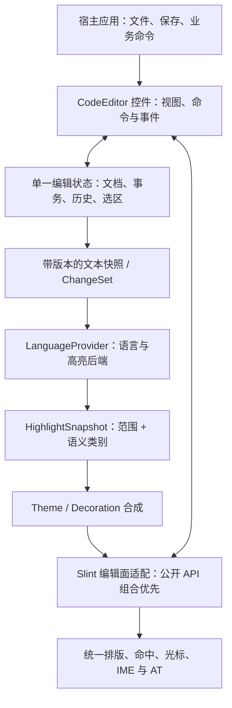

# 通用 Slint 代码编辑器：架构调研与 WGSL 高亮实例决策

> 调研与实现日期：2026-11-02。状态：**本仓独立 CodeEditor 已实现并接入 OpenQuartz；采用 Slint 公开组件 API + cosmic-text，不使用 Slint editable-range 补丁**。完整无障碍、真实系统 IME 和 Windows/Linux 验收仍未完成，不满足公共发布门槛。当前实现和运行证据见第 11 节；第 3–8 节保留为原先 TextInput 路线的历史评估，不是当前代码结构。

> **目标变更：** 用户希望做的是可供多个 Slint 应用使用的编辑器组件，WGSL 只是第一种语言。以下组件架构重新评估优先于本文原先仅服务本应用的阶段建议。

## 1. 结论

不要把一款 app 的 WGSL 词法器直接包成通用 editor，也不要把完整 editor 全压在一个 `.slint` 组件、一个 Rust crate 或一个 TextInput 着色补丁里。可广泛复用的边界应当是：**单一纯文本文档与编辑状态 + 独立、可替换的语言/高亮后端 + 单一原生编辑视图渲染派生的样式层**。主题语义与颜色映射再单独一层；语言 lexer 既不知道 Slint，也不画图。

Slint 允许用户组合基础元素与现有控件，定义、导出和复用自己的组件；开发公共 CodeEditor 不要求修改 Slint 或获得上游批准。Slint 1.18.1 缺少的是给现有 editable TextInput 叠加格式区间的公开接口，`StyledText` 则是显示 API。因此：复用 TextInput 的输入链路并增加分段着色，可能需要底层扩展；组合基础元素并自行管理编辑面的路线不以该扩展为前提，但必须承担排版命中、选区、历史、IME 和无障碍等职责。不能把前一路线的限制说成 Slint 不允许自定义编辑器。

**已确定的开发安排：先在本仓开发可复用 CodeEditor，成熟后再迁移到独立仓库；当前不新建仓库或发布。** 优先调查基于公开 API 组合控件的实现，不预设必须 fork Slint 或先提交上游 RFC。组件与 OpenQuartz 业务依赖隔离，语言适配器和主题独立；先验证真实编辑面、单一文档与历史、Unicode 命中和平台输入，再确定实现边界。若公开 API 存在无法满足的具体能力缺口，以运行证据决定是否提出上游扩展，不把这条备选路线当作开发前置条件。详情、对比与门槛见第 10 节。

## 2. 现状与问题边界

- 原生应用在 [`apps/open_quartz_slint/Cargo.toml`](../apps/open_quartz_slint/Cargo.toml) 精确锁定 `slint`/`slint-build` 1.18.1，使用 `renderer-femtovg-wgpu` 和 wgpu 30，声明 Rust 1.92。原生宿主当前不依赖 WebView；Slint 和 NativeHost 共用 GPU 设备与队列（[`render_bridge.rs`](../apps/open_quartz_slint/src/render_bridge.rs)）。
- 当前 [`CodeEditor`](../crates/slint_code_editor/ui/code_editor.slint) 由 Slint Image/FocusScope/TouchArea/标准工具控件组合，Rust [`Document`](../crates/slint_code_editor/src/document.rs) 使用 cosmic-text 0.18.2 拥有编辑文档与排版；同一字形布局处理着色、光标、选区、命中和实际可见行号。旧应用内 `code_editor.rs`/`.slint` 与元数据转发已删除，Inspector 只消费组件事件、维护草稿并 Apply。
- 当前真实窗口证据包含双语言实例、多色像素、Unicode、只读切换、查找替换与文本 Undo/Redo，应用场景含显式提交、GPU 输出和保存重开。MCP key 事件进入真实 FocusScope，但**不是系统键盘或输入法候选操作验收**；辅助技术值和动作也不等于读屏器完整文本导航。
- Web 版 [`ShaderEditor.tsx`](../src/components/SidePanel/ShaderEditor.tsx) 使用 CodeMirror 6 和 `@iizukak/codemirror-lang-wgsl`（Lezer/JS），与原生不是同一控件；语法分类可以参考，但不是可直接链接的 Rust 组件。已有 `naga::front::wgsl::parse_str` 用于 WGSL 解析，现有执行层的注释/关键字识别是辅助逻辑，不输出供高亮使用的完整词法 span；naga lexer 在私有模块内。
- [Slint TextInput](https://docs.slint.dev/latest/docs/slint/reference/keyboard-input/textinput/) 的公开属性是统一 `color`；[`StyledText`](https://docs.slint.dev/latest/docs/slint/reference/elements/styledtext/) 是显示元素而非编辑器。[Slint 上游富文本编辑 issue #2723](https://github.com/slint-ui/slint/issues/2723) 在调研时仍 open。源码事实以锁定版本为准，在线文档为 latest。

## 3. 显示方案对比

| 方案 | 实时编辑着色 | 原生输入语义 | 集成与维护风险 | 决策 |
|---|---|---|---|---|
| Slint 内核 color-range 扩展 | 目标支持，待原型验证 | 继续使用同一个 TextInput；IME/选区仍需逐项验收 | 需要维护或上游化 Slint 补丁；须验证 layout、缓存、可访问性与平台 | **完整功能首选候选** |
| 只读/失焦彩色显示，聚焦切回 TextInput | 否 | 编辑期间保留现有输入；模式切换的复制、查找、焦点与滚动要处理 | 相对少改内核，但必须验证两种排版、选区复制及可访问性 | 仅供明确接受“不实时”时选择 |
| 透明 TextInput + 彩色镜像 | 看似可以 | 目前不能保证 | Slint 1.18.1 非 Apple/Android 平台光标色取 TextInput 文字色；透明会丢 caret。IME preedit 插在可视字符串但不一定属于已提交的 `text`；字形排版、选区和滚动也可能错位 | 不作为交付路径 |
| 自研 Slint 编辑器（token 逐段绘制） | 可以设计 | 需自管完整输入 | 需要自己实现光标、Unicode 双向文本、选区、IME、撤销、剪贴板、可访问性等；[社区原型](https://github.com/slint-ui/slint/issues/10928)并非上述能力验收 | 不建议为着色重写编辑器 |
| WebView + 现有 CodeMirror | 现有 Web 编辑器已有 | WebView 自己处理；与 Slint 需桥接焦点等 | 现有原生 app 无接入；按 [Wry 文档](https://docs.rs/wry/latest/wry/) child WebView 可用于 macOS/Windows/X11，Wayland/GTK 有额外集成条件；z-order、尺寸、IME、焦点、快捷键、安全和 IPC 未验证 | 备选，不认为与共享 wgpu 技术互斥 |
| 等 Slint 上游 | 取决于上游 | 最少本地补丁 | 日期与 API 不可控 | 并行跟踪，不作为当前排期依赖 |

也可以使用独立 Web/Tauri 应用获得既有 CodeMirror；这不是在现有 Slint inspector 内嵌 WebView 的验证结果。显示层方案如果使用 `StyledText` 的 Markdown，应避免把任意 WGSL 当作 markup 拼接：尖括号、`&`、反引号、换行与缩进必须原样保留，且需要验证该版本是否能安全构造任意颜色区间。即使显示正确，选择、复制、Find/Next 及辅助技术是否与原控件一致仍需要证明。

## 4. Slint 1.18.1 可编辑 color-range 技术设计

### 4.1 可复用的底层与关键陷阱

阅读的固定版本源码：

- [`items/text.rs`](https://github.com/slint-ui/slint/blob/v1.18.1/internal/core/items/text.rs)：`TextInput` 持 `text`、单一颜色、cursor/anchor 和 `preedit_text`；`RenderString::text()` 产生 Plain；`visual_representation()` 合成当前 IME 预编辑文本与 selection。
- [`sharedparley/shaping.rs`](https://github.com/slint-ui/slint/blob/v1.18.1/internal/core/textlayout/sharedparley/shaping.rs)：现有 `Style::Color` 可变成 Parley 的彩色 brush；Plain 分支用 `paragraph_ranges` 保存**原文的全局字节范围**。只读 Styled 分支的 paragraph range 为 `0..0`，不能直接用于以字节映射光标的输入控件。
- [`sharedparley.rs`](https://github.com/slint-ui/slint/blob/v1.18.1/internal/core/textlayout/sharedparley.rs)：`with_text_input_layout_impl` 明确要求 Plain，返回 Styled 将进入 `None`；hit testing、光标几何、输入排版及可访问性依赖原文范围。绝不能只把 TextInput 的 `RenderString` 改成现有 Markdown Styled。
- [`sharedparley/draw.rs`](https://github.com/slint-ui/slint/blob/v1.18.1/internal/core/textlayout/sharedparley/draw.rs) 的 glyph 绘制已有 selection foreground 覆盖 `Style::Color` 的优先级。femtovg、skia 和软件**矢量字体**路径使用共享 Parley 绘制；这说明可复用基础，不代表补丁已经验证或全部渲染路径零修改。软件位图字体 fallback 单独绘制，需评估实现或明确降级。

### 4.2 建议内核数据流（待 POC，不是现有 API）

```text
WGSL 源文本 + 版本号
    -> 独立高亮器: 有序 UTF-8 [start, end) + color 类别
    -> TextInput 新属性/模型（具体 .slint/Rust 映射待验证）
    -> 保留原始 Plain 字符串与 paragraph_ranges
    -> 与每个段落做交集，转换成段内 FormattedSpan(Color)
    -> 同一个 Parley layout：文本、光标、选区、命中及 AT 共用
    -> 原生 renderer 绘制
```

建议在内部引入语义类似 `PlainWithColorRanges { text, ranges }` 的表示，**或者等价地在 Plain 排版路径传入单独的颜色区间**；这只是设计方向，须根据 Slint 内部接口选择更小补丁。关键不变量：

1. 文本始终只有一份真实来源；样式不改变源码、换行、tab、font 或 Unicode cluster。段落仍保留相对完整可视文本的全局 byte range。多个高亮跨度跨行时与每个段落求交、减去段落起始位置后交给 `FormattedSpan`。
2. 输入范围使用半开 UTF-8 byte range，边界必须落在字符边界，`0 <= start <= end <= text.len()`；忽略空区间，检测重叠并定义确定优先级，合并相邻同色 span。非法或**非当前文本 revision** 的结果不得错误染色，安全回退纯色但编辑必须可用。
3. 在 IME preedit 插入点，已提交文本的范围需要映射到合成可视文本：之前不变，之后平移 preedit 的字节长度，跨插入点则拆分；preedit 自身保留原生组合样式。替换选区、组合提交/取消、多字节字符和软换行必须单独验证。不要声称现有 `visual_representation()` 会自动替应用样式做映射。
4. 前景色优先级明确为选区前景 > 语法颜色 > 默认文本色，组合下划线/背景与原生行为一致。纯颜色不影响布局几何是设计要求，仍需验证 ligature、字形 fallback 和双向文本。
5. 色彩变化须让实际缓存失效；样式何时读取、`VecModel` 行更新是否触发依赖追踪，以及 text 与 range 更新的原子性都需原型验证。颜色进入 shaping 可能触发重新排版；当前基准**没有测量**这部分。
6. 保持现有 `set-selection-offsets`、Find/Next、只读、焦点、粘贴/撤销和复制纯文本；不要在编程式重设 text 时破坏输入法及 undo 栈。优先复用原有 `edited` 更新路径；必要时带 revision 的异步结果只能用于同版本文本。

### 4.3 预计改动边界和发布要求

需要评估 `i-slint-core`（TextInput 属性、raw+color 表示、IME 范围映射、段落构建和输入布局/accessibility）、`i-slint-compiler`（内建属性声明、Rust/C++/解释器绑定及诊断）以及可能的 `i-slint-common`（可共享的 struct/type）。目前没有证明 `.slint <[TextStyle]>` 可以直接对应一个特定 `Property<SharedVector<_>>`：API 和 model 更新必须先编译验证。若选择单个原文+range 的原子快照，也必须先解决与 TextInput 双向绑定、undo/IME 相容性。`[patch.crates-io]` 应在 Slint app 自己的独立 workspace 生效，同时核对 `slint-build` 的编译器与应用 runtime 使用同一修订，避免 ABI/生成器版本不一致；不得修改全局 Cargo registry。

优先向 Slint 上游讨论最小 color-only API 或贡献补丁；本地 fork 必须固定到具体 commit、保留升级 diff 和自动化测试。Slint 是多重许可：项目包为 MIT **不自动决定 Slint 许可**。其 [1.18.1 Royalty-free 条款](https://github.com/slint-ui/slint/blob/v1.18.1/LICENSES/LicenseRef-Slint-Royalty-free-2.0.md) 允许在符合条件的应用中使用修改版，但包含署名和不得单独公开分发软件等约束；GPLv3 或商业许可的条件不同。**在公开 fork/vendoring、向用户分发产物之前，确认选用许可、署名、源码分发和依赖 notices；这里不是法律意见。** 同时评估 fork 更新、安全修复、各 renderer 和平台的长期维护责任。

## 5. WGSL 分词候选：实际测量

探针代码保存在 [`spikes/wgsl-highlight-research`](../spikes/wgsl-highlight-research)，四个独立 Cargo workspace 各有锁文件，不修改产品依赖。运行方式和完整原始证据见 [spike README](../spikes/wgsl-highlight-research/README.md)。

本次运行：macOS arm64 / Apple M4 Pro，Rust 1.95.0，release；当前 catalog 34 项（SHA-256 `97a31dc162282e340e3647a37fb0f3e9e8b441aa7590c490f27b353fdb913dda`）+ 15 个边界样本。实际生成 [`summary.json`](../test-results/research/wgsl-highlight-2026-11-02/summary.json) 和四份详细结果。`test-results` 是本地忽略的运行产物，别人需要重新运行生成；本表是本次快照而非 CI 承诺。

| 候选 | 当前 catalog | 已观察的优势与缺口 | 推荐 |
|---|---:|---|---|
| [`tree-sitter-wgsl 0.0.6`](https://docs.rs/tree-sitter-wgsl/0.0.6/tree_sitter_wgsl/) / tree-sitter 0.20.10 | 34/34 无 parse error | 增量树可用；`alias`、`diagnostic(...)`、`const_assert`、样本中的 `>>` 报错；未闭合注释落入 ERROR | 不直接采用 |
| [`tree-sitter-wgsl-bevy 0.1.4`](https://docs.rs/tree-sitter-wgsl-bevy/0.1.4/tree_sitter_wgsl_bevy/) / tree-sitter 0.25.10 | 34/34 无 parse error | 处理该 `>>` 样本；`alias`、`const`、Unicode 标识符、`diagnostic`、`const_assert`、`.5h` 样本报错；接受 Bevy `#import`，并非纯 WGSL 校验 | 不直接采用 |
| [`wgsl-parse 0.3.2`](https://docs.rs/wgsl-parse/0.3.2/wgsl_parse/lexer/) + Logos 0.16.1 raw lexer | 34/34 无 lexer error | 词法 span 保留嵌套及未闭合注释、Unicode，非法字符后继续；合法 `0x1.fp+2f` 被 lexer 判错，但 naga 接受 | 可参考；有明确缺口 |
| [`wgsl-parse 0.4.0`](https://docs.rs/wgsl-parse/0.4.0/wgsl_parse/lexer/) + 固定 `wgsl-types 0.4.0` + Logos 0.16.1 raw lexer | 34/34 无 lexer error | 同上；接受 `alias`/`const`/`diagnostic`/`const_assert` 的**词法切分**，不等于完成语法验证；同样误报上述合法 hex float | **词法原型首选候选，先修缺口再决定依赖** |

**重要区别：** `tree-sitter-wgsl 0.0.6` 的 crates.io 来源是 `mehmetoguzderin`（见[实际 manifest](https://docs.rs/crate/tree-sitter-wgsl/0.0.6/source/Cargo.toml)），与搜索常见的 [`szebniok/tree-sitter-wgsl`](https://github.com/szebniok/tree-sitter-wgsl) 不是同一代码库；不能直接假设另一个仓库的 highlighter query 与发布版兼容。两个已测 Tree-sitter crate 的 Rust 绑定均未提供可直接使用的 highlights query，**本次没有验证任何高亮 query**。WGSL 有嵌套块注释；未闭合源码是正常编辑态，Tree-sitter 报 ERROR 不必然说明其不能高亮，但是否恢复出足够 token 需要单独评估。

两种 `wgsl-parse` 候选直接用 `Token::lexer(source).spanned()`，而非 parser 使用的过滤 trivia 的封装；得到的 range 样本均在 UTF-8 字符边界。未闭合 block comment 被当成直到文件尾的 comment，非常适合编辑态着色，但 lexer 仍非语法验证器。对于异常 token 输出默认色并继续、把合法 hex-float 漏洞提交/修复上游或在独立词法层正确处理，不能把 lexer error 当作编译错误。其 0.4.0 依赖含 LALRPOP build、`parse_ident` 每标识符构造 `String`，不能假称零分配；纳入产品前评估编译时间、二进制体积、维护与按字节扫描的低分配替代。经 `cargo metadata` 检查，当前四个锁文件**已声明**的传递依赖 Rust 版本均不高于 1.92，但本机只有 Rust 1.95，**尚未用 Rust 1.92 实编**。`wgsl-parse 0.5/0.6` 声明 Rust 1.97.1；即使固定 0.4.0，允许解析到较新 `wgsl-types 0.4.4` 也会触发 1.97.1，必须锁定并在 MSRV CI 实证。

### 5.1 性能：只测了解析/分词

每项 101 次、release、中位数，源码是相同合成函数重复；Tree-sitter 增量为文件开头插入一行注释，与 fresh parse 的 S-expression 一致。

| 输入字节 | Tree-sitter 0.0.6 全量 / 增量 μs | Bevy grammar 全量 / 增量 μs | raw lexer 0.3.2 全量 μs | raw lexer 0.4.0 全量 μs |
|---:|---:|---:|---:|---:|
| 976 | 158.125 / 19.792 | 91.375 / 12.792 | 17.584 | 17.166 |
| 9,760 | 1,241.666 / 148.292 | 530.500 / 75.750 | 139.875 | 128.792 |
| 97,600 | 12,783.916 / 1,641.041 | 5,353.500 / 762.042 | 751.125 | 756.125 |

不要直接比较为最终用户延迟：Tree-sitter 构建树而 lexer 只收集 token；没有 highlighter query、颜色分类、model 更新、UTF-8/IME 映射、Parley shaping、绘制或真实按键时间。重复源码也不能代表所有 shader（尤其长注释、错误态、不同平台）。这些结果只支持“先测完整重扫，再决定是否增量”，不能支持“输入必定流畅”。

## 6. 产品集成设计

本节保留 WGSL/OpenQuartz 的消费者接入要求；通用组件目标下，分词与主题应放在组件的 language adapter 中，而不是照此在应用内建立第二套实现。组件边界、状态所有权及分发决策以第 10 节为准。

1. 在 `apps/open_quartz_slint/src/code_editor.rs` 或相邻模块提供纯函数/独立状态：`highlight(source) -> Vec<HighlightRange>`；`HighlightRange` 含 byte `start/end` 与类别，而非每个 token 各分配一个源文本副本。类别至少覆盖 keyword、type、attribute、builtin/function、number、comment、default；识别用户函数或自定义类型只能标为启发式，别冒充语义分析。
2. 独立颜色主题映射类别到颜色；颜色区间排序、去重、合并、限制数量，保留默认色空隙；确保与背景和选区有可读对比。使用数字/属性/函数分类前对照 CodeMirror 行为与 WGSL 实际语法，而不是复制 JS 实现。
3. 在 `publish_shader_editor_metadata` 现有草稿更新链上接入，同时覆盖选择新节点、撤销、外部更新与只读 preset。将结果关联当前草稿版本；小文档先同步重扫，只有真实 profiling 表明需要时才切到 worker/增量，并保证过期计算不会覆盖新输入。查找仅更新 query 时不应无必要重跑整个 lexer。
4. 将颜色区间通过选定的 Slint 扩展 API 传入现有 `CodeEditor` 的同一个 TextInput；应用不做透明覆盖、不通过 HTML/Markdown 注入源码。API 的模型粒度、无分配/缓存和事件同步需要以 POC 与 profiling 结果确定。
5. 在 `naga`/GPU 校验出现错误时，高亮器仍应能显示可识别片段；高亮失败必须局部回退普通色，并在测试/诊断中可观察，不把错误假装成编译通过。

## 7. 实施阶段、门槛与相对工作量

| 阶段 | 交付与放行门槛 | 相对工作量 / 未知项 |
|---|---|---|
| A. 内核最小 POC | 隔离 fork，固定一段多行文本和颜色区间，femtovg-wgpu 真窗口下证明多色；逐行点击、拖选、上下箭头及 UTF-8 byte range 光标位置与纯文本一致；空范围/错误范围不崩 | **高**：最关键未知是内建属性绑定、全局段落映射、缓存；此文未跑该 POC |
| B. IME 与平台验证 | macOS、Windows、Linux 真实输入法的输入中、选候选、替换/取消/提交；再验选区前景、复制/粘贴、Undo/Redo、Find/Next、DPI/字体回退、AT | **高**：需要真实平台及 IME；不能用 MCP 文本赋值替代 |
| C. WGSL 高亮器 | 先以第 5 节候选为参照，补齐 hex float 与错误恢复；34 catalog + 边界输入 span golden 与源码重建不变式；Rust 1.92 和目标平台编译 | **中**：库依赖、分配、保留注释和词法分类需进一步评估 |
| D. 集成及性能 | 原生编辑、preset 只读、节点切换/草稿、Find/Next/Apply/Undo/Redo/保存重开；连续输入时测端到端 P50/P95、内存及 dropped frames；与无高亮 baseline 对比 | **中到高**：本次只有 lexer/parser 微基准，不能据此估期 |
| E. 可发布维护 | 上游协作或受控 fork、许可证与 notices、跨平台 CI、升级策略；软件位图 renderer 明确支持或安全降级 | **中到高**：授权与远端平台尚未验证 |

上述为相对工作量排序，**不是工期承诺**；如果 A/B 未通过，应停止合入实时高亮，不以降级显示冒充完成。

## 8. 验收清单

- **词法**：34 原始 catalog、不同 category、多字节标识符与注释、CRLF、tab、空文档、长行、嵌套/未闭合注释、`alias`、`const_assert`、`diagnostic`、泛型 `>>`、合法 hex/decimal/f16 字面量、非法字符后恢复；任意半成品不能 panic、跳字符或制造越界 span。
- **输入状态**：真实键盘逐字输入/删除、跨 token 和跨行选择、Home/End/上下翻页、拖选和自动滚动、Find/Next、全选复制纯文本、粘贴、Undo/Redo；IME 选区替换、预编辑更新、提交和取消，包含中文/emoji 与正在插入位置前后的着色。
- **渲染**：颜色和语义一致；选中前景可读；长行水平滚动、缩放、DPI 1/1.25/2、混合字体、双向和组合字符/ligature 不错位；样式失效不会造成旧 token 染到新文本；预设只读仍可查看与复制。
- **集成**：选择节点和切换项目不串色或覆盖草稿；Apply、错误提示、保存/重新打开和 GPU 输出维持现有行为。增加真实原生窗口场景，但必须明确 MCP 非 IME 证明；用平台实际输入法和辅助技术分别记录结果。
- **性能与可靠性**：以实际设备上 10 KB/100 KB Shader、长行、连续输入和滚动测端到端 P95 与无高亮基线，记录上限和机器信息；CI 固定 MSRV、lock 和许可证。此处不凭当前微基准设定未经产品确认的硬指标。

## 9. 参考

- [Slint TextInput](https://docs.slint.dev/latest/docs/slint/reference/keyboard-input/textinput/)、[StyledText](https://docs.slint.dev/latest/docs/slint/reference/elements/styledtext/)、[富文本编辑 issue #2723](https://github.com/slint-ui/slint/issues/2723)、[社区编辑器原型 #10928](https://github.com/slint-ui/slint/issues/10928)。
- [Slint 1.18.1 TextInput 实现](https://github.com/slint-ui/slint/blob/v1.18.1/internal/core/items/text.rs)、[共享布局](https://github.com/slint-ui/slint/blob/v1.18.1/internal/core/textlayout/sharedparley.rs)、[颜色整形](https://github.com/slint-ui/slint/blob/v1.18.1/internal/core/textlayout/sharedparley/shaping.rs)、[选区绘制](https://github.com/slint-ui/slint/blob/v1.18.1/internal/core/textlayout/sharedparley/draw.rs)。
- [WGSL 规范](https://www.w3.org/TR/WGSL/)、[wgsl-parse 0.4.0 lexer](https://docs.rs/wgsl-parse/0.4.0/wgsl_parse/lexer/)、[Tree-sitter 标准 WGSL crate](https://docs.rs/tree-sitter-wgsl/0.0.6/tree_sitter_wgsl/)、[Bevy 扩展 grammar](https://github.com/tree-sitter-grammars/tree-sitter-wgsl-bevy)。
- [Wry 平台及 child WebView 文档](https://docs.rs/wry/latest/wry/)、[Slint 1.18.1 Royalty-free 许可](https://github.com/slint-ui/slint/blob/v1.18.1/LICENSES/LicenseRef-Slint-Royalty-free-2.0.md)。

## 10. 从本应用着色到可广泛使用的 Slint CodeEditor

本节回应新的产品目标：不是“给 WGSL 上色”，而是做一个可嵌入其他 Slint 应用、可替换语言后端、有明确平台支持和维护契约的公共代码编辑器。第 4 节的小内核补丁只是可能的底层使能工作，第 5 节的 WGSL 候选只是一个 adapter 的评估；两者相加仍不等于通用组件。

### 10.1 有人做过：已有成果与不能直接复用的部分

| 工作 | 已核实内容 | 不能据此声称 |
|---|---|---|
| [`lpmwfx/slint-codeeditor`](https://github.com/lpmwfx/slint-codeeditor)，[上游展示 #10928](https://github.com/slint-ui/slint/issues/10928) | Rust + Slint 原型，JavaScript-like 分词、逐 token Text、行号、自绘光标、基本按键和点击定位；README 自称 MVP | 已完成通用输入、IME、选区、撤销、无障碍或可直接依赖的组件 |
| [Slint #1325](https://github.com/slint-ui/slint/issues/1325) | 独立 TextDocument、编辑模型、undo/redo 与 formatting 的设计讨论；仍 open | 上游已提供独立 public TextDocument API |
| [Slint #2723](https://github.com/slint-ui/slint/issues/2723) | 富文本编辑所需 API 的追踪，仍 open | `StyledText` 已支持编辑 |
| [Slint #9560](https://github.com/slint-ui/slint/issues/9560) | 已 closed 的富文本**显示**工作，issue 明确不包括 end-user editing | 该 issue 完成意味着 code editor 已完成 |
| [Discussion #10563](https://github.com/slint-ui/slint/discussions/10563) | 2026-01-28 维护者回答当前没有内建的 decent code editor，指向 #2723 | 任何时候、任何社区都没人做过 |

社区原型的[编辑状态源码](https://github.com/lpmwfx/slint-codeeditor/blob/master/src/core/editor_state.rs)用 `Vec<String>`、line/char-count 光标，`flat_tokens()` 遍历所有行重新生成 UI token；[UI 源码](https://github.com/lpmwfx/slint-codeeditor/blob/master/ui/editor/editor-view.slint)用固定 `char-width: 7.8` 按字符数计算 token 和光标 x，使用单独 `Text` 和 Rectangle 光标而非 TextInput。这种做法能做出 demo，但 tab、双宽字、emoji/组合字符、字体回退、ligature、RTL 和命中位置不能靠固定字符宽度解决。所查实现没有完整 selection/clipboard/undo/redo/IME/AT 状态机。仓库 README 的可用声明不是已核实的标准许可证：若要复制源码，先澄清授权；不能把它当 MIT 组件直接 vendoring。

搜索也发现 [Glyph](https://github.com/Freedomwithin/Glyph) 等独立编辑器应用：其 README 声称使用 custom pixel renderer、cosmic-text、piece table 和 Tree-sitter，但这不证明存在可独立嵌入、具备版本 API 和平台验收的 Slint widget。本文只把它们作为参考，未运行这些应用，不采信其“零延迟/O(1)”等宣传作为性能证据。**没有找到足以直接依赖的成熟公共 Slint code editor，不等于不存在任何实现。**

### 10.2 其他平台怎样实现

| 平台 | 实际扩展点 | 编辑与高亮如何共存 | 对 Slint 的启示 |
|---|---|---|---|
| [Qt](https://doc.qt.io/qt-6/qsyntaxhighlighter.html) | `QSyntaxHighlighter::highlightBlock/setFormat`，`previousBlockState`；`QTextDocument`、`QTextLayout` | 格式作用于同一 document 的 block layout；源码中显式映射 preedit 区间，文本不是 HTML 镜像 | 提供依附于原文的格式区间和布局 hook，而不要求用户自己实现键盘 |
| [GTK GtkSourceView](https://gnome.pages.gitlab.gnome.org/gtksourceview/gtksourceview5/class.Buffer.html) | `GtkSourceBuffer` 扩展 `GtkTextBuffer`，language/style scheme；[View](https://gnome.pages.gitlab.gnome.org/gtksourceview/gtksourceview5/class.View.html) 扩展 TextView | buffer 管代码高亮/context tags，view 管 gutter、缩进、滚动；语言定义独立 | 通用控件和语言/主题分离，并承接 GtkAccessibleText 一类的平台职责 |
| [CodeMirror 6](https://codemirror.net/docs/guide/) | `EditorState`、`Transaction`、`EditorView`、language/decorations/extensions | 状态与文档更新通过事务，view 渲染；语言包和高亮不是第二份编辑控件 | 可组合扩展、确定版本的派生数据、可见区域与状态分开；并非可直接移植的 DOM 组件 |
| [Flutter](https://api.flutter.dev/flutter/widgets/TextEditingController/buildTextSpan.html) | `TextEditingController.buildTextSpan(context, style, withComposing)` | 从当前 editing value 构造同一编辑面的 TextSpan，默认保留 composing underline，允许覆盖着色 | Slint 缺的正是这类“可编辑文本的样式 hook”，不只是富文本 viewer |
| [Scintilla](https://www.scintilla.org/Design.html) | Document/CellBuffer、style bytes、Editor、平台端口；lexer 可用 Lexilla | 样式不进入文本 undo，文档可供多个 view 使用，视图管理可见行和命中 | 装饰是派生状态；完整替代编辑引擎可行，但平台输入/绘制移植是独立大项 |
| [egui TextEdit](https://docs.rs/egui/latest/egui/widgets/text_edit/struct.TextEdit.html) | `layouter` 回调，返回用于编辑显示的排版结果 | 可覆盖文字呈现而不用新建一份可编辑字符串；实际能力仍需框架输入/AT 保证 | 理想扩展应在原有输入控件内部共用排版，而不是叠两个 UI |

以上是 API/源码调查，不是把这些控件嵌进 Slint 的实际验证。Qt 的[高亮实现](https://github.com/qt/qtbase/blob/dev/src/gui/text/qsyntaxhighlighter.cpp)直接把 format ranges 写入 `QTextLayout`，并为 preedit 平移范围；Scintilla 设计文档明确 styling 不记录在 undo actions。两者揭示相同的不变量：**颜色变化不是文本编辑，输入位置必须与高亮位置使用同一份文档和排版。**

**参考模型实跑：** 在独立临时 npm 目录使用 Node 运行 CodeMirror state 6.7.6、commands 6.11.1、language 6.13.1、Lezer highlight 1.2.5、WGSL adapter 0.3.0。输入含中文/emoji 注释的 WGSL，把 `1.0` 编辑为 `0.5`，从同一 state 的 syntax tree 提取高亮，确认 `fn` 和 `0.5` 有实际分类、源码未被高亮改变，随后一次 undo 恢复原文、一次 redo 恢复编辑；所有断言通过。该实验只验证无界面模型中的派生高亮与编辑历史共存，不验证样式热切换、Slint 渲染、IME、辅助技术或输入延迟。CodeMirror 的范围是 JS UTF-16 位置，不能直接当 Rust UTF-8 byte offset。

`cosmic-text` 也不是“只有画字”的库：[`Editor`](https://docs.rs/cosmic-text/latest/cosmic_text/struct.Editor.html)已有 Buffer 上的编辑、cursor/selection 和绘制接口，[`AttrsList`](https://docs.rs/cosmic-text/latest/cosmic_text/struct.AttrsList.html)能附加属性区间。采用它可以少写部分文字与编辑算法，但不会自动提供 Slint 的 IME 接口、焦点、剪贴板、无障碍、滚动和共享 wgpu 集成。换引擎意味着选择**完整自管 editor surface**路线，不是单纯换一个 lexer。对当前 Slint 而言，复用其 Parley/layout 输入链路应先于引入第二套 shaping 引擎；后者只在前者不能满足明确的组件能力需求时做对照原型。

### 10.3 建议分层：语法库可换，文档和历史只能有一个所有者

以下是**建议架构，不是已实现的 crate/API**；包名暂定、未核查 crates.io 可用性。不因图中分层就先建多个空 crate，先用独立模块验证边界，稳定后再决定发布包数量。



- **编辑状态/文档层**：纯文本、单调 revision、变更范围、line index、selection/affinity、命令与 undo 边界；不引用 WGSL、naga、GPU、窗口、theme 或 Slint 类型。选区一般是 view/session 状态，不强迫所有共享 document 的 view 共用一个光标；多视图是独立能力，未实现前不承诺。
- **LanguageProvider**：消费 snapshot + ChangeSet，产出 byte ranges + 语义 capture 和带版本的诊断；后端可用 Tree-sitter+queries、Syntect、词法状态机或宿主自己的解析器。树解析和 lexical provider 都可实现，**不能因当前 WGSL grammar 不完整而排除 Tree-sitter 作为多语言后端**。WGSL 的语法缺口留在该 adapter 内修正。
- **Theme/Decoration**：capture 到样式映射，与 grammar 分离；语法颜色、搜索匹配、诊断下划线、当前行和选区各有通道和确定优先级。声明初始支持哪些样式属性；color-only 底层不能宣传为已支持粗体/字体大小等会影响几何的效果。
- **Slint adapter 与 CodeEditor**：同一 editing surface 处理 shaping、命中、tab/wrap、visible lines、滚动、输入法、焦点、clipboard 和辅助技术；gutter 使用实际 layout 的行几何，不能假定 `index * 18px` 在所有字体和缩放下都准确。`.slint` 控件公开配置/事件/动作，Rust controller 负责语法、快照和调度；C++/解释器绑定是额外发布契约，不因 `.slint` 可导入就自动成立。
- **宿主 OpenQuartz**：源码草稿、Apply、保存、GPU lint、SDK/节点与 graph undo 属于应用；它订阅组件编辑/提交事件，不让通用 editor 依赖执行引擎。输入 undo 与 graph undo 的焦点/提交边界必须显式定义。

**不能重复建立历史。** 若采用现有 TextInput 作为权威，文档、组合状态和 undo 继续由它拥有，组件只保存只读镜像快照和派生索引；不要在外部再维护一套会写回 text 的 rope/undo。若组合基础元素并自行管理编辑面，则独立 Document/事务系统拥有文本与历史，视图和输入适配层不另建一套编辑状态。只有试图让内置 TextInput 充当外部 Document 的编辑前端时，才需要它提供足够的增量编辑、selection/composition 和 history 委托/禁用接口；单凭 color-range 属性做不到这种迁移。TextInput 与外部 core 各有 undo，再每次按键互相 `set_text`，是本架构禁止的实现。

可复用不等于必须先造一个富文本 word processor 或 IDE。最小公开 API 要明确这几件事：`document/version`；`selection anchor/head + affinity`；读写/只读与编辑事务；`HighlightSnapshot(version, spans, language_generation)`；主题/语法后端切换；命令与 change/selection/viewport 事件。记录 UTF-8 byte offset 与 grapheme/visual column/UTF-16 的区别；LSP、Qt/JS adapter 的位置在边界转换，不能把 `char count` 或 JS `.length` 当 byte offset。禁止 stale version 的高亮覆盖新文档；同版本切语言也需 generation 以避免串色。composing 是平台编辑状态，不能让 lexer 或高亮快照提交/取消它。

### 10.4 本仓孵化与后续分发

用户已确定先在本仓开发，成熟后迁移新仓。仓库位置不等于组件耦合：

1. 组件源码、Slint UI、语言适配器和必要资源保持清晰边界，不依赖 OpenQuartz 的 graph/store、SDK、naga 校验或 GPU 执行层；由应用依赖组件，而不是组件反向导入应用。先用实际功能验证边界，不为分层建立多个空 crate。
2. 在本仓保留一个不依赖 OpenQuartz 业务的独立示例消费者，验证组件可构建、可编辑和可配置；OpenQuartz 作为真实业务消费者验证集成。示例不是组件能力的替代品。
3. 优先使用 Slint 公开 API 组合基础元素与控件；不复制社区原型中未澄清授权的源码，也不以固定字符宽度和自绘光标冒充完整文字输入。原生输入、排版与辅助技术能力必须通过实际运行核实。
4. 只有遇到有证据的底层能力缺口，才评估上游 RFC 或受控 fork。若最终依赖补丁，必须说明 compiler/runtime 版本与许可；Rust consumer 的 `[patch.crates-io]` 仍需在其 workspace root 配置，组件不能通过传递依赖替使用者强制生效。
5. 达到下节验收标准、API 和资源边界稳定后，再迁移组件、示例及其必要测试/文档到独立仓库。当前不创建远端仓库、不发布包、不提前声明支持未验证的平台或绑定语言。

### 10.5 通用组件的完成标准

基本 editor 的交付必须是可独立消费的真实组件，不是一个示例 app、只有颜色的画布或“失焦才高亮”的替代品：

- 可用普通 Slint app 导入构建，不依赖 OpenQuartz；公开简单 text/readonly/theme 配置及编辑、查找/替换、选区、滚动和快捷键行为，支持关闭高亮作为 plain editor。
- 至少以两种差异明显的语言适配器验证抽象，例如 WGSL + JSON（嵌套注释的源码与字符串/转义文档），以及一个 custom provider 消费者。不能通过复制控件代码增加语言。
- 内置高亮 provider、registry 和主题有独立版本；不默认把所有 parser/语言编入 core。未启用的 provider 不引入其依赖。Tree-sitter 的 grammar/query/许可与 Syntect syntax 资源的许可分别核对，不把“引擎许可”当作所有语言定义的许可。
- 同一文本和编辑历史；语法/主题切换不修改源码、selection、composition、dirty 状态或 undo 次数。多 editor 实例不共享未声明的 global 文档/主题；程序替换全文、用户输入和 undo 的事件语义不同且确定。
- 成对定义 wrap、tab width、indentation、CRLF 保存、Unicode grapheme 和 bidirectional 的支持边界；语言高亮不能改变输入位置。readonly 仍可选中/复制；键盘焦点归属、系统快捷键、context menu 和 AT 检查不能省略。
- 标明已测试平台和 renderer；桌面三平台的真实键盘、中文/日文 IME、clipboard、Undo/Redo、DPI 和辅助技术验收。mobile/Web 或 software bitmap 若未验证，就写未支持，不能由“Slint 跨平台”推导出“组件全平台验收”。
- 从 10 KB、100 KB 延伸到明确的大文件/长行语料，分别测 parse/query、model publication、layout/shaping、paint、keypress-to-frame P50/P95、内存和取消延迟；按字形可见区域裁剪不等于已经实现了文档/布局虚拟化。发布文档上限以实际结果为准。

补全、LSP、格式化、折叠、多光标、协作、多视图/大型 rope 文档等可作为独立扩展能力，接口保留空间即可，**不把这些未来能力当作第一轮完成条件，也不宣称已经支持**。同样，不能把真正编辑器必须具备的 selection、IME、undo、copy/paste 和 accessibility 降格为可选的未来工作。

### 10.6 下一步决策

当前已经在本仓完成公开 API 组合路线的可运行组件、语言适配器、独立示例与 OpenQuartz 接入，未创建新仓、公开 fork 或发布包。后续迁移新仓仍以第 10.5 节发布门槛为准；尤其完整文本无障碍报告缺少公开 Slint API，真实 IME 与跨平台运行仍需验收。不能因为单机测试通过就宣布通用编辑器已全面完成。


## 11. 本仓组件实现与验证

### 11.1 实际结构

- [`crates/slint_code_editor`](../crates/slint_code_editor) 是独立 Cargo workspace，`publish = false`，只依赖 Slint、cosmic-text、arboard 和 Unicode segmentation；没有 OpenQuartz、naga、graph 或 GPU 执行层依赖。
- [`document.rs`](../crates/slint_code_editor/src/document.rs)：单一 cosmic-text Editor、Change 事务历史、只读/选区/Unicode grapheme 编辑、原始 CRLF 保存、布局命中与可见区域 raster。颜色不进入文本历史；程序替换全文清空历史。只发布已提交文本的 SharedString 快照，不把 preedit 当作已保存源码。
- [`syntax.rs`](../crates/slint_code_editor/src/syntax.rs)：WGSL/JSON/Plain 的独立、无第三方依赖词法层，嵌套/未闭合注释、转义字符串、十六进制浮点与 WGSL `f/h/i/u` 后缀；函数分类是启发式，不替代 naga/GPU 验证。也支持宿主返回自定义 `Highlight` byte ranges。
- [`theme.rs`](../crates/slint_code_editor/src/theme.rs)：独立调色板；组件提供 light/dark 开关，Rust Document 可设置 Theme。示例演示 custom provider，不复制控件实现。
- [`lib.rs`](../crates/slint_code_editor/src/lib.rs)：每窗口 Runtime、多实例路由、单个公开 winit IME 过滤器、生成桥接绑定宏；Slint model lease 销毁时释放文档。组件的 `.slint` 不导入应用主题或业务控件。
- [`examples/editor.rs`](../crates/slint_code_editor/examples/editor.rs) / [`ui/demo.slint`](../crates/slint_code_editor/ui/demo.slint)：独立 WGSL/JSON 双实例、Plain/主题/只读和 custom provider 开关。`npm run dev:editor` 可启动；`npm run test:editor` 执行组件回归。集成说明见 [开发文档](DEVELOPMENT.md#可复用-slint-编辑器)。

### 11.2 实跑发现并修复的问题

1. macOS 的 bitmap-only `NISC18030.ttf` 被当作中文等宽 fallback，cosmic-text 的 scalable metrics 返回 `units_per_em = 0`；字宽变成 infinity，实际绘制在 SubpixelBin 中溢出崩溃。已在构建 FontSystem 前根据可缩放 `head.units_per_em` 选择兼容字体，不抑制 panic 或跳过中文；修复后中文/emoji 真窗口正常，保留混合文字渲染/命中回归。
2. 只读状态若仅在 frame 回调中更新，开关切换后立即输入仍可写入；已将状态独立同步到命令与 focus 路径，真窗口中先失败、修复后通过。
3. 应用 Inspector 延迟创建组件时，bridge 已 ready，不会再次触发 changed-ready；语义值正确但图像空白。新增 init 路径与 lease 初始化；增强应用验收为实际 key 替换/单步 Undo 和源码区域多类颜色像素检查，不再只检查 accessibleValue。

### 11.3 验证边界与证据

- 组件 10 项回归测试通过，覆盖词法、Unicode/CRLF byte offsets、嵌套注释、合法 hex-float、预编辑不修改已提交文本、grapheme 删除、原子替换、历史/样式隔离、只读转换及实际字形命中。应用测试 68 项通过。组件格式检查通过；应用 fmt --check 仍报告既有未格式化代码，未批量重排无关文件。
- 独立真窗口实跑：WGSL/JSON 多色显示、中文/emoji、选中替换、单步 Undo/Redo、主题/语言切换不占历史、立即只读拒绝写入、Find/Next/Replace All 及一次 Undo 恢复；custom provider 切换不改源码。90 行 Unicode 文档滚轮移动到第 21 行、横向滚动保留行号；滚动后的拖选替换与撤销通过。系统剪贴板跨实例复制/粘贴和粘贴 Undo 通过。右键菜单在 Slint 官方 `SLINT_NO_MUDA=1` 绘制模式下实际显示并执行 Cut/Undo；系统原生菜单进入 AppKit 模态，自动化无法继续，不声称该路径完成验收。截图在本地忽略目录 `test-results/code-editor/`。
- 应用 17 项交互验收通过，新增真实 key 与高亮像素检查；最终报告 `test-results/slint-ui/interaction-2026-11-02T14-16-22-128Z/report.html`。34 项原始 catalog Shader 的源码/只读身份、参数、连接、真实 GPU 输出全部通过，报告 `test-results/slint-ui/shaders-2026-11-02T13-56-17-459Z/report.html`。这些目录是运行产物，不是提交的固定证据文件。
- 非端到端性能探针：macOS arm64、未优化组件的 debug 构建、600×400 logical / 2× raster、相同 Unicode WGSL 行重复、11 次文件头插空格后重着色+布局+raster 的中位数。8,820 bytes 为 34.140 ms，88,200 bytes 为 52.836 ms；初次 set_text+raster 分别 110.848 / 128.331 ms（不含 FontSystem 构建）。没有测 UI dispatch、图像上传或 keypress-to-frame P95；不能称为输入延迟，也不能宣称稳定 60fps。同步全量 lexer 与 CPU raster 是当前性能限制。
- **真实 IME 尚未验收**：已实现 winit preedit/selection/commit、候选框光标区域与取消，但系统候选操作没有实际运行证明。Orca 原生 GUI 读取报告可见窗口但无 AX window；permissions 显示已授权，仍无法完成该路径。MCP 输入/单元测试不能代替此验收。
- **完整 AT 存在 API 缺口**：Slint 1.18.1 `AccessibleStringProperty` 没有公开 caret/selection/text-run 报告；后端的 `set_text_selection` 与 TextRun 子节点依赖私有内置 TextInput。自定义组件仅能公开角色、值、只读状态和接收动作，不能宣称 VoiceOver/其他读屏器完整编辑支持。解决该发布条件需要底层公开扩展或独立、可协调的可访问性适配，不通过伪造属性解决。
- Windows/Linux、移动端/Web、所有 renderer、超长单行与系统剪贴板/真实输入法的平台验收未完成。当前 no-wrap，横纵滚轮滚动；没有额外承诺折叠、补全、LSP、多视图或 CodeMirror 等价能力。
