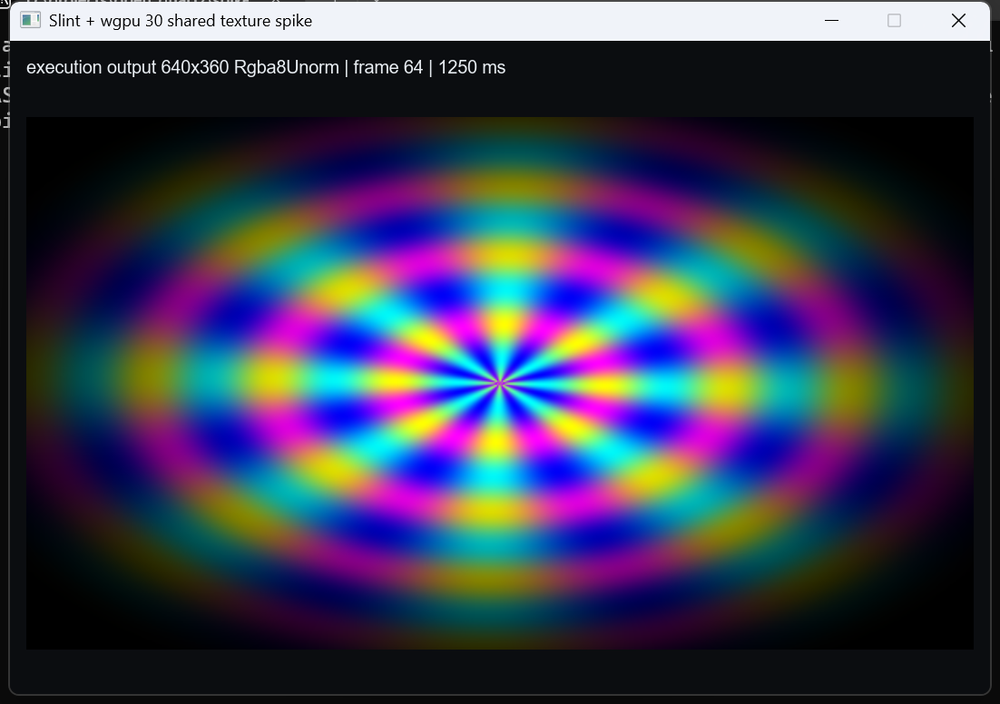

# Slint render spike

Phase 1 proof for the [Slint UI refactor](../../docs/SLINT_UI_REFACTOR.md): verify that
Slint 1.18.1 can render with the same wgpu 30 `Device`/`Queue` as the real
`open_quartz_execution` renderer and import its output texture through
`slint::Image::try_from`.

This is an isolated Cargo workspace with its own lockfile and target directory. It uses the
main workspace's `open_quartz_execution` and `open_quartz_schema` crates by path, but does
not change the production Tauri app.

## Scope

- Creates its own wgpu 30 instance/adapter/device/queue.
- Forces DX12 on Windows; uses primary backends elsewhere.
- Builds a real execution graph: `Time` input -> animated WGSL shader -> `Renderer`.
- Runs `ExecutionEngine` and `GpuExecutor` on the shared device/queue every UI tick.
- Imports the actual 640x360 `Rgba8Unorm` renderer output into `slint::Image`.
- Auto-closes with `--seconds N`, or runs until the window closes.

It does **not** yet prove:

- production native-host wiring, project loading, or command/event flow;
- resize, format/color-space, minimize/restore, or surface-loss behavior;
- macOS/Linux/Android/iOS behavior;
- long-run stability or performance parity with the Tauri app.

## Run

```powershell
cargo run --release -- --seconds 10
```

Expected output on Windows:

```text
adapter: ... | backend=Dx12 | type=DiscreteGpu
slint: wgpu 30 backend selected with manual device/queue
PASS: imported open_quartz_execution output 640x360 Rgba8Unorm into slint::Image
spike: frames=... elapsed=... fps=...
spike: completed ... frames in ...s
```



## Verified

Environment: Windows, NVIDIA GeForce RTX 3050 Ti Laptop GPU, DX12, Rust 1.96.1,
Slint 1.18.1, wgpu 30.0.1.

- [x] `cargo check`
- [x] Slint selects wgpu 30 with a manually supplied `Device`/`Queue`
- [x] `ExecutionEngine` + `GpuExecutor` run on the shared device/queue
- [x] `Image::try_from` accepts the real renderer output
- [x] Texture updates are visible frame over frame
- [x] Window auto-closes and process exits cleanly
- [x] No validation error in a 5-second release run
- [x] Screenshot captured

Release run observed 288 frames in 5.01 s (~57 FPS) on a 640x360 output. This is a 16 ms
UI-timer loop, not a renderer benchmark.

## Findings

`unstable-wgpu-30` alone is not enough with Slint's default femtovg setup. Without the
`renderer-femtovg-wgpu` feature, Slint keeps the OpenGL renderer and fails at runtime with:

```text
WGPU 30.x rendering is not supported with an OpenGL renderer
```

The spike therefore enables both features:

```toml
slint = { version = "=1.18.1", features = ["renderer-femtovg-wgpu", "unstable-wgpu-30"] }
```

Slint's web stack requires newer `wasm-bindgen`/`js-sys`/`web-sys` versions than the main
workspace previously pinned. The execution and SDK crates now pin `wasm-bindgen = "=0.2.129"`;
`cargo check --target wasm32-unknown-unknown` still passes.

The renderer output is `Rgba8Unorm`, which `Image::try_from` accepts as long as the texture
has both `TEXTURE_BINDING` and `RENDER_ATTACHMENT` usage. Both requirements are satisfied by
`open_quartz_execution` render targets.

## Next

1. Extract the Tauri-free native host and drive a real project graph through Slint.
2. Add resize, format/color, minimize/restore, and 10-minute validation runs.
3. Validate macOS/Linux/Android/iOS, then decide whether to enter Phase 3.
