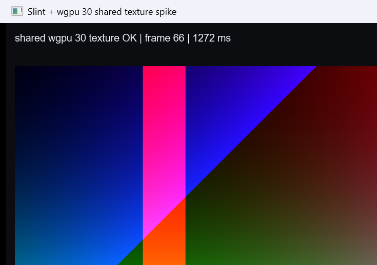

# Slint render spike

Phase 1a proof for the [Slint UI refactor](../../docs/SLINT_UI_REFACTOR.md): verify that
Slint 1.18.1 can render with the same wgpu 30 `Device`/`Queue` as an external producer and
import a `wgpu::Texture` through `slint::Image::try_from`.

This is an isolated Cargo workspace. It does not depend on the main Open Quartz workspace
and does not change the production Tauri app.

## Scope

- Creates its own wgpu 30 instance/adapter/device/queue.
- Forces DX12 on Windows; uses primary backends elsewhere.
- Selects Slint's wgpu 30 backend with `WGPUConfiguration::Manual`.
- Updates a 640x360 `Rgba8UnormSrgb` texture on every UI tick.
- Imports the texture into `slint::Image` and displays it in a Slint window.
- Auto-closes with `--seconds N`, or runs until the window closes.

It does **not** yet prove:

- import of the real `open_quartz_execution` renderer output;
- zero-copy from the production render graph;
- resize/format compatibility with the real renderer;
- macOS/Linux/Android/iOS behavior;
- production performance.

## Run

```powershell
cargo run --release -- --seconds 10
```

Expected output on Windows:

```text
adapter: ... | backend=Dx12 | type=DiscreteGpu
slint: wgpu 30 backend selected with manual device/queue
PASS: imported wgpu texture into slint::Image
spike: frames=... elapsed=... fps=...
spike: completed ... frames in ...s
```



## Verified

Environment: Windows, NVIDIA GeForce RTX 3050 Ti Laptop GPU, DX12, Rust 1.96.1,
Slint 1.18.1, wgpu 30.0.1.

- [x] `cargo check`
- [x] Slint selects wgpu 30 with a manually supplied `Device`/`Queue`
- [x] `Image::try_from(texture)` succeeds
- [x] Texture updates are visible frame over frame
- [x] Window auto-closes and process exits cleanly
- [x] No validation error in a 5-second release run
- [x] Screenshot captured

Release run observed 291 frames in 5.01 s. This includes CPU test-pattern generation on
the UI tick and is not a renderer performance benchmark.

## Finding

`unstable-wgpu-30` alone is not enough with Slint's default femtovg setup. Without the
`renderer-femtovg-wgpu` feature, Slint keeps the OpenGL renderer and fails at runtime with:

```text
WGPU 30.x rendering is not supported with an OpenGL renderer
```

The spike therefore enables both features:

```toml
slint = { version = "=1.18.1", features = ["renderer-femtovg-wgpu", "unstable-wgpu-30"] }
```

## Next

1. Upgrade the main workspace from wgpu 27 to wgpu 30 and keep core tests green.
2. Feed the actual `open_quartz_execution` output texture into this spike path.
3. Add resize, format/color, minimize/restore, and 10-minute validation runs.
